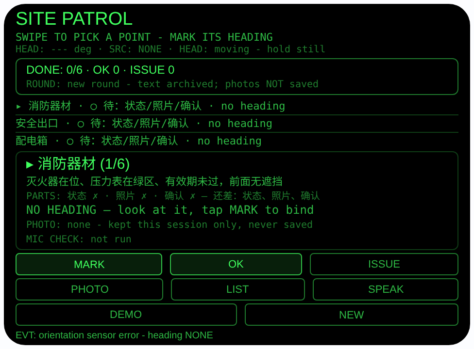
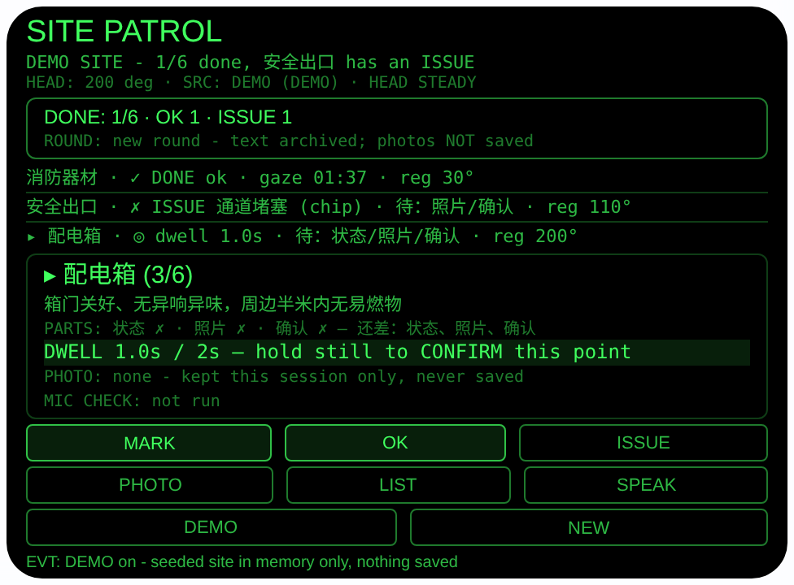
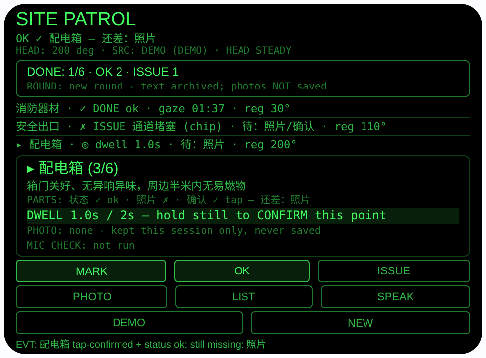
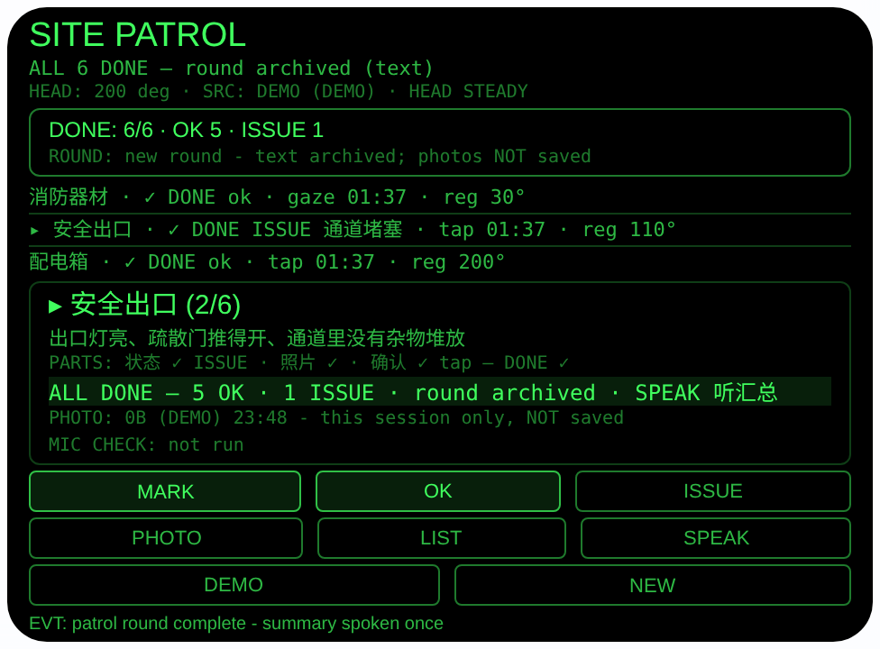

# site-patrol — 工地巡检（Rokid 眼镜 AIUI Agent）

**Studio 导入地址**（复制到 Global AIUI Studio 的 Import Project 输入框）：

```
https://github.com/sakai55/rokid/tree/agent-site-patrol
```


50 个「指向性生活问题」Agent 的第 Z49 个。工地、仓库巡检最难的
不是看，是**记**：六个点走一圈，双手拿着工具和材料，脑子里还
要装着「消防器材看了、出口好像堵着、配电箱还没去」。本 Agent
把巡检拆成固定的六个检查点摆在你眼前，逐个领你走到跟前；而且
完成标准定得严：**状态、照片、确认三件齐全才算完成一件**，缺
哪件它当场告诉你。全六项走完，一轮巡检自动存档为文字记录。

## 预览截图

截图统一存放于仓库根目录 `screenshots/site-patrol/`。









## 解决的问题

巡检漏项，是因为检查点散在整个场地、又没有一份清单盯着你：
灭火器在楼梯口、配电箱在设备间、防护栏在临边。本 Agent 的清
单是**绑在方向上的**——每个检查点登记一次你看向它的头部朝
向，之后你站在场地里转头，它告诉你每个点还差哪几件、未完成
的点在你哪个方向。更重要的是完成规则：入住巡检（#43）里
「看过」就算数，工地巡检不行——**状态**（没问题还是有问题）、
**照片**（你确实站到跟前了）、**确认**（凝视/点头/点按）三
件缺一不可，检查从「大概看过了」变成「三件一件不落」。

## 指向性设计（为什么必须用眼镜）

- **凝视即确认（GAZE/HEAD）**：检查点绑头部朝向后，「看向它
  + 头稳住连续 2 秒」填上确认一件（±25° 锥形区、250ms 一拍
  累计计时）——快速转头扫一圈每个点都「路过」，驻留规则让
  这种假确认拿不到 gaze 确认。
- **漏检按方位领回（GEO-H 的室内版）**：未完成项按登记朝向
  算相对角，指引框给 8 向箭头与「TURN: RIGHT 40°」；朗读进
  度时逐项报还差哪几件，并报「最近的未完成项在你右手边 X
  度」。永远不报东南西北。朝向**跨轮次保留**，同一个工地每
  轮不用重新登记。
- **口述填记录（MIC4 的检查口径）**：发现问题点 ISSUE，先做
  佩戴者模式麦克风**可用性检查**（结果单独记在 MIC CHECK
  行，检查流不是识别输入），再由宿主 ASR 把你说的问题**原
  样**记下；没有识别能力的主机、或识别报错未出结果时，如
  实改走预置词条（灭火器过期/通道堵塞/围栏破损/标识缺失），
  并标注是预置，不是假装在听。
- **手势优先（档案 §3.2.1）**：全部主流程只用触控板手势 +
  头稳 + 点头就能走完（见下方「手势映射」）；屏幕按钮与手
  势等效或为手势不代办的动作留明确入口。双手拿工具时，选
  点靠滑动、确认靠凝视和点头、听进度靠点头后的朗读。

## 手势映射

本 Agent 的全部主流程（选检查点 → 登记朝向 → 三件逐项补齐 →
听进度/汇总）都可以只用眼镜腿触控板手势 + 头部动作完成。手
势与键码的对应来自官方文档档案 §3.2.1。

| 手势 | 键码 | 在本 Agent 中的动作 |
|---|---|---|
| 单击触控板 | Enter | 情景主操作：已收轮 = 朗读汇总；选中项已完成 = 跳到下一个未完成项；选中项未登记朝向 = 登记朝向（MARK）；其余 = 点按确认该项（OK 路径：填状态 ok 与确认 tap），确认后仍有缺件则朗读缺件 |
| 滑动触控板 | ArrowUp / ArrowDown | 在 6 个检查点之间前后移动选中项 |
| 双击触控板 | Backspace | 返回 / 关闭（由宿主处理，本 Agent 只记录事件） |
| 长按触控板 | —（系统级） | 唤醒 AI 助手（系统功能，不经过本 Agent） |
| 头部稳定时点头 | onHeadGesture `nod` | 仅当你正对着选中检查点（登记朝向在 ±25° 内）且头稳时 = 填该项的确认一件（记为 nod）；点头从不设状态、从不登记问题、从不拍照、从不登记朝向 |
| 屏幕按钮 | — | MARK（登记朝向：没有朝向就没有转向指引与凝视确认，这是前提）、OK（点按确认：同时填状态 ok 与确认 tap，给不等 2 秒驻留的人一条如实入账的路；已登记 ISSUE 的点上 OK 只填确认，绝不覆盖问题状态）、ISSUE（登记问题：要开口述/选词条，必须有明确入口，点头按纪律不得代办）、PHOTO（拍照：三件之一，必须有明确入口，绝不与确认绑定）、LIST（跳到下一个未完成项：滑动是逐个移，LIST 是直达漏项）、SPEAK（朗读进度/汇总）、DEMO（无传感器时演示：点按步进朝向，转满一圈再点退出）、NEW（新一轮：两段确认防误触；清进度、留朝向与归档） |

## 功能流程

1. 第一次到工地先逐个登记：滑动选中检查点，看着它点 MARK
   （或单击触控板），把当时的头部朝向绑给它；六个点登记完
   只需一次，以后每轮自动复用
2. 逐项补齐三件：转头看向检查点，头稳住停满 2 秒即凝视确
   认（记 `gaze`）；点 OK 设状态「没问题」兼点按确认（记
   `tap`）；正对着它点头只填确认（记 `nod`）；每个点要点
   PHOTO 拍一张会话内照片——三件缺哪件，清单行和指引框
   都写着（「待：状态/照片/确认」「还差：照片」）
3. 发现问题：点 ISSUE，麦克风检查后直接说出问题（如「灭火
   器压力表不在绿区」），原样入账（记 `ASR`）填上状态一
   件；照片和确认仍要分别补齐。没识别能力的主机点 ISSUE
   轮换预置词条（记 `chip`）；识别报错时按提示再点一次
   ISSUE，同样改走预置词条留档
4. 漏项不用慌：LIST 直达下一个未完成项，指引框按登记朝向
   给出「TURN: RIGHT 40°」把你领回去；SPEAK 逐项朗读还差
   哪几件
5. 六项三件全齐：自动收轮——朗读汇总一次（几项没问题、几
   项有问题，问题备注逐条念出），本轮以纯文字存档（最多 5
   轮，超了丢最旧一轮并明说）
6. 下一轮巡检：点 NEW（两段确认）清掉本轮进度开新轮，朝
   向和已归档轮次都保留；半轮没走完就开新轮，未完成的部分
   不归档

> 诚实说明：本 Agent 记录的是**你逐项看过、站到过、确认
> 过**，不是**检查点本身没问题**——灭火器压力够不够、栏杆
> 牢不牢，靠的是你的眼睛和手，眼镜判断不了。**照片不落
> 盘、不归档**：AIUI 的 wx 存储存不下照片 Blob，本 Agent
> 要求拍照只是把它当作「你当时站在这个点跟前」的会话内凭
> 据，关掉页面即消失；需要留证（比如向施工方追责）请用手
> 机拍。归档的每一轮只有文字。原计划行里写的「wearer 麦
> 抗噪」不成立：佩戴者模式麦克风只做可用性检查，不降噪、
> 不改变宿主识别听到的内容（见 AGENTS.md 行为边界）。

## 权限

| 权限 | 用途 |
|---|---|
| CAMERA | PHOTO 给检查点拍一张 default 模式照片，仅存本次会话内存，永不落盘、永不归档、永不上传 |
| RECORD_AUDIO | ISSUE 前的佩戴者模式麦克风可用性检查（开流读回设置即停轨）与问题口述的一次性宿主识别 |

朝向传感器在 AIUI 里不需要单独的权限声明。相机与麦克风只在
用户点 PHOTO / ISSUE 时启动，用完立即停掉全部媒体轨道。

## 打包与预览

```bash
cd ~/workspace/rokid/site-patrol
~/tools/bin/aix pack . -o ../dist/site-patrol.aix
~/tools/bin/aix preview . --html-out artifacts/preview.html
```

本地预览截图走 `~/workspace/preview-tools/` 的本地 Ink + puppeteer 路线
（`shot-site.js`，独立页面副本 `preview-site.html`；按钮点击坐标在
shot 脚本运行日志中按 canvas 坐标记录）。

## 真机测试（海外版 · 云端下发 · Path 1）

1. 推到 GitHub 后，Global AIUI Studio（aiui-global.rokid.com，en-US）用
   分支导入：`https://github.com/sakai55/rokid/tree/agent-site-patrol`
   （该分支根目录即本 Agent 文件）
2. Studio 的 **Device Debug** 页签填 Basic Information，在 AIX Packaging
   点 **Repackage and Save**，确认顶部出现绿色
   **● Debug version ready — Ready for device debugging**
3. **Hi Rokid**（海外版 `com.rokid.sprite.global.aiapp`，不是国内版
   Rokid Ai App）→ 设置 → 开发者选项 → AIUI → 更新眼镜资源包，
   等「智能体资源包下载成功」
4. 对眼镜说「乐奇，打开 site-patrol」，在真实工地/仓库里：站在
   场地中央逐个 MARK 六个检查点；逐项验证三件规则——只设状
   态不拍照时不算完成、只凝视确认不设状态时不算完成、三件
   齐才 DONE；故意快速转头扫一圈验证骗不到 gaze 确认；对消
   防器材口述登记一个问题，听汇总是否逐字念回你的口述；走
   完一轮退出重进，验证轮次文字在、照片不在、朝向还在；
   故意漏一项，验证 TURN 指引的左右与实际方位一致；再开一
   轮验证朝向不用重新登记

## 真机测试信息（Global AIUI Studio · Device Debug）

| 项目 | 值 |
|---|---|
| Agent Name（Studio） | 待导入后回填 |
| Version（Build） | 1.0.0（待导入后回填） |
| App Category | 待导入后回填 |
| Intent Description | 待导入后回填 |
| Agent ID | 待导入后回填 |
| AIX Package Size | 约 28.6 KB（本地打包 `dist/site-patrol.aix`） |
| 状态 | 本地完成，待导入 Studio |
| Studio | aiui-global.rokid.com（en-US） |
| 下发方式 | 云端下发 → Hi Rokid（海外版）更新眼镜资源包 |

## 验证情况

**已验证**

- 静态检查：app.json / package.json JSON 解析通过；`<script def>` JSON
  解析通过；`<script setup>` 与 app.js 提取后 `node --check` 语法通过；
  全目录 grep 无 `Page(` / `App(` / `Widget(` / `workers:` 残留。
- 状态机测试：Node 里以 wx/传感器/识别/相机存根加载页面对象跑
  **101 条断言全过**——覆盖：无朝向时 MARK 拒绝、登记朝向落盘
  为纯文字、三件完成规则（状态/照片/确认以三种不同顺序补齐都
  正确判 DONE、任缺一件都不算完成且缺件逐项报出）、凝视确认
  规则（锥形区 + 头稳连续 2 秒按 250ms 拍累计、头不稳清零、
  离开锥形区清零、快速扫视骗不到确认）、相对角符号约定
  （+ 为右）与 TURN 指引措辞/度数、ISSUE 口述路径（麦克风
  检查流在识别启动前已停轨、MIC CHECK 与聆听行分离、口述原
  样入账、登记问题不填确认件）、无 ASR 主机的预置词条轮换、
  PHOTO 走 default 模式且所有落盘 payload 经断言不含任何照片
  字节/标记、相机轨道拍后即停、轮次归档（收轮存档一次、翻转
  状态只更新同一快照、汇总只念一次、归档上限 5 轮丢最旧）、
  NEW 两段确认（单点只布防、滑动解防、二点才开新轮且朝向保
  留、会话照片清空、归档不动）、记录在新页面加载时完整恢复
  （朝向/状态/归档轮次）、点头纪律（没对上/头不稳都忽略、对
  上且头稳只填确认、点头从不设状态从不拍照从不记问题）、纯
  手势主流程（Enter 登记/确认/朗读缺件、滑动选点、双击无副
  作用）、DEMO 种子（3 登记 1 完成 1 问题、驻留预置、演示中
  零落盘、NEW 在演示中被拒、步满一圈退出并恢复真实记录）、
  TTS 从不设置 lang、onUnload 清理无异常。
- 打包：`aix pack` 成功；`aix list` 核对包内含 README.md、AGENTS.md、
  app.js、app.json、package.json、pages/index/index.ink
  （artifacts/ 已被 .aixignore 排除）。
- 预览渲染：aix preview + 本地 Ink + puppeteer 截图四张（见
  Preview Media）：首页初始态、DEMO 演示工地、三件缺件态、
  六项全检收轮态均完整渲染。

**未验证**

- **照片确实无法持久化（设计前提，第一优先核对）**：AIUI 的
  wx 存储按文档存不了 Blob，本 Agent 因此只把照片留在会话
  内存并在界面/README 明示「不保存、不归档」。真机需核对：
  宿主是否另有照片落盘通道（若有，也应在后续版本明确改口
  径，而不是让用户误以为照片留了证）。
- **佩戴者模式麦克风检查的真机行为**：wearer 模式在真机
  getUserMedia 上的读回结果与工地噪声环境下宿主 ASR 的实
  际识别率（识别走宿主自己的麦克风，检查模式不降噪——原计
  划行「wearer 麦抗噪」的说法不成立，见正文诚实说明）；口
  述是原样入账，识别错了就是错的备注，汇总朗读正是让你核
  对的一环。
- 真机头部稳定检测与 2 秒凝视驻留的手感（±25° 锥形区在真
  实工地尺度是否合适、站在场地不同位置时登记朝向的几何偏
  差）；登记朝向只对登记时站的位置成立，跨轮次复用的前提
  是每轮站在差不多的位置。
- 触控板手势（单击/滑动/双击）与点头在本 Agent 键位映射下
  的真机触发情况；六项走完一整轮的实际耗时与归档 5 轮上限
  是否合用。

---

## 提审资料（Review Submission）

> Global AIUI Studio → Submit 页签的 Review Information 逐项对应下面四段，
> 提交时整段复制。每次提交前重新确认 Preview Media。

### Feature Description

Site Patrol runs a six-point safety round on building sites and warehouses: fire equipment, safety exit, distribution box, guardrails, material stacking, warning signs. Bind each point to the direction you face it; a point counts as done only when its status is set, its photo is taken and it is confirmed by a two-second gaze or a tap. Dictate issue notes verbatim, follow turn guidance to unfinished points, and archive finished rounds as text. Photos stay in the session only and are never saved.

（499 字符）

### Opening Message

Hi, I'm **Site Patrol** — a six-point round that keeps both hands free.

**Swipe** to pick a point, look at it and tap **MARK** once to bind its direction. A point is done only with all three parts: a **status** (OK, or ISSUE with your dictated note), a **photo**, and a **confirmation** — hold your gaze on it for two seconds, nod at it, or tap OK. I'll tell you exactly which part is missing and point you to unfinished points. Finished rounds are archived as text; photos are never saved.

（491 字符）

### Preview Media

提交要求：3–5 个 JPG/PNG 图片或 MP4 视频，至少含 1 张图和 1 个视频，每次提交前重新确认。

- Image 1：`artifacts/preview-site-patrol-index.png`（aix preview 首页：SITE PATROL 初始态，六项清单、三件规则提示、MARK/OK/ISSUE/PHOTO/LIST/SPEAK/DEMO/NEW 按钮齐全，本地文件，提交时从本地上传）
- Image 2：`artifacts/preview-site-patrol-demo.png`（DEMO 演示工地：3 个检查点已登记朝向、消防器材三件齐全已完成、安全出口已登记预置问题「通道堵塞」（来源 chip）、当前驻留配电箱 1.0s/2s，本地文件）
- Image 3：`artifacts/preview-site-patrol-parts.png`（DEMO 中对配电箱点 OK 后的缺件态：状态 ok 与确认 tap 入账，PARTS 行与状态行明示「还差：照片」，证明三件缺一不算完成，本地文件）
- Image 4：`artifacts/preview-site-patrol-done.png`（六项全部完成收轮态：DONE 6/6、OK/ISSUE 计数、ALL DONE 指引行与本轮已存档提示，本地文件）
- Video：待真机补 — 真机录制「逐个 MARK 登记 → 逐项凝视确认+拍照+设状态补齐三件 → 对消防器材口述登记问题 → LIST 跳漏项 → 收轮听汇总」全过程（MP4），录好后放 `artifacts/` 并更新此处（总数保持 3–5 个，届时删减一张图）
- 状态：未齐（已有 4 张图；还需至少 1 个视频，总数保持在 3–5 个后才可提交）

### Change Log

#### Build 1.0.0

**Features added**

- Six-point site patrol: fire equipment, safety exit, distribution box, guardrails, material stacking, warning signs - each with a concrete look-for cue. Every point can be bound to the head heading you face it from (MARK), headings persist across rounds on the same site, and unfinished points are announced with the parts they still miss plus relative turn guidance ("TURN: RIGHT 40°"). Cardinal directions are never used.
- Three-part completion rule (stricter than a simple check-off): a point counts as DONE only when all three are recorded, in any order - a STATUS (OK, or ISSUE with a note), a PHOTO, and a CONFIRMATION (2-second gaze dwell, a steady nod while facing it, or tap OK). Missing parts are named on the list row, in the guide box, and spoken aloud after a tap-confirm, so a point can never look finished while a part is missing.
- ISSUE notes with verbatim dictation: an issue runs a wearer-mode microphone availability check first (reported on its own MIC CHECK line; the check stream is stopped before recognition starts and never feeds it - the mode is a check, not noise cancelling), then host speech recognition stores your problem note word for word. On hosts without recognition - or when recognition errors out - ISSUE honestly falls back to labelled preset chips （灭火器过期 / 通道堵塞 / 围栏破损 / 标识缺失） instead of pretending to listen.
- Round archiving as text: finishing all six points archives the round (date, time, per-point status, note, confirmation method) on-device, up to five rounds with the oldest dropped and announced; a spoken summary reads the counts and every issue note once. NEW starts the next round behind a two-step confirm, clearing progress but keeping the registered headings and the archive.
- Session-only photos: PHOTO takes a default-mode picture of the selected point as an in-session record that you stood there. Photos are never written to storage and never archived (blobs cannot persist there); the UI says so on the photo line at all times - keep evidence on your phone if you need it beyond the session.
- Gesture-first operation (temple touchpad, dossier §3.2.1): single tap = contextual primary action (bind / confirm / next / speak summary or missing parts), swipe = move selection, double-tap = host back, steady nod = fill the confirmation part only while facing the selected point - a nod never sets a status, never files an issue, never takes the photo and never registers a heading. Eight on-screen buttons mirror the gestures or cover actions gestures must not perform, each justified in the README gesture map.

**Improvements**

- None (initial release).

**Fixes**

- None (initial release).
