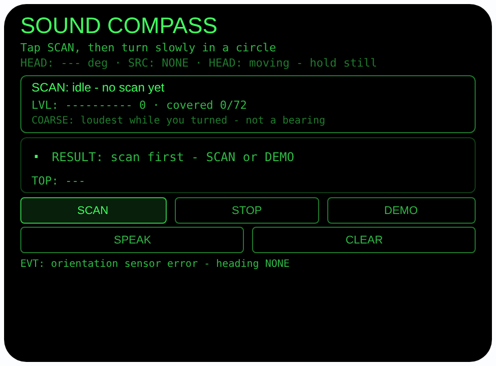
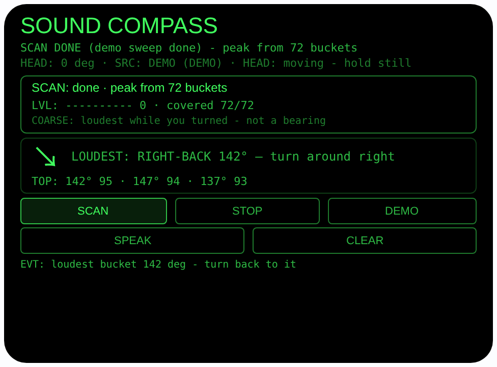

# sound-compass — 声源罗盘（Rokid 眼镜 AIUI Agent）

**Studio 导入地址**（复制到 Global AIUI Studio 的 Import Project 输入框）：

```
https://github.com/sakai55/rokid/tree/agent-sound-compass
```


50 个「指向性生活问题」Agent 的第 Z16 个。声音发生了 — 水管在
响、水壶开了、手机在另一个房间响、有人在喊你 — 却分不清是从
哪个方向来的。本 Agent 用「转头电平扫描」解决：你慢慢转一圈，
眼镜把每个头部朝向上的响度记进方位桶，转完告诉你「刚才最响
的方向在你右后方」，你转回去找。

## 预览截图

截图统一存放于仓库根目录 `screenshots/sound-compass/`。





## 解决的问题

辨别声源方向靠的是双耳和转头，人本来就会下意识转头找声音，
但响一声就没了的声音（手机响两声、水壶鸣笛一下）转完头也
来不及确认。手机更帮不上忙：它测不到你面朝哪儿。眼镜同时
有麦克风和头部朝向，于是可以把「转头找声音」变成一次可
回看的扫描：响度按朝向存下来，声音停了，结果还在。

## 指向性设计（为什么必须用眼镜）

- **转头扫描（SCAN 宪法）**：AIUI 运行时没有波束成形
  （beamforming）声源角度 API，本 Agent 绝不假装有。它用
  的是 PLAN 的 SCAN 法：头部朝向就是扫描的地址 — 麦克风
  只管响度，`AbsoluteOrientationSensor` 的 yaw 决定这份
  响度记在哪个方向上。两个传感器缺一不可，手机只有前者。
- **全向麦克风模式（MIC4）**：SCAN 用 `getUserMedia` 的
  `captureSource: 'microphone'` + `microphoneMode:
  'omnidirectional'` 开麦 — 4 麦阵列的全向模式均衡收各个
  方向的声音，不偏向佩戴者自己的声音，正适合测环境响度；
  流接 Web Audio `AnalyserNode`（只接分析器不接输出，
  防啸叫），每 100ms 算一次 RMS。模式被设备拒绝
  （OverconstrainedError）时回退默认麦克风并如实提示。
- **5° 方位桶 + 峰值指引**：20 秒扫描（或 STOP 提前结束）
  内，电平按朝向分进 72 个 5° 桶、每桶留最大值；结束时
  取最高桶为最响方向，相对你**当前**朝向算相对角，配 8 向
  大箭头、转身提示与 TOP3 桶列表。你继续转头，相对角实时
  更新 — 转到 |相对角| ≤ 15° 时高亮「LOUDEST: AHEAD」。
- **耳朵确认**：SPEAK 用中文朗读结果，如「刚才最响的
  方向在你右后方，大约 142 度」；有结果时头部稳定点头
  也能触发朗读，不用腾手。

## 功能流程

1. 待机：界面显示头部朝向与来源（SENSOR / DEMO / NONE）、
   电平条与已覆盖桶数；常驻一行 COARSE 说明
2. SCAN：点 SCAN（或 Enter）→ 先查朝向：无朝向（SRC NONE）
   如实拒绝并说明原因；再查麦克风与 Web Audio，不可用
   FAIL 写明 → 开麦扫描，慢慢转一圈（建议转满 360°），
   界面实时显示剩余秒数、电平条、覆盖桶数；20 秒到时
   自动结束，或点 STOP 提前结束
3. 结果：峰值桶 + 相对当前朝向的箭头与「LOUDEST:
   RIGHT-BACK 142° — turn around right」式提示 + TOP3；
   转头时相对角实时变化，转回去对上 AHEAD 高亮
4. SPEAK：朗读最近结果（点头亦可）；CLEAR 清空桶与结果
5. DEMO：合成一次完整转头 — 朝向 0°→355°，电平剖面为
   140° 高斯峰 + 噪声底，填满 72 桶后停在朝向 0° 走正常
   结果路径（峰值桶 142°、相对角 +142°），无麦克风无
   传感器也能完整演示

> 诚实说明：这是粗略的电平扫描，不是精密测向。它回答的是
> 「你转这一圈里哪个朝向最响」，精度只有 5° 桶级。房间
> 反射、风噪会把峰值带偏；持续不断的背景声（空调、电视、
> 一直在烧的水）会让「最响」失去意义；太轻、太短的声音
> 可能测不到。真要紧的安全声音（报警器、婴儿哭声）请直接
> 循声去找，不要等扫描结果。

## 权限

| 权限 | 用途 |
|---|---|
| RECORD_AUDIO | SCAN 时开麦测响度：`getUserMedia` 全向模式 + `AnalyserNode` 实时算 RMS；只算电平数值，不录音、不保存、不上传 |

朝向传感器在 AIUI 里不需要单独的权限声明。扫描的桶数据只
留在内存里，页面关掉即消失。

## 打包与预览

```bash
cd ~/workspace/rokid/sound-compass
~/tools/bin/aix pack . -o ../dist/sound-compass.aix
~/tools/bin/aix preview . --html-out artifacts/preview.html
```

本地预览截图走 `~/workspace/preview-tools/` 的本地 Ink + puppeteer 路线
（`shot-sound.js`；结果截图的点击序列为 canvas 内 DEMO (395, 207)
点 1 次后等约 9.5 秒待合成扫描扫完：注意 artifacts/preview.html
需先把 importmap 的 jspm 地址换成本地 `/ink/index.js` 再复制到
preview-tools/www/）。

## 真机测试（海外版 · 云端下发 · Path 1）

1. 推到 GitHub 后，Global AIUI Studio（aiui-global.rokid.com，en-US）用
   分支导入：`https://github.com/sakai55/rokid/tree/agent-sound-compass`
   （该分支根目录即本 Agent 文件）
2. Studio 的 **Device Debug** 页签填 Basic Information，在 AIX Packaging
   点 **Repackage and Save**，确认顶部出现绿色
   **● Debug version ready — Ready for device debugging**
3. **Hi Rokid**（海外版 `com.rokid.sprite.global.aiapp`，不是国内版
   Rokid Ai App）→ 设置 → 开发者选项 → AIUI → 更新眼镜资源包，
   等「智能体资源包下载成功」
4. 对眼镜说「乐奇，打开 sound-compass」，在厨房打开水龙头，
   走到门口点 SCAN 慢慢转一圈，看结果方向是否指向厨房，
   再点 SPEAK 听中文朗读；换一个安静房间重复一次对比

## 真机测试信息（Global AIUI Studio · Device Debug）

| 项目 | 值 |
|---|---|
| Agent Name（Studio） | 待导入后回填 |
| Version（Build） | 1.0.0（待导入后回填） |
| App Category | 待导入后回填 |
| Intent Description | 待导入后回填 |
| Agent ID | 待导入后回填 |
| AIX Package Size | 约 16.3 KB（本地打包 `dist/sound-compass.aix`，分次打包有 ±0.01 KB 级抖动） |
| 状态 | 本地完成，待导入 Studio |
| Studio | aiui-global.rokid.com（en-US） |
| 下发方式 | 云端下发 → Hi Rokid（海外版）更新眼镜资源包 |

## 验证情况

**已验证**

- 静态检查：app.json / package.json JSON 解析通过；`<script def>` JSON
  解析通过；`<script setup>` 与 app.js 提取后 `node --check` 语法通过；
  全目录 grep 无 `Page(` / `App(` / `Widget(` / `workers:` 残留；
  5 个 bindtap 处理函数（scanTap / stopTap / demoTap / speakTap /
  clearTap）全部有定义。
- 扫描数学：峰值挑选 + 相对角/方向名公式在 Node 里用同一份
  代码验算 — DEMO 高斯剖面峰值精确落入 142° 桶（电平 0.952）；
  朝向 0° → 相对角 +142° RIGHT-BACK、朝向 142° → 0° FRONT、
  朝向 200° → −58° LEFT-FRONT；跨 0° 环绕用例（峰 350°/
  朝向 10° → −20°；峰 10°/朝向 350° → +20°）正确；
  TOP3 为 142/147/137 的峰值平台，与预览渲染逐字一致。
- 打包：`aix pack` 成功；`aix list` 核对包内含 README.md、AGENTS.md、
  app.js、app.json、package.json、pages/index/index.ink
  （artifacts/ 已被 .aixignore 排除）。
- 预览渲染：aix preview + 本地 Ink + puppeteer 截图两张（见
  Preview Media）：首页待机态完整渲染（朝向 SRC NONE 如实
  标注 — 预览主机方向传感器报错，页脚如实显示，不编造
  朝向；COARSE 说明行常驻）；点 DEMO 后合成扫描扫满
  72/72 桶并进入结果态：箭头 ↘、「LOUDEST: RIGHT-BACK
  142° — turn around right」、「TOP: 142° 95 · 147° 94 ·
  137° 93」，与 Node 验算一致。

**未验证**

- 真机 AbsoluteOrientationSensor 朝向读数的精度与零点参考
  （扫描中转头速度与传感器约 5Hz 读数的配合未在真机测；
  转得太快桶会漏采）。
- 真机 4 麦 `omnidirectional` 模式是否被接受、电平动态范围
  与 RMS×3 标定在真实声压下是否合适；模式回退路径未在
  真机触发过。
- 真实房间里的反射、混响与持续背景声对峰值方向的实际
  偏移程度 — 这是方法本身的已知边界，只能真机多场景实测。
- 真机头部稳定检测、点头 SPEAK、TTS 朗读结果的效果。

---

## 提审资料（Review Submission）

> Global AIUI Studio → Submit 页签的 Review Information 逐项对应下面四段，
> 提交时整段复制。每次提交前重新确认 Preview Media。

### Feature Description

Sound Compass helps you find where a sound came from - running water, a kettle, a phone ringing in another room. Tap SCAN and turn slowly in a circle: the glasses measure how loud it is in each direction, bucketed by your head heading. When you stop, an arrow and a spoken hint point you back to the loudest direction. It is a coarse scan, not a precise bearing: reflections and steady noise can shift the result, and the app says so.

### Opening Message

Hi, I'm **Sound Compass** - I listen while you turn, then point you at the loudest direction.

Tap **SCAN** and turn slowly in a full circle: for up to 20 seconds I bucket the loudness by your head heading (tap **STOP** to finish early). I then show an arrow and **SPEAK** the result, like *right-back, about 140 degrees*, plus the top 3 directions. No mic or sensor handy? Tap **DEMO** for a synthetic sweep with its peak built at 140 degrees.

### Preview Media

提交要求：3–5 个 JPG/PNG 图片或 MP4 视频，至少含 1 张图和 1 个视频，每次提交前重新确认。

- Image 1：`artifacts/preview-sound-compass-index.png`（aix preview 首页待机态：未扫描、朝向 SRC NONE 如实标注、COARSE 说明行，本地文件，提交时从本地上传）
- Image 2：`artifacts/preview-sound-compass-result.png`（DEMO 合成扫描完成后的结果态：72/72 桶、峰值 142°、RIGHT-BACK 142° 指引与 TOP3，本地文件）
- Video：待真机补 — 真机录制「厨房开水龙头 → 门口 SCAN 转一圈 → 结果指向厨房 → SPEAK 朗读」全过程（MP4），录好后放 `artifacts/` 并更新此处
- 状态：未齐（已有 2 张图；还需至少 1 个视频，总数补到 3–5 个后才可提交）

### Change Log

#### Build 1.0.0

**Features added**

- Turn-head level scan: the microphone opens in omnidirectional mode (with a labeled fallback to the default microphone when the device rejects that mode), feeds a Web Audio AnalyserNode, and RMS level is sampled every 100 ms into 72 heading buckets of 5 degrees, keeping the maximum per bucket, for up to 20 seconds or until STOP.
- Loudest-direction guidance: the peak bucket is shown relative to your current heading with an 8-way arrow, a plain turn hint (e.g. turn around right), a top-3 bucket list and an AHEAD highlight within 15 degrees; the result updates live as you keep turning, and SPEAK reads it aloud in Chinese. A nod while your head is steady also triggers the readout.
- Honest refusals and limits: a real scan refuses to start without an orientation heading (a scan without headings is just a list of loudness with no address), and fails with the reason shown when the microphone or Web Audio is unavailable. The UI carries a permanent COARSE note: this is the loudest direction while you turned, not a precise bearing, and reflections or steady background noise can shift it.
- DEMO synthetic sweep: heading sweeps 0 to 355 degrees against a gaussian level profile peaking at 140 degrees plus a noise floor, filling all 72 buckets and exercising the full result path with no microphone or sensor.
- Privacy by design: levels are computed live from the waveform and no audio is recorded, stored or uploaded; the microphone tracks are stopped and the AudioContext is closed when a scan ends, and on page hide/unload.

**Improvements**

- None (initial release).

**Fixes**

- None (initial release).
