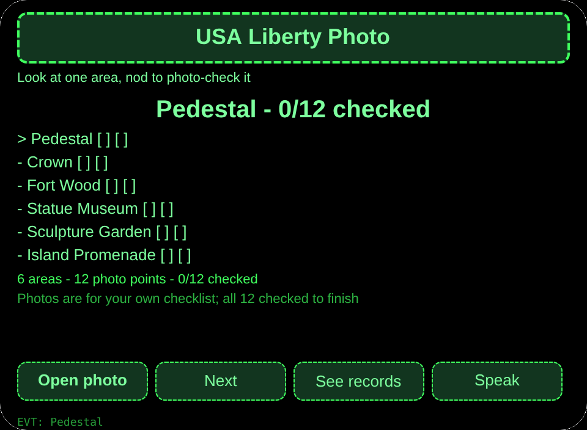
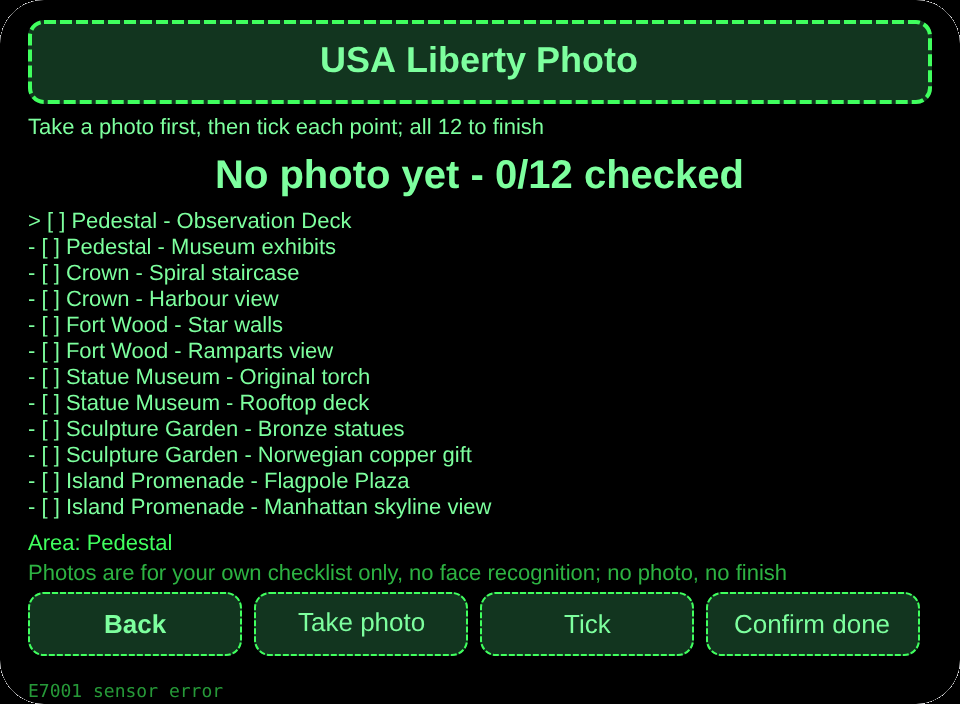
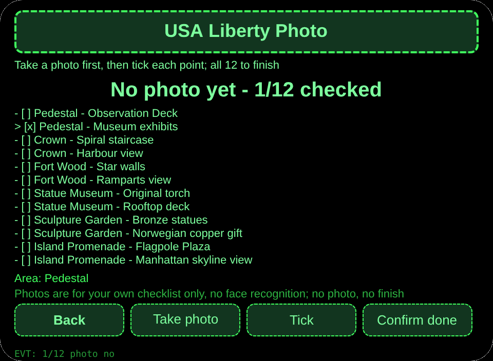
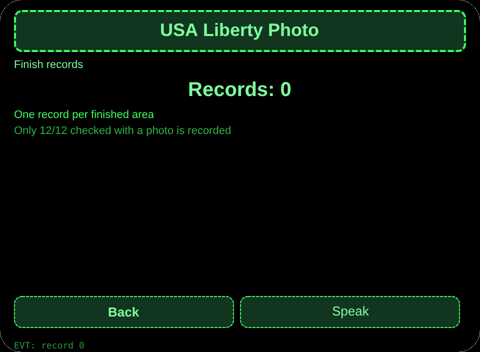

# USA Liberty Photo

**Studio import address** (copy into the Global AIUI Studio Import Project box):

```
https://github.com/sakai55/rokid/tree/agent-usa-liberty-photo
```

[usa-liberty-photo.aix](https://raw.githubusercontent.com/sakai55/rokid/main/aix/usa-liberty-photo.aix)

## Features

A visitor at the Statue of Liberty with both hands full of guidebook and tickets looks at each viewpoint and nods to photo-check 12 photo points across 6 areas; the visit is not complete until every point is checked.

## Scene

A visitor at the Statue of Liberty with both hands full of guidebook and tickets looks at each viewpoint and nods to photograph-check 12 photo points, and the visit is not complete until every point is checked.

## Direction composition

USA local scene x directional (gaze photo-check) x attention. Three gates: scene (a Statue of Liberty visitor with both hands full of guidebook and tickets); loop (pick an area, look to lock it, nod to photograph, tick points one by one, missing-point reminder, finish confirmation); thickness (6 real Liberty Island areas x 12 real photo points + multi-step flow + cross-session records). Directional carries the gaze photo-check; attention carries the point-by-point checklist.

## Glasses-only capability

Hands-free first-person capture: the photo is a mandatory step on the way to finishing, taken by looking and nodding with both hands full. Wiring: app.json declares CAMERA, photo page photoTap (getUserMedia + ImageCapture.takePhoto), Blob to data URL via arrayBuffer + chunked btoa, FileReader = 0; confirmTap is gated on this._photo.

## Pages

| Pages | Pages |
|---|---|
| pages/index | 6 areas |
| pages/photo | 12 photo points check |
| pages/record | Finish records |

## Content set

6 areas x 12 photo points, all web-verified as real, publicly visitable Liberty Island / Statue of Liberty spots on 2026-11-23: Pedestal (Observation Deck / Museum exhibits), Crown (Spiral staircase / Harbour view), Fort Wood (Star walls / Ramparts view), Statue Museum (Original torch / Rooftop deck), Sculpture Garden (Bronze statues / Norwegian copper gift), Island Promenade (Flagpole Plaza / Manhattan skyline view).

## Cross-session storage

Storage key `usaLibertyPhotoV1` (selected area, ticked photo points, photo time and byte count, finish records, lastError). The photo itself is kept only in the session, not persisted.

## Permissions

CAMERA declared (photo check). No location or media permission is used.

## Gesture map

| Single tap | Enter | Main confirm |
| Swipe up / down | ArrowUp / ArrowDown | Change selection |
| Nod | onHeadGesture('nod') | Same as main confirm |
| Double tap | Backspace | Back |

## Error codes

- `E5001` Storage write failed
- `E5002` Storage read failed
- `E3005` Speech failed
- `E8001` Navigation failed
- `E7001` Head sensor unavailable or read failed
- `E8004` Camera API missing (camera interface not present)
- `E2001` Photo failed (takePhoto threw)
- `E2013` Photo encode failed (arrayBuffer / chunked btoa threw)

- Photos are for the visitor's own checklist only; no face recognition, no claim of automatic landmark recognition.
- No photo, no finish; unticked points only prompt, nothing is recorded.
- When preview has no camera, the photo fails honestly and is never faked as a success.

## Preview screenshots






## Review Submission

### Feature Description

A visitor at the Statue of Liberty with both hands full of guidebook and tickets looks at each viewpoint and nods to photo-check 12 photo points across 6 areas; the visit is not complete until every point is checked.

### Opening Message

Guidebook in hand, look at each viewpoint, nod to photograph it — all 12 points checked to finish.

### Preview Media

[preview-usa-liberty-photo-video.mp4](https://raw.githubusercontent.com/sakai55/rokid/main/screenshots/usa-liberty-photo/preview-usa-liberty-photo-video.mp4)


### Change Log

- Features：First release features as above.
- Improvements：None.
- Fixes：None.

## Device test info

| Studio name | To be filled |
|---|---|
| Studio name | To be filled |
| Version / Build | To be filled |
| App Category | To be filled |
| Intent Description | To be filled |
| Agent ID | To be filled |
| Status | To be filled |
