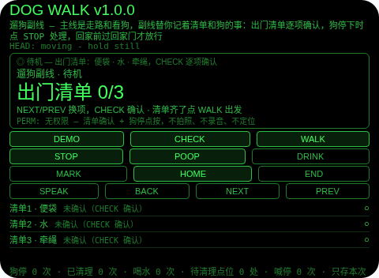
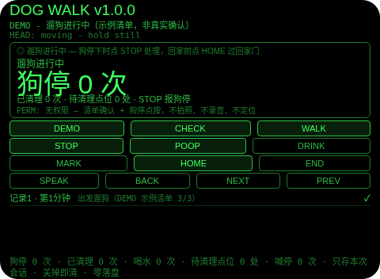
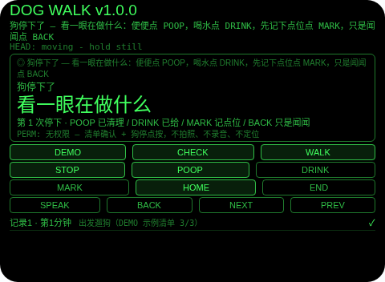
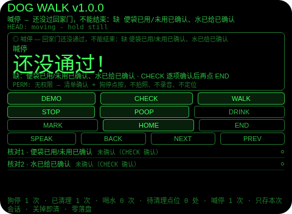
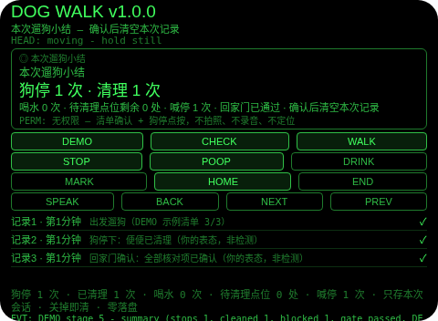

# Dog Walk（遛狗副线）

**Studio 导入地址**（复制到 Global AIUI Studio 的 Import Project 输入框）：

```
https://github.com/sakai55/rokid/tree/agent-dog-walk
```

**AIX 直接下载**（最新版）：[dog-walk.aix](https://raw.githubusercontent.com/sakai55/rokid/main/aix/dog-walk.aix)

注意力外挂系列 DU03（DUAL 并行型，本组第三位）。遛狗时双手牵绳，主线是走路和看狗，副线是「便袋带了没、水带了没、狗便清了没、回家前别漏项」——出门清单、狗停处理、回家核对三件事抢同一双手和同一双眼睛：牵着绳就没法腾出手记，顾着看路就容易把「刚才那处该捡」忘在脑后。本 Agent 把副线外包出去：出门前便袋、水、牵绳逐项确认；遛狗中狗停下时点 STOP，看一眼在做什么——便便点 POOP 确认已清理，喝水点 DRINK 确认已给，来不及清理点 MARK 按停留朝向记下待清理点位；回家前点 HOME 进入回家门，便袋、水和每个待清理点位逐项确认后才放行；没过回家门就点结束，只会当场喊停并点名缺项，绝不报「可以回家了」；结束时给一张小结：狗停几次、清理几次、喝水几次、喊停几次、回家门是否通过。

## 解决的问题

遛狗的注意力分叉：主线是路、车和脚边的狗，副线是三件小事——出门带齐了没、狗停下时在干什么、回家前有没有漏项。最容易掉的是中间那件：狗停下闻一闻、蹲一下，主人脑子里只记「它停了」，等走出几十米才想起来「刚才那处到底捡了没」。本 Agent 管三件事：出门前替你逐项打勾，狗停时逼你当场定性（清理了、喝水了、还是先记下点位），回家前在门口逐项拦你核对——拦的不是门，是你脑子里的「好像都弄完了」。

## 注意力外挂设计（DUAL 并行型）

- **狗停下只能由你点按报告，Agent 从不检测**：没有狗行为识别、没有定位、没有步数/移动感知，所以它根本不知道狗是否真的停下、便便是否真的清理了，也永远不声称知道。STOP 是你本人的报告，POOP/DRINK/MARK 是你本人的定性，点位只是停留时朝向的提醒锚，不是狗便的位置记录。
- **出门清单是出发的门，不是摆设**：便袋、水、牵绳三项必须逐项 CHECK 确认，缺一项 WALK 就拒绝并点名缺项；清单齐了才能出发——出发前拦一次，比回家后发现没带便袋便宜得多。
- **狗停处理当场定性，不留「回头再想」**：停下后必须选一项——POOP（已清理，清理次数 +1）、DRINK（已给，喝水次数 +1）、MARK（先记下点位，待清理点位 +1）、BACK（只是闻闻，记一条「闻了闻，继续走」）。没有「稍后再说」的第五选项，因为「稍后」就是遗忘的入口。
- **待清理点位是 PLAN 里「回程逐个提醒清理」的落地**：MARK 记下的每个点位都会成为回家门里独立的一格核对项，确认一格、清掉一格；点位不清零，回家门就过不了。回程提醒不是一句「别忘了」，而是逐个点名。
- **回家门是本 Agent 存在的理由，且无法绕过**：END 不是出口——遛狗中或回家门里，没过门就点 END 只会喊停计数 +1、横幅 + 一次 TTS 点名缺项，原地不动；只有 HOME 开门 → CHECK 逐项确认（便袋、水、每个待清理点位）→ 全部确认自动通过 → 回到遛狗中，END 才真正结束并出小结。没有任何一条路径能在回家门未通过时到达小结，没有任何一条被喊停的状态文案会说「可以回家了」。
- **点头只确认清单和门，从不报告狗停**：头稳点头在待机确认清单项、在回家门确认核对项、在小结页确认清空；遛狗中和狗停下的点头一律忽略并说明——因为狗停和便便/喝水/记点位是选择题，不是点头能默认选中的答案；不稳的点头不占 1.2 秒锁。
- **纠错便宜，销毁需确认**：小结页返回键回到遛狗中（不删东西，回家门仍通过）；回家门里返回键取消本次回家（不计喊停——还没回，只是不回了，点位仍在，下次 HOME 重新核对）；确认（点按/点头）才清空本次记录；没有 DEL 键——清掉横幅却还记着「已提醒」的状态，比开着提醒更会骗人。
- **只记本次遛狗，关掉即清（诚实边界）**：清单、狗停、点位、计数只存会话内存，关掉 Agent 即清——上次遛狗的点位对今天没有任何意义，存下来才是误导。
- **它不是宠物健康/行为监测设备（最重要的一条）**：没有狗行为识别、没有定位、没有步数/移动感知，不能监测狗的健康或行为；它只负责提醒你逐项确认、并在回家时拦你核对一次，拦完之后狗怎么样，全是你自己的事。
- **为什么胸前设备做不了**：清单确认和狗停定性必须在视线内一眼完成（低头看胸口设备等于又一次离场，狗就在这时跑开）；喊停必须是一眼可读的横幅而不是一句语音（语音说完就没了，横幅留在视线里才拦得住人）；确认要靠点头/点按完成而不离场（双手牵绳时摸胸口确认本身就是一次离场）。三条都只有头戴设备成立。

## 与邻近 Agent 的分工

- 注意力系列 `play-watch`（DU01）：同组模板——同一条点头纪律、同一条零落盘规则；但它的副线是游乐场活动区的定时回看，且完全没有门。本 Agent 增加出门清单、狗停定性和回家门，因为「忘了带」「忘了捡」「忘了核对」是三种不同的失败。
- 注意力系列 `bag-watch`（DU02）：同组模板——同一条离开门拦截逻辑；但它的副线是行李朝向登记 + 5 分钟回看提醒。本 Agent 的门是核对门（便袋、水、点位逐项确认），不是朝向门；且狗停处理（POOP/DRINK/MARK/BACK）是行李副线没有的当场定性环节。
- 注意力系列 `pack-sweep`（CO04）：出门前在家装箱清点——逐件确认装进了包；本 Agent 的出门清单只管遛狗三件（便袋、水、牵绳），且从狗停处理到回家核对全程都在路上。

## 功能流程

1. **出门清单（CHECK / NEXT / PREV / 点按 / 头稳点头）**：待机屏列出便袋、水、牵绳三项，NEXT/PREV 换项，CHECK 逐项确认；缺一项点 WALK 就拒绝并点名缺项；三项齐了点 WALK 出发，记一条「出发遛狗」。
2. **遛狗进行中**：守望屏一眼可见狗停几次、已清理几次、待清理点位几处；狗停下时点 STOP 进入狗停提示。
3. **狗停提示（STOP → POOP / DRINK / MARK / BACK）**：停下后看一眼在做什么——便便点 POOP（已清理，清理次数 +1）、喝水点 DRINK（已给，喝水次数 +1）、来不及清理点 MARK（按停留朝向记下待清理点位，点位 +1）、只是闻闻点 BACK（记一条「闻了闻，继续走」）；四项之外没有第五选项；狗停下时点 END 拒绝（先处理停下，不计喊停）。
4. **回家门（HOME → CHECK 逐项确认）**：点 HOME 进入回家门，核对项为便袋已用/未用、水已给，外加每个待清理点位各一格；NEXT/PREV 换项，CHECK 逐项确认；确认一格点位、清掉一格点位；全部确认后自动通过并回到遛狗中；回家门里返回键取消本次回家（不计喊停，点位仍在）。
5. **喊停（END 未过门）**：遛狗中或回家门里，没过门就点 END，只会喊停计数 +1、横幅「还没通过！」+ 一次 TTS 点名缺项，原地不动，绝不报「可以回家了」。
6. **结束与小结（END 已过门）**：小结列出狗停几次、清理几次、喝水几次、待清理点位剩余几处、喊停几次、回家门是否通过、记录几条；返回键回到遛狗中（不删东西，回家门仍通过），确认后清空本次记录。
7. **演示（DEMO）**：五段演示——清单确认 + 出发（示例清单）→ 狗停提示（第 1 次停下）→ 便便已清理 + 回家门打开（待确认 2 项）→ 未过门点 END 被喊停（喊停 1 次）→ 核对项全部确认 + END 出小结（狗停 1 次、清理 1 次、喊停 1 次、回家门已通过）；已有用户清单或用户遛狗进行时 DEMO 拒绝，绝不覆盖。

## 手势映射

| 手势/按键 | 动作 |
|---|---|
| 点按（Enter） | 待机：确认当前清单项；回家门：确认当前核对项；小结页：确认并清空；遛狗中/狗停下：无动作并说明 |
| 双击（Backspace） | 狗停下：只是闻闻，继续走；回家门：取消本次回家（不计喊停，点位仍在）；小结页：回到遛狗中；待机/遛狗中：无动作并说明 |
| 上滑（ArrowUp） | 清单/核对项/记录下一条 |
| 下滑（ArrowDown） | 清单/核对项/记录上一条 |
| 头稳 + 点头 | 待机：确认当前清单项；回家门：确认当前核对项；小结页：确认并清空；遛狗中/狗停下：忽略并说明（点头不报告狗停、不选便便/喝水/记点位）；不稳的点头不计入 1.2 秒锁 |
| 屏上按钮 | DEMO 演示 / CHECK 确认清单或核对项 / WALK 出发 / STOP 狗停下了 / POOP 便便已清理 / DRINK 喝水已给 / MARK 先记下点位 / HOME 回家门 / END 结束（未过门只喊停）/ SPEAK 朗读当前状态 / BACK 返回或只是闻闻 / NEXT 下一条 / PREV 上一条 |

## 权限说明

- 不申请任何权限（app.json 的 `permissions` 为 `[]`，静态校验明确断言这一点；空权限已有 shelf-sweep、pack-sweep、play-watch、bag-watch 的先例）。
- 不申请 `CAMERA`（没有任何拍照环节：点位靠停留时朝向登记，演示清单是标注的示例）、不申请 `RECORD_AUDIO`（没有任何语音输入：喊停的 TTS 是输出，不是录音）、不申请 `GEOLOCATION`（遛狗副线不需要定位）。

## 打包与预览命令

```bash
~/tools/bin/aix pack . -o ../dist/dog-walk.aix
~/tools/bin/aix preview . --html-out artifacts/preview.html
```

本地预览截图管线见 `~/workspace/custom-skills/rokid-preview-screenshots/SKILL.md`（本地 Ink + puppeteer，480×352；本 Agent 的探针脚本在 `~/workspace/preview-tools/shot-dog-walk.js`，DEMO 点按序列 [175, 160, 190, 170, 165]，逐态探测：喊停态的 DEMO 带在 y=165，视觉定位给出的 y=128 是错的，已实测纠正）。

## 真机测试信息表

| 项目 | 内容 |
|---|---|
| Studio 名称 | （导入后回填） |
| Version / Build | 1.0.0 / （导入后回填） |
| App Category | （导入后回填） |
| Intent Description | （导入后回填） |
| Agent ID | （导入后回填） |
| 状态 | 未导入（本地全流程完成，待 GO 在 Global Studio 导入 + 真机测试） |

## 预览截图







## 提审资料 (Review Submission)

### Feature Description

遛狗副线：遛狗时双手牵绳，主线是走路和看狗，副线是「便袋带了没、水带了没、狗便清了没、回家前别漏项」——出门清单、狗停处理、回家核对三件事抢同一双手和同一双眼睛。本 Agent 把副线外包：出门前便袋、水、牵绳逐项确认；遛狗中狗停下时点 STOP，看一眼在做什么——便便点 POOP 确认已清理，喝水点 DRINK 确认已给，来不及清理点 MARK 按停留朝向记下待清理点位；回家前点 HOME 进入回家门，便袋、水和每个待清理点位逐项确认后才放行；没过回家门就点结束，只会当场喊停并点名缺项，绝不报「可以回家了」；结束时给一张小结。诚实边界：它不是宠物健康/行为监测设备——没有狗行为识别、没有定位、没有步数/移动感知，「狗停下了」只能由你自己点按，Agent 不检测狗是否真的停下；「已清理」只是你本人的表态；数据只存本次会话，关掉即清。权限：无。

### Opening Message

**主线走路看狗，副线它记着——清单、狗停、回家核对，一件都不用你脑子记。**

- 出门清单：便袋、水、牵绳逐项 CHECK 确认，齐了点 WALK 出发
- 狗停提示：狗停下时点 STOP，看一眼在做什么
- 便便已清理：停下后点 POOP 确认，清理次数 +1
- 喝水已给：停下后点 DRINK 确认，喝水次数 +1
- 先记点位：来不及清理点 MARK，按停留朝向记下待清理点位，回家门逐个提醒清理
- 只是闻闻：停下后点 BACK，记一条「闻了闻，继续走」，不算清理
- 回家门：点 HOME 进入，CHECK 逐项确认便袋、水和每个待清理点位；全部确认后自动通过
- 喊停：没过回家门就点 END，只会喊停计数 +1、横幅 + 一次 TTS 点名缺项，原地不动，绝不报「可以回家了」
- 结束与小结：过门后 END 出小结；返回键回到遛狗中，确认后清空本次记录
- 诚实边界：它不是宠物健康/行为监测设备——没有狗行为识别、没有定位、没有步数/移动感知，「狗停下了」只能由你自己点按；数据只存本次会话，关掉即清；权限：无

### Preview Media

- 图片：上述 5 张预览截图（出门清单、遛狗进行中、狗停提示、回家门喊停、本次遛狗小结）
- 视频：真机阶段补（需眼镜实拍）

### Change Log

**Build 1.0.0**
- Features added：出门清单（便袋/水/牵绳逐项确认，缺项拒绝出发并点名）；狗停提示与当场定性（POOP 已清理 / DRINK 已给 / MARK 按停留朝向记待清理点位 / BACK 只是闻闻）；回家门（便袋、水、每个待清理点位逐项确认，确认一格清掉一格，全部确认自动通过）；喊停（未过门点 END 只喊停计数 + 横幅 + 一次 TTS 点名缺项，绝不放行）；本次遛狗小结（狗停/清理/喝水/喊停/回家门状态，返回不删、确认才清）；DEMO 五段演示；本次会话内存零落盘；头稳点头纪律（点头只确认清单和门，不报告狗停，不稳点头不占锁）。
- Improvements：无（首版）。
- Fixes：无（首版）。

## 如实说明

- 没有狗行为识别：狗停下、便便、喝水全部由你本人点按报告或定性，Agent 没有任何传感器能验证其中任何一项；演示中的狗停是 DEMO 演示，不是检测。
- 没有定位、没有步数/移动感知：待清理点位只是一个「停留时朝向」的提醒锚，不是狗便的位置记录；回程提醒是按点位逐个点名，不是导航。
- 没有宠物健康/行为监测：本 Agent 不判断狗的健康、情绪或行为，只帮你记清单、记次数、拦核对。
- 没有拍照、没有录音、没有定位权限：app.json 的 `permissions` 为 `[]`。
- 数据只存本次遛狗会话内存：清单、狗停、点位、计数在小结确认后清空，Agent 关闭时（onUnload）全部清空；没有任何落盘。
- 回家门未通过时点结束只会喊停并点名缺项，绝不报「可以回家了」；小结页的「可以回家了 ✓」只出现在回家门已通过之后，且那是你本人的逐项表态，不是检测结论。
