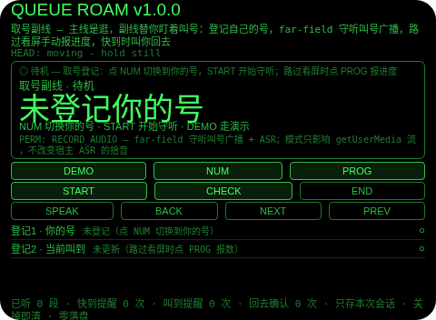
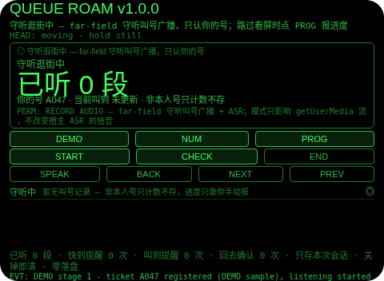
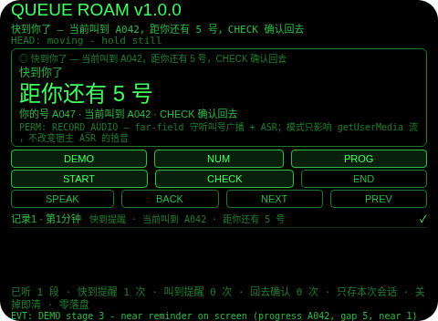
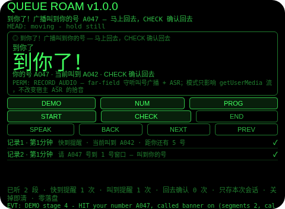
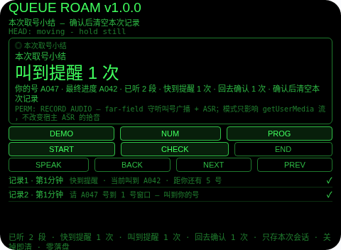

# Queue Roam（取号副线）

**Studio 导入地址**（复制到 Global AIUI Studio 的 Import Project 输入框）：

```
https://github.com/sakai55/rokid/tree/agent-queue-roam
```

注意力外挂系列 D05（DUAL 并行型，本组最后一位）。取了号想去逛逛，又怕过号，只能守在屏幕前干等——逛和等号抢同一个人：走开了怕错过，守着又逛不成。本 Agent 把副线外包出去：登记自己的号，START 开始 far-field 守听叫号广播，转写逐段过叫号门——只有叫到你的号才亮强横幅 + 一次 TTS「到你了，马上回去」；路过叫号屏时点 PROG 手动报进度（这是你报的数，不是读屏），当前叫到号距你的号 ≤5 个时出横幅 + 一次 TTS「快到你了，回去等着」；结束时给一张本次取号小结：登记号、最终进度、已听几段、快到提醒几次、叫到提醒几次、回去确认几次。

## 解决的问题

取号的注意力分叉：主线是逛，副线是两件小事——广播刚才是不是叫到我了、现在叫到几号了我还有多久。最容易掉的是第二件：逛着逛着就忘了当前进度，回来一看已经过号；以及第一件：广播里夹一句叫号，正在挑东西的手根本没听见。本 Agent 管三件事：出发前把你的号登记下来，逛街中替你听着广播、只把叫到你的号捞出来，路过叫号屏时你报一次进度、快到时按号距叫你回去——叫的不是官方系统，是你登记的号减去你报的进度。

## 注意力外挂设计（DUAL 并行型）

- **叫号门只认转写文本里的号段，从不认人**：没有说话人识别，叫号判定只对 ASR 转写文本做号段匹配（首个「字母 + 三位数字」与你的号精确比对）——广播喇叭、窗口喊话说的都一样过门，ASR 听错号就可能漏报/误报，README 和屏上文案都明说这是 best-effort，不是安防级保证。
- **只有叫到你的号才亮横幅，非本人号当场丢弃**：一段转写进来，先过门——叫到你的号才亮强横幅 + 一次 TTS「到你了，马上回去」+ 记一条事件；叫别人号的广播只让「已听段数」走 1，句子本身不存任何地方，并且绝不推动进度——ASR 听错一个号就不能把进度带偏。
- **进度是你手动报的数，不是读屏**：没有读屏、没有 OCR，Agent 从来看不见叫号屏——路过叫号屏时你点 PROG 报一次当前叫到号，进度只在你点按时动。PROG 在待机和小结页一律拒绝：报进度属于一次正在进行的取号。
- **号距只是算术，不是官方排队系统**：号距 = 你的号减去你报的进度（同字母前缀才算，前缀不同不算、不提醒）；距 5 号以内（含 5 号）出一次快到提醒，同一进度值只提醒一次；手动报到你的号本身也算叫到。官方叫号仍以现场屏/广播为准，这一点写进屏上文案和如实说明，不软化。
- **命中和快到都只花一次短语音**：TTS 只说「到你了，马上回去」或「快到你了，回去等着」，原句只在视线内呈现——刚省下的注意力不能又被朗读吃回去，跟 F04 会议过滤同一条纪律。
- **登记是开始的门，不是摆设**：START 要求你的号已登记，缺了就拒绝并点名；守听开始后 NUM 一律拒绝——中途改号等于改记忆，门必须关着。
- **点头只切换号和确认回去，从不开始守听、不报进度**：头稳点头在待机切换你的号（循环到你的号停下）、在快到/叫到横幅时确认回去、在小结页确认清空；守听中无横幅时点头一律忽略并说明；不稳的点头不计入 1.2 秒锁；进度是手动报数，点头不能替你报。
- **纠错便宜，销毁需确认**：小结页返回键回到守听中（不删东西，小结重建）；确认（点按/点头）才清空本次记录；没有 DEL 键——清掉横幅却还记着「已提醒」的状态，比开着提醒更会骗人。
- **只记本次取号，关掉即清（诚实边界）**：号、进度、事件、计数只存会话内存，关掉 Agent 即清——上次取的号对今天没有任何意义，存下来才是误导。
- **为什么胸前设备做不了**：叫到提醒必须在视线内一眼可读（低头看胸口设备等于又一次离场，逛的东西就在这时错过）；快到提醒必须贴在视线里而不是事后翻手机；回去确认要靠点头完成而不离场（掏手机确认本身就是一次离场）。三条都只有头戴设备成立。

## 与邻近 Agent 的分工

- 注意力系列 `tour-watch`（D04）：同组模板——同一条门 + 一次 TTS 纪律、同一条点头纪律、同一条零落盘规则、同一条 DEMO 五段弧；但它的门是集合信息，登记的是集合点朝向和集合钟点，提醒是钟点阈值。本 Agent 没有朝向、没有钟点：门是号段，进度是手动报数，提醒是号距。
- 注意力系列 `meeting-filter`（F04）：同系列关键词门模板——同一条门 + 一次 TTS 纪律；但它的门是「你的名字/你的议题」，且保留命中前 10 秒回放缓冲。本 Agent 的门是号段，且完全没有回放缓冲：命中直接记成事件。
- 注意力系列 `lecture-filter`（F05）：同系列信号笔记模板——同一条「命中记下来、非命中只计数丢弃」规则；但它的信号是课堂信号，且没有进度、没有号距、没有回去确认。本 Agent 增加手动进度、号距阈值和回去确认，因为错过号是错过一轮，不是错过一句话。

## 功能流程

1. **取号登记（NUM / 点按 / 头稳点头）**：待机屏列出两项——你的号（NUM 在 A047/A052/B008/C120 间切换，停在你的号上）、当前叫到（未更新，路过看屏时点 PROG 报数）；没登记号点 START 就拒绝并点名；登记了点 START 开始守听。
2. **守听逛街中（far-field 守听 + 叫号门）**：叫号广播转写逐段过门；叫别人号只让「已听段数」走 1、句子当场丢弃、进度不动；叫到你的号亮强横幅 + 一次 TTS「到你了，马上回去」+ 记一条事件。
3. **路过报进度与快到提醒（PROG + 号距阈值）**：路过叫号屏时点 PROG 报当前叫到号；号距 ≤5 个时出横幅「距你还有 N 号」+ 一次 TTS「快到你了，回去等着」；同一进度值只提醒一次；手动报到你的号本身也算叫到；CHECK 或头稳点头确认回去，横幅清掉、确认计数 +1。
4. **结束与小结（END）**：小结列出你的号、最终进度、已听几段、快到提醒几次、叫到提醒几次、回去确认几次；返回键回到守听中（不删东西），确认后清空本次记录。
5. **演示（DEMO）**：五段演示——号 A047 登记（示例）并开始守听 → 他人号广播只计数（已听 1 段、叫到 0 次、进度不动）→ 两次手动报进度（A040 静默、A042 距 5 号快到提醒 1 次）→ 叫到你的号强横幅（已听 2 段、叫到 1 次）→ 回去确认 + END 出小结（已听 2 段、快到 1 次、叫到 1 次、确认 1 次、最终进度 A042）；已有用户登记或用户取号进行时 DEMO 拒绝，绝不覆盖。

## 手势映射

| 手势/按键 | 动作 |
|---|---|
| 点按（Enter） | 待机：切换你的号；快到/叫到横幅时：确认回去；小结页：确认并清空；守听中无横幅：无动作并说明 |
| 双击（Backspace） | 小结页：回到守听中；待机/守听中：无动作并说明 |
| 上滑（ArrowUp） | 登记项/记录下一条 |
| 下滑（ArrowDown） | 登记项/记录上一条 |
| 头稳 + 点头 | 待机：切换你的号；快到/叫到横幅时：确认回去；小结页：确认并清空；守听中无横幅：忽略并说明（点头不开始守听、不报进度）；不稳的点头不计入 1.2 秒锁 |
| 屏上按钮 | DEMO 演示 / NUM 切换你的号 / PROG 报进度 / START 开始守听 / CHECK 确认回去 / END 结束出小结 / SPEAK 朗读当前状态 / BACK 返回 / NEXT 下一条 / PREV 上一条 |

## 权限说明

- 只申请 `RECORD_AUDIO`（app.json 的 `permissions` 为 `["RECORD_AUDIO"]`，静态校验明确断言这一点）：far-field 守听叫号广播 + ASR 输入。
- 收音模式诚实边界（舰队审计结论）：far-field 是 AIUI 麦克风 API 的模式，只影响 getUserMedia 流的拾音，不改变宿主 ASR 的拾音；屏上文案和本节都明说这一点。
- 不申请 `CAMERA`（没有任何拍照环节：叫号屏从不被读取，演示进度是标注的示例）、不申请 `GEOLOCATION`（取号副线不需要定位：Agent 从不知道你在哪、屏在哪）。

## 打包与预览命令

```bash
~/tools/bin/aix pack . -o ../dist/queue-roam.aix
~/tools/bin/aix preview . --html-out artifacts/preview.html
```

本地预览截图管线见 `~/workspace/custom-skills/rokid-preview-screenshots/SKILL.md`（本地 Ink + puppeteer，480×352；本 Agent 的探针脚本在 `~/workspace/preview-tools/shot-queue-roam.js`，DEMO 点按序列 [185, 180, 180, 180, 180]，逐态探测：守听态 y=190 打中的是 START（拒绝，仅 EVT 行变化）、y=210 是 SPEAK，只有 y=170–180 是真 DEMO；待机态 y=170 打空、y=200+ 打空——哈希变化不等于命中，首版截图务必逐张目视）。

## 真机测试信息表

| 项目 | 内容 |
|---|---|
| Studio 名称 | （导入后回填） |
| Version / Build | 1.0.0 / （导入后回填） |
| App Category | （导入后回填） |
| Intent Description | （导入后回填） |
| Agent ID | （导入后回填） |
| 状态 | 未导入（本地全流程完成，待 GO 在 Global Studio 导入 + 真机测试） |

## 预览截图







## 提审资料 (Review Submission)

### Feature Description

取号副线：取了号想去逛逛，又怕过号，只能守在屏幕前干等。本 Agent 把副线外包：登记自己的号，START 开始 far-field 守听叫号广播，转写逐段过叫号门——只有叫到你的号才亮强横幅 + 一次 TTS「到你了，马上回去」；路过叫号屏时点 PROG 手动报进度，当前叫到号距你的号 ≤5 个时出横幅 + 一次 TTS「快到你了，回去等着」；结束出本次取号小结。诚实边界：没有读屏/OCR，进度只能手动报；没有说话人识别，ASR 听错号就可能漏报/误报；号距只是登记号与手动进度相减的算术，不是官方排队系统；数据只存本次会话，关掉即清。权限：RECORD_AUDIO。

### Opening Message

**主线放心逛，副线它盯着——叫到你的号、快到你的号，一件都不用你脑子记。**

- 取号登记：NUM 在 A047/A052/B008/C120 间切换，停在你的号上
- 开始守听：登记了点 START，far-field 守听叫号广播
- 叫号门：转写里首个「字母 + 三位数字」与你的号精确比对，只有叫到你的号才亮强横幅
- 叫到提醒：一次 TTS「到你了，马上回去」，原句记成事件，不朗读整句
- 非本人号：只让「已听段数」走 1，句子当场丢弃，进度不动
- 路过报进度：路过叫号屏时点 PROG 报当前叫到号（手动报数，不是读屏）
- 快到提醒：号距 ≤5 个时出横幅 + 一次 TTS「快到你了，回去等着」，同一进度值只提醒一次
- 回去确认：CHECK 或头稳点头确认回去，横幅清掉、确认计数 +1
- 结束与小结：END 出本次取号小结；返回键回到守听中，确认后清空本次记录
- 诚实边界：没有读屏/OCR，没有说话人识别，号距只是算术、不是官方排队系统；数据只存本次会话，关掉即清；权限：RECORD_AUDIO

### Preview Media

- 图片：上述 5 张预览截图（待机、守听逛街中、快到提醒、叫到强横幅、本次取号小结）
- 视频：真机阶段补（需眼镜实拍）

### Change Log

**Build 1.0.0**
- Features added：你的号登记（NUM 切换 A047/A052/B008/C120，缺号拒绝开始并点名）；far-field 守听 + 叫号门（转写首个号段与你的号精确比对，叫到才亮强横幅 + 一次 TTS + 记事件，非本人号只计数丢弃且不推动进度）；手动报进度（PROG 循环报当前叫到号，待机/小结页拒绝）；号距提醒（同前缀相减，≤5 个出快到提醒、同一进度值只提醒一次，报到你的号本身算叫到）；回去确认（CHECK/点头确认回去，横幅清掉、确认计数 +1）；本次取号小结（登记号/最终进度/已听段数/快到与叫到提醒次数/回去确认次数，返回不删、确认才清）；DEMO 五段演示；本次会话内存零落盘；头稳点头纪律（点头只切换号和确认回去，不稳点头不占锁）。
- Improvements：无（首版）。
- Fixes：无（首版）。

## 如实说明

- 没有读屏、没有 OCR：叫号屏进度只能由你路过时点 PROG 手动报数，Agent 从来看不见叫号屏；演示里的进度 A040/A042 是标注的示例。
- 没有说话人识别：叫号判定只对 ASR 转写文本做号段匹配，广播喇叭、窗口喊话说的都一样过门；ASR 听错号就可能漏报（叫到你的号没听出来）或误报（别人的号听成了你的号），真机命中率取决于真机 ASR 与环境噪音。
- 号距只是算术：号距 = 你的号减去你报的进度（同字母前缀才算），不是官方排队系统；官方叫号仍以现场屏/广播为准；进度超过你的号时不做任何「已过号」推断。
- 收音模式不改变宿主 ASR 的拾音：far-field 是 AIUI 麦克风 API 的模式，只影响 getUserMedia 流的拾音；宿主 ASR 用自己的拾音，模式选 far-field 不会让 ASR 听得更远。
- 没有拍照、没有定位权限：app.json 的 `permissions` 为 `["RECORD_AUDIO"]`。
- 数据只存本次取号会话内存：号、进度、事件、计数在小结确认后清空，Agent 关闭时（onUnload）全部清空；没有任何落盘。
- DEMO 的号、进度、转写句都是标注的示例：真机上转写来自真实 ASR，进度来自你路过看屏时的手动报数。
