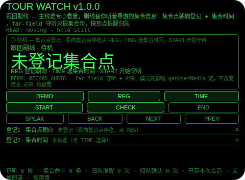
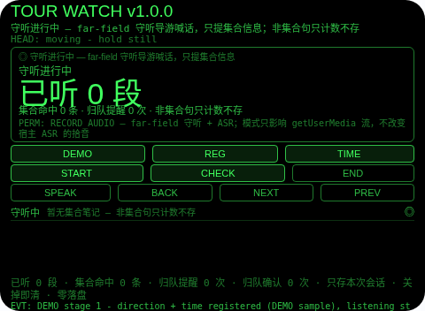
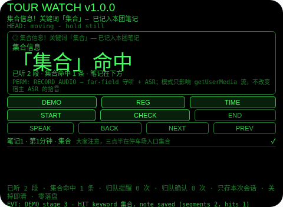
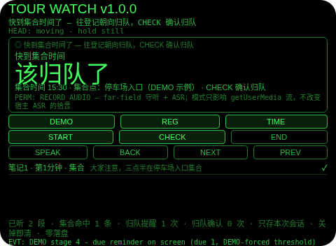
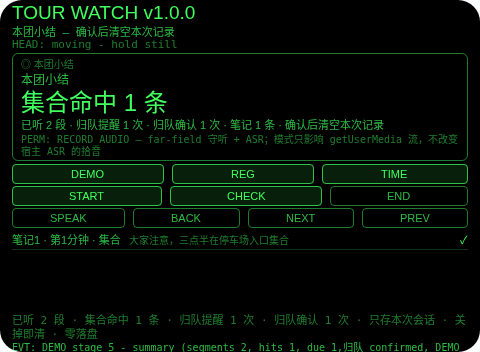

# Tour Watch（跟团副线）

**Studio 导入地址**（复制到 Global AIUI Studio 的 Import Project 输入框）：

```
https://github.com/sakai55/rokid/tree/agent-tour-watch
```

**AIX 直接下载**（最新版）：[tour-watch.aix](https://raw.githubusercontent.com/sakai55/rokid/main/aix/tour-watch.aix)

注意力外挂系列 DU04（DUAL 并行型，本组第四位）。跟团旅游专心看景时，导游的集合时间/广播通知一走神就错过——看景和听集合通知抢同一双耳朵：盯着景就听不清喊话，竖着耳朵听广播就看不好景。本 Agent 把副线外包出去：看向集合点停稳登记朝向，TIME 选集合时间，START 开始 far-field 守听；导游喊话/广播转写逐段过集合关键词门（集合/出发/上车/点名/集合点），只有集合句才亮横幅 + 一次 TTS 点名关键词 + 原句存入本团笔记，非集合句只计数、判定即丢弃；快到集合时间提前提醒往登记朝向归队，CHECK 或头稳点头确认归队；结束时给一张本团小结：已听几段、集合命中几条、归队提醒几次、归队确认几次。

## 解决的问题

跟团的注意力分叉：主线是景，副线是两件小事——导游刚才是不是说了集合时间和集合点、快到点了该往哪边走回去。最容易掉的是第二件：集合点登记时记得，逛着逛着就忘了朝哪个方向走；以及第一件：广播里夹一句「三点半停车场入口集合」，正在拍照的手根本没听见。本 Agent 管三件事：出发前把集合点朝向和集合时间登记下来，游览中替你听着广播、只把集合句捞出来存成笔记，快到点时按登记朝向叫你归队——叫的不是导航，是你自己登记的方向。

## 注意力外挂设计（DUAL 并行型）

- **集合门只认转写文本里的关键词，从不认人**：没有说话人识别，命中只对 ASR 转写文本做集合关键词匹配——导游、领队、广播喇叭说的都一样过门，ASR 听错就可能漏报/误报，README 和屏上文案都明说这是 best-effort，不是安防级保证。
- **命中句才存，非集合句当场丢弃**：一段转写进来，先过门——命中（集合/出发/上车/点名/集合点，关键词表顺序首词胜出）才亮横幅 + 一次 TTS 点名关键词 + 原句存入本团笔记（带第几分钟）；没命中只让「已听段数」走 1，句子本身不存任何地方。笔记里没有整团的转写，只有集合句。
- **命中只花一次短语音，不朗读整句**：TTS 只点名关键词（「集合信息：集合」），原句只在视线内呈现——刚省下的注意力不能又被朗读吃回去，跟 FI04 会议过滤同一条纪律。
- **集合朝向只是你登记的方向，不是定位导航**：REG 存的是你登记时看向的朝向标签，Agent 不知道集合点在哪、不会带路；归队提醒的意思是「往你登记的那个方向走」，走过去仍靠你自己看路。这一点写进屏上文案和如实说明，不软化。
- **归队提醒是钟点阈值 crossing，不是循环唠叨**：集合时间是钟点，倒计时是到该钟点的真实时间；10 分钟警告响一次、过期警告响一次，提醒已在屏上时绝不重播；CHECK 或头稳点头确认归队后横幅清掉、确认计数 +1——确认的是「你说你归队了」，不是传感器证明你到了。
- **登记和时间是出发的门，不是摆设**：START 要求朝向和时间都已登记，缺一项就拒绝并点名缺项；守听开始后 REG/TIME 一律拒绝——中途改集合点等于改记忆，门必须关着。
- **点头只登记朝向和确认归队，从不开始守听、不存笔记**：头稳点头在待机登记朝向（你正看向它，这就是凝视确认）、在归队提醒时确认归队、在小结页确认清空；守听中无提醒时点头一律忽略并说明；不稳的点头不计入 1.2 秒锁。
- **纠错便宜，销毁需确认**：小结页返回键回到守听中（不删东西，小结重建）；确认（点按/点头）才清空本次记录；没有 DEL 键——清掉横幅却还记着「已提醒」的状态，比开着提醒更会骗人。
- **只记本次跟团，关掉即清（诚实边界）**：朝向、时间、笔记、计数只存会话内存，关掉 Agent 即清——上次跟团的集合点对今天没有任何意义，存下来才是误导。
- **为什么胸前设备做不了**：集合提醒必须在视线内一眼可读（低头看胸口设备等于又一次离场，景就在这时错过）；命中笔记必须贴在视线里而不是事后翻手机；归队确认要靠点头完成而不离场（掏手机确认本身就是一次离场）。三条都只有头戴设备成立。

## 与邻近 Agent 的分工

- 注意力系列 `meeting-filter`（FI04）：同系列关键词门模板——同一条门 + 一次 TTS 纪律；但它的门是「你的名字/你的议题」，且保留命中前 10 秒回放缓冲。本 Agent 的门是集合信息，且完全没有回放缓冲：命中句直接存成笔记。
- 注意力系列 `lecture-filter`（FI05）：同系列信号笔记模板——同一条「命中句成笔记、非命中只计数丢弃」规则；但它的信号是课堂信号（重点/考试/作业），且没有朝向、没有钟点、没有归队提醒。本 Agent 增加集合点朝向、集合钟点和归队提醒，因为错过集合点是错过车，不是错过一句话。
- 注意力系列 `dog-walk`（DU03）：同组模板——同一条点头纪律、同一条零落盘规则、同一条 DEMO 五段弧；但它的副线是清单和回家门，完全没有守听。本 Agent 的副线是守听：门是转写文本，提醒是钟点阈值。

## 功能流程

1. **集合点登记（REG / TIME / 点按 / 头稳点头）**：待机屏列出两项登记——集合点朝向（看向集合点停稳，点 REG 或头稳点头登记）、集合时间（TIME 在 15:00/15:30/16:00/16:30 间切换）；缺一项点 START 就拒绝并点名缺项；两项齐了点 START 开始守听。
2. **守听进行中（far-field 守听 + 集合关键词门）**：导游喊话/广播转写逐段过门；非集合句只让「已听段数」走 1、句子当场丢弃；集合句亮横幅 + 一次 TTS 点名关键词 + 原句存入本团笔记（带第几分钟）。
3. **归队提醒（钟点阈值）**：到集合时间前 10 分钟出提醒「快到集合时间了，往登记朝向归队」+ 一次 TTS；过了集合时间未确认则出更强的过期提醒；CHECK 或头稳点头确认归队，横幅清掉、确认计数 +1。
4. **结束与小结（END）**：小结列出已听几段、集合命中几条、归队提醒几次、归队确认几次、笔记几条；返回键回到守听中（不删东西），确认后清空本次记录。
5. **演示（DEMO）**：五段演示——朝向 + 时间登记（示例：停车场入口、15:30）并开始守听 → 非集合句只计数（已听 1 段、命中 0 条）→ 集合句命中存笔记（已听 2 段、命中 1 条，关键词集合）→ 快到点提醒（归队提醒 1 次，DEMO 强制阈值，真机由钟点触发）→ 归队确认 + END 出小结（已听 2 段、命中 1 条、归队提醒 1 次、归队已确认）；已有用户登记或用户跟团进行时 DEMO 拒绝，绝不覆盖。

## 手势映射

| 手势/按键 | 动作 |
|---|---|
| 点按（Enter） | 待机：登记集合点朝向；归队提醒时：确认归队；小结页：确认并清空；守听中无提醒：无动作并说明 |
| 双击（Backspace） | 小结页：回到守听中；待机/守听中：无动作并说明 |
| 上滑（ArrowUp） | 登记项/笔记下一条 |
| 下滑（ArrowDown） | 登记项/笔记上一条 |
| 头稳 + 点头 | 待机：登记集合点朝向；归队提醒时：确认归队；小结页：确认并清空；守听中无提醒：忽略并说明（点头不开始守听、不存笔记）；不稳的点头不计入 1.2 秒锁 |
| 屏上按钮 | DEMO 演示 / REG 登记朝向 / TIME 选集合时间 / START 开始守听 / CHECK 确认归队 / END 结束出小结 / SPEAK 朗读当前状态 / BACK 返回 / NEXT 下一条 / PREV 上一条 |

## 权限说明

- 只申请 `RECORD_AUDIO`（app.json 的 `permissions` 为 `["RECORD_AUDIO"]`，静态校验明确断言这一点）：far-field 守听 + ASR 输入。
- 收音模式诚实边界（舰队审计结论）：far-field 是 AIUI 麦克风 API 的模式，只影响 getUserMedia 流的拾音，不改变宿主 ASR 的拾音；屏上文案和本节都明说这一点。
- 不申请 `CAMERA`（没有任何拍照环节：集合点靠看向登记，演示朝向是标注的示例）、不申请 `GEOLOCATION`（跟团副线不需要定位：集合朝向只是你登记的方向，Agent 从不知道集合点在哪）。

## 打包与预览命令

```bash
~/tools/bin/aix pack . -o ../dist/tour-watch.aix
~/tools/bin/aix preview . --html-out artifacts/preview.html
```

本地预览截图管线见 `~/workspace/custom-skills/rokid-preview-screenshots/SKILL.md`（本地 Ink + puppeteer，480×352；本 Agent 的探针脚本在 `~/workspace/preview-tools/shot-tour-watch.js`，DEMO 点按序列 [185, 175, 175, 175, 175]，逐态探测：守听态 y=195/205 打中的是 START（仅 EVT 行变化）、y=215 是 SPEAK，只有 y=175 是真 DEMO——哈希变化不等于命中，首版截图务必逐张目视）。

## 真机测试信息表

| 项目 | 内容 |
|---|---|
| Studio 名称 | （导入后回填） |
| Version / Build | 1.0.0 / （导入后回填） |
| App Category | （导入后回填） |
| Intent Description | （导入后回填） |
| Agent ID | （导入后回填） |
| 状态 | 未导入（本地全流程完成，待 GO 在 Global Studio 导入 + 真机测试） |

## 预览截图







## 提审资料 (Review Submission)

### Feature Description

跟团副线：跟团旅游专心看景时，导游的集合时间/广播通知一走神就错过。本 Agent 把副线外包：看向集合点停稳登记朝向，TIME 选集合时间，START 开始 far-field 守听；导游喊话/广播转写逐段过集合关键词门（集合/出发/上车/点名/集合点），只有集合句才亮横幅 + 一次 TTS 点名关键词 + 原句存入本团笔记，非集合句只计数、判定即丢弃；快到集合时间提前提醒往登记朝向归队，CHECK/点头确认归队；结束出本团小结。诚实边界：没有说话人识别，ASR 听错就可能漏报/误报；集合朝向只是你登记的方向，不是定位导航；笔记只存命中句；数据只存本次会话，关掉即清。权限：RECORD_AUDIO。

### Opening Message

**主线专心看景，副线它听着——集合句、集合点、归队时间，一件都不用你脑子记。**

- 集合点登记：看向集合点停稳，点 REG 登记朝向
- 集合时间：TIME 在 15:00/15:30/16:00/16:30 间切换
- 开始守听：两项齐了点 START，far-field 守听导游喊话
- 集合关键词门：集合/出发/上车/点名/集合点，只有集合句才亮横幅
- 命中成笔记：一次 TTS 点名关键词，原句存入本团笔记（带第几分钟），不朗读整句
- 非集合句：只让「已听段数」走 1，句子当场丢弃，不存任何地方
- 归队提醒：快到集合时间提前提醒往登记朝向归队，CHECK 或头稳点头确认归队
- 结束与小结：END 出本团小结；返回键回到守听中，确认后清空本次记录
- 诚实边界：没有说话人识别，ASR 听错就可能漏报/误报；集合朝向只是你登记的方向，不是定位导航；数据只存本次会话，关掉即清；权限：RECORD_AUDIO

### Preview Media

- 图片：上述 5 张预览截图（待机、守听进行中、集合命中、快到点归队提醒、本团小结）
- 视频：真机阶段补（需眼镜实拍）

### Change Log

**Build 1.0.0**
- Features added：集合点朝向登记（看向停稳点 REG，头稳点头也可登记，缺项拒绝开始并点名）；集合时间选择（TIME 切换 15:00/15:30/16:00/16:30）；far-field 守听 + 集合关键词门（集合/出发/上车/点名/集合点，表顺序首词胜出）；命中成笔记（横幅 + 一次 TTS 点名关键词 + 原句存笔记带分钟标记，不朗读整句）；非集合句只计数丢弃；归队提醒（10 分钟警告一次、过期警告一次，CHECK/点头确认归队）；本团小结（已听段数/命中条数/归队提醒与确认次数/笔记条数，返回不删、确认才清）；DEMO 五段演示；本次会话内存零落盘；头稳点头纪律（点头只登记朝向和确认归队，不稳点头不占锁）。
- Improvements：无（首版）。
- Fixes：无（首版）。

## 如实说明

- 没有说话人识别：命中只对 ASR 转写文本做集合关键词匹配，导游、领队、广播喇叭说的都一样过门；ASR 听错就可能漏报（集合句没听出来）或误报（非集合句里恰好有关键词），真机命中率取决于真机 ASR 与环境噪音。
- 集合朝向不是定位导航：REG 存的只是你登记时看向的朝向标签，Agent 不知道集合点在哪、不会带路；归队提醒的意思是「往你登记的那个方向走」，走过去仍靠你自己看路。
- 笔记只存命中句：本团笔记里只有过门的集合句（带第几分钟和关键词），其余转写判定即丢弃，不存任何地方。
- 收音模式不改变宿主 ASR 的拾音：far-field 是 AIUI 麦克风 API 的模式，只影响 getUserMedia 流的拾音；宿主 ASR 用自己的拾音，模式选 far-field 不会让 ASR 听得更远。
- 没有拍照、没有定位权限：app.json 的 `permissions` 为 `["RECORD_AUDIO"]`。
- 数据只存本次跟团会话内存：朝向、时间、笔记、计数在小结确认后清空，Agent 关闭时（onUnload）全部清空；没有任何落盘。
- DEMO 的集合点、集合时间、转写句和快到点提醒阈值都是标注的示例：真机上转写来自真实 ASR，归队提醒由真实钟点触发。
