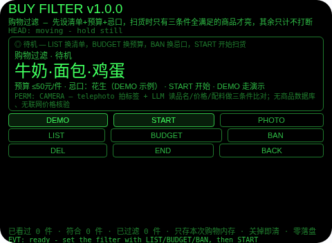
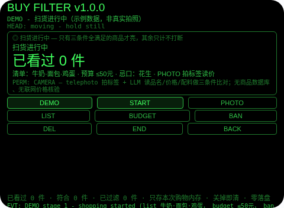
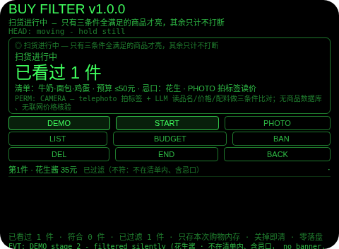
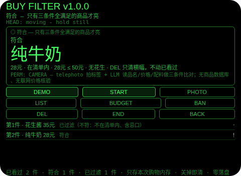
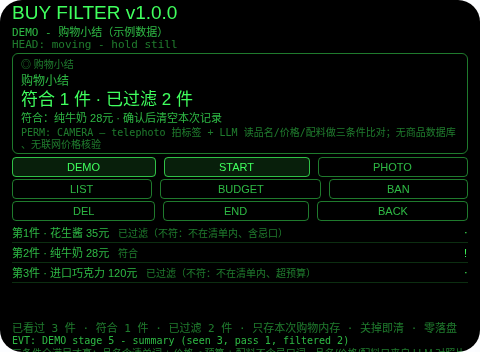

# Buy Filter（购物过滤）

**Studio 导入地址**（复制到 Global AIUI Studio 的 Import Project 输入框）：

```
https://github.com/sakai55/rokid/tree/agent-buy-filter
```

**AIX 直接下载**（最新版）：[buy-filter.aix](https://raw.githubusercontent.com/sakai55/rokid/main/aix/buy-filter.aix)

注意力外挂系列 FI03（FILTER 过滤型，本组第三位）。逛超市最累的不是走路，而是满货架的促销都在抢你的注意力：每件商品都得看一眼、读一遍价签、判断一次「要不要、超没超预算、含不含忌口」，逛了一圈，脑子比腿还累，真正要买的反而漏掉，还容易顺手拿超预算或忌口的东西。本 Agent 把这个判断外包出去：出发前先声明三条件（示例清单：牛奶·面包·鸡蛋；单件预算 ≤50 元；忌口：花生），然后只管看向商品拍照——LLM 读出品名、价格、配料；只有三条件全满足时，它才亮起横幅并 TTS 报一次符合与理由；不满足的商品，只在「已过滤」计数里默默加一，不亮屏、不出声、不打断你。

## 解决的问题

购物时的注意力税：目标明明只有三条（在清单内、不超预算、不含忌口），眼睛却要对每件商品都做一次「读 + 算 + 判断」。结果是注意力被迫全程在线，真正符合的那件出现时反而可能因为看花眼而错过，或者顺手拿了不该拿的。本 Agent 把「读 + 判断」外包：规则事先定好（清单、预算、忌口），扫货时你只管看；符合时它负责叫你，不符合时它只负责计数——结束时的小结告诉你：这趟看了几件、符合了哪几件、过滤了几件，你可以回看，但不必当时被每件商品打断。

## 注意力外挂设计（FILTER 过滤型）

- **先声明三条件，规则扫货中不改**：清单、预算、忌口只能在待机时换（LIST 在示例清单间轮换，BUDGET 在 30/50/100 元间轮换，BAN 在 无/花生/乳糖/麸质间轮换）；扫货中改规则会被拒绝并说明原因——信任中的过滤器不能在你不注意时被改写规则。
- **匹配规则只有三条，这是第一位的诚实边界**：品名（归一化后）含清单关键词、价格 ≤ 单件预算、配料（归一化后）不含忌口词，三条全满足才亮。没有商品数据库、没有联网价格核验、没有条码查价——品名、价格、配料只来自 LLM 对照片的读数，所以读错一个字或一个数字就可能误判，界面、朗读、README 都明说：纯牛奶 28 元符合（在清单内、预算内、无花生），面包 60 元只超预算就不亮，花生酱 35 元不在清单内又含忌口也不亮。
- **不符合的商品只动计数器**：不符合只让「已过滤」加一、进列表并注明不符原因，不弹横幅、不播报。过滤器如果每件商品都报一遍，过滤器本身就成了干扰源。拍照或读标签失败、读数格式不全（缺品名或价格）则**根本不计数**：你并没有真的看到一件商品的品名和价格，计进去就是假覆盖，拿它去比预算更是凭空编造。
- **拍照必须是 deliberate 的点按**：点按（Enter）拍标签；头稳点头只在待机开始扫货和小结确认时有效，扫货中点头无效——拍标签绝不能因为一次无意的点头就触发；不稳的点头不占 1.2 秒锁。
- **纠错便宜，销毁需确认**：扫货中 DEL 只清符合横幅，绝不动已看过列表、不结束扫货；小结页返回键回到扫货（不删东西），确认（点按/点头）才清空本次记录。
- **只记本次购物，关掉即清（诚实边界，第二位）**：全部内容只存本次会话内存，关掉 Agent 即清——适用窗口就是正在逛的这趟超市，零隐私残留；下一趟重新从空白过滤器开始，正是正确用法。
- **为什么胸前设备做不了**：符合横幅必须进视线（低头看胸口设备等于又一次离场）；不符合的商品必须静默计数（胸口设备出声报「这件不行」等于把过滤反过来变成打断）；结束小结要一眼扫全（语音逐条报一遍等于重新占用注意力）。三条都只有头戴设备成立。

## 与邻近 Agent 的分工

- 指向性系列 `allergen-guard`：逐件看配料、命中忌口才警告——它是**警告器**；本 Agent 从不单件警告，它先声明三条件，只有全满足的商品才浮出水面——它是**过滤器**。
- 指向性系列 `shelf-compare`：对已经拿起的商品逐件比价——它是**比价器**；本 Agent 在拿起之前就做决定，不符合的根本不浮出水面。
- `sign-filter`（FI02）：声明的目标打断，其余牌只计——它是本 Agent 的视觉孪生，区别是本 Agent 用三条件过滤商品而不是单目标过滤牌子。待机时才能改规则、零落盘两条纪律是共用的。
- `focus-shield`（FI01）：声音的会话门禁——白名单词打断，其余只记。本 Agent 是它的购物孪生。

## 功能流程

1. **定过滤条件（LIST / BUDGET / BAN，待机时）**：在示例清单、预算档、忌口词间轮换；扫货中改规则会被拒绝。
2. **开始扫货（START / 点按 / 头稳点头）**：状态行明说「只有三条件全满足的商品才亮，其余只计不打断」。
3. **拍标签读价（PHOTO / 点按）**：telephoto 拍照 → LLM 按「品名|价格|配料」读标签 → 三条件比对；读数失败或格式不全不计数，重拍一次。
4. **符合才亮（符合）**：三条件全满足 → 视线内横幅 + TTS 报一次符合、价格与理由；DEL 只清横幅，不动已看过。
5. **不符合只计（已过滤）**：已过滤加一、进列表并注明不符原因，不亮屏、不出声。
6. **结束与小结（END）**：小结列出看过几件、符合几件、已过滤几件、符合商品与价格；返回键回到扫货（不删东西），确认后清空本次记录。
7. **演示（DEMO）**：五段演示——扫货开始（清单牛奶·面包·鸡蛋、预算 ≤50 元、忌口花生）→ 不符合商品「花生酱 35 元」静默计数（不在清单内、含忌口，无横幅、无 TTS）→ 符合商品「纯牛奶 28 元」横幅 + TTS → 不符合商品「进口巧克力 120 元」静默计数（不在清单内、超预算）→ 购物小结（看过 3 件、符合 1 件、已过滤 2 件）；已有用户扫货时 DEMO 拒绝，绝不覆盖。

## 手势映射

| 手势/按键 | 动作 |
|---|---|
| 点按（Enter） | 待机：开始扫货；扫货中：拍标签读价；小结页：确认并清空 |
| 双击（Backspace） | 小结页：回到扫货；扫货中：无动作并说明（END 结束扫货，DEL 清横幅）；待机：无动作并说明 |
| 上滑（ArrowUp） | 已看过列表下一条 |
| 下滑（ArrowDown） | 已看过列表上一条 |
| 头稳 + 点头 | 待机：开始扫货；小结页：确认并清空；扫货中：无效并说明（点头绝不拍标签）；不稳的点头不计入 1.2 秒锁 |
| 屏上按钮 | DEMO 演示 / START 开始 / PHOTO 拍标签 / LIST 换清单 / BUDGET 换预算 / BAN 换忌口 / DEL 清横幅 / END 结束出小结 / BACK 返回 |

## 权限说明

- 只申请 `CAMERA`（app.json 的 `permissions` 为 `["CAMERA"]`，静态校验明确断言这一点）。
- telephoto 拍照：ImageCapture `telephoto` + 宿主 LLM 图片输入按「品名|价格|配料」读标签，两者都包在 try/catch 里，预览环境不可用时软失败（不计数）。
- 不申请 `RECORD_AUDIO`（没有任何语音输入环节：清单、预算、忌口从示例池里选，确认靠手势）、不申请 `GEOLOCATION`（逛超市不需要定位）。

## 打包与预览命令

```bash
~/tools/bin/aix pack . -o ../dist/buy-filter.aix
~/tools/bin/aix preview . --html-out artifacts/preview.html
```

本地预览截图管线见 `~/workspace/custom-skills/rokid-preview-screenshots/SKILL.md`（本地 Ink + puppeteer，480×352；本 Agent 的探针脚本在 `~/workspace/preview-tools/shot-buy-filter.js`、`probe-buy.js`）。

## 真机测试信息表

| 项目 | 内容 |
|---|---|
| Studio 名称 | （导入后回填） |
| Version / Build | 1.0.1 / （导入后回填） |
| App Category | （导入后回填） |
| Intent Description | （导入后回填） |
| Agent ID | （导入后回填） |
| 状态 | 未导入（本地全流程完成，待 GO 在 Global Studio 导入 + 真机测试） |

## 预览截图







## 提审资料 (Review Submission)

### Feature Description

超市购物过滤器：满货架促销都在抢注意力，真正要买的反而漏掉，还容易顺手拿超预算或忌口的东西。本 Agent 出发前先声明三条件（示例清单牛奶·面包·鸡蛋、单件预算≤50元、忌口花生），然后只管看向商品拍照——LLM 读出品名、价格、配料；只有三条件全满足时才亮起横幅并 TTS 报一次符合与理由；不满足的只在已过滤计数里默默加一，不亮屏、不出声。结束小结列出符合商品与已过滤数。诚实边界：没有商品数据库，品名、价格、配料只来自照片读数，读数错则判断错；没有联网价格核验；数据只存本次购物内存，关掉即清。权限仅 CAMERA。

### Opening Message

**先定三条件，再扫货——只有全满足的商品才配打断你。**

- 待机时定条件：LIST 换清单，BUDGET 换预算，BAN 换忌口；扫货中改规则会被拒绝
- START 开始扫货：状态行明说只有三条件全满足的商品才亮，其余只计不打断
- PHOTO 拍标签读价：telephoto 拍照 → LLM 按品名|价格|配料读标签 → 三条件比对；读数失败或格式不全不计数，重拍一次
- 符合：三条件全满足 → 视线内横幅 + TTS 报一次符合、价格与理由；DEL 只清横幅，不动已看过
- 不符合：已过滤加一、进列表并注明不符原因，不亮屏、不出声
- END 出购物小结：看过几件、符合几件、已过滤几件、符合商品与价格；返回键回到扫货，确认后清空本次记录
- 诚实边界：没有商品数据库，读数错则判断错；没有联网价格核验；数据只存本次购物，关掉即清

### Preview Media

- 图片：上述 5 张预览截图（待机、扫货进行中、不符合静默计数、符合横幅、购物小结）
- 视频：真机阶段补（需眼镜实拍）

### Change Log

**Build 1.0.0**
- Features added：过滤条件声明（示例清单、预算档、忌口词，待机时可换）；扫货拍标签（telephoto + LLM 按品名|价格|配料读数）；三条件比对过滤（符合横幅 + 一次 TTS，不符合只计并注明原因）；购物小结（看过/符合/已过滤/符合商品与价格）；DEMO 五段演示；DEL 清横幅/小结确认清空；本次购物内存零落盘；头稳点头纪律（扫货中点头不拍标签，不稳点头不占锁）。
- Improvements：无（首版）。
- Fixes：无（首版）。

**Build 1.0.1**
- Features added：无。
- Improvements：无。
- Fixes：删除 FileReader（Ink 运行时不存在，真机必死）：标签照片 Blob→dataURL 改走官方文档路径 `blob.arrayBuffer()` + 分块 `btoa`，失败接全局错误码 E2005 并如实显示。
