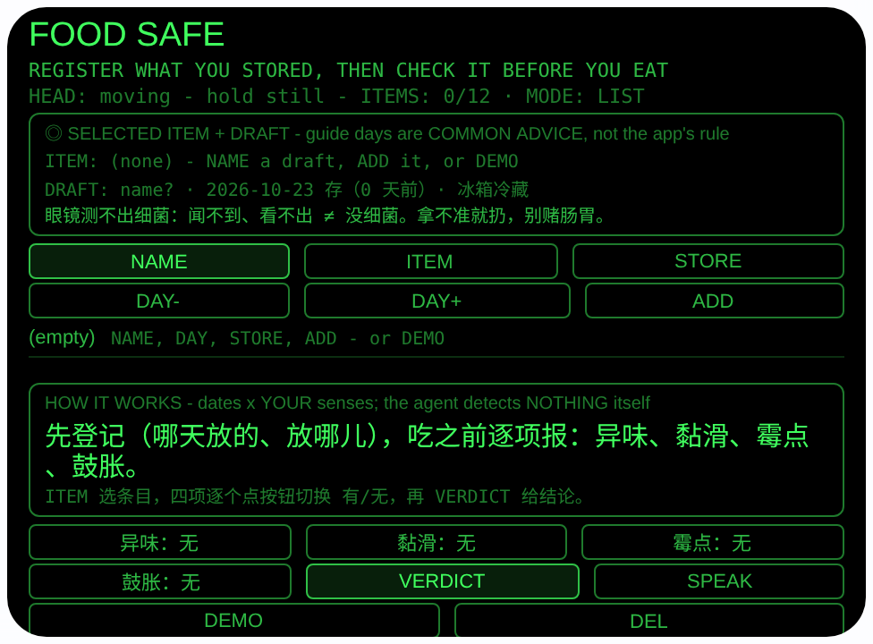
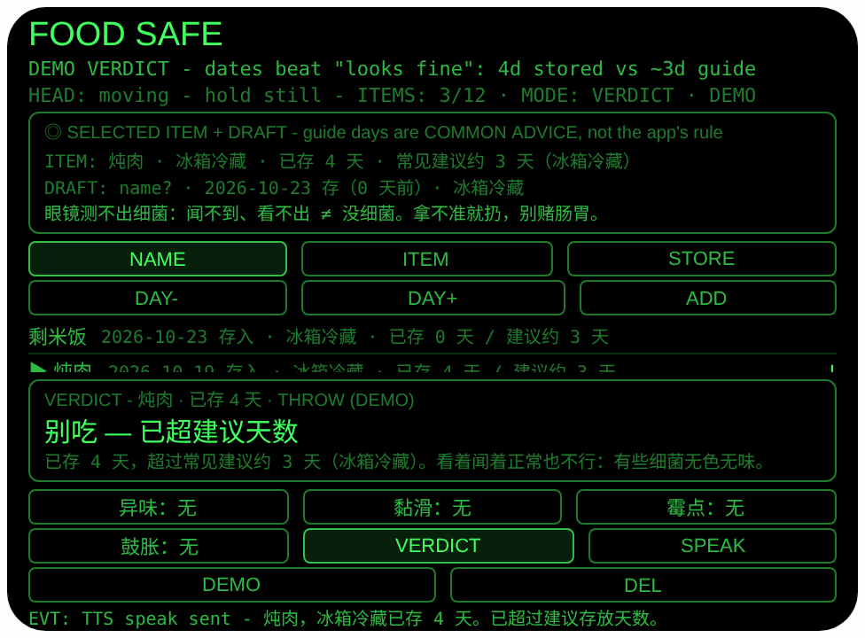

# food-safe — 剩菜安全（Rokid 眼镜 AIUI Agent）

50 个「指向性生活问题」Agent 的第 35 个，G 组（健康安全）收尾。
剩菜放了三四天，闻着好像没事、看着也没坏，到底能不能吃？
生鲜买回来搁冰箱一角，忘了是哪天放的。本 Agent 自己测不出
任何东西——它把判断拆成两个你能当场核对的因子摆在眼前：
**日期**（你登记的存放日期到今天的真实天数，对照一张明示
的常见存放建议）× **你的感官**（你亲手闻、看、摸后逐项
报告的四项）。任何一边出问题都倒向「别吃」；两边都过，也
只给留了余地的「相对安心」。它不替代专业判断。

## 预览截图

截图统一存放于仓库根目录 `screenshots/food-safe/`。





## 解决的问题

判断剩菜能不能吃，难的不是知识，是两个动作总有一个被跳过：
只看日期的，忽略了「没到期也会坏」；只闻一闻的，忘了「有
些细菌无色无味」。还有第三个坑：放进去是哪天，站在冰箱门
口根本想不起来。本 Agent 在放食物进冰箱的那一刻就让你把
日期登记好（说个名字、拨一下天数，十秒钟），吃之前站在
冰箱门口逐项核对：先看天数，再闻、再看、再摸——四项报完
结论自动出来并朗读，手上端着盘子也不用腾手翻手机。

## 指向性设计（为什么必须用眼镜）

- **站在冰箱门口，视线正对食物（GAZE 现场核对）**：四项
  检查全是「看着这盒、闻着这盒、摸着这盒」——检查对象
  就是你眼睛正看着、手里正拿着的那一份，不用报名字区分
  左右，和 #23 fresh-pick「感测的是你」同一条线：报的
  是你本人的观察，Agent 只做合并与分级。
- **头部稳定 + 点头只确认不替答**：`enableWorldAwareness()`
  后点头（`onHeadGesture` nod）在检查中只触发「给结论」，
  绝不替你把任何一项拨成「无」——四项只能由你亲手点按
  切换（同 #22/#23 的先报后确认纪律）。
- **日期是真算术，不是感觉（HEAD 无关，时间因子）**：
  存放天数由登记日期与真实今天以 UTC 日序号相减，跨月、
  跨年、闰年都准确；登记时用 DAY−/DAY+ 把「哪天放的」
  一次拨对，之后每天打开都自动重算。
- **佩戴者麦克风登记（MIC4 wearer）**：NAME 前先以
  `microphoneMode: 'wearer'` 做佩戴者模式麦克风检查再
  一次性识别，名字原样进草稿先给你核对；无识别的主机
  如实 SKIP 改走预置轮换——站在冰箱前双手端着东西，
  名字靠说、日期靠拨，不用打字。

## 分级规则（确定性，两因子，顺序写死）

| 优先级 | 条件 | 结论 |
|---|---|---|
| 1 | 你报了霉点/变色或包装鼓胀（硬红旗） | **别吃 — 扔掉**，与天数无关 |
| 2 | 你报了异味或表面黏滑 | **别吃 — 扔掉**，感官变质优先于日期（没到期也会坏） |
| 3 | 四项无异常，但存放天数 > 建议天数 | **别吃 — 已超建议天数**，日期优先于「看着正常」（细菌可无色无味） |
| 4 | 天数超过建议的一半，或室温存放 | **谨慎 — 今天吃完，彻底加热**，老人小孩孕妇拿不准就扔 |
| 5 | 其余 | **相对安心 — 尽快吃，剩菜彻底加热**（「相对」强制，从不说「安全」） |

存放建议表（内置，界面与文档全程标注**常见建议**）：
冰箱冷藏剩菜/开封牛奶约 3 天、生鱼片类约 1 天、冰箱冷冻
约 30 天、室温剩菜只建议当天。

## 功能流程

1. 登记：NAME 说食物名（原样进草稿）或无 ASR 时轮换预置
   （剩米饭 / 炖肉 / 凉拌菜 / 牛奶 / 生鱼片）→ DAY−/DAY+
   拨存放日期（0–14 天前）→ STORE 轮换存放方式 → ADD
   存入 `foodSafeItems`（最多 12 条，本机 wx 存储）
2. 列表：每条显示存入日期、存放方式、已存天数与建议天数；
   已超建议的标 `!`；ITEM（或方向键）选中一条
3. 检查：逐项点按钮切换 有/无——异味、黏滑、霉点、鼓胀
   （点第一项自动进入检查态；结论出来后改任何一项，
   结论作废重报）
4. 结论：VERDICT（或检查态点头、Enter）按上表分级，大字
   显示 + 附命中规则的原因 + 自动 TTS 朗读
5. SPEAK 朗读选中条目的天数/建议/检查提醒；DEL 删除已
   吃完或已扔掉的条目
6. DEMO：一次 Date 快照生成三条（剩米饭今天、牛奶 1 天前、
   炖肉 4 天前，均冷藏），落在炖肉结论态演示规则 3

> 安全与边界说明：**本 Agent 感测不到任何东西**——日期是你
> 登记的，四项是你报的。闻不到、看不出 ≠ 没细菌；感官与
> 日期都过也只是「相对安心」。拿不准就扔，别为一口剩菜赌
> 肠胃。它不是食品安全检测，不替代专业判断；老人、小孩、
> 孕妇、免疫力弱的人用更严的标准（拿不准就扔）；儿童不要
> 单独用它判断食物能不能吃。

## 权限

| 权限 | 用途 |
|---|---|
| RECORD_AUDIO | 食物名语音录入：佩戴者模式麦克风检查 + 一次性语音识别，名字原样保存、先显示核对再登记 |

麦克风只在用户点 NAME 时启动，识别完立即停掉媒体轨道。
大模型不参与本 Agent：分级是写死的确定性规则。记录只存
本机 wx 同步存储，不上传。

## 打包与预览

```bash
cd ~/workspace/rokid/food-safe
~/tools/bin/aix pack . -o ../dist/food-safe.aix
~/tools/bin/aix preview . --html-out artifacts/preview.html
```

本地预览截图走 `~/workspace/preview-tools/` 的本地 Ink + puppeteer 路线
（`shot-food.js`；结论截图的点击序列为 canvas 内 DEMO (127, 338)，
坐标经视觉定位确认）。

## 真机测试（海外版 · 云端下发 · Path 1）

1. 推到 GitHub 后，Global AIUI Studio（aiui-global.rokid.com，en-US）用
   分支导入：`https://github.com/sakai55/rokid/tree/agent-food-safe`
   （该分支根目录即本 Agent 文件）
2. Studio 的 **Device Debug** 页签填 Basic Information，在 AIX Packaging
   点 **Repackage and Save**，确认顶部出现绿色
   **● Debug version ready — Ready for device debugging**
3. **Hi Rokid**（海外版 `com.rokid.sprite.global.aiapp`，不是国内版
   Rokid Ai App）→ 设置 → 开发者选项 → AIUI → 更新眼镜资源包，
   等「智能体资源包下载成功」
4. 对眼镜说「乐奇，打开 food-safe」，在自家冰箱前实测：放剩菜时
   登记一轮（语音名字是否原样、老人语音识别率是本 Agent 最大
   风险点），隔几天检查一轮——故意留一份超期剩菜，核对超期
   判定与朗读；再拿一份明显变质的报异味/霉点，核对红旗与
   感官两级判定是否先于日期触发

## 真机测试信息（Global AIUI Studio · Device Debug）

| 项目 | 值 |
|---|---|
| Agent Name（Studio） | 待导入后回填 |
| Version（Build） | 1.0.0（待导入后回填） |
| App Category | 待导入后回填 |
| Intent Description | 待导入后回填 |
| Agent ID | 待导入后回填 |
| AIX Package Size | 约 20.6 KB（本地打包 `dist/food-safe.aix`） |
| 状态 | 本地完成，待导入 Studio |
| Studio | aiui-global.rokid.com（en-US） |
| 下发方式 | 云端下发 → Hi Rokid（海外版）更新眼镜资源包 |

## 验证情况

**已验证**

- 静态检查：app.json / package.json JSON 解析通过；`<script def>` JSON
  解析通过；`<script setup>` 与 app.js 提取后 `node --check` 语法通过；
  全目录 grep 无 `Page(` / `App(` / `Widget(` / `workers:` 残留。
- 日期与分级逻辑（Node 实测）：把页面对象以 wx 打桩加载进
  Node，共 88 条断言全过——含日序号跨月（9/28→10/2 = 4 天）、
  跨年（12/30→1/3 = 4 天）、闰年 2 月（2024 年 2 天 / 2025 年
  1 天）与字符串往返；建议天数表（冷藏 3 / 生鱼片 1 / 冷冻
  30 / 室温 0，冷冻优先于生鱼片规则）；分级全矩阵：四项
  16 种组合在第 0 天逐一验证（任一项有 → 别吃，全无 →
  相对安心），红旗与感官两级文案分开、且都先于日期；日期
  边界（恰好等于建议天数 = 谨慎不是别吃；建议 3 天时
  1 天安心、2 天谨慎；冷冻 15 天安心、16 天谨慎、30 天
  谨慎、31 天别吃；生鱼片 1 天谨慎、2 天别吃；室温第 0 天
  谨慎、第 1 天别吃）；未来日期钳制为 0 天；登记全流程
  （预置轮换、天数步进钳制 0–14、存放轮换、无名字拒绝
  ADD、上限 12 条拒绝第 13 条、坏数据加载时被丢弃、存储
  往返）；检查流程（点按才动四项、结论自动朗读、结论后
  改报作废重报、点头只给结论不替答）；DEMO 一快照
  （三条日期自洽、炖肉恰好 4 天、落在超期 THROW 结论）。
- 打包：`aix pack` 成功；`aix list` 核对包内含 README.md、AGENTS.md、
  app.js、app.json、package.json、pages/index/index.ink
  （artifacts/ 已被 .aixignore 排除）。
- 预览渲染：aix preview + 本地 Ink + puppeteer 截图两张（见下方
  Preview Media）：首页初始态完整渲染（条目/草稿行、常驻诚实
  行、空列表行、登记与四项检查按钮）；点 DEMO 后到达结论态：
  状态行「4d stored vs ~3d guide」、条目行炖肉已存 4 天、
  大字「别吃 — 已超建议天数」+ 原因行、四项全「无」、页脚
  TTS 已发送事件均正确渲染。检查态另在 Node 流程断言中
  覆盖（点第一项自动进入检查态、结论后改报作废重报）。

**未验证**

- 真机语音识别对食物名的准确率（尤其老人语音、方言口音）——
  本 Agent 最大的真实风险点；名字原样显示核对是为此设的防线，
  真机待测。
- 真机头部稳定检测、点头给结论、结论 TTS 朗读的及时性。
- **判断方式的产品边界**：本 Agent 不闻、不看、不测细菌——
  结论全部来自用户登记的日期与用户报告的四项观察，日期记错
  或观察报错它都抓不到；建议天数表是标注为「常见建议」的
  经验值，不同食物、不同冰箱温度会有出入。这不是待补的
  验证项，是已知边界。
- 设备时钟不准时天数判断跟着错（Agent 不校正时钟），真机
  待留意。

---

## 提审资料（Review Submission）

> Global AIUI Studio → Submit 页签的 Review Information 逐项对应下面四段，
> 提交时整段复制。每次提交前重新确认 Preview Media。

### Feature Description

Food Safe grades leftovers before you eat them. Register what you stored: say its name, step back to the day you stored it, pick fridge, freezer or room temperature. At the fridge door, report four things with your nose, eyes and fingers: off smell, slimy surface, mould, swollen pack. It combines the real days stored, against a general storage-life guide, with your reports, and grades it: throw away, eat today reheated, or relatively OK. It senses nothing itself and never calls food safe.

### Opening Message

Hi, I'm **Food Safe** - I can't smell or see your food, but I keep the two questions that matter in front of you.

**NAME** what you stored, **DAY- / DAY+** to when you stored it, **STORE** for where, **ADD** to save it. Before eating, **ITEM** to pick it and tap the four checks honestly - smell, slime, mould, swelling - then **VERDICT**. Red flags and overdue dates both mean throw it away. When in doubt, throw it out.

### Preview Media

提交要求：3–5 个 JPG/PNG 图片或 MP4 视频，至少含 1 张图和 1 个视频，每次提交前重新确认。

- Image 1：`artifacts/preview-food-safe-index.png`（aix preview 首页：FOOD SAFE 初始态，含选中条目/草稿行、常驻诚实行、登记与检查按钮及列表，本地文件，提交时从本地上传）
- Image 2：`artifacts/preview-food-safe-verdict.png`（DEMO 结论态：炖肉冷藏已存 4 天、四项无异常仍判「别吃 — 已超建议天数」+ 原因行 + DEMO 标注，本地文件）
- Video：待真机补 — 真机录制「往冰箱放剩菜时登记一份 → 隔几天站冰箱门口逐项闻/看/摸报告 → 出分级结论并朗读」全过程（MP4），录好后放 `artifacts/` 并更新此处
- 状态：未齐（已有 2 张图；还需至少 1 个视频，总数补到 3–5 个后才可提交）

### Change Log

#### Build 1.0.0

**Features added**

- Leftover registration at the fridge: say the food's name (wearer-mode mic check, one-shot speech recognition, kept verbatim and shown for checking; honest preset cycling - leftover rice, stew, cold dish, milk, sashimi - when no recogniser exists), step the stored date back 0-14 days, cycle fridge / freezer / room temperature, and save up to 12 items on-device.
- Two-factor risk grading with fixed, conservative rule order: mould/discolouration or a swollen pack is a hard red flag (throw away regardless of dates); off smell or a slimy surface also means throw away (spoilage beats dates); past the general guide days also means throw away even when everything looks fine (dates beat looks - bacteria can be invisible and odourless); past half the guide days, or room-temperature storage, means eat it today with thorough reheating; otherwise "relatively OK" - the agent never calls food safe.
- Four wearer-reported checks at the fridge door (smell, slime, mould, swelling), toggled only by your own taps - a head nod triggers the verdict but never answers a check for you; changing a report after a verdict voids it. Real day arithmetic (UTC day numbers) so stored-days stay exact across months, years and leap days; verdict and reason spoken aloud.
- DEMO seeds three items from a single date snapshot (rice today, milk 1 day, stew 4 days, all refrigerated) and lands on the stew's over-date throw-away verdict, demonstrating that dates beat "looks fine".

**Improvements**

- None (initial release).

**Fixes**

- None (initial release).
