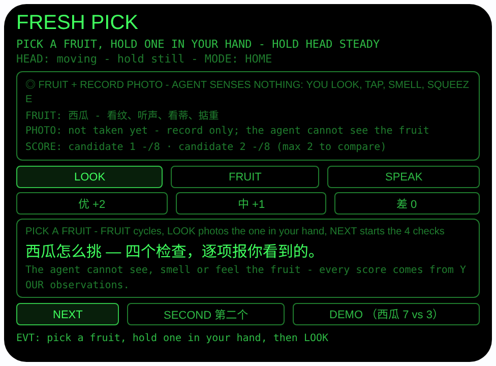
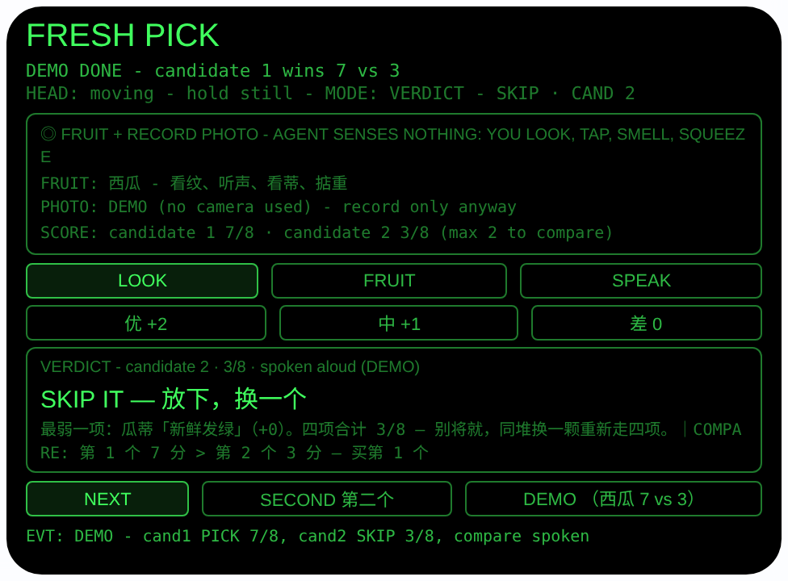

# fresh-pick — 生鲜挑手（Rokid 眼镜 AIUI Agent）

**Studio 导入地址**（复制到 Global AIUI Studio 的 Import Project 输入框）：

```
https://github.com/sakai55/rokid/tree/agent-fresh-pick
```


50 个「指向性生活问题」Agent 的第 Z23 个。不会挑水果的人，
买回家切开才发现没熟、过熟或已经坏了。本 Agent 不替你看
水果——它感测不到任何东西。它做的是把老手的挑选方法拆成
四步摆在你眼前：你手里拿着哪颗，就逐项用你自己的眼睛、
耳朵、手和鼻子检查，把观察到的结果报给它，它负责打分、
给结论、点名最弱的一项，还能给第二颗打分，两颗比一比。

## 预览截图

截图统一存放于仓库根目录 `screenshots/fresh-pick/`。





## 解决的问题

挑水果的经验全在手上和耳朵里：敲一敲、掂一掂、闻一闻、
看蒂头——新手不是不知道这些动作，而是记不全、顺序乱、
拿不准标准。本 Agent 把每一颗的挑选变成不能跳步的四项
核查挂在视线上：你看着哪颗、手里拿着哪颗，就核查哪颗；
四项走完分数自动出来，两颗还能直接比高低，不用腾手
翻手机搜「西瓜怎么挑」。

## 指向性设计（为什么必须用眼镜）

- **凝视即指向（GAZE）+ 手中物拍照（default）**：看着
  你手里正挑的这颗点头，或点 LOOK，用
  `ImageCapture.takePhoto({mode:'default'})` 拍下留档
  ——你看着的那颗就是正在打分的那颗，不用报名字、不用
  区分左右。
- **头部稳定 = 凝视确认，点头只确认不替选**：
  `enableWorldAwareness()` 后 `onOrientationStabilityChange`
  报告头部稳定（HEAD STEADY）；点头（`onHeadGesture` 的
  `nod`）在核查中只「确认你已经选好的那一项」——绝不
  替你选，更不会自动挑最好的那档（同 #22 的先选后确认
  纪律）。没选就点头/确认会被拦下并提示先选。
- **感测的是你，不是水果（诚实边界）**：AIUI 运行时
  没有把照片变成成熟度结论的链路——本 Agent 不把照片
  送 LLM、不使用 LLM（产品选择；平台本身支持照片经
  data: URL 送入模型），也没有图像分类。所以每一分
  都来自佩戴者亲眼、亲手、
  亲耳、亲鼻报的观察，Agent 只做「结构化清单 + 计分 +
  点名弱项」。界面全程标注 「every score comes from
  YOUR observations」。
- **结论自动出声 + 两颗对比（PLAN 的「那颗更熟」）**：
  出分即 TTS 朗读结论；第二颗走完后直接给对比行与
  朗读「第一个分更高，买第一个」——不用记着第一颗的
  分数心算，老手说的「左边那颗更熟」在这里是两轮真实
  观察的分数差。

## 功能流程

1. 选水果：FRUIT 在 5 种内置水果间切换（西瓜 / 牛油果 /
   芒果 / 香蕉 / 桃子），每种四个真检查、按老手顺序排：
   西瓜「纹路→敲声→瓜蒂→重量」、牛油果「表皮色→轻捏
   回弹→蒂头下颜色→晃动核声」、芒果「香味→软硬→斑点
   →果形」、香蕉「颜色→斑点→果柄→硬度」、桃子
   「香味→底色→绒毛→轻捏」；FRUIT 只在首页可换，
   挑到一半不许换水果防串账
2. 把一颗拿在手里，看着它稳住头 → 点头，或点 LOOK →
   default 模式拍照（只作记录），显示字节数
3. 点 NEXT 开始核查：一次一项，大字提示（如「轻敲瓜身
   — 听是什么声」），三个选项按钮就是这一项的三种观察
   （好 +2 / 中 +1 / 差 0）；先点你真正观察到的那项，
   再 NEXT / Enter / 点头确认记入（方向键可轮换已选项）
4. 四项走完自动出结论（自动朗读）：
   - 合计 ≥7 → **PICK IT — 熟度正好，买它**
   - 合计 4–6 → **OK — 能买**，每种水果各有说法：
     牛油果「再放 1–2 天」、芒果/桃子「再放 1 天」、
     香蕉「再放半天到一天」；西瓜采后不后熟，只写
     「熟度中等」
   - 合计 ≤3 → **SKIP IT — 放下，换一个**
   - 每个结论都附「为什么」：点名四项中得分最低的一项
     （如「最弱一项：敲声『闷声』（+1）」），那正是
     下一颗要先看的地方；四项全好时报最弱项为满分项
5. 对比：结论页点 SECOND（或点头），把另一颗拿在手里
   再走同样四项（最多比 2 颗）；第二颗出分后显示对比
   行「第 1 个 7 分 > 第 2 个 3 分 — 买第 1 个」并朗读；
   同分则报「两个都是 X 分 — 一样好，拿顺手的那个」
6. SPEAK 重读当前检查提示或结论；结论页（两颗比完后）
   点 NEXT / 点头回到首页开始新一轮（水果保留，分数
   清空）
7. DEMO 按钮：西瓜第一颗报好观察（2/2/2/1 = 7 分 →
   PICK IT）、第二颗报弱观察（1/1/0/1 = 3 分 →
   SKIP IT），直接走到带对比行的结论页

> 安全与边界说明：分数是经验规则，不是检测结果——检查
> 项与打分按常见挑选经验写死在内置表里，品种、产地、
> 季节都会影响判断（如某些西瓜品种纹路天生浅）。本
> Agent 不判断食品安全：已经发霉、异味冲鼻的东西不要
> 因为分数犹豫，直接别买。

## 权限

| 权限 | 用途 |
|---|---|
| CAMERA | 取流并以 default 模式拍摄手里正挑的那颗水果（只作影像记录，不参与识别，成熟度由用户亲身观察后逐项报告、由 Agent 计分） |

相机只在用户触发时启动：拍完立即停掉全部媒体轨道。
分数与结论只在内存里，不落盘、不持久化任何数据。

## 打包与预览

```bash
cd ~/workspace/rokid/fresh-pick
~/tools/bin/aix pack . -o ../dist/fresh-pick.aix
~/tools/bin/aix preview . --html-out artifacts/preview.html
```

本地预览截图走 `~/workspace/preview-tools/` 的本地 Ink + puppeteer 路线
（`shot-fresh.js`；结论截图的点击序列为 canvas 内 DEMO (373, 302)，
坐标经视觉定位确认；核查态另行实测过 NEXT (67, 302) → 选项 (90, 195)
→ NEXT，动态选项按钮与先选后确认均正常）。

## 真机测试（海外版 · 云端下发 · Path 1）

1. 推到 GitHub 后，Global AIUI Studio（aiui-global.rokid.com，en-US）用
   分支导入：`https://github.com/sakai55/rokid/tree/agent-fresh-pick`
   （该分支根目录即本 Agent 文件）
2. Studio 的 **Device Debug** 页签填 Basic Information，在 AIX Packaging
   点 **Repackage and Save**，确认顶部出现绿色
   **● Debug version ready — Ready for device debugging**
3. **Hi Rokid**（海外版 `com.rokid.sprite.global.aiapp`，不是国内版
   Rokid Ai App）→ 设置 → 开发者选项 → AIUI → 更新眼镜资源包，
   等「智能体资源包下载成功」
4. 对眼镜说「乐奇，打开 fresh-pick」，去水果摊/超市实测：同堆西瓜
   挑两颗走完四项 + SECOND 对比，看分数与切开后的实际熟度是否
   对得上；再试牛油果（捏/看蒂）和香蕉各一轮，核对结论页与
   TTS 朗读是否正确、及时

## 真机测试信息（Global AIUI Studio · Device Debug）

| 项目 | 值 |
|---|---|
| Agent Name（Studio） | 待导入后回填 |
| Version（Build） | 1.0.1（待导入后回填） |
| App Category | 待导入后回填 |
| Intent Description | 待导入后回填 |
| Agent ID | 待导入后回填 |
| AIX Package Size | 约 19.5 KB（本地打包 `dist/fresh-pick.aix`） |
| 状态 | 本地完成，待导入 Studio |
| Studio | aiui-global.rokid.com（en-US） |
| 下发方式 | 云端下发 → Hi Rokid（海外版）更新眼镜资源包 |

## 验证情况

**已验证**

- 静态检查：app.json / package.json JSON 解析通过；`<script def>` JSON
  解析通过；`<script setup>` 与 app.js 提取后 `node --check` 语法通过；
  全目录 grep 无 `Page(` / `App(` / `Widget(` / `workers:` 残留。
- 打分/结论/对比逻辑（Node 实测）：把页面对象以 wx 打桩加载进
  Node，共 81 条断言全过——含水果表形状（5 种 × 4 项 ×
  选项分值恒为 2/1/0、西瓜四项与敲声选项与设计一致）、
  结论边界（7 分 PICK、6 分与 4 分 OK、3 分与 0 分 SKIP、
  8 分满分 PICK）、各水果 OK 文案（牛油果「再放 1–2 天」、
  西瓜只写「熟度中等」不虚构后熟）、为什么行点名最低分
  项（并列取第一项、全满分时文案合理）、对比三态
  （第 1 个赢 / 第 2 个赢 / 同分）、完整流程（未选确认被
  拦、逐项推进、出分自动朗读、SECOND 第二颗、第三颗被
  拒、结论页 FRUIT 被拦、重置回首页、选项在核查外被
  拦）、DEMO 全程（两颗 7 vs 3、对比行与朗读）。
- 打包：`aix pack` 成功；`aix list` 核对包内含 README.md、AGENTS.md、
  app.js、app.json、package.json、pages/index/index.ink
  （artifacts/ 已被 .aixignore 排除）。
- 预览渲染：aix preview + 本地 Ink + puppeteer 截图两张（见下方
  Preview Media）：首页初始态完整渲染（水果行西瓜 + 照片行 +
  分数行、LOOK/FRUIT/SPEAK、优/中/差选项行与 NEXT/SECOND/
  DEMO 按钮及挑选提示框）；另行点 NEXT 实测核查态：第 2/4 项
  「敲声」的选项按钮正确变为该项的三种观察（清脆嘭嘭 / 闷声 /
  沙哑发空），页脚确认第 1 项已按「清晰深刻（+2）」记入；点
  DEMO 后到达两颗对比结论态：分数行 7/8 与 3/8、大字
  「SKIP IT — 放下，换一个」、为什么行点名瓜蒂「新鲜发绿」
  （+0）、对比行「第 1 个 7 分 > 第 2 个 3 分 — 买第 1 个」
  均正确渲染。

**未验证**

- 真机相机取流与 default 模式拍手中水果的记录效果（预览主机无
  相机，LOOK 的 FAIL 路径已如实写明原因，真机待测）。
- 真机头部稳定检测、点头确认选项、结论与对比的自动 TTS 朗读
  及时性（菜场/超市环境噪声下待测）。
- **识别方式的产品边界**：本 Agent 不看、不闻、不摸水果——
  成熟度结论全部来自用户自己报告的观察，照片只作记录；
  检查项与分数是内置的经验规则，品种/季节差异不在覆盖
  范围内。这是已知边界，不是待补的验证项。
- **挑选准确率**：分数与切开后实际熟度的一致性只能靠真机
  在真实水果摊上多轮实测（不同品种、不同季节），本地无法
  验证。

---

## 提审资料（Review Submission）

> Global AIUI Studio → Submit 页签的 Review Information 逐项对应下面四段，
> 提交时整段复制。每次提交前重新确认 Preview Media。

### Feature Description

Fresh Pick teaches you to choose fruit like an old hand. Pick a fruit - watermelon, avocado, mango, banana or peach - hold one in your hand, and the agent walks you through the four checks experienced shoppers actually use: stripes, knock sound, stem, weight. You report what you see, hear, smell and feel; it scores your observations out of 8 and says PICK IT, OK or SKIP IT, naming the weakest check. Score a second one and it tells you which to buy.

### Opening Message

Hi, I'm **Fresh Pick** - I can't see the fruit, but I know how to choose it.

Pick a fruit with **FRUIT**, hold one in your hand, **LOOK** for a record photo, then **NEXT**: I'll walk you through 4 real checks - look, tap, smell, squeeze. Tap what you actually observe, confirm with **NEXT** or a nod, and I'll score it out of 8: **PICK IT**, **OK**, or **SKIP IT**, with the weakest check named. Tap **SECOND** to score another one and I'll tell you which to buy.

### Preview Media

提交要求：3–5 个 JPG/PNG 图片或 MP4 视频，至少含 1 张图和 1 个视频，每次提交前重新确认。

- Image 1：`artifacts/preview-fresh-pick-index.png`（aix preview 首页：FRESH PICK 初始态，含水果/照片/分数行、LOOK/FRUIT/SPEAK 与优/中/差选项行、NEXT/SECOND/DEMO 按钮及挑选提示框，本地文件，提交时从本地上传）
- Image 2：`artifacts/preview-fresh-pick-verdict.png`（DEMO 走完两颗西瓜打分后的对比结论态：分数行 7/8 与 3/8、大字「SKIP IT — 放下，换一个」+ 为什么行点名最弱项 + 对比行「买第 1 个」+ DEMO 标注，本地文件）
- Video：待真机补 — 真机录制「拿起一颗西瓜 → 点头拍照 → 逐项敲/看/掂并报告 → 出分结论 → SECOND 第二颗对比」全过程（MP4），录好后放 `artifacts/` 并更新此处
- 状态：未齐（已有 2 张图；还需至少 1 个视频，总数补到 3–5 个后才可提交）

### Change Log

#### Build 1.0.1

**Features added**

- None (documentation-accuracy fix only).

**Improvements**

- None.

**Fixes**

- Corrected a capability premise in the docs: README/AGENTS.md previously stated photos "cannot be sent to an LLM" as a platform fact. Per the official capability dossier (LanguageModel image input accepts image_url, including data: URLs), photos CAN be sent to the model. Fresh Pick still sends no photo and uses no LLM — that is a product choice, now stated as such (capability-boundary audit 2026-10-24).

#### Build 1.0.0

**Features added**

- Guided fruit picking for 5 fruits (watermelon, avocado, mango, banana, peach): each fruit gets the 4 real checks an experienced shopper uses, in shopper order - e.g. watermelon stripes, knock sound, stem, weight; avocado skin colour, squeeze rebound, stem-cap colour, seed rattle. You report what you observe (good +2 / middling +1 / bad 0 per check), picked first and confirmed with NEXT, Enter or a nod; a nod never picks for you and never picks the best option.
- Scored verdict spoken aloud: totals out of 8 - 7+ PICK IT, 4-6 OK with per-fruit wording (avocado "wait 1-2 days", banana "wait half a day to a day", watermelon honestly labelled middling since it does not ripen after picking), 3 or less SKIP IT. Every verdict names the lowest-scoring check as the reason, so you know what to look at first on the next one.
- Two-candidate compare: after a verdict, SECOND scores another candidate of the same fruit through the same 4 checks (max 2), then shows and speaks the comparison - "candidate 1 scores higher, buy candidate 1" - or calls a tie.
- Gaze-directed record photo: head-stability gaze confirmation (HEAD STEADY), nod or LOOK photographs the candidate in your hand in default mode (record only); DEMO scores a strong watermelon (7, PICK IT) against a weak one (3, SKIP IT) and lands on the comparison verdict, no camera needed.

**Improvements**

- None (initial release).

**Fixes**

- None (initial release).
