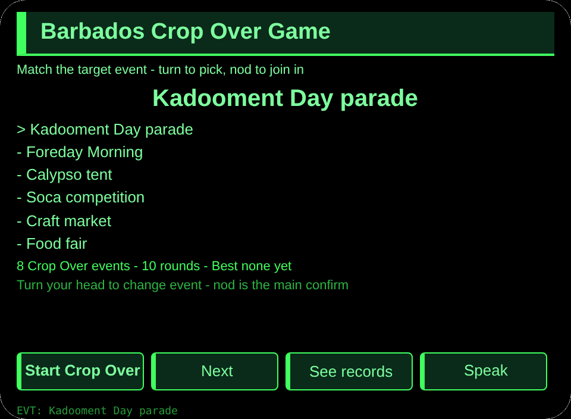
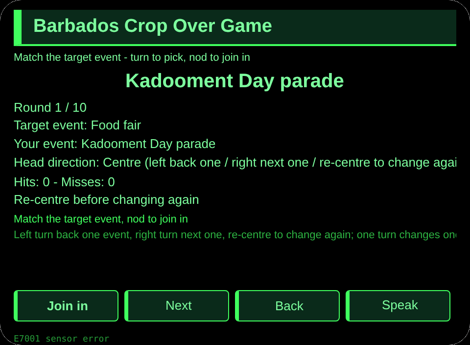
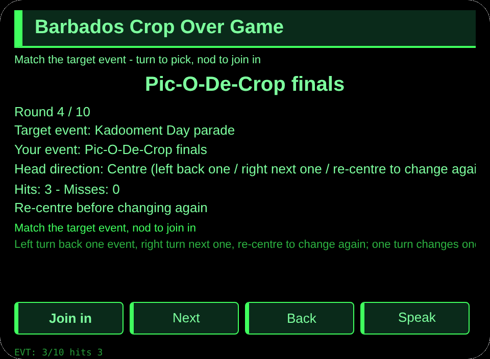
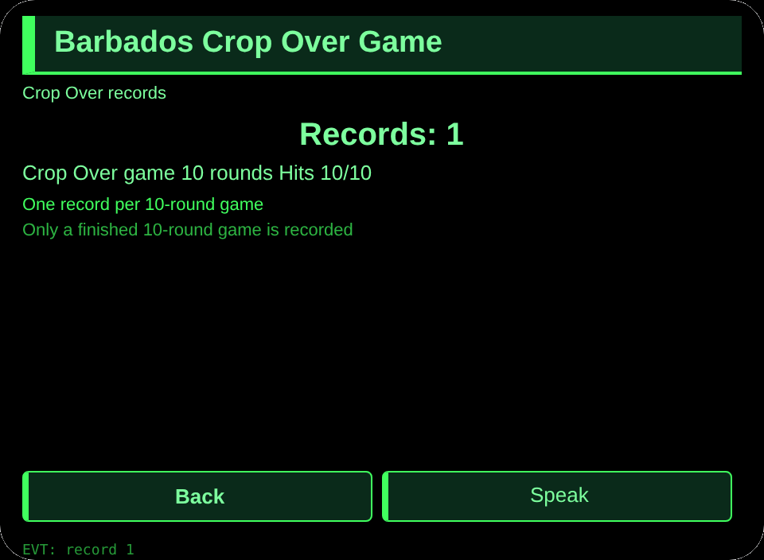

# Barbados Crop Over Game

**Studio import address** (copy into the Global AIUI Studio Import Project box):

```
https://github.com/sakai55/rokid/tree/agent-barbados-crop-over-game
```

[barbados-crop-over-game.aix](https://raw.githubusercontent.com/sakai55/rokid/main/aix/barbados-crop-over-game.aix)

## Features

At a family gathering during Crop Over, family members use only head direction to pick a festival event and nod to join in, settling the score over 10 rounds and keeping the best across sessions.

## Scene

At a family gathering during Crop Over, family members use only head direction to pick a festival event and nod to join in, settling the score over 10 rounds.

## Direction composition

Barbados local scene x game x directional (head-turn event picking). Three gates: scene (a Crop Over family gathering, playing together on one pair of glasses); loop (start, head-pick an event, nod to join in, 10 rounds, settle with a score); thickness (8 real Crop Over events + fixed 10-round sequence + best records across sessions). Game carries the play loop; directional carries the head-turn event picking.

## Glasses-only capability

Head-direction coordination + nod as the main confirm: turn the head to pick a festival event, nod to join in, no phone in hand during play. Wiring: pages/play/index.ink _startSensor + _onYaw (re-centre to re-arm, left back one / right next one, one step per turn, never spin) + onHeadGesture nod triggers primaryTap to join in; buttons pick an event when the sensor is off.

## Pages

| Pages | Pages |
|---|---|
| pages/index | 8 Crop Over events and best score |
| pages/play | 10 rounds of event matching, nod to join in, settle with a score |
| pages/record | Crop Over records |

## Content set

8 real Crop Over events: Kadooment Day parade, Foreday Morning, Calypso tent, Soca competition, Craft market, Food fair, Grand Kadooment costumes, Pic-O-De-Crop finals. 10-round fixed target sequence [5, 2, 7, 0, 4, 1, 6, 3, 5, 2] written in code.

## Cross-session storage

Storage key `barbadosCropOverGameV1` (best score, settled records, lastError).

## Permissions

No declared permissions. Speech is host-managed and needs no declaration.

## Gesture map

| Single tap | Enter | Main confirm |
| Swipe up / down | ArrowUp / ArrowDown | Change selection |
| Nod | onHeadGesture('nod') | Same as main confirm |
| Double tap | Backspace | Back |

## Error codes

- `E5001` Storage write failed
- `E5002` Storage read failed
- `E3005` Speech failed
- `E8001` Navigation failed
- `E7001` Head sensor unavailable or read failed

- Scores come only from real nods and taps; no score is invented.
- One head turn changes only one event; re-centre before changing again, never spin.
- The target sequence is fixed in code, not claimed random.
- Without a sensor, buttons pick an event; scoring stays the same. Sensor failure shows E7001.

## Preview screenshots






## Review Submission

### Feature Description

At a family gathering during Crop Over, family members use only head direction to pick a festival event and nod to join in, settling the score over 10 rounds and keeping the best across sessions.

### Opening Message

Crop Over time! Match the target event, nod to join in, 10 rounds to settle the winner.

### Preview Media

[preview-barbados-crop-over-game-video.mp4](https://raw.githubusercontent.com/sakai55/rokid/main/screenshots/barbados-crop-over-game/preview-barbados-crop-over-game-video.mp4)


### Change Log

- Features：First release features as above.
- Improvements：None.
- Fixes：None.

## Device test info

| Studio name | To be filled |
|---|---|
| Studio name | To be filled |
| Version / Build | To be filled |
| App Category | To be filled |
| Intent Description | To be filled |
| Agent ID | To be filled |
| Status | To be filled |
