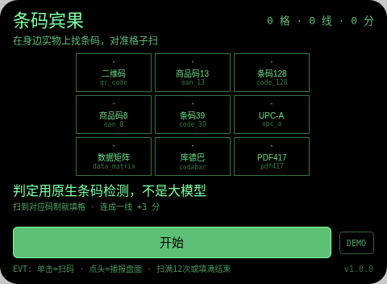
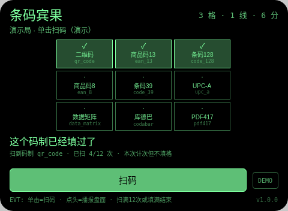
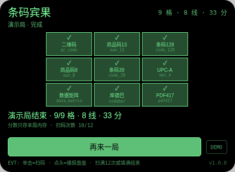

# 条码宾果 Barcode Bingo

**Studio 导入地址**（复制到 Global AIUI Studio 的 Import Project 输入框）：

```
https://github.com/sakai55/rokid/tree/agent-barcode-bingo
```

拍照现实交互游戏系列 GA44。3×3 宾果盘固定 9 个码制格：二维码、商品码13、条码128、商品码8、条码39、UPC-A、数据矩阵、库德巴、PDF417。在身边实物（包装、书、票据、设备标签）上找条码，对准单击扫码。

与指向性系列 parcel-sort（扫码分拣包裹的登记工具）的区别：parcel-sort 是把包裹码登记归类的活儿；本作不登记任何内容，只认码制填格凑线，是宾果游戏。检测到的码内容只在判定行里短暂显示前 18 字，不保存。

## 预览截图





## 玩法

1. 3×3 宾果盘固定 9 个码制格：二维码、商品码13、条码128、商品码8、条码39、UPC-A、数据矩阵、库德巴、PDF417。在身边实物（包装、书、票据、设备标签）上找条码，对准单击扫码。
2. 拍照（wide）后用原生 BarcodeDetector 检测码制：命中未填格就填格 ✓；重复码制或盘上没有的码制，本次计次但不填格；没扫到码不计次可重扫。最多扫 12 次，填满 9 格提前结束。
3. 计分 = 填格数 + 连线数 × 3（行/列/对角共 8 条线）。点头播报当前盘面（已填几格、几线、已扫几次）。

## 手势映射

| 手势（镜腿触控板） | 键事件 | 在本 Agent 中的作用 |
|---|---|---|
| 单击 | Enter | 开始 / 扫码 / 再来一局 |
| 滑动 | ArrowUp / ArrowDown | 不用滑动 |
| 点头 | onHeadGesture('nod') | 播报盘面（已填格数 / 连线数 / 已扫次数） |
| 双击 | Backspace | 系统返回（不拦截） |
| 长按 | — | 唤醒助手（系统级，不拦截） |

屏幕上只有一个主按钮（样式随本款形态单独定型）与一个 DEMO 演示键：DEMO 只在网页预览等无相机/无大模型环境里走标注清楚的演示局（预置结果），真机正常游玩走主按钮的真实拍照判定路径。

## 判定链路

takePhoto(wide) → Blob → createImageBitmap → 原生 BarcodeDetector.detect() 读 format；不用大模型判定（本系列唯一例外，PLAN 指定）。扫不到码不计次，格式以检测返回的 format 名为准。

判定期间显示「判定中…」等待态。每轮结果都经 TTS 播报。判定是大模型（或原生检测）给的，可能出错——见下。

## 技术诚实说明

- 码制名以 BarcodeDetector 返回的 format 为准；宿主支持的码制以 getSupportedFormats 为上限，盘上某种码制若宿主不支持检测，就永远填不上——真机首测要先核对 9 种码制的支持情况，如实记录。
- 同一实物上的码只能提供它自身的码制，凑满盘需要真的找齐不同码制的实物；照片不保存，码内容不落盘。
- 本机无 BarcodeDetector 时明示不可用，只提供标注的演示局，绝不假装扫到码。
- 平台没有连续视频理解：每轮都是一次离散拍照判定，不存在实时 AR 式连续识别（这是 stream-probe 探针的实测结论口径）。
- 计分只存本局内存：不调任何存储 API，不落盘、不造排行榜。

## 权限

`CAMERA` 一项：拍照判定必需。代码不使用定位与麦克风采集（TTS 播报不需 RECORD_AUDIO），故只声明这一项。

## 打包与预览

```bash
cd ~/workspace/rokid/git-rokid-photo/games/barcode-bingo
~/tools/bin/aix pack . -o barcode-bingo.aix
~/tools/bin/aix preview . --html-out artifacts/preview.html
```

打包大小 13.52 KB（打包在 README/AGENTS 定稿后执行，`aix list` 已核验包内含 README.md 与 AGENTS.md）。

## 真机测试（GO 的 Path 1，无线缆）

1. 将本项目导入 Global AIUI Studio（GitHub 导入分支 `agent-barcode-bingo`）。
2. 在 Studio 中构建并保存新的 AIX 版本（构建与提审）。
3. 手机 Hi Rokid App：设置 → 开发者选项 → AIUI → 更新眼镜资源包，等到「智能体资源包下载成功」。
4. 在眼镜上语音打开：「乐奇，打开条码宾果智能体」。
5. 验收点：首测先核对宿主实际支持的码制清单与盘面 9 格的对应；扫一个二维码确认填 qr_code 格；重复扫同一码确认提示已填过且计次；扫一个盘外码制（如 aztec）确认提示盘上没有；凑成一线确认 +3 分与播报；扫满 12 次或填满 9 格确认结算。

## 真机测试信息

| 字段 | 值 |
|---|---|
| Studio 名称 | 条码宾果（待导入后回填） |
| Version / Build | 1.0.1 / 待导入后回填 |
| App Category | 待导入后回填 |
| Intent Description | Barcode bingo game for Rokid glasses: fill a 3x3 card of barcode formats by scanning real codes with the native BarcodeDetector; lines score bonus points, 12 scans max. Camera only. |
| Agent ID | 待导入后回填 |
| 状态 | 未真机验证 |

## 验证情况

**已验证（本地）**
- 静态校验：app.json、package.json 解析通过；从 .ink 抽出的 `<script setup>` 与 app.js 均 `node --check` 通过；无 `Page(`/`App(`/`Widget(` 误用；权限只有 CAMERA 且与实际使用一致；CSS 只用绿色色阶（最亮 `#7dff9e`，无 `#ffffff`、无白色 rgba）。
- 网页预览实跑：用本地 Ink 运行时管线打开预览，点 DEMO 走完一局演示路径（判定为预置结果、全程标注演示局），就绪 / 进行 / 完成各状态截图已逐张目检，状态属实、互不重复。
- `aix pack` 成功，13.52 KB；`aix list` 确认包内含 README.md 与 AGENTS.md。

**未验证（如实说明）**
- 真机相机拍照质量、大模型图片判定的实际延迟与准确率、TTS 实际发声均待 GO 真机自测；判定延迟以 stream-probe 第 03 项真机结果为准（未测前按「判定中」等待态设计）。

## 提审资料 (Review Submission)

### Feature Description

> Barcode bingo on Rokid glasses. A 3x3 card holds nine barcode formats: QR, EAN-13, Code 128, EAN-8, Code 39, UPC-A, Data Matrix, Codabar, PDF417. Hunt real packaging, books and labels, snap a code, and the native BarcodeDetector - not an LLM - fills the matching cell. Filled cells score 1, completed lines score +3, twelve scans maximum. Nod speaks the board state. Camera only; photos are never saved.

### Opening Message

> ## 条码宾果
> 
> 3×3 宾果盘固定 9 个码制格：二维码、商品码13、条码128、商品码8、条码39、UPC-A、数据矩阵、库德巴、PDF417。在身边实物（包装、书、票据、设备标签）上找条码，对准单击扫码。
> 
> 判定仅供娱乐，有争议以你的目测为准；申诉只记录、永不改分。分数只存本局内存。

### Preview Media

- `preview-barcode-bingo-ready.png`
- `preview-barcode-bingo-playing.png`
- `preview-barcode-bingo-done.png`

> 正式提审需 3–5 个媒体文件且含 ≥1 段视频（≤60 s），视频待 GO 真机自测时补录。

### Change Log（Build 1.0.0）

**Features added**

- 条码宾果全流程：3×3 宾果盘固定 9 个码制格：二维码、商品码13、条码128、商品码8、条码39、UPC-A、数据矩阵、库德巴、PDF417。在身边实物（包装、书、票据、设备标签）上找条码，对准单击扫码。
- 判定链路：takePhoto(wide) → Blob → createImageBitmap → 原生 BarcodeDetector.detect() 读 format；不用大模型判定（本系列唯一例外，PLAN 指定）。扫不到码不计次，格式以检测返回的 format 名为准。
- 手势优先：单击开始 / 扫码 / 再来一局；滑动不用滑动；点头播报盘面（已填格数 / 连线数 / 已扫次数）；每轮结果 TTS 播报，判定中显示等待态
- 诚实机制：判定失败如实记本轮失败不假判；申诉只记录不改分；照片只在内存判定不落盘；网页预览提供标注清楚的 DEMO 演示局

**Improvements**

- 无（首个版本）

**Fixes**

- 无（首个版本）

### Change Log（Build 1.0.1）

**Features added**

- 无

**Improvements**

- 无

**Fixes**

- 删除 FileReader（Ink 运行时不存在，真机必死）：照片 Blob→dataURL 改走官方文档路径 `blob.arrayBuffer()` + 分块 `btoa`，失败接全局错误码 E2005 并如实报错可重试。
