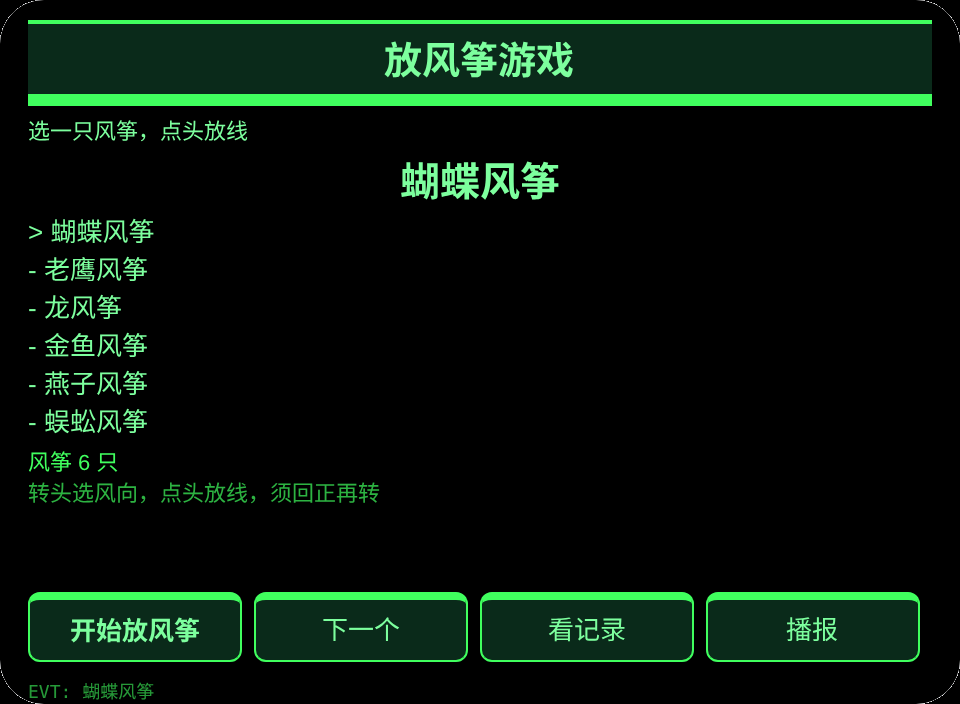
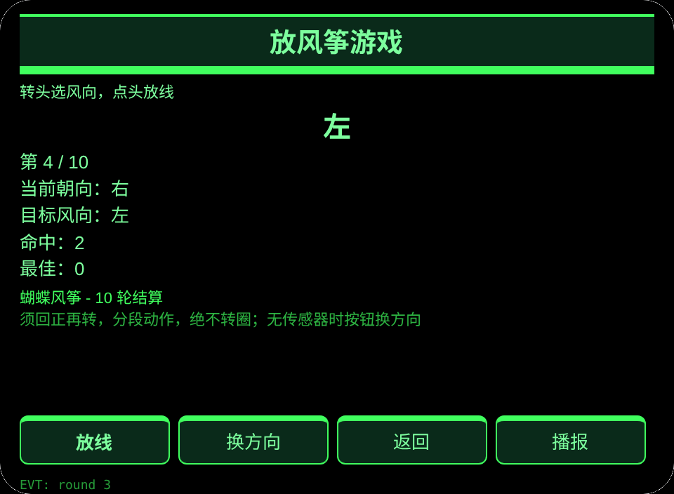
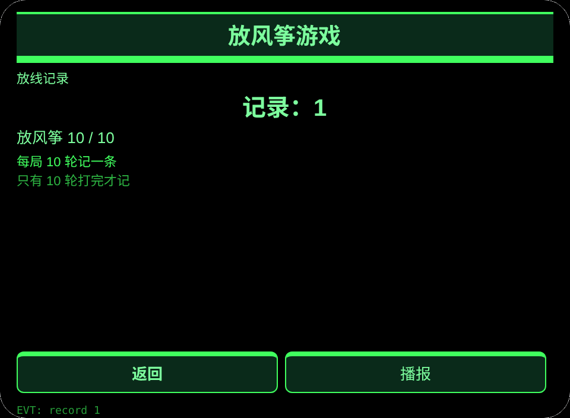

# 放风筝游戏

**Studio 导入地址**（复制到 Global AIUI Studio 的 Import Project 输入框）：

```
https://github.com/sakai55/rokid/tree/agent-china-kite-game
```

[china-kite-game.aix](https://raw.githubusercontent.com/sakai55/rokid/main/aix/china-kite-game.aix)

## 功能

中国家庭放风筝时只用头部方向选风向、点头放线，10 轮结算计分、成绩跨会话保存。

## 场景

中国家庭放风筝时只用头部方向选风向、点头放线，10 轮结算。

## 方向构成

中国在地 × 游戏 × 指向性（转头选风向）。

## 眼镜独占能力

视线与头部方向协调：放风筝时双手拉线，转头选风向、点头放线，不用掏手机。接线：pages/play/index.ink 的 _startSensor＋_onYaw＋点头触发 primaryTap 放线；须回正再转，分段动作，绝不转圈；无传感器时按钮换方向可玩，传感器失败显示 E7001。

## 页面

| 页面 | 页面 |
|---|---|
| pages/index | 6 只风筝 |
| pages/play | 10 轮放线结算 |
| pages/record | 放线记录 |

## 内容集

风筝 6 只：蝴蝶风筝、老鹰风筝、龙风筝、金鱼风筝、燕子风筝、蜈蚣风筝；每局 10 轮，目标风向左／右／中／左／中／右／右／左／中／右。

## 跨会话持久化

存储键 `chinaKiteGameV1`（已选风筝、最佳命中、放线记录、lastError）。

## 权限

无清单权限。语音播报不需要清单权限，相机与定位不用。

## 手势映射

| 单指点按 | Enter | 主确认 |
| 上滑／下滑 | ArrowUp / ArrowDown | 切换选项 |
| 点头 | onHeadGesture('nod') | 等同主确认 |
| 双击 | Backspace | 返回上一页 |

## 错误码

- `E5001` 存储写入失败
- `E5002` 存储读取失败
- `E3005` 语音播报失败
- `E8001` 页面跳转失败
- `E7001` 头部传感器不可用或读数失败

- 风向目标每局固定 10 轮，不声称测真实风速。
- 无传感器时按钮换方向可玩，传感器失败显示 E7001。
- 分数只来自真实点头与点按，不虚构分数。

## 预览截图






## 提审资料

### Feature Description

中国家庭放风筝时只用头部方向选风向、点头放线，10 轮结算计分、成绩跨会话保存。

### Opening Message

风筝拿好了，转头选风向、点头放线，我帮你记分。

### Preview Media

[preview-china-kite-game-video.mp4](https://raw.githubusercontent.com/sakai55/rokid/main/screenshots/china-kite-game/preview-china-kite-game-video.mp4)


### Change Log

- Features：首版功能见上文页面表。
- Improvements：无。
- Fixes：无.

## 设备测试信息

| Studio 名称 | 待填 |
|---|---|
| Studio 名称 | 待填 |
| Version / Build | 待填 |
| App Category | 待填 |
| Intent Description | 待填 |
| Agent ID | 待填 |
| 状态 | 待填 |
