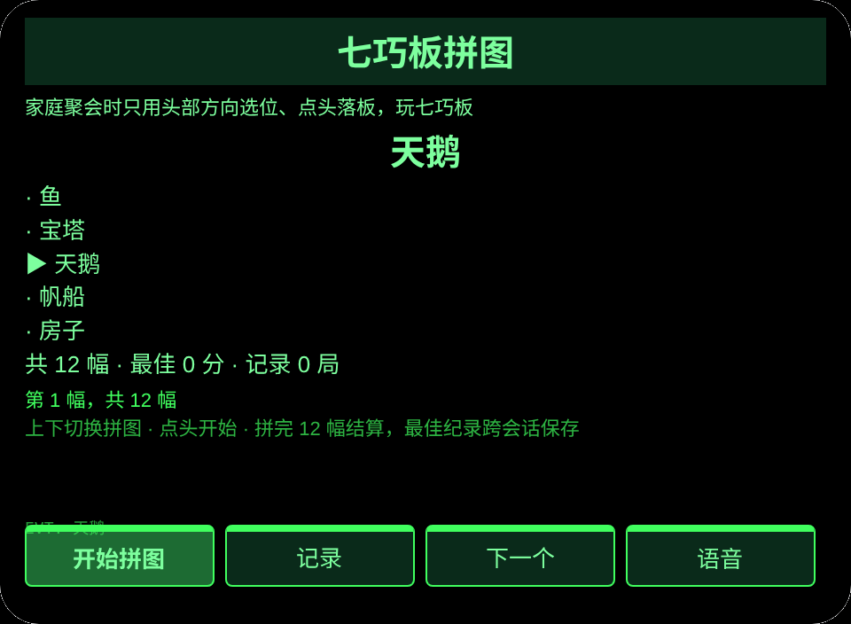
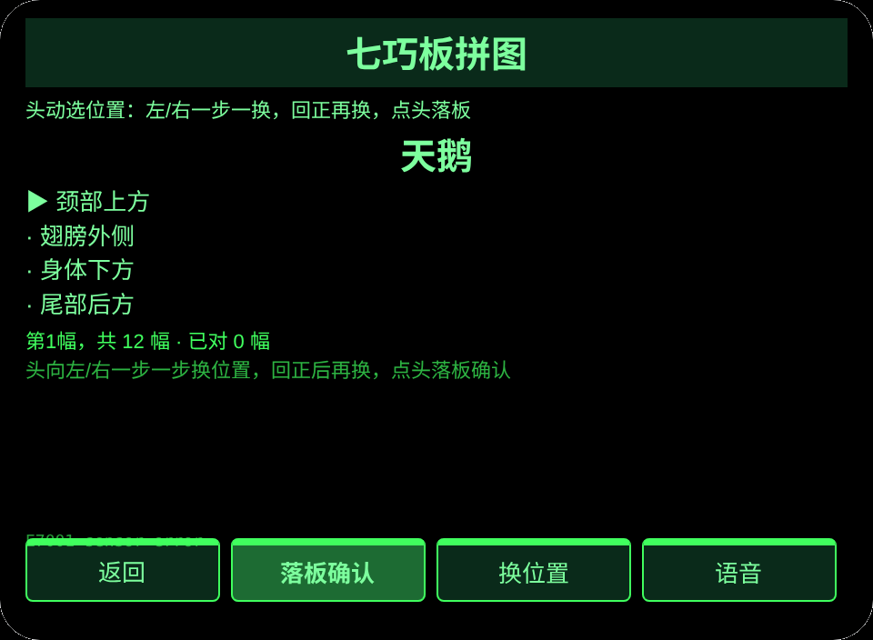
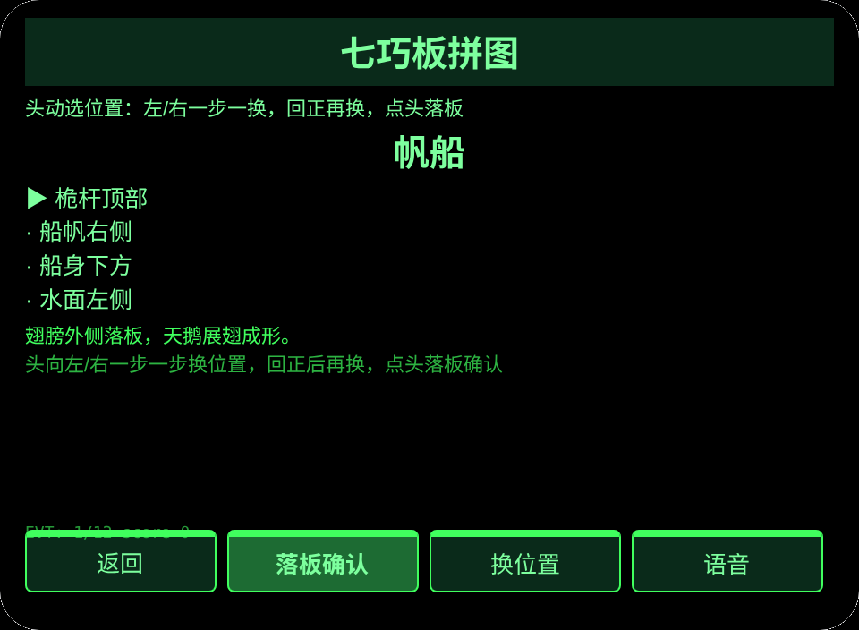
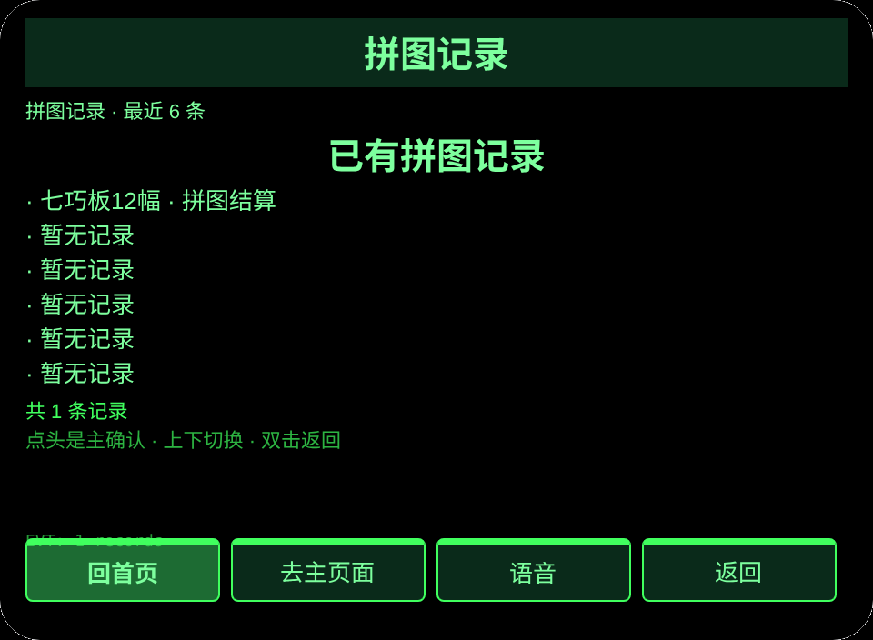

# 七巧板拼图

**Studio 导入地址**（复制到 Global AIUI Studio 的 Import Project 输入框）：

```
https://github.com/sakai55/rokid/tree/agent-china-tangram-game
```

**AIX 直接下载**（最新版）: [china-tangram-game.aix](https://raw.githubusercontent.com/sakai55/rokid/main/aix/china-tangram-game.aix)

GA54 · 中国在地 × 游戏 × 指向性。家庭聚会时家人只用头部方向选拼板位置、点头落板，玩七巧板拼图，12 图结算。

AIX 包大小：12920 B

## 预览截图






## 方向构成

中国在地 × 游戏 × 指向性。

## 结构与功能

index／play／record 共 3 页。首页浏览 12 幅拼图，拼图页头动选位、点头落板，12 幅后结算并保存最佳纪录；记录页看最近 6 局。

## 内容集计数

拼图 12 幅：天鹅、帆船、房子、猫、狗、兔子、山、桥、人跑步、蝴蝶、鱼、宝塔；每幅 4 个候选落板位置，共 48 个候选位置；结算按 12 幅计分，最佳纪录跨会话保存。

跨会话持久化：存储键 `chinaTangramGameV1`。

## 眼镜独占能力

视线与头部方向协调：`pages/play/index.ink` 的 `_startSensor` 用 `AbsoluteOrientationSensor`（typeof 守卫，yaw 阈值 ±0.35，回正强制：回正后才能再换一步，绝不转圈）选位，`onHeadGesture('nod')` 等价主确认落板；头动选位与点头落板是完成每幅拼图的必经步，按键只是兜底。

## 权限

无清单权限。头部传感器与 TTS 不需要清单权限。

## 诚实边界

- 本机只做屏上与语音呈现的流程，不承诺真机之外的能力。
- 失败时只显示裸错误码，不把英文报错原文直接上屏。
- 未登记、未测位、未到时的状态如实显示，不编造结果。

## 错误码

失败时在眼镜屏上显示裸码，TTS 只读码本身，最近一次错误写入持久化数据的 `lastError`（含码、本机 slug、版本与原文）。本机可能出现的码：

- `E5001` 记录保存失败（存储写入异常）
- `E5002` 记录读取失败（读取／解析异常）
- `E3005` 播报失败（TTS speak 异常）
- `E8001` 页面切换失败（navigateTo／navigateBack 异常）
- `E7001` 朝向传感器不可用或报错

## 设备测试信息

| Studio 名 | 未填写 |
| Version | 1.0.0 |
| App Category | 未填写 |
| Intent Description | 未填写 |
| Agent ID | 未填写 |
| 状态 | 未导入 |

## 提审资料

Feature Description: 家庭聚会时的七巧板游戏：只用头部方向选拼板位置、点头落板，拼完 12 幅结算并保存最佳纪录。

Opening Message: 不用动手点。转头选位置，点一下头就落板，12 幅拼完看你拼对几幅。

Preview Media:

- `preview-china-tangram-game-video.mp4`
- `preview-china-tangram-game-index.png`
- `preview-china-tangram-game-play.png`
- `preview-china-tangram-game-record-s2.png`

Change Log — Build 1.0.0:

- Features added: 初版
- Improvements: 无（初版）
- Fixes: 无（初版）
