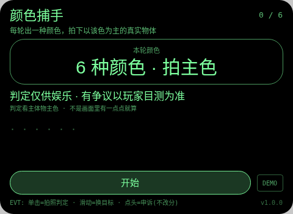
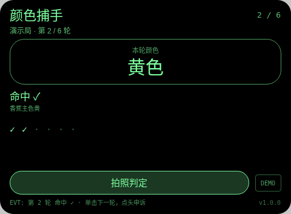
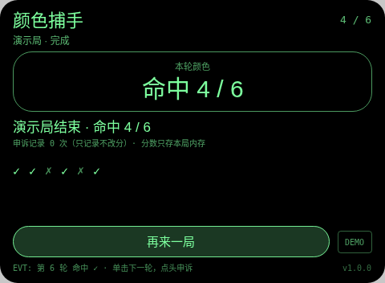

# 颜色捕手 Color Catch

**Studio 导入地址**（复制到 Global AIUI Studio 的 Import Project 输入框）：

```
https://github.com/sakai55/rokid/tree/agent-color-catch
```

拍照现实交互游戏系列 GA42。每轮出一种颜色（固定顺序：红 → 黄 → 蓝 → 绿 → 橙 → 紫），语音同步播报。找一个以该颜色为主色的真实物体，对准占满画面，单击拍照。

与路缘坡系列 CC04 color-order-check（按色序核对物品的辅助工具）的区别：那是给特定人群核对一排物品颜色顺序的工具；本作是出题—找色—拍照判定的计分游戏，判的是主体物主色，不是顺序核对。

## 预览截图





## 玩法

1. 每轮出一种颜色（固定顺序：红 → 黄 → 蓝 → 绿 → 橙 → 紫），语音同步播报。找一个以该颜色为主色的真实物体，对准占满画面，单击拍照。
2. 判定看的是主体物的主色：画面角落里有一点该颜色不算命中。照片送大模型图片输入，只回 `VERDICT:` + `REASON:`，本地解析计分，命中 +1。
3. 滑动可先跳到另一未拍颜色轮；判定后点头 = 记录申诉（不改分）；大模型不可用/格式不对，该轮如实记判定失败。

## 手势映射

| 手势（镜腿触控板） | 键事件 | 在本 Agent 中的作用 |
|---|---|---|
| 单击 | Enter | 开始 / 拍照判定 / 下一轮 / 再来一局 |
| 滑动 | ArrowUp / ArrowDown | 切换到上一个 / 下一个未判定目标（已判定的不重拍） |
| 点头 | onHeadGesture('nod') | 判定显示后 = 记录申诉（只记次数，永不改分）；判定前 = 重读本轮目标 |
| 双击 | Backspace | 系统返回（不拦截） |
| 长按 | — | 唤醒助手（系统级，不拦截） |

屏幕上只有一个主按钮（样式随本款形态单独定型）与一个 DEMO 演示键：DEMO 只在网页预览等无相机/无大模型环境里走标注清楚的演示局（预置结果），真机正常游玩走主按钮的真实拍照判定路径。

## 判定链路

takePhoto(default) → FileReader data: URL → LanguageModel 图片输入；提示词写明「主体物主色」口径，只回 `VERDICT:` + `REASON:` 两行，本地解析。

判定期间显示「判定中…」等待态。每轮结果都经 TTS 播报。判定是大模型（或原生检测）给的，可能出错——见下。

## 技术诚实说明

- 眼镜屏幕是单色绿，但相机照片是真实彩色，判定基于照片而非屏幕所见；颜色口径（主体物主色）在提示词里写死。
- 大模型对相近色（橙/粉、蓝/紫）可能判错；写明娱乐判定、以玩家目测为准，申诉只记录不改分。
- 照片只在内存判定，不落盘。
- 平台没有连续视频理解：每轮都是一次离散拍照判定，不存在实时 AR 式连续识别（这是 stream-probe 探针的实测结论口径）。
- 计分只存本局内存：不调任何存储 API，不落盘、不造排行榜。

## 权限

`CAMERA` 一项：拍照判定必需。代码不使用定位与麦克风采集（TTS 播报不需 RECORD_AUDIO），故只声明这一项。

## 打包与预览

```bash
cd ~/workspace/rokid/git-rokid-photo/games/color-catch
~/tools/bin/aix pack . -o color-catch.aix
~/tools/bin/aix preview . --html-out artifacts/preview.html
```

打包大小 13.87 KB（打包在 README/AGENTS 定稿后执行，`aix list` 已核验包内含 README.md 与 AGENTS.md）。

## 真机测试（GO 的 Path 1，无线缆）

1. 将本项目导入 Global AIUI Studio（GitHub 导入分支 `agent-color-catch`）。
2. 在 Studio 中构建并保存新的 AIX 版本（构建与提审）。
3. 手机 Hi Rokid App：设置 → 开发者选项 → AIUI → 更新眼镜资源包，等到「智能体资源包下载成功」。
4. 在眼镜上语音打开：「乐奇，打开颜色捕手智能体」。
5. 验收点：对着红色物体拍红色轮确认命中；对着蓝色物体拍红色轮确认没中且理由提到主色；拍一个角落带一点红色的画面确认不算命中（主色口径）；滑动切轮、点头申诉各验一次；6 轮走完确认结算。

## 真机测试信息

| 字段 | 值 |
|---|---|
| Studio 名称 | 颜色捕手（待导入后回填） |
| Version / Build | 1.0.0 / 待导入后回填 |
| App Category | 待导入后回填 |
| Intent Description | Photo color-matching game for Rokid glasses. Each round calls a color; the player photographs a real object whose main color matches, judged by host LLM image input (VERDICT YES/NO plus reason). Swipe switches rounds, nod logs a non-scoring appeal. Camera only; photos judged in memory, never saved. |
| Agent ID | 待导入后回填 |
| 状态 | 未真机验证 |

## 验证情况

**已验证（本地）**
- 静态校验：app.json、package.json 解析通过；从 .ink 抽出的 `<script setup>` 与 app.js 均 `node --check` 通过；无 `Page(`/`App(`/`Widget(` 误用；权限只有 CAMERA 且与实际使用一致；CSS 只用绿色色阶（最亮 `#7dff9e`，无 `#ffffff`、无白色 rgba）。
- 网页预览实跑：用本地 Ink 运行时管线打开预览，点 DEMO 走完一局演示路径（判定为预置结果、全程标注演示局），就绪 / 进行 / 完成各状态截图已逐张目检，状态属实、互不重复。
- `aix pack` 成功，13.87 KB；`aix list` 确认包内含 README.md 与 AGENTS.md。

**未验证（如实说明）**
- 真机相机拍照质量、大模型图片判定的实际延迟与准确率、TTS 实际发声均待 GO 真机自测；判定延迟以 stream-probe 第 03 项真机结果为准（未测前按「判定中」等待态设计）。

## 提审资料 (Review Submission)

### Feature Description

> Color hunt on Rokid glasses. Six rounds call a color by voice and screen: red, yellow, blue, green, orange, purple. Photograph a real object whose MAIN color matches; the host LLM image judge replies VERDICT YES/NO plus a reason. A speck of the color in a corner does not count. Swipe switches unattempted rounds; a nod after a verdict logs an appeal that never changes the score. Judging is for fun; the player's own eyes win disputes.

### Opening Message

> ## 颜色捕手
> 
> 每轮出一种颜色（固定顺序：红 → 黄 → 蓝 → 绿 → 橙 → 紫），语音同步播报。找一个以该颜色为主色的真实物体，对准占满画面，单击拍照。
> 
> 判定仅供娱乐，有争议以你的目测为准；申诉只记录、永不改分。分数只存本局内存。

### Preview Media

- `preview-color-catch-ready.png`
- `preview-color-catch-playing.png`
- `preview-color-catch-done.png`

> 正式提审需 3–5 个媒体文件且含 ≥1 段视频（≤60 s），视频待 GO 真机自测时补录。

### Change Log（Build 1.0.0）

**Features added**

- 颜色捕手全流程：每轮出一种颜色（固定顺序：红 → 黄 → 蓝 → 绿 → 橙 → 紫），语音同步播报。找一个以该颜色为主色的真实物体，对准占满画面，单击拍照。
- 判定链路：takePhoto(default) → FileReader data: URL → LanguageModel 图片输入；提示词写明「主体物主色」口径，只回 `VERDICT:` + `REASON:` 两行，本地解析。
- 手势优先：单击开始 / 拍照判定 / 下一轮 / 再来一局；滑动切换到上一个 / 下一个未判定目标（已判定的不重拍）；点头判定显示后 = 记录申诉（只记次数，永不改分）；判定前 = 重读本轮目标；每轮结果 TTS 播报，判定中显示等待态
- 诚实机制：判定失败如实记本轮失败不假判；申诉只记录不改分；照片只在内存判定不落盘；网页预览提供标注清楚的 DEMO 演示局

**Improvements**

- 无（首个版本）

**Fixes**

- 无（首个版本）
