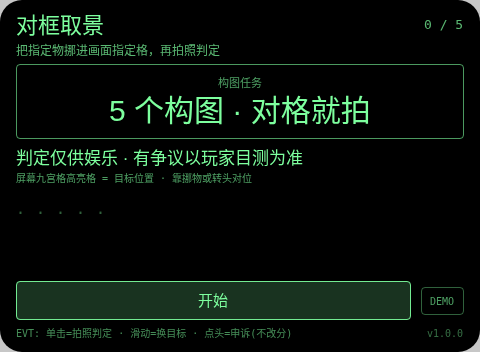
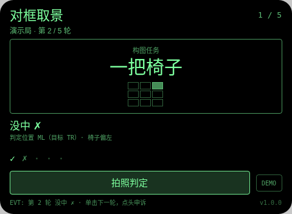
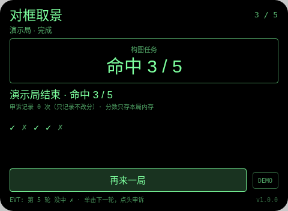

# 对框取景 Frame Align

**Studio 导入地址**（复制到 Global AIUI Studio 的 Import Project 输入框）：

```
https://github.com/sakai55/rokid/tree/agent-frame-align
```

拍照现实交互游戏系列 GA46。每轮给一个构图任务（固定顺序：书→左上、椅子→右上、杯子→正中、水瓶→左下、植物→右下），屏幕九宫格高亮目标格，语音同步播报。

与 games 系列 photo-level（拍照水平校准玩法）的区别：photo-level 判的是画面水平不水平；本作判的是目标物落在九宫格哪一格，是构图对位游戏，不测水平。

## 预览截图





## 玩法

1. 每轮给一个构图任务（固定顺序：书→左上、椅子→右上、杯子→正中、水瓶→左下、植物→右下），屏幕九宫格高亮目标格，语音同步播报。
2. 靠挪动物体或转头取景，把目标物主体挪进高亮格，单击拍照。大模型只报告它看到的区域代码（ZONE: TL/TC/TR/ML/C/MR/BL/BC/BR，找不到回 NONE），命中与否由本地拿 ZONE 与目标格比对计分——判定结果里会写明「判定位置 X（目标 Y）」。
3. 滑动可先跳到另一未做构图轮；判定后点头 = 记录申诉（不改分）；大模型不可用/没给 ZONE，该轮如实记判定失败。

## 手势映射

| 手势（镜腿触控板） | 键事件 | 在本 Agent 中的作用 |
|---|---|---|
| 单击 | Enter | 开始 / 拍照判定 / 下一轮 / 再来一局 |
| 滑动 | ArrowUp / ArrowDown | 切换到上一个 / 下一个未判定目标（已判定的不重拍） |
| 点头 | onHeadGesture('nod') | 判定显示后 = 记录申诉（只记次数，永不改分）；判定前 = 重读本轮目标 |
| 双击 | Backspace | 系统返回（不拦截） |
| 长按 | — | 唤醒助手（系统级，不拦截） |

屏幕上只有一个主按钮（样式随本款形态单独定型）与一个 DEMO 演示键：DEMO 只在网页预览等无相机/无大模型环境里走标注清楚的演示局（预置结果），真机正常游玩走主按钮的真实拍照判定路径。

## 判定链路

takePhoto(default) → FileReader data: URL → LanguageModel 图片输入，只回 `ZONE:` + `REASON:` 两行；本地把 ZONE 与本轮目标格比对计分（大模型只报位置，不直接判输赢）。

判定期间显示「判定中…」等待态。每轮结果都经 TTS 播报。判定是大模型（或原生检测）给的，可能出错——见下。

## 技术诚实说明

- 九宫格是按画面平均三等分的粗格，物体跨格时以「主体所在格」为准，大模型报的格与玩家目测可能差一格：写明娱乐判定、以玩家目测为准，申诉只记录不改分。
- 屏幕上的格是屏幕坐标，不是空间锚定：头一转格就跟着转，对位靠的是拍照那一瞬间的位置。照片只在内存判定，不落盘。
- 平台没有连续视频理解：每轮都是一次离散拍照判定，不存在实时 AR 式连续识别（这是 stream-probe 探针的实测结论口径）。
- 计分只存本局内存：不调任何存储 API，不落盘、不造排行榜。

## 权限

`CAMERA` 一项：拍照判定必需。代码不使用定位与麦克风采集（TTS 播报不需 RECORD_AUDIO），故只声明这一项。

## 打包与预览

```bash
cd ~/workspace/rokid/git-rokid-photo/games/frame-align
~/tools/bin/aix pack . -o frame-align.aix
~/tools/bin/aix preview . --html-out artifacts/preview.html
```

打包大小 14.09 KB（打包在 README/AGENTS 定稿后执行，`aix list` 已核验包内含 README.md 与 AGENTS.md）。

## 真机测试（GO 的 Path 1，无线缆）

1. 将本项目导入 Global AIUI Studio（GitHub 导入分支 `agent-frame-align`）。
2. 在 Studio 中构建并保存新的 AIX 版本（构建与提审）。
3. 手机 Hi Rokid App：设置 → 开发者选项 → AIUI → 更新眼镜资源包，等到「智能体资源包下载成功」。
4. 在眼镜上语音打开：「乐奇，打开对框取景智能体」。
5. 验收点：把书实际摆在画面左上拍确认命中且结果行写明判定位置 TL；把书摆到右下拍左上轮确认没中且位置写 BR 或相符值；让目标物缺席拍照确认回 NONE 记没中；滑动、点头申诉各验一次；5 轮走完确认结算。

## 真机测试信息

| 字段 | 值 |
|---|---|
| Studio 名称 | 对框取景（待导入后回填） |
| Version / Build | 1.0.0 / 待导入后回填 |
| App Category | 待导入后回填 |
| Intent Description | Photo framing game for Rokid glasses: put a named object into a named cell of a 3x3 grid, snap, and the host LLM reports the zone it sees for a local hit/miss compare. Camera only. |
| Agent ID | 待导入后回填 |
| 状态 | 未真机验证 |

## 验证情况

**已验证（本地）**
- 静态校验：app.json、package.json 解析通过；从 .ink 抽出的 `<script setup>` 与 app.js 均 `node --check` 通过；无 `Page(`/`App(`/`Widget(` 误用；权限只有 CAMERA 且与实际使用一致；CSS 只用绿色色阶（最亮 `#7dff9e`，无 `#ffffff`、无白色 rgba）。
- 网页预览实跑：用本地 Ink 运行时管线打开预览，点 DEMO 走完一局演示路径（判定为预置结果、全程标注演示局），就绪 / 进行 / 完成各状态截图已逐张目检，状态属实、互不重复。
- `aix pack` 成功，14.09 KB；`aix list` 确认包内含 README.md 与 AGENTS.md。

**未验证（如实说明）**
- 真机相机拍照质量、大模型图片判定的实际延迟与准确率、TTS 实际发声均待 GO 真机自测；判定延迟以 stream-probe 第 03 项真机结果为准（未测前按「判定中」等待态设计）。

## 提审资料 (Review Submission)

### Feature Description

> Framing game on Rokid glasses. Five composition tasks: book top-left, chair top-right, cup center, water bottle bottom-left, plant bottom-right. Move the object - or your head - until it sits in the highlighted cell, then snap. The host LLM only reports the 3x3 zone it sees (ZONE code); a local compare with the target cell scores the hit, and the result line shows both zones. Nod logs a non-scoring appeal.

### Opening Message

> ## 对框取景
> 
> 每轮给一个构图任务（固定顺序：书→左上、椅子→右上、杯子→正中、水瓶→左下、植物→右下），屏幕九宫格高亮目标格，语音同步播报。
> 
> 判定仅供娱乐，有争议以你的目测为准；申诉只记录、永不改分。分数只存本局内存。

### Preview Media

- `preview-frame-align-ready.png`
- `preview-frame-align-playing.png`
- `preview-frame-align-done.png`

> 正式提审需 3–5 个媒体文件且含 ≥1 段视频（≤60 s），视频待 GO 真机自测时补录。

### Change Log（Build 1.0.0）

**Features added**

- 对框取景全流程：每轮给一个构图任务（固定顺序：书→左上、椅子→右上、杯子→正中、水瓶→左下、植物→右下），屏幕九宫格高亮目标格，语音同步播报。
- 判定链路：takePhoto(default) → FileReader data: URL → LanguageModel 图片输入，只回 `ZONE:` + `REASON:` 两行；本地把 ZONE 与本轮目标格比对计分（大模型只报位置，不直接判输赢）。
- 手势优先：单击开始 / 拍照判定 / 下一轮 / 再来一局；滑动切换到上一个 / 下一个未判定目标（已判定的不重拍）；点头判定显示后 = 记录申诉（只记次数，永不改分）；判定前 = 重读本轮目标；每轮结果 TTS 播报，判定中显示等待态
- 诚实机制：判定失败如实记本轮失败不假判；申诉只记录不改分；照片只在内存判定不落盘；网页预览提供标注清楚的 DEMO 演示局

**Improvements**

- 无（首个版本）

**Fixes**

- 无（首个版本）
