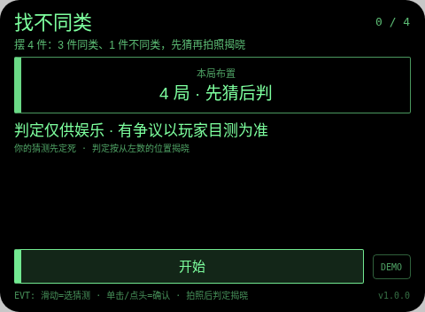
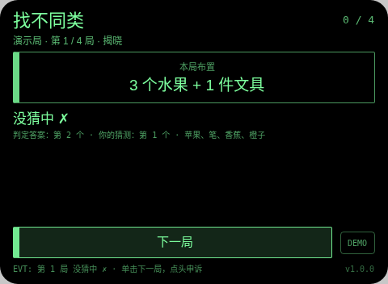
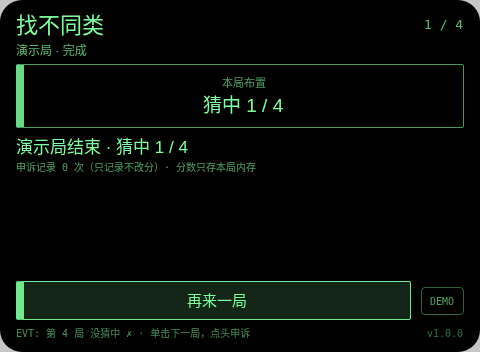

# 找不同类 Odd One Out

**Studio 导入地址**（复制到 Global AIUI Studio 的 Import Project 输入框）：

```
https://github.com/sakai55/rokid/tree/agent-odd-one-out
```

拍照现实交互游戏系列 GA47。每局给出布置（固定 4 局：水果组混文具、餐具组混玩具、文具组混厨具、鞋组混帽子）。把 4 件实物从左到右摆开。

与 JP 系列 gomi-sort（垃圾分类投放辅助）的区别：gomi-sort 是教你把垃圾分对类的生活工具；本作是玩家自己摆局、先下注猜测、再拍照揭晓的对赌式找茬游戏，分类只作裁判口径。

## 预览截图





## 玩法

1. 每局给出布置（固定 4 局：水果组混文具、餐具组混玩具、文具组混厨具、鞋组混帽子）。把 4 件实物从左到右摆开。
2. 先猜：滑动选「第几个是不同类」，单击或点头确认——猜测先定死，拍照后不许改口。然后对准 4 件物品拍照。
3. 大模型回 `ODD:`（不同类的位置）+ `ITEMS:`（从左到右 4 件物品名），本地拿 ODD 与你的猜测比对：猜中 +1。判定念出的物品清单会显示出来，它认错了物品一眼可见。

## 手势映射

| 手势（镜腿触控板） | 键事件 | 在本 Agent 中的作用 |
|---|---|---|
| 单击 | Enter | 开始 / 确认猜测 / 拍照判定 / 下一局 / 再来一局 |
| 滑动 | ArrowUp / ArrowDown | 移动猜测选项 |
| 点头 | onHeadGesture('nod') | 猜测阶段 = 确认猜测；判定显示后 = 记录申诉（不改分） |
| 双击 | Backspace | 系统返回（不拦截） |
| 长按 | — | 唤醒助手（系统级，不拦截） |

屏幕上只有一个主按钮（样式随本款形态单独定型）与一个 DEMO 演示键：DEMO 只在网页预览等无相机/无大模型环境里走标注清楚的演示局（预置结果），真机正常游玩走主按钮的真实拍照判定路径。

## 判定链路

takePhoto(default) → FileReader data: URL → LanguageModel 图片输入，只回 `ODD:` + `ITEMS:` 两行；本地解析位置与猜测比对计分。没给有效位置（0 或格式不对）记判定失败。

判定期间显示「判定中…」等待态。每轮结果都经 TTS 播报。判定是大模型（或原生检测）给的，可能出错——见下。

## 技术诚实说明

- 位置口径是从照片画面左到右数，玩家摆位时若没拉开间距或物品重叠，大模型可能数错位：判定行展示它认出的 4 件物品清单供核对；娱乐判定、以玩家目测为准，申诉（判定后点头）只记录不改分。
- 类别边界（如番茄算水果还是蔬菜）以大模型判定为准并写明，这正是本游戏的争议乐趣来源，但不假装客观。照片只在内存判定，不落盘。
- 平台没有连续视频理解：每轮都是一次离散拍照判定，不存在实时 AR 式连续识别（这是 stream-probe 探针的实测结论口径）。
- 计分只存本局内存：不调任何存储 API，不落盘、不造排行榜。

## 权限

`CAMERA` 一项：拍照判定必需。代码不使用定位与麦克风采集（TTS 播报不需 RECORD_AUDIO），故只声明这一项。

## 打包与预览

```bash
cd ~/workspace/rokid/git-rokid-photo/games/odd-one-out
~/tools/bin/aix pack . -o odd-one-out.aix
~/tools/bin/aix preview . --html-out artifacts/preview.html
```

打包大小 14.13 KB（打包在 README/AGENTS 定稿后执行，`aix list` 已核验包内含 README.md 与 AGENTS.md）。

## 真机测试（GO 的 Path 1，无线缆）

1. 将本项目导入 Global AIUI Studio（GitHub 导入分支 `agent-odd-one-out`）。
2. 在 Studio 中构建并保存新的 AIX 版本（构建与提审）。
3. 手机 Hi Rokid App：设置 → 开发者选项 → AIUI → 更新眼镜资源包，等到「智能体资源包下载成功」。
4. 在眼镜上语音打开：「乐奇，打开找不同类智能体」。
5. 验收点：按布置摆好 4 件，先滑动选猜测并确认，确认猜测锁定后进入拍照；拍照后确认 ITEMS 清单与实物顺序一致、ODD 位置属实；故意猜错一局确认判没猜中且分数不增；判定后点头确认只记申诉；4 局走完确认结算。

## 真机测试信息

| 字段 | 值 |
|---|---|
| Studio 名称 | 找不同类（待导入后回填） |
| Version / Build | 1.0.1 / 待导入后回填 |
| App Category | 待导入后回填 |
| Intent Description | Odd-one-out photo game for Rokid glasses: arrange 3-of-a-kind plus 1 odd real item, call its position first, then a photo judged by host LLM image input (ODD position plus item list) is compared locally with the call. Camera only. |
| Agent ID | 待导入后回填 |
| 状态 | 未真机验证 |

## 验证情况

**已验证（本地）**
- 静态校验：app.json、package.json 解析通过；从 .ink 抽出的 `<script setup>` 与 app.js 均 `node --check` 通过；无 `Page(`/`App(`/`Widget(` 误用；权限只有 CAMERA 且与实际使用一致；CSS 只用绿色色阶（最亮 `#7dff9e`，无 `#ffffff`、无白色 rgba）。
- 网页预览实跑：用本地 Ink 运行时管线打开预览，点 DEMO 走完一局演示路径（判定为预置结果、全程标注演示局），就绪 / 进行 / 完成各状态截图已逐张目检，状态属实、互不重复。
- `aix pack` 成功，14.13 KB；`aix list` 确认包内含 README.md 与 AGENTS.md。

**未验证（如实说明）**
- 真机相机拍照质量、大模型图片判定的实际延迟与准确率、TTS 实际发声均待 GO 真机自测；判定延迟以 stream-probe 第 03 项真机结果为准（未测前按「判定中」等待态设计）。

## 提审资料 (Review Submission)

### Feature Description

> Odd-one-out on Rokid glasses. Four set-ups: hide one odd item among three of a kind (stationery among fruits, a toy among tableware, a kitchen tool among stationery, a hat among shoes). Arrange four real items, call the odd position first - the call is locked before the photo - then snap. The host LLM lists the items left to right and reports the odd position; a local compare scores your call. Nod after a verdict logs a non-scoring appeal.

### Opening Message

> ## 找不同类
> 
> 每局给出布置（固定 4 局：水果组混文具、餐具组混玩具、文具组混厨具、鞋组混帽子）。把 4 件实物从左到右摆开。
> 
> 判定仅供娱乐，有争议以你的目测为准；申诉只记录、永不改分。分数只存本局内存。

### Preview Media

- `preview-odd-one-out-ready.png`
- `preview-odd-one-out-playing.png`
- `preview-odd-one-out-done.png`

> 正式提审需 3–5 个媒体文件且含 ≥1 段视频（≤60 s），视频待 GO 真机自测时补录。

### Change Log（Build 1.0.0）

**Features added**

- 找不同类全流程：每局给出布置（固定 4 局：水果组混文具、餐具组混玩具、文具组混厨具、鞋组混帽子）。把 4 件实物从左到右摆开。
- 判定链路：takePhoto(default) → FileReader data: URL → LanguageModel 图片输入，只回 `ODD:` + `ITEMS:` 两行；本地解析位置与猜测比对计分。没给有效位置（0 或格式不对）记判定失败。
- 手势优先：单击开始 / 确认猜测 / 拍照判定 / 下一局 / 再来一局；滑动移动猜测选项；点头猜测阶段 = 确认猜测；判定显示后 = 记录申诉（不改分）；每轮结果 TTS 播报，判定中显示等待态
- 诚实机制：判定失败如实记本轮失败不假判；申诉只记录不改分；照片只在内存判定不落盘；网页预览提供标注清楚的 DEMO 演示局

**Improvements**

- 无（首个版本）

**Fixes**

- 无（首个版本）

### Change Log（Build 1.0.1）

**Features added**

- 无

**Improvements**

- 无

**Fixes**

- 删除 FileReader（Ink 运行时不存在，真机必死）：照片 Blob→dataURL 改走官方文档路径 `blob.arrayBuffer()` + 分块 `btoa`，失败接全局错误码 E2005 并如实记为拍照失败可重试。
