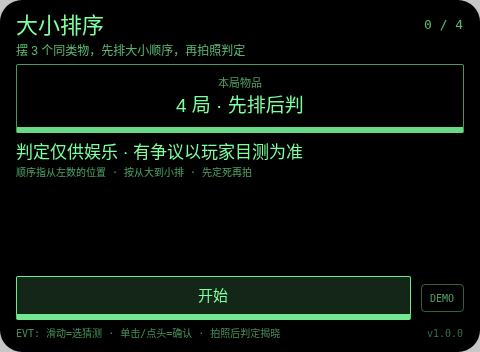
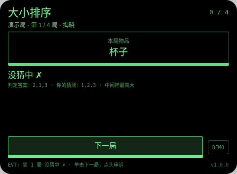
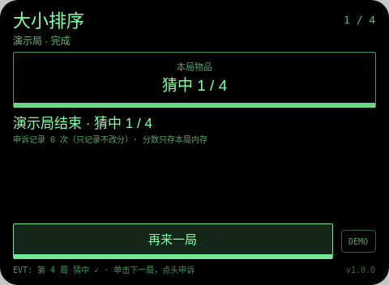

# 大小排序 Size Sort

**Studio 导入地址**（复制到 Global AIUI Studio 的 Import Project 输入框）：

```
https://github.com/sakai55/rokid/tree/agent-size-sort
```

拍照现实交互游戏系列 GA48。每局指定一类物品（固定 4 局：杯子 → 书 → 瓶子 → 鞋）。找 3 个同类、大小有别的实物，从左到右摆开，位置编号 1、2、3。

与指向性系列 shelf-compare（货架商品登记比对工具）的区别：shelf-compare 是把商品信息拍下来比价比参数的购物工具；本作判的是三个同类物的相对大小顺序，是先猜后判的排序游戏，不登记商品信息。

## 预览截图





## 玩法

1. 每局指定一类物品（固定 4 局：杯子 → 书 → 瓶子 → 鞋）。找 3 个同类、大小有别的实物，从左到右摆开，位置编号 1、2、3。
2. 先排：滑动在 6 种排列里选你认为的「从大到小」位置序（如 2,1,3 = 中间最大、左边第二、右边最小），单击或点头确认——先定死再拍照。
3. 大模型回 `ORDER:`（它看到的从大到小位置序）+ 一句理由，本地全序比对：完全一致才算猜中 +1，差一位也不算（结果行会同时写出判定顺序与你的顺序）。

## 手势映射

| 手势（镜腿触控板） | 键事件 | 在本 Agent 中的作用 |
|---|---|---|
| 单击 | Enter | 开始 / 确认猜测 / 拍照判定 / 下一局 / 再来一局 |
| 滑动 | ArrowUp / ArrowDown | 移动猜测选项 |
| 点头 | onHeadGesture('nod') | 猜测阶段 = 确认猜测；判定显示后 = 记录申诉（不改分） |
| 双击 | Backspace | 系统返回（不拦截） |
| 长按 | — | 唤醒助手（系统级，不拦截） |

屏幕上只有一个主按钮（样式随本款形态单独定型）与一个 DEMO 演示键：DEMO 只在网页预览等无相机/无大模型环境里走标注清楚的演示局（预置结果），真机正常游玩走主按钮的真实拍照判定路径。

## 判定链路

takePhoto(default) → FileReader data: URL → LanguageModel 图片输入，只回 `ORDER:`（位置序号的排列）+ `REASON:`；本地校验必须是 1/2/3 的有效排列再与猜测全等比对，无效排列记判定失败。

判定期间显示「判定中…」等待态。每轮结果都经 TTS 播报。判定是大模型（或原生检测）给的，可能出错——见下。

## 技术诚实说明

- 大小口径是「在画面里的视觉大小」（占画面大小/高度），不是实物真实尺寸：摆得离镜头近会显得大——这是写明的规则，玩家摆位时应让三件物品大致在同一排、同一距离，判定结果行写明理由供核对。
- 全序一致才得分，口径严格且写死；娱乐判定、以玩家目测为准，申诉只记录不改分。照片只在内存判定，不落盘。
- 平台没有连续视频理解：每轮都是一次离散拍照判定，不存在实时 AR 式连续识别（这是 stream-probe 探针的实测结论口径）。
- 计分只存本局内存：不调任何存储 API，不落盘、不造排行榜。

## 权限

`CAMERA` 一项：拍照判定必需。代码不使用定位与麦克风采集（TTS 播报不需 RECORD_AUDIO），故只声明这一项。

## 打包与预览

```bash
cd ~/workspace/rokid/git-rokid-photo/games/size-sort
~/tools/bin/aix pack . -o size-sort.aix
~/tools/bin/aix preview . --html-out artifacts/preview.html
```

打包大小 14.17 KB（打包在 README/AGENTS 定稿后执行，`aix list` 已核验包内含 README.md 与 AGENTS.md）。

## 真机测试（GO 的 Path 1，无线缆）

1. 将本项目导入 Global AIUI Studio（GitHub 导入分支 `agent-size-sort`）。
2. 在 Studio 中构建并保存新的 AIX 版本（构建与提审）。
3. 手机 Hi Rokid App：设置 → 开发者选项 → AIUI → 更新眼镜资源包，等到「智能体资源包下载成功」。
4. 在眼镜上语音打开：「乐奇，打开大小排序智能体」。
5. 验收点：摆 3 个大小分明的杯子，先选定顺序并确认锁定，再拍照确认 ORDER 与目测一致；故意选错顺序确认判没猜中；把一件物品明显推近镜头，确认判定按画面大小走（验证口径说明属实）；判定后点头只记申诉；4 局走完确认结算。

## 真机测试信息

| 字段 | 值 |
|---|---|
| Studio 名称 | 大小排序（待导入后回填） |
| Version / Build | 1.0.0 / 待导入后回填 |
| App Category | 待导入后回填 |
| Intent Description | Size-sorting photo game for Rokid glasses: arrange three of a kind, call the big-to-small position order first, then a host-LLM-judged photo returns ORDER for a local exact-match score. Camera only. |
| Agent ID | 待导入后回填 |
| 状态 | 未真机验证 |

## 验证情况

**已验证（本地）**
- 静态校验：app.json、package.json 解析通过；从 .ink 抽出的 `<script setup>` 与 app.js 均 `node --check` 通过；无 `Page(`/`App(`/`Widget(` 误用；权限只有 CAMERA 且与实际使用一致；CSS 只用绿色色阶（最亮 `#7dff9e`，无 `#ffffff`、无白色 rgba）。
- 网页预览实跑：用本地 Ink 运行时管线打开预览，点 DEMO 走完一局演示路径（判定为预置结果、全程标注演示局），就绪 / 进行 / 完成各状态截图已逐张目检，状态属实、互不重复。
- `aix pack` 成功，14.17 KB；`aix list` 确认包内含 README.md 与 AGENTS.md。

**未验证（如实说明）**
- 真机相机拍照质量、大模型图片判定的实际延迟与准确率、TTS 实际发声均待 GO 真机自测；判定延迟以 stream-probe 第 03 项真机结果为准（未测前按「判定中」等待态设计）。

## 提审资料 (Review Submission)

### Feature Description

> Size-sorting game on Rokid glasses. Four rounds (cups, books, bottles, shoes): line up three of a kind, call their big-to-small order as a position sequence first - the call is locked before the photo - then snap. The host LLM returns the order it sees (ORDER plus a reason); only an exact match scores. Size means visual size in the photo, so keep the three in one row at one distance. Nod after a verdict logs a non-scoring appeal.

### Opening Message

> ## 大小排序
> 
> 每局指定一类物品（固定 4 局：杯子 → 书 → 瓶子 → 鞋）。找 3 个同类、大小有别的实物，从左到右摆开，位置编号 1、2、3。
> 
> 判定仅供娱乐，有争议以你的目测为准；申诉只记录、永不改分。分数只存本局内存。

### Preview Media

- `preview-size-sort-ready.png`
- `preview-size-sort-playing.png`
- `preview-size-sort-done.png`

> 正式提审需 3–5 个媒体文件且含 ≥1 段视频（≤60 s），视频待 GO 真机自测时补录。

### Change Log（Build 1.0.0）

**Features added**

- 大小排序全流程：每局指定一类物品（固定 4 局：杯子 → 书 → 瓶子 → 鞋）。找 3 个同类、大小有别的实物，从左到右摆开，位置编号 1、2、3。
- 判定链路：takePhoto(default) → FileReader data: URL → LanguageModel 图片输入，只回 `ORDER:`（位置序号的排列）+ `REASON:`；本地校验必须是 1/2/3 的有效排列再与猜测全等比对，无效排列记判定失败。
- 手势优先：单击开始 / 确认猜测 / 拍照判定 / 下一局 / 再来一局；滑动移动猜测选项；点头猜测阶段 = 确认猜测；判定显示后 = 记录申诉（不改分）；每轮结果 TTS 播报，判定中显示等待态
- 诚实机制：判定失败如实记本轮失败不假判；申诉只记录不改分；照片只在内存判定不落盘；网页预览提供标注清楚的 DEMO 演示局

**Improvements**

- 无（首个版本）

**Fixes**

- 无（首个版本）
