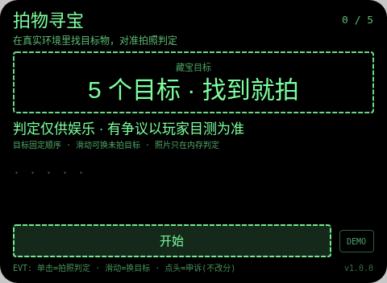
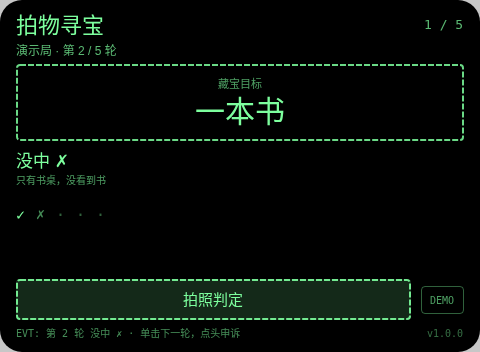
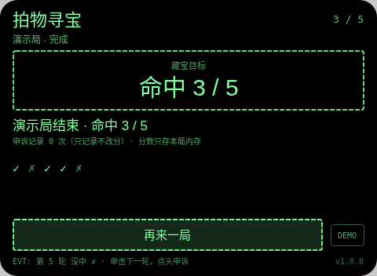

# 拍物寻宝 Snap Hunt

**Studio 导入地址**（复制到 Global AIUI Studio 的 Import Project 输入框）：

```
https://github.com/sakai55/rokid/tree/agent-snap-hunt
```

拍照现实交互游戏系列 GA41。屏幕一次给出一个目标物（固定顺序：红色杯子 → 一本书 → 一把钥匙 → 一把椅子 → 一瓶水），语音同步播报。在真实环境里找到它，对准，单击镜腿拍照。

与注意力系列 home-find（找物登记工具）的区别：home-find 是把常找物品的位置登记下来日后查询的生活工具；本作是当场出题、当场拍照判定计分的寻宝游戏，不登记、不查询。

## 预览截图





## 玩法

1. 屏幕一次给出一个目标物（固定顺序：红色杯子 → 一本书 → 一把钥匙 → 一把椅子 → 一瓶水），语音同步播报。在真实环境里找到它，对准，单击镜腿拍照。
2. 照片经 FileReader 转 data: URL 送宿主大模型图片输入，大模型只回固定格式 `VERDICT: YES/NO` + 一句理由，本地解析计分：命中 +1。判定中会显示「判定中…」等待态。
3. 滑动可先跳到另一个未拍的目标（已判定的不能重拍）；判定后点头 = 记录申诉（只记录次数，永不改分）；大模型不可用或回答格式不对时，该轮如实记「判定失败 · 本轮不计分」。

## 手势映射

| 手势（镜腿触控板） | 键事件 | 在本 Agent 中的作用 |
|---|---|---|
| 单击 | Enter | 开始 / 拍照判定 / 下一轮 / 再来一局 |
| 滑动 | ArrowUp / ArrowDown | 切换到上一个 / 下一个未判定目标（已判定的不重拍） |
| 点头 | onHeadGesture('nod') | 判定显示后 = 记录申诉（只记次数，永不改分）；判定前 = 重读本轮目标 |
| 双击 | Backspace | 系统返回（不拦截） |
| 长按 | — | 唤醒助手（系统级，不拦截） |

屏幕上只有一个主按钮（样式随本款形态单独定型）与一个 DEMO 演示键：DEMO 只在网页预览等无相机/无大模型环境里走标注清楚的演示局（预置结果），真机正常游玩走主按钮的真实拍照判定路径。

## 判定链路

takePhoto(default) → Blob → FileReader data: URL → LanguageModel 图片输入；提示词要求只回 `VERDICT:` + `REASON:` 两行，本地正则解析 VERDICT 行计分。

判定期间显示「判定中…」等待态。每轮结果都经 TTS 播报。判定是大模型（或原生检测）给的，可能出错——见下。

## 技术诚实说明

- 判定靠大模型图片输入，可能因光线、角度、遮挡判错；UI 与本文件均写明「判定仅供娱乐，有争议以玩家目测为准」，申诉只记录不改分。
- 照片只在内存里转 data: URL 判定，不落盘、不上传自有服务器（大模型为宿主托管通道）。
- 不拍他人正脸作判定对象：五个目标全是物。
- 平台没有连续视频理解：每轮都是一次离散拍照判定，不存在实时 AR 式连续识别（这是 stream-probe 探针的实测结论口径）。
- 计分只存本局内存：不调任何存储 API，不落盘、不造排行榜。

## 权限

`CAMERA` 一项：拍照判定必需。代码不使用定位与麦克风采集（TTS 播报不需 RECORD_AUDIO），故只声明这一项。

## 打包与预览

```bash
cd ~/workspace/rokid/git-rokid-photo/games/snap-hunt
~/tools/bin/aix pack . -o snap-hunt.aix
~/tools/bin/aix preview . --html-out artifacts/preview.html
```

打包大小 14.09 KB（打包在 README/AGENTS 定稿后执行，`aix list` 已核验包内含 README.md 与 AGENTS.md）。

## 真机测试（GO 的 Path 1，无线缆）

1. 将本项目导入 Global AIUI Studio（GitHub 导入分支 `agent-snap-hunt`）。
2. 在 Studio 中构建并保存新的 AIX 版本（构建与提审）。
3. 手机 Hi Rokid App：设置 → 开发者选项 → AIUI → 更新眼镜资源包，等到「智能体资源包下载成功」。
4. 在眼镜上语音打开：「乐奇，打开拍物寻宝智能体」。
5. 验收点：语音打开后确认首目标播报「找一找：红色杯子」；对着红色杯子拍照确认命中（看判定延迟与理由是否合理）；对着无关画面拍照确认没中；滑动确认能切到未拍目标；判定后点头确认只记申诉不改分；断网或大模型不可用时确认该轮记判定失败而非假命中；5 个目标走完确认结算与再来一局。

## 真机测试信息

| 字段 | 值 |
|---|---|
| Studio 名称 | 拍物寻宝（待导入后回填） |
| Version / Build | 1.0.0 / 待导入后回填 |
| App Category | 待导入后回填 |
| Intent Description | Photo treasure-hunt game for Rokid glasses. Five fixed targets are called by voice; the player finds each in the real environment and snaps a photo, judged by the host LLM image input (VERDICT YES/NO plus a reason). Swipe switches unattempted targets, nod logs a non-scoring appeal. Camera only; photos are judged in memory and never saved. |
| Agent ID | 待导入后回填 |
| 状态 | 未真机验证 |

## 验证情况

**已验证（本地）**
- 静态校验：app.json、package.json 解析通过；从 .ink 抽出的 `<script setup>` 与 app.js 均 `node --check` 通过；无 `Page(`/`App(`/`Widget(` 误用；权限只有 CAMERA 且与实际使用一致；CSS 只用绿色色阶（最亮 `#7dff9e`，无 `#ffffff`、无白色 rgba）。
- 网页预览实跑：用本地 Ink 运行时管线打开预览，点 DEMO 走完一局演示路径（判定为预置结果、全程标注演示局），就绪 / 进行 / 完成各状态截图已逐张目检，状态属实、互不重复。
- `aix pack` 成功，14.09 KB；`aix list` 确认包内含 README.md 与 AGENTS.md。

**未验证（如实说明）**
- 真机相机拍照质量、大模型图片判定的实际延迟与准确率、TTS 实际发声均待 GO 真机自测；判定延迟以 stream-probe 第 03 项真机结果为准（未测前按「判定中」等待态设计）。

## 提审资料 (Review Submission)

### Feature Description

> Photo treasure hunt on Rokid glasses. Five fixed targets (red cup, book, key, chair, water bottle) are called one at a time by voice and screen. Find each in the real room, aim, and snap: the photo goes to the host LLM image judge, which replies VERDICT YES/NO plus a one-line reason. Swipe switches unattempted targets; a nod after a verdict logs an appeal that never changes the score. Judging is for fun; the player's own eyes win disputes.

### Opening Message

> ## 拍物寻宝
> 
> 屏幕一次给出一个目标物（固定顺序：红色杯子 → 一本书 → 一把钥匙 → 一把椅子 → 一瓶水），语音同步播报。在真实环境里找到它，对准，单击镜腿拍照。
> 
> 判定仅供娱乐，有争议以你的目测为准；申诉只记录、永不改分。分数只存本局内存。

### Preview Media

- `preview-snap-hunt-ready.png`
- `preview-snap-hunt-playing.png`
- `preview-snap-hunt-done.png`

> 正式提审需 3–5 个媒体文件且含 ≥1 段视频（≤60 s），视频待 GO 真机自测时补录。

### Change Log（Build 1.0.0）

**Features added**

- 拍物寻宝全流程：屏幕一次给出一个目标物（固定顺序：红色杯子 → 一本书 → 一把钥匙 → 一把椅子 → 一瓶水），语音同步播报。在真实环境里找到它，对准，单击镜腿拍照。
- 判定链路：takePhoto(default) → Blob → FileReader data: URL → LanguageModel 图片输入；提示词要求只回 `VERDICT:` + `REASON:` 两行，本地正则解析 VERDICT 行计分。
- 手势优先：单击开始 / 拍照判定 / 下一轮 / 再来一局；滑动切换到上一个 / 下一个未判定目标（已判定的不重拍）；点头判定显示后 = 记录申诉（只记次数，永不改分）；判定前 = 重读本轮目标；每轮结果 TTS 播报，判定中显示等待态
- 诚实机制：判定失败如实记本轮失败不假判；申诉只记录不改分；照片只在内存判定不落盘；网页预览提供标注清楚的 DEMO 演示局

**Improvements**

- 无（首个版本）

**Fixes**

- 无（首个版本）
