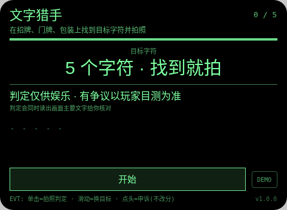
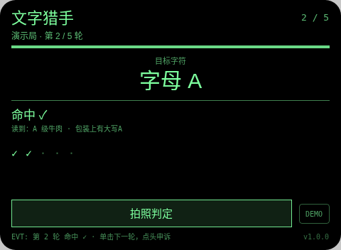
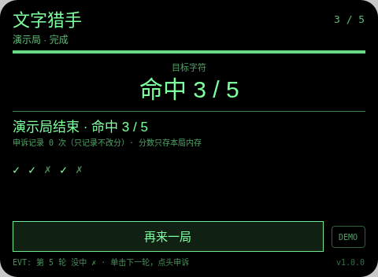

# 文字猎手 Word Spot

**Studio 导入地址**（复制到 Global AIUI Studio 的 Import Project 输入框）：

```
https://github.com/sakai55/rokid/tree/agent-word-spot
```

拍照现实交互游戏系列 GA43。每轮出一个目标字符（固定顺序：数字 7 → 字母 A → 数字 3 → 汉字「门」→ 字母 S），在招牌、门牌、包装、书脊上找到它，对准拍清楚，单击拍照。

与指向性系列 DI sign-reader（读招牌工具）的区别：sign-reader 是把远处招牌全文读给你的出行工具；本作只判「目标字符在不在画面文字里」并计分，是找字游戏，读出的文字仅作判定凭据展示。

## 预览截图





## 玩法

1. 每轮出一个目标字符（固定顺序：数字 7 → 字母 A → 数字 3 → 汉字「门」→ 字母 S），在招牌、门牌、包装、书脊上找到它，对准拍清楚，单击拍照。
2. 大模型判定同时读出画面主要文字（TEXT 行）并显示在判定结果里，玩家可当场核对它到底读到了什么——读错了一眼可见。命中 +1。
3. 滑动可先跳到另一未拍字符轮；判定后点头 = 记录申诉（不改分）；大模型不可用/格式不对，该轮如实记判定失败。

## 手势映射

| 手势（镜腿触控板） | 键事件 | 在本 Agent 中的作用 |
|---|---|---|
| 单击 | Enter | 开始 / 拍照判定 / 下一轮 / 再来一局 |
| 滑动 | ArrowUp / ArrowDown | 切换到上一个 / 下一个未判定目标（已判定的不重拍） |
| 点头 | onHeadGesture('nod') | 判定显示后 = 记录申诉（只记次数，永不改分）；判定前 = 重读本轮目标 |
| 双击 | Backspace | 系统返回（不拦截） |
| 长按 | — | 唤醒助手（系统级，不拦截） |

屏幕上只有一个主按钮（样式随本款形态单独定型）与一个 DEMO 演示键：DEMO 只在网页预览等无相机/无大模型环境里走标注清楚的演示局（预置结果），真机正常游玩走主按钮的真实拍照判定路径。

## 判定链路

takePhoto(default) → FileReader data: URL → LanguageModel 图片输入（平台无 OCR API，这是官方读字路径）；只回 `VERDICT:` + `TEXT:`（读到的主要文字）+ `REASON:` 三行，本地解析并展示 TEXT 供核对。

判定期间显示「判定中…」等待态。每轮结果都经 TTS 播报。判定是大模型（或原生检测）给的，可能出错——见下。

## 技术诚实说明

- 平台没有 OCR API：所谓读字就是拍照 + 大模型图片输入，可能读错形近字（如 S 与 5、7 与 1）；判定结果展示它读到的文字，玩家可核对，申诉只记录不改分。
- 判定仅供娱乐，有争议以玩家目测为准；照片只在内存判定，不落盘。
- 不拍他人正脸作判定对象：目标是招牌、门牌、包装上的字。
- 平台没有连续视频理解：每轮都是一次离散拍照判定，不存在实时 AR 式连续识别（这是 stream-probe 探针的实测结论口径）。
- 计分只存本局内存：不调任何存储 API，不落盘、不造排行榜。

## 权限

`CAMERA` 一项：拍照判定必需。代码不使用定位与麦克风采集（TTS 播报不需 RECORD_AUDIO），故只声明这一项。

## 打包与预览

```bash
cd ~/workspace/rokid/git-rokid-photo/games/word-spot
~/tools/bin/aix pack . -o word-spot.aix
~/tools/bin/aix preview . --html-out artifacts/preview.html
```

打包大小 14.10 KB（打包在 README/AGENTS 定稿后执行，`aix list` 已核验包内含 README.md 与 AGENTS.md）。

## 真机测试（GO 的 Path 1，无线缆）

1. 将本项目导入 Global AIUI Studio（GitHub 导入分支 `agent-word-spot`）。
2. 在 Studio 中构建并保存新的 AIX 版本（构建与提审）。
3. 手机 Hi Rokid App：设置 → 开发者选项 → AIUI → 更新眼镜资源包，等到「智能体资源包下载成功」。
4. 在眼镜上语音打开：「乐奇，打开文字猎手智能体」。
5. 验收点：对着含 7 的价签拍确认命中且 TEXT 读对；对着不含目标字符的包装拍确认没中且 TEXT 是真实读到的文字（不是编的）；拍一张模糊文字确认判定如实回 NO 或判定失败；滑动、点头申诉各验一次；5 轮走完确认结算。

## 真机测试信息

| 字段 | 值 |
|---|---|
| Studio 名称 | 文字猎手（待导入后回填） |
| Version / Build | 1.0.1 / 待导入后回填 |
| App Category | 待导入后回填 |
| Intent Description | Photo character-hunt game for Rokid glasses. Each round names a target character to find on real signs or packaging; the host LLM image judge transcribes the photo text and answers VERDICT YES/NO, showing the transcription for cross-checking. Camera only; photos judged in memory, never saved. |
| Agent ID | 待导入后回填 |
| 状态 | 未真机验证 |

## 验证情况

**已验证（本地）**
- 静态校验：app.json、package.json 解析通过；从 .ink 抽出的 `<script setup>` 与 app.js 均 `node --check` 通过；无 `Page(`/`App(`/`Widget(` 误用；权限只有 CAMERA 且与实际使用一致；CSS 只用绿色色阶（最亮 `#7dff9e`，无 `#ffffff`、无白色 rgba）。
- 网页预览实跑：用本地 Ink 运行时管线打开预览，点 DEMO 走完一局演示路径（判定为预置结果、全程标注演示局），就绪 / 进行 / 完成各状态截图已逐张目检，状态属实、互不重复。
- `aix pack` 成功，14.10 KB；`aix list` 确认包内含 README.md 与 AGENTS.md。

**未验证（如实说明）**
- 真机相机拍照质量、大模型图片判定的实际延迟与准确率、TTS 实际发声均待 GO 真机自测；判定延迟以 stream-probe 第 03 项真机结果为准（未测前按「判定中」等待态设计）。

## 提审资料 (Review Submission)

### Feature Description

> Text hunt on Rokid glasses. Five target characters (7, A, 3, the character for door, S) hide on real signs, doorplates and packaging. Photograph one and the host LLM image judge transcribes the visible text, shows what it read, and answers VERDICT YES/NO. There is no OCR API on this platform: reading is photo plus LLM image input, and the shown transcription lets you catch its mistakes. Nod logs a non-scoring appeal.

### Opening Message

> ## 文字猎手
> 
> 每轮出一个目标字符（固定顺序：数字 7 → 字母 A → 数字 3 → 汉字「门」→ 字母 S），在招牌、门牌、包装、书脊上找到它，对准拍清楚，单击拍照。
> 
> 判定仅供娱乐，有争议以你的目测为准；申诉只记录、永不改分。分数只存本局内存。

### Preview Media

- `preview-word-spot-ready.png`
- `preview-word-spot-playing.png`
- `preview-word-spot-done.png`

> 正式提审需 3–5 个媒体文件且含 ≥1 段视频（≤60 s），视频待 GO 真机自测时补录。

### Change Log（Build 1.0.0）

**Features added**

- 文字猎手全流程：每轮出一个目标字符（固定顺序：数字 7 → 字母 A → 数字 3 → 汉字「门」→ 字母 S），在招牌、门牌、包装、书脊上找到它，对准拍清楚，单击拍照。
- 判定链路：takePhoto(default) → FileReader data: URL → LanguageModel 图片输入（平台无 OCR API，这是官方读字路径）；只回 `VERDICT:` + `TEXT:`（读到的主要文字）+ `REASON:` 三行，本地解析并展示 TEXT 供核对。
- 手势优先：单击开始 / 拍照判定 / 下一轮 / 再来一局；滑动切换到上一个 / 下一个未判定目标（已判定的不重拍）；点头判定显示后 = 记录申诉（只记次数，永不改分）；判定前 = 重读本轮目标；每轮结果 TTS 播报，判定中显示等待态
- 诚实机制：判定失败如实记本轮失败不假判；申诉只记录不改分；照片只在内存判定不落盘；网页预览提供标注清楚的 DEMO 演示局

**Improvements**

- 无（首个版本）

**Fixes**

- 无（首个版本）

### Change Log（Build 1.0.1）

**Features added**

- 无

**Improvements**

- 无

**Fixes**

- 删除 FileReader（Ink 运行时不存在，真机必死）：照片 Blob→dataURL 改走官方文档路径 `blob.arrayBuffer()` + 分块 `btoa`，失败接全局错误码 E2005 并如实记为拍照失败可重试。
