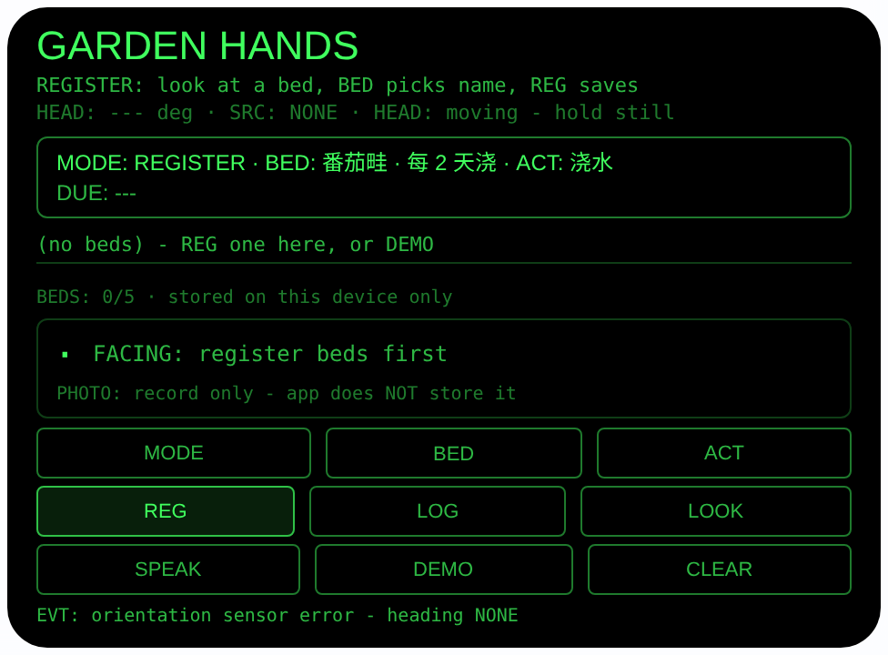
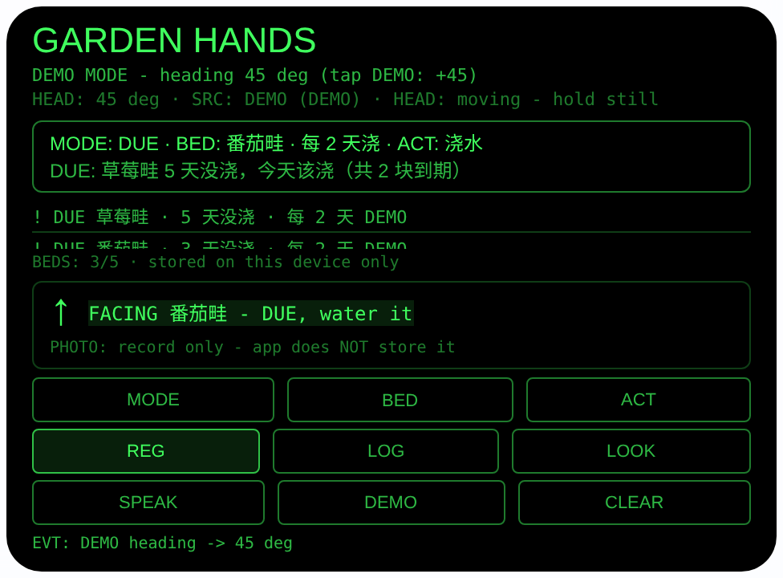

# garden-hands — 园艺手记（Rokid 眼镜 AIUI Agent）

**Studio 导入地址**（复制到 Global AIUI Studio 的 Import Project 输入框）：

```
https://github.com/sakai55/rokid/tree/agent-garden-hands
```


50 个「指向性生活问题」Agent 的第 14 个。戴着手套、手上全是泥，
记不住哪块畦什么时候浇过水 — 不是重复浇就是漏浇。本 Agent 让苗床
按「你站在园子里看向它的头部朝向」登记，浇完水点一下头就记上
今天；哪块到期了按逾期程度排给你看、念给你听；想找某块畦，
转头对上它登记时的朝向，它就亮出来。

## 预览截图

截图统一存放于仓库根目录 `screenshots/garden-hands/`。





## 解决的问题

园艺的记录活儿偏偏发生在最不方便记的时候：双手戴着手套、沾着
泥，手机掏出来也点不了。结果全靠脑子记 — 番茄畦是前天浇的还是
大前天？草莓那块好像一直没轮到。本 Agent 把登记挂在视线和朝向
上（你总要看着畦才能浇它），把记录简化成「点一下头」，把回忆
换成它按日期算给你看。

## 指向性设计（为什么必须用眼镜）

- **苗床 = 按头部朝向登记（HEAD）**：站在园子里看着一块畦按
  REG，眼镜存下「畦名 + 那一刻 `AbsoluteOrientationSensor` 的
  头部朝向角 + 这块畦的浇水间隔天数」。园子里的畦本来就是按
  方位排开的，朝向就是最自然的地址；手机拿在手里测不到你
  看向哪块畦。
- **找畦 = 转头对齐朝向**：相对角 = 登记朝向 − 当前朝向，
  角度上最近的一块畦配 8 向大箭头显示；|相对角| ≤ 15° 时
  高亮「FACING 番茄畦」，并结合到期状态告诉你「该浇了」还是
  「只是看看」。不报东南西北，只报相对你头部的方向。
- **戴手套也能记（点头 LOG）**：开启世界感知
  （`enableWorldAwareness()`）后，头部稳定时点头 = 当前模式
  的主动作 — REGISTER 模式登记、DUE/FIND 模式给选中的畦
  记一条今天做完的活儿（浇水 / 施肥 / 修剪 / 除虫），浇水
  同时重置那块畦的浇水时钟。全程不用摘手套、不用腾手。
- **到期是算出来的，不是记出来的**：DUE 视图按
  「今天距上次浇水天数 − 该畦间隔」排序，最逾期的在最前、
  标 `! DUE`；从没浇过的畦如实排在最前。天数全部由本机
  `Date` 的真实日期相减得到（日期算法已在 Node 里验算：
  3/1/5 天前与今天的差值精确）。
- **耳朵收汇总**：SPEAK 用中文朗读到期汇总，如「草莓畦5天
  没浇了，今天该浇。番茄畦3天没浇了，今天该浇。」

## 功能流程

1. REGISTER（默认）：站在园子里看着一块畦，BED 轮换畦名
   （番茄畦 / 黄瓜架 / 香草盆 / 月季丛 / 草莓畦，间隔分别为
   2 / 2 / 1 / 3 / 2 天），点 REG 或头部稳定时点头 →
   存 {畦名， 朝向°, 间隔， 上次浇水， 上次动作} 到 wx 同步
   存储（key `gardenBeds`，最多 5 块，onLoad 读取、
   onUnload 落盘）；同一块畦重新登记只更新朝向与间隔，
   保留浇水历史；CLEAR 清空全部
2. 干活记录：ACT 轮换动作（浇水 / 施肥 / 修剪 / 除虫），
   BED 选畦（非 REGISTER 模式下轮换已登记的畦），LOG 或
   点头给选中的畦打上今天的日期戳；动作是浇水时更新
   上次浇水日期
3. DUE：点 MODE 切换 → 列表按逾期程度排序，到期标
   `! DUE`，顶部常驻最紧急的一块；SPEAK 朗读到期汇总
4. FIND：再点 MODE 切换 → 慢慢转头，角度上最近的畦显示
   箭头，转到 FACING 高亮就是正对它；FACING 行在所有模式
   都实时计算
5. LOOK：看着畦拍一张当此刻的生长记录（default 模式）；
   照片只取字节数显示，**本 Agent 不保存照片**（见诚实说明）
6. DEMO：用运行时 `Date` 实时算日期登记 3 块标注 DEMO 的畦
   （番茄畦 30°、3 天前浇 → 到期；黄瓜架 150°、1 天前浇 →
   未到期；草莓畦 270°、5 天前浇 → 最逾期）并切到 DUE；
   之后每点一次 DEMO 朝向 +45°，朝向步进到 45° 时正对
   30° 的番茄畦（相对角 −15°）进入 FACING 高亮 — 预览可
   完整演示

> 诚实说明：这是「方位 + 日期手记」，不是植物监测。眼镜不测
> 土壤湿度、不识别植物、不判断长势；浇水间隔是按畦名查的内置
> 经验值，赶上连雨天该不该浇还是你说了算。LOOK 的照片只是按下
> 快门那一刻的记录，本 Agent 不落盘保存它 — 想做生长对比，
> 请用眼镜/手机相册自己留照片。朝向是相对你登记时站的位置的：
> 你换个位置站，几何关系就变了。

## 权限

| 权限 | 用途 |
|---|---|
| CAMERA | LOOK 拍一张苗床的此刻记录照（default 模式）；只取字节数显示，不保存、不上传 |

朝向传感器在 AIUI 里不需要单独的权限声明。记录只存本机 wx 同步
存储，不上传、不联网。

## 打包与预览

```bash
cd ~/workspace/rokid/garden-hands
~/tools/bin/aix pack . -o ../dist/garden-hands.aix
~/tools/bin/aix preview . --html-out artifacts/preview.html
```

本地预览截图走 `~/workspace/preview-tools/` 的本地 Ink + puppeteer 路线
（`shot-garden.js`；DUE 截图的点击序列为 canvas 内 DEMO (240, 317)
连点 2 次：登记 3 块样例畦并切到 DUE，再步进朝向 45° 到 FACING
番茄畦；注意 artifacts/preview.html 需先把 importmap 的 jspm 地址
换成本地 `/ink/index.js` 再复制到 preview-tools/www/）。

## 真机测试（海外版 · 云端下发 · Path 1）

1. 推到 GitHub 后，Global AIUI Studio（aiui-global.rokid.com，en-US）用
   分支导入：`https://github.com/sakai55/rokid/tree/agent-garden-hands`
   （该分支根目录即本 Agent 文件）
2. Studio 的 **Device Debug** 页签填 Basic Information，在 AIX Packaging
   点 **Repackage and Save**，确认顶部出现绿色
   **● Debug version ready — Ready for device debugging**
3. **Hi Rokid**（海外版 `com.rokid.sprite.global.aiapp`，不是国内版
   Rokid Ai App）→ 设置 → 开发者选项 → AIUI → 更新眼镜资源包，
   等「智能体资源包下载成功」
4. 对眼镜说「乐奇，打开 garden-hands」，在园子里看着番茄畦 REG
   登记，浇完水点头 LOG，再切 DUE 确认它从到期名单里消失，
   转头验证 FACING 找畦

## 真机测试信息（Global AIUI Studio · Device Debug）

| 项目 | 值 |
|---|---|
| Agent Name（Studio） | 待导入后回填 |
| Version（Build） | 1.0.0（待导入后回填） |
| App Category | 待导入后回填 |
| Intent Description | 待导入后回填 |
| Agent ID | 待导入后回填 |
| AIX Package Size | 17.51 KB（本地打包 `dist/garden-hands.aix`） |
| 状态 | 本地完成，待导入 Studio |
| Studio | aiui-global.rokid.com（en-US） |
| 下发方式 | 云端下发 → Hi Rokid（海外版）更新眼镜资源包 |

## 验证情况

**已验证**

- 静态检查：app.json / package.json JSON 解析通过；`<script def>` JSON
  解析通过；`<script setup>` 与 app.js 提取后 `node --check` 语法通过；
  全目录 grep 无 `Page(` / `App(` / `Widget(` / `workers:` 残留；
  9 个 bindtap 处理函数全部有定义。
- 日期算法：`_daysSince` / `_daysAgoStr` 在 Node 里用同一份代码
  验算 — 今天差值 0、1/3/5 天前差值精确，null（从没浇过）返回
  null 并在 DUE 排序里算最逾期；DEMO 的 3 天前/间隔 2 天 = 到期、
  5 天前 = 最逾期的预期与预览渲染一致。
- 打包：`aix pack` 成功；`aix list` 核对包内含 README.md、AGENTS.md、
  app.js、app.json、package.json、pages/index/index.ink
  （artifacts/ 已被 .aixignore 排除）。
- 预览渲染：aix preview + 本地 Ink + puppeteer 截图两张（见
  Preview Media）：首页 REGISTER 态完整渲染（畦名 番茄畦 / 每 2 天
  浇已选、无登记、朝向 SRC NONE 如实标注 — 预览主机方向传感器
  报错，代码按 NONE 路径处理并在页脚如实显示，不编造朝向）；
  DEMO 连点 2 次后切到 DUE：3 块样例畦入列（BEDS 3/5），列表
  按逾期排序 — 草莓畦「! DUE · 5 天没浇」在最前、番茄畦
  「! DUE · 3 天没浇」次之，顶部 DUE 行汇总「草莓畦 5 天没浇，
  今天该浇（共 2 块到期）」；朝向步进到 45°，相对 30° 登记的
  番茄畦相对角 −15°，箭头 ↑ 且「FACING 番茄畦 - DUE, water it」
  高亮。

**未验证**

- 真机 AbsoluteOrientationSensor 朝向读数的精度与零点参考
  （本 Agent 只用登记与找畦两次读数的相对关系，零点漂移会影响
  指引准确度，已如实说明；登记朝向只对你登记时站的位置有效）。
- 真机头部稳定检测、点头 LOG/REG、TTS 朗读到期汇总的效果。
- 真机相机 default 模式拍照（预览主机无相机，LOOK 的 FAIL 路径
  按代码如实显示，未实拍）。
- **间隔是经验值不是监测值**：内置间隔按畦名写死，连雨天/高温天
  的实际需水量会偏离，这是已知的产品边界，不是待补的验证项。

---

## 提审资料（Review Submission）

> Global AIUI Studio → Submit 页签的 Review Information 逐项对应下面四段，
> 提交时整段复制。每次提交前重新确认 Preview Media。

### Feature Description

Garden Hands is a care log for gardeners whose hands are busy, gloved and muddy. Stand in your garden, look at a bed and register it: the agent stores the bed, your head heading toward it, and its watering interval. After you water, feed, prune or spray, log it with a nod - no phone, no clean hands needed. The DUE view works out from real dates which bed is most overdue and reads it aloud, and turning your head finds a bed again: face its registered heading and it lights up.

### Opening Message

Hi, I'm **Garden Hands** - I remember your garden beds by the way you face them.

In the garden, look at a bed, tap **BED** to pick its name, then **REG** (or nod while steady) - I store the bed, your heading and its watering interval. Done a job? Set **ACT**, then **LOG** or just nod, and I stamp today's date. Tap **MODE** for the **DUE** list, most overdue first, **SPEAK** to hear it, and turn your head in **FIND** until I say **FACING**. Tap **DEMO** to try it now.

### Preview Media

提交要求：3–5 个 JPG/PNG 图片或 MP4 视频，至少含 1 张图和 1 个视频，每次提交前重新确认。

- Image 1：`artifacts/preview-garden-hands-index.png`（aix preview 首页 REGISTER 态：畦名/间隔已选、无登记、朝向 SRC NONE 如实标注，本地文件，提交时从本地上传）
- Image 2：`artifacts/preview-garden-hands-due.png`（DEMO 登记 3 块畦并步进朝向到 45° 后的 DUE 态：逾期排序列表、顶部到期汇总、FACING 番茄畦高亮，本地文件）
- Video：待真机补 — 真机录制「园子里看着番茄畦登记 → 浇水后点头记录 → DUE 查看到期 → 转头 FACING 找畦」全过程（MP4），录好后放 `artifacts/` 并更新此处
- 状态：未齐（已有 2 张图；还需至少 1 个视频，总数补到 3–5 个后才可提交）

### Change Log

#### Build 1.0.0

**Features added**

- Heading-bound bed registry: looking at a bed and registering stores the bed name, your AbsoluteOrientationSensor head heading and a per-bed watering interval in wx sync storage (key gardenBeds, up to 5 beds); re-registering a bed updates its heading and interval but keeps its watering history.
- Gloved-hands logging: ACT cycles watering, feeding, pruning and pest control; LOG - or a nod while your head is steady - stamps today's real date on the selected bed, and a watering log resets that bed's watering clock.
- Computed DUE view: beds are sorted by days since last watering minus their interval, never-watered beds first, overdue rows flagged ! DUE, with a persistent summary line and a Chinese TTS readout of everything that is due.
- Find-by-turning: the angularly nearest registered bed gets an 8-way arrow in every mode, and facing it within 15 degrees lights a FACING banner combined with its due state.
- Honest limits throughout: heading sources are labeled SENSOR, DEMO or NONE and registration refuses to invent a heading; the LOOK photo is a moment record whose byte size is shown but which the app does not store, and no plant recognition or soil sensing is claimed.

**Improvements**

- None (initial release).

**Fixes**

- None (initial release).
