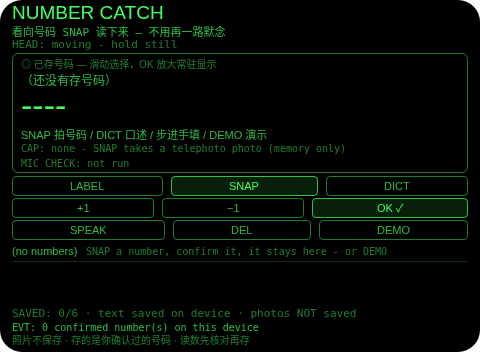
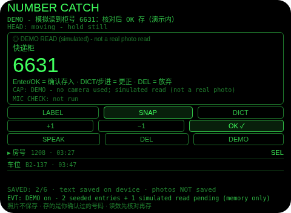
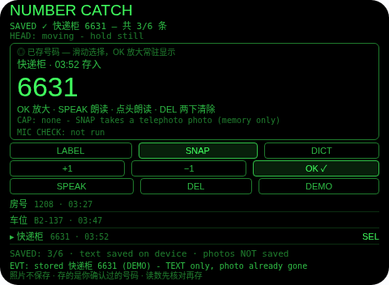
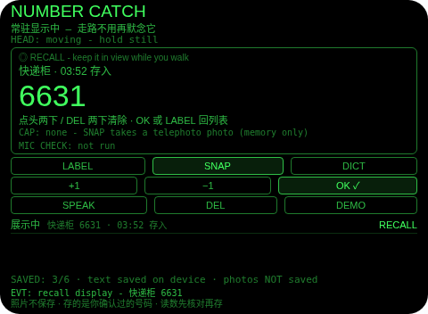

# Number Catch（号码速记）

**Studio 导入地址**（复制到 Global AIUI Studio 的 Import Project 输入框）：

```
https://github.com/sakai55/rokid/tree/agent-number-catch
```


注意力外挂系列 HO01（HOLD 默念型，本组第一个）。酒店房号、快递柜号、取餐号、停车位号——这类号码的共同点是：看一眼就得在脑子里默念一路，中间聊一句话就忘。本 Agent 的做法：看向号码拍一张长焦照片，主机大模型把数字读出来放大给你核对，你确认了才存住；之后号码就挂在你视线里，走路不用再当复读机，用完在常驻显示里点头两下清掉。






## 解决的问题

短时记忆最怕打断：号码本身不长，难的是从「看到它」到「用上它」之间不能想任何别的事。本 Agent 把这段路外包掉——捕获只花一次注视（拍照读数），保存必过一次确认（防机器读错），回看是零成本的（号码常驻视线内），清除也不用腾手（点头两下）。脑子从复读机里解放出来，号码交给眼镜记。

## 注意力外包设计（HOLD 默念型）

- **看向即捕获（telephoto + LLM 图片输入）**：SNAP 用 `ImageCapture.takePhoto({mode:'telephoto'})` 长焦拍下你正看的那个号码，照片 Blob 经 `FileReader` 编码为 data: URL，作为 user 消息的 `image_url` 内容发给主机 `LanguageModel`（多模态内容只进 user 角色，system 只经 `initialPrompts`；先查 `availability()`，用完 `destroy()`）——这是档案 §2.9 的官方读字路径，**平台没有 OCR，本 Agent 也不声称有**。提示词只要一行 `READ: <号码>`，解析只认干净的含数字 token，散文式回复一律判读数失败，绝不猜。
- **确认即存，未确认绝不存**：读数落在核对屏上、以大字显示并标注「LLM READ - may misread」，只有你点 OK（Enter）才落盘。读错了先改：DICT 口述正确号码，或步进 ±1（只改纯数字；含字母的号码如 B2-137 步进会拒绝并提示走 DICT）。改过的才存，原始错读永不进存储。
- **照片永不落盘**：wx 存储存不下 Blob，本 Agent 也从不写照片——落盘的只有你确认过的号码文字 `{标签, 号码, 时间}`（key `numberCatch`，最多 6 条）。存满时第 7 条如实拒绝并保留待核对手里的这条，绝不静默覆盖。界面常驻行写明「照片不保存 · 存的是你确认过的号码」。
- **手填路径独立可用**：模型不可用、转换不可用、模型报错、照片没读清、wx 回退照片无 Blob、甚至设备根本没有相机——全部如实落到同一张核对屏（空白 + 原因），DICT 口述或步进填入照样能存。拍照读数是加速器，不是门槛。
- **常驻回看（RECALL）**：存好的号码在列表里；OK 打开选中的一条全屏常驻——大字号码 + 标签 + 存入时间，走到地方之前不用再低头掏手机或票根。
- **为什么胸前设备做不了**：捕获要和视线同轴（你看的号码就是拍的号码）、回递要进视线内（常驻显示不打断走路）、清除要免手（点头）——三条都只有头戴设备成立。

## 功能流程

1. **选标签**：LABEL（或正在记时滑动）在 房号 / 快递柜 / 取餐号 / 车位 / 其他 间切换。
2. **SNAP**：长焦拍照 → 自动 READ（照片 → data: URL → 大模型读数）→ 进入核对屏。若 SNAP 时已有照片且读数为空，SNAP = 对同一张照片重试读数；核对屏上再点 SNAP = 重拍。
3. **核对屏（CONFIRM）**：大字号码 + 来源标注（LLM READ / 你口述的 / 手填 / DEMO）。OK = 确认存入；DICT = 口述更正；+1/−1 = 步进更正（纯数字）；DEL = 放弃这条（它本来就没存）。
4. **DICT**（任何时候可用）：先做佩戴者模式麦克风可用性检查（结果单独一行 `MIC CHECK:`，检查流读完设置立即停轨），再用宿主 SpeechRecognition（zh-CN）在它自己的麦克风上听你口述的号码——听的是你亲眼看到的号码。中文数字两种读法都认：一千二百零八（数值式）与六六三一（逐字式，前导零保留，如 零五零八 → "0508"）；听不清成号码就如实拒绝，原值不变，绝不猜。
5. **回看**：列表滑动选中，OK 全屏常驻；SPEAK 或列表里点头朗读「标签 + 号码」。
6. **清除**：常驻显示里点头两下（第一下只武装并明示「再点头一次清除」，第二下清除并朗读一次「已清除」），或 DEL 两下（列表/常驻显示同一纪律）；做别的动作或过 6 秒自动解除武装。一下点头永远删不掉任何东西。
7. **DEMO**：内存播入 2 条记录（房号 1208 / 车位 B2-137）+ 1 条模拟读数（快递柜 6631）停在核对屏；演示内确认只进演示列表，全程不写真实存储，退出后真实号码原样恢复。

## 手势映射

主流程（捕获 → 核对 → 存 → 回看 → 清除）靠滑动 + 单击 + 点头即可走完：

| 手势（镜腿触控板） | 键事件 | 在本 Agent 中的作用 |
|---|---|---|
| 单击 | Enter | 情境主操作 OK：列表 = 打开常驻显示；常驻显示 = 回列表；正在记 = 进核对屏；核对屏 = **确认存入** |
| 上滑 / 下滑 | ArrowUp / ArrowDown | 列表/常驻显示：选上一条 / 下一条；正在记：切标签；核对屏：号码 +1 / −1（纯数字时） |
| 点头（头稳时） | `onHeadGesture('nod')` | **常驻显示里 = 清除两步**：第一下武装、第二下清除（本 Agent 是 PLAN 特许的例外）；列表里 = 只朗读选中号码；核对屏/正在记时不存不删，只提示 |
| 双击 | Backspace | 系统返回（不拦截） |
| 长按 | — | 唤醒助手（系统级，不拦截） |

屏幕按钮（每个都有保留理由）：

| 按钮 | 理由 |
|---|---|
| LABEL | 切换号码标签（类型的唯一入口；常驻显示里兼作回列表） |
| SNAP | 拍照读数的主动作（核对屏上兼作重试读数/重拍） |
| DICT | 口述填入或更正号码（双手占用、或拍照路径失败时的独立通路） |
| +1 / −1 | 滑动的镜像：核对屏上精确修正一位数字；列表里切换选中 |
| OK ✓ | Enter 的镜像（情境主操作，含核对屏上的确认存入） |
| SPEAK | 朗读当前号码（点头在列表里的镜像，头不方便动时用） |
| DEL | 清除入口：与点头同一套两步纪律（核对屏上 = 放弃未存的这条） |
| DEMO | 演示种子数据走完读数核对与常驻显示全程（提审/自测用） |

## 权限

| 权限 | 用途 |
|---|---|
| `CAMERA` | SNAP 长焦拍号码（照片 Blob 只在内存中转供 READ，转完即弃，从不落盘保存） |
| `RECORD_AUDIO` | DICT 的佩戴者模式麦克风可用性检查（getUserMedia，检查流立即停轨）+ 宿主 SpeechRecognition 口述号码/更正（zh-CN） |

只申请 2 项，无定位。麦克风模式只作用于 getUserMedia 流，永不影响宿主 `SpeechRecognition`；聆听状态标注为 (host ASR)。TTS 用宿主固定音色，永不设置 utterance 的 `lang`（官方文档注明该属性不生效）。相机/麦克风只在用户点 SNAP / DICT 时启动，用完立即停掉全部媒体轨道。

## 打包与预览

```bash
cd ~/workspace/rokid/number-catch
~/tools/bin/aix pack . -o ../dist/number-catch.aix
~/tools/bin/aix list ../dist/number-catch.aix
~/tools/bin/aix preview . --html-out artifacts/preview.html
```

本地预览截图走 `~/workspace/preview-tools/` 的本地 Ink + puppeteer 路线（`shot-number.js`，独立页面副本 `preview-number.html`）。

## 真机测试（GO 的 Path 1，无线缆）

1. 将本项目导入 Global AIUI Studio（GitHub 导入分支 `agent-number-catch`）。
2. 在 Studio 中构建并保存新的 AIX 版本（构建与提审）。
3. 手机 Hi Rokid App：设置 → 开发者选项 → AIUI → 更新眼镜资源包，等到「智能体资源包下载成功」。
4. 在眼镜上语音打开：「乐奇，打开 Number Catch 智能体」。
5. 验收点：**第一优先验证图片读数通路**——对着真实房号牌/快递柜号 SNAP，READ 是否真的返回数字（验证宿主接受 image_url / data: URL、FileReader 可用）、远距离小字与反光表面的读准率、读错时 DICT/步进更正是否顺手；图片通路若不通，是否如实落到失败状态且口述路径完整可用；存满 6 条后第 7 条被拒且不覆盖；常驻显示走到电梯口全程不用再默念；点头一下不清除、两下才清除且只报一次；重启眼镜后 6 条文字记录仍在。

## 真机测试信息

| 字段 | 值 |
|---|---|
| Studio 名称 | Number Catch（待导入后回填） |
| Version / Build | 1.0.0 / 待导入后回填 |
| App Category | 待导入后回填 |
| Intent Description | Glance-catch for short-lived numbers: telephoto photo read by the host AI, stored only after your confirm, recalled in view, cleared by a two-step nod. |
| Agent ID | 待导入后回填 |
| 状态 | 本地构建完成，待导入 Studio |

## 验证情况

**已验证（本地）**

- 静态校验：app.json / package.json / `<script def>` 三处 JSON 解析通过；抽出的 `<script setup>` 与 app.js 均 `node --check` 通过；无 `Page(`/`App(`/`Widget(`/`workers:` 误用。
- Node harness **153 条断言全过**：确认门纪律（未确认读数绝不落盘、OK 之前零存储写入）、提示词组装（user content 恰两段、image_url 携带 data: 前缀、system 只经 initialPrompts、读后 destroy）、步进与口述更正都先于保存替换读数（含字母号码步进拒绝）、读数失败全变体都落到可用手填路径（模型不可用 / FileReader 缺失 / 模型抛错 / 无大模型 / READ: NONE / 垃圾回复不猜）、无相机主机完整可用、6 条封顶拒绝且待核对条目保留不覆盖、两下点头清除语义（头不稳不武装、一下永不清除、清除只朗读一次、列表里点头只朗读、核对屏点头永不保存）、DEL 两步 + 其他动作解除武装、纯键位流程（Enter/方向键走完存入与常驻）、解析器电池（数值式/逐字式中文数字、前导零保留、号码代码、垃圾拒绝、散文回复拒绝）、DEMO 全程真实存储逐字节不变、持久化往返、存档条目恰为 {label, number, time} 三个字符串字段、TTS 从不设置 lang。
- `aix pack` 成功（约 25.2 KB），`aix list` 确认 README.md 在包内、artifacts 已排除。
- 预览截图 4 张已生成并逐张目检：EVT 行与底部常驻诚实行均在画面内（点击坐标经帧哈希探针逐状态标定）。

**未验证（如实说明）**

- **真机图片读数通路未经真机验证（第一位）**：宿主 `LanguageModel` 是否真的接受 user 消息里的 `{type:'image_url'}` content、data: URL 是否被接受、Blob → `FileReader.readAsDataURL` 在眼镜运行时里是否可用——档案 §2.9 只保证文档层面成立，三者都要真机实测。**照片从不保存**：本 Agent 落盘的永远只有你核对确认过的号码文字，照片 Blob 只在内存里活到读数完成；想回看原图请用手机拍。若图片通路在真机不通，READ 会如实落到失败状态，本 Agent 靠 DICT 口述 + 步进仍可完整使用。
- 真机大模型读号码的质量：小字、反光、倾斜、连体字（如 1 与 7、0 与 O）的读错率；读错不可怕——核对屏就是为它设的，但读准率决定这条路径的实际价值。
- 真机长焦对快递柜小屏、停车场远处车位牌的取景清晰度；wx 回退照片在真机上的触发频率（回退照片没有 Blob，READ 对它如实 n/a、只能口述/步进）。
- 真机 DICT 识别率：大厅噪声下宿主识别器听号码的准确度、中文数字两种读法的实际返回形态（wearer 检查流不参与识别）；头部稳定性事件与点头手势在真机上的投递与误触率（两步纪律就是为误触设的）。
- wx 存储在眼镜重启后的持久性；宿主 TTS 朗读含字母号码（如 B2-137）的实际效果。

## 提审资料 (Review Submission)

### Feature Description（498 字符）

> Number Catch kills the muttered-number walk. Aim at a hotel room, locker, pickup or parking number and SNAP: a telephoto photo goes to the host AI as an image (the official read-text path - there is no OCR) and the digits come back huge, for your check. Nothing is stored until you confirm; correct a misread by dictation or stepper first, or dictate the number yourself. Up to 6 confirmed numbers stay in view while you walk; two nods in the recall view clear one. The photo itself is never saved.

### Opening Message（498 字符）

> ## Number Catch
>
> Room 1208, locker 6631, bay B2-137 - numbers you see once and mutter all the way. **SNAP** photographs the number (telephoto) and the host AI reads the digits back **huge** - a machine read that may misread, so it is stored only when you tap **OK**. Wrong? **DICT** the correction or step it. No camera luck? Dictation alone works. Confirmed numbers (up to 6) stay in view; open one full-screen and nod twice to clear it.
>
> *Photos are never saved - only the numbers you confirmed.*

### Preview Media

- `preview-number-catch-index.png` — 首页初始态：空列表 + 常驻诚实行（照片不保存 · 存的是你确认过的号码）
- `preview-number-catch-demo.png` — DEMO 核对屏：模拟读数 快递柜 6631 大字待核对（标注 DEMO READ，非真实照片读数）
- `preview-number-catch-list.png` — DEMO 列表：房号 1208 / 车位 B2-137 / 快递柜 6631 三条（演示内确认后）
- `preview-number-catch-show.png` — 常驻显示：选中的号码全屏大字 + 点头两下清除提示

> 正式提审需 3–5 个媒体文件且含 ≥1 段视频（≤60 s），视频待 GO 真机自测时补录。

### Change Log（Build 1.0.0）

**Features added**

- 长焦拍照读数（官方图片路径）：SNAP 长焦拍号码，照片 → data: URL → 主机大模型读出一行号码，核对屏大字显示并标注机器读数；提示词只要 `READ:` 一行，解析拒绝散文与无数字 token，不猜
- 确认门：只有佩戴者 OK 才落盘；DICT 口述更正 / 步进更正都先于保存；存档为 {标签， 号码， 时间} 纯文字（key `numberCatch`，≤6 条），满额如实拒绝不覆盖
- 独立手填路径：拍照/读数任一环节失败都落到同一核对屏并写明原因，口述（中文数字数值式 + 逐字式）或步进即可完成存入
- 常驻回看与两步清除：选中号码全屏常驻显示；常驻里点头两下（或 DEL 两下）才清除并朗读一次，其余场景点头不存不删
- DEMO：2 条种子记录 + 1 条模拟读数走完核对全程，不写真实存储，退出精确恢复

**Improvements**

- 无（首个版本）

**Fixes**

- 无（首个版本）
