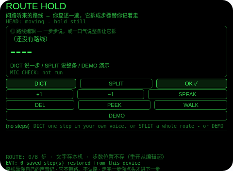
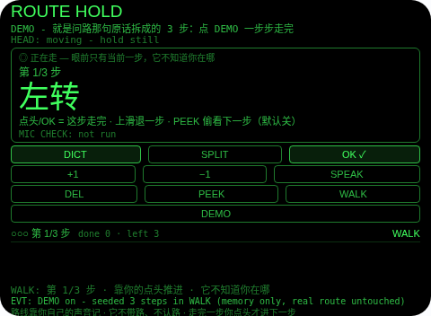
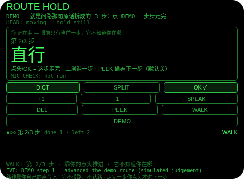
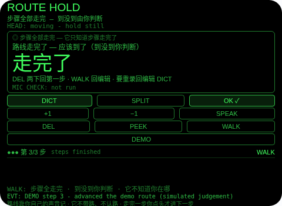

# Route Hold（路线默念）

**Studio 导入地址**（复制到 Global AIUI Studio 的 Import Project 输入框）：

```
https://github.com/sakai55/rokid/tree/agent-route-hold
```


注意力外挂系列 HO04（HOLD 默念型）。问路，对方一口气说完：「左转、直行、第二个灯右转。」边走边在脑子里默念，聊一句话、看一眼手机，就走错一个路口。本 Agent 的做法：对方说完，你自己复述一遍（麦克风只听你一个人）——可以一步步说、每步核对后存下；也可以一口气说整条，它按步骤词拆开摆在你面前，你删掉拆错的步再存。走的时候，眼前只有当前这一步，你判断这步走完了，点一下头才进下一步。它不知道你在哪，也永远不会假装知道。






## 解决的问题

口头路线是典型的短时记忆陷阱：三五步无关联的指令同时涌进来，脑子只能靠默念维持，边走边念还占着注意力，一分心就错步。本 Agent 把这段路外包掉——存路线只花一次复述（你说一遍），入步必过一次核对（防识别听错），整条一口气说的先拆成待存步摆出来给你删改（拆错不可怕，存错才可怕），路线落盘成文字（说完先干别的、过会儿再走都行），走路时零记忆负担（眼前只有当前一步，判断走完点一下头）。脑子从复读机里解放出来，路线交给眼镜记。

## 注意力外包设计（HOLD 默念型）

- **麦克风只听你，不听指路人**：建路线 = 你把刚听到的路线用自己的声音复述一遍。本 Agent 从不声称在听、在录、在转写对方说话——界面状态行、EVT 措辞、本文档都写明「只听你复述」。对方说一遍，你说一遍，眼镜从你这遍接住。
- **它没有任何定位能力，这是刻意的（如实说明，第一位）**：本 Agent 不申请定位权限，没有地图、没有位置跟踪——它根本不知道你在哪。推进一步靠的是你的判断：你觉得这步走完了，点头（或 OK / 下滑）才进下一步；它永远不会自己推进。步骤走完时它只说「路线走完了，应该到了」——走完的是步骤，到没到由你判断，它从不断言到达。
- **确认即存步，未确认绝不存**：每一步先落在核对片上，标注「ASR 听写待确认」，只有你点 OK（Enter）才存入路线落盘。听错了先改：DICT 重念替换待确认步（它本来就没存下），或 DEL 丢弃；**点头在核对时被刻意忽略**——点头永远不存步。路线上限 8 步，第 9 步如实拒绝并保留待确认步，绝不静默丢弃或覆盖。
- **SPLIT 整条拆步是「提案」不是「保存」**：一口气说整条时，它按步骤词拆分（然后 / 接着 / 其次 / 最后、句号、紧挨转弯词或「第二个灯」这类序号地标前的逗号、「再」只在后面跟转弯词时才算步骤词——「再走一百米」是一步，不会被腰斩），拆出的步全部摆在核对屏上：DEL 逐个删掉拆错的，OK 才全部存下。若一句话里找不到步骤词，它就如实整句当作一步走核对门，绝不靠猜硬拆。
- **超出上限会出声说明**：核对屏待存步超过剩余空位时，存得下的存下，存不下的会朗读明说「还有 N 步没存下，路线满了」——绝不静默丢弃。
- **解析贴近原话**：只剥掉步首的裸步骤词（先 / 然后 / 接着 / 最后）和句末标点——它们是连接词，不是步骤本身。超过 30 字的听写截到 30 字并在 EVT 行写明截断；剥完为空的按没听清拒绝，绝不猜。
- **显示截断如实标注**：超过 12 字的步显示为前 12 字 + 「…」，全文留在存储里、走路推进与 SPEAK 读的是全文；核对片与步行屏都会标注「显示截断」。
- **步骤以文字落盘，这是它的本职（如实说明）**：`{步骤文字}` 纯文字（key `routeHold`，最多 8 步），每次变更即存，关掉 Agent、之后再打开还在——在路口说、走到一半想起来再走，全靠这条。**走到的步数位置不落盘**：重开回到编辑态，再走从第一步开始。存的是文字，从不存音频；界面常驻行与本文档都写明。
- **走路时只显示当前一步（PLAN 定版）**：下一步默认不预告。PEEK 是明确标注的例外：一个开关，点一下把下一步以小字亮出来瞥一眼，再点关掉；推进、后退、重置都会自动关掉它——是瞥一眼，不是常开模式。
- **点头 = 这步走完了，本 Agent 的核心 HOLD 手势**：走路时头稳住点一下头，推进一步并当场朗读新一步（「第2步：直行」）。头不稳的点头不算数；**点头永不后退**（后退是刻意的上滑）、永不存步、永不接受待存步、永不删除。
- **走错有补救**：上滑退回一步（朗读退回的步）；从「走完」退回会重新武装收尾播报；走路中 DEL 两下重置回第一步；要改路线点 WALK 回编辑态重录——**走路中不能改路线**，DICT / SPLIT 在走路时被如实拒绝并告诉你先回编辑。
- **删除是两步**：编辑态 DEL 第一下武装、第二下才删焦点步；做别的动作或过 6 秒自动解除武装。核对屏里 DEL 删待存步是一下生效——待存步从未存下，没有需要保护的东西。
- **为什么胸前设备做不了**：走路时递回要进视线内（双手要扶包、看路，步骤得挂在眼前）、推进确认要靠头部信号（低头摸胸口按键既危险又打断看路）、复述要贴着你的嘴（头部麦克风听你复述最清楚）——三条都只有头戴设备成立。

## 功能流程

1. **存路线（DICT 逐步）**：先做佩戴者模式麦克风可用性检查（结果单独一行 `MIC CHECK:`，检查流读完设置立即停轨），再用宿主 SpeechRecognition（zh-CN）在它自己的麦克风上听你复述的一步；落在核对片上，OK 存下，DICT 重念替换，DEL 丢弃。
2. **存路线（SPLIT 整条）**：一口气复述整条路线，同样的麦克风检查 + 宿主识别，然后按步骤词拆成待存步清单：滑动选步、DEL 删错步、OK 全部存下（超限部分朗读说明）。找不到步骤词的整句自动转成单个待确认步。
3. **走路（WALK）**：点 WALK（或编辑态点 OK）开始，眼前只剩当前一步大字 + 小字步数（第 2/3 步）；头稳点头 / OK / 下滑 = 这步走完，朗读下一步；上滑 = 退一步；PEEK = 瞥一眼下一步（默认关）；DEL 两下 = 回第一步；WALK = 回编辑。
4. **收尾**：最后一步走完后横幅显示「路线走完了 — 应该到了（到没到你判断）」并朗读一次；退回再走完会重新播报。
5. **DEMO**：内存播入 PLAN 原句拆成的 3 步（左转 / 直行 / 第二个灯右转），直接进入走路态；继续点 DEMO 依次推进到走完；全程不写真实存储，退出后真实路线原样恢复。

## 手势映射

主流程（复述 → 核对 → 存步 → 点头推进 → 收尾）靠滑动 + 单击 + 点头即可走完：

| 手势（镜腿触控板） | 键事件 | 在本 Agent 中的作用 |
|---|---|---|
| 单击 | Enter | 情境主操作 OK：核对片上 = **确认存步**；核对屏上 = **全部存下**；编辑态 = 开始走路；走路时 = 这步走完，推进一步 |
| 下滑 | ArrowDown | 编辑/核对时移动焦点（下一步 / 下一个待存步）；走路时 = 推进一步（与点头同义，头要看路时用） |
| 上滑 | ArrowUp | 编辑/核对时移动焦点（上一步）；走路时 = 退回一步（朗读退回的步） |
| 点头（头稳时） | `onHeadGesture('nod')` | **这步走完了**（本 Agent 的核心手势）：走路时一下推进一步并朗读新步；头不稳不算；永不后退、永不存步、永不接受待存步、永不删除 |
| 双击 | Backspace | 系统返回（不拦截） |
| 长按 | — | 唤醒助手（系统级，不拦截） |

屏幕按钮（每个都有保留理由）：

| 按钮 | 理由 |
|---|---|
| DICT | 逐步复述存步/重念替换的主动作（一步步建路线全靠它） |
| SPLIT | 整条复述拆步的主动作（一口气说完，拆开给你核对） |
| OK ✓ | Enter 的镜像（情境主操作：存步 / 全部存下 / 开始走 / 推进一步） |
| +1 / −1 | 焦点移动（编辑/核对时选步，走路时推进/后退；Enter 旁的手动等价物） |
| SPEAK | 朗读当前语境：待确认步全文 / 待存步清单 / 整条路线 / 走路时只读当前步全文 |
| DEL | 核对片上 = 丢弃待确认步；核对屏上 = 删掉焦点的待存步；编辑态 = 两步删除焦点步；走路时 = 两步重置回第一步 |
| PEEK | 瞥一眼下一步（默认关；只走路时有效，推进/后退/重置后自动关） |
| WALK | 模式开关：编辑态 = 开始走路；走路时 = 回到编辑（改路线只能在编辑态） |
| DEMO | 演示 PLAN 原句 3 步路线走完全程（提审/自测用） |

## 权限

| 权限 | 用途 |
|---|---|
| `RECORD_AUDIO` | DICT / SPLIT 的佩戴者模式麦克风可用性检查（getUserMedia，检查流立即停轨）+ 宿主 SpeechRecognition 听你复述的步骤/整条路线（zh-CN） |

只申请 1 项。**刻意不申请 `GEOLOCATION`**：脑子里默念的路线不需要定位，本 Agent 永远不知道你在哪。无相机（说出来的路线不需要拍照）。麦克风模式只作用于 getUserMedia 流，永不影响宿主 `SpeechRecognition`；聆听状态标注为 (host ASR)。TTS 用宿主固定音色，永不设置 utterance 的 `lang`（官方文档注明该属性不生效）。麦克风只在用户点 DICT / SPLIT 时启动，用完立即停掉全部媒体轨道。

## 打包与预览

```bash
cd ~/workspace/rokid/route-hold
~/tools/bin/aix pack . -o ../dist/route-hold.aix
~/tools/bin/aix list ../dist/route-hold.aix
~/tools/bin/aix preview . --html-out artifacts/preview.html
```

本地预览截图走 `~/workspace/preview-tools/` 的本地 Ink + puppeteer 路线（`shot-route.js`，独立页面副本 `preview-route.html`）。

## 真机测试（GO 的 Path 1，无线缆）

1. 将本项目导入 Global AIUI Studio（GitHub 导入分支 `agent-route-hold`）。
2. 在 Studio 中构建并保存新的 AIX 版本（构建与提审）。
3. 手机 Hi Rokid App：设置 → 开发者选项 → AIUI → 更新眼镜资源包，等到「智能体资源包下载成功」。
4. 在眼镜上语音打开：「乐奇，打开 Route Hold 智能体」。
5. 验收点：DICT 逐步复述三步短路线时宿主识别的实际返回形态与核对片把关是否顺手；SPLIT 一口气说「左转、直行、第二个灯右转」时拆步是否正确、口语变体（带「然后/接着/最后」、带「再走一百米」）的拆分是否符合预期；边走边点头推进的误触率（头不稳不推进是否符合手感）；实际按存下路线走一条陌生路，全程只靠点头推进是否顺手；走到最后一步的收尾播报与「退回再走完重新播报」；关掉 Agent 再打开，步骤是否仍在、步数位置是否回到编辑态（设计如此）；存满 8 步后第 9 步被拒且待确认步不丢；SPLIT 待存步超限时「没存下」的朗读说明是否清楚。

## 真机测试信息

| 字段 | 值 |
|---|---|
| Studio 名称 | Route Hold（待导入后回填） |
| Version / Build | 1.0.0 / 待导入后回填 |
| App Category | 待导入后回填 |
| Intent Description | Hear-it-once route keeper: repeat spoken directions in your own voice, confirm each step (or split a whole route and prune it), then walk with only the current step in view - a nod means you judge it done. No map, no positioning. |
| Agent ID | 待导入后回填 |
| 状态 | 本地构建完成，待导入 Studio |

## 验证情况

**已验证（本地）**

- 静态校验：app.json / package.json / `<script def>` 三处 JSON 解析通过；抽出的 `<script setup>` 与 app.js 均 `node --check` 通过；无 `Page(`/`App(`/`Widget(`/`workers:` 误用；权限仅 `RECORD_AUDIO`，全仓无 `GEOLOCATION` 字样出现在代码中。
- Node harness **113 条断言全过**：权限恰为 [RECORD_AUDIO]；单步解析电池（剥步首步骤词/句末标点、整步原话保留、空与裸步骤词拒绝）；拆步电池（PLAN 原句经逗号+序号地标拆对、步骤词各变体、「再」后跟转弯词才拆而「再走一百米」保持整步、无步骤词整句保留、句号分步）；DICT 与 SPLIT 两条听写核对流程（未确认绝不存、确认/接受前零存储写入、条目恰为 {text} 单字段）；重念替换待确认步、垃圾听写拒绝；核对屏提案 → 删错步 → 接受全程落盘文本精确；拆不出 2 步时整句转单步核对门；把核对屏删空回到编辑且原路线不变；8 步封顶拒绝且待确认步保留、路线满时接受被拒且提案保留、部分接受只存得下的且朗读说明没存下的数目；持久化往返（模拟重开后步骤恢复、回到编辑态、重开不重写存储）；走路纪律（头不稳点头不算、头稳点头一下恰推进一次且朗读新步、收尾句每次到达只报一次且退回后重新武装、退到第一步再退不算）；PEEK 默认关 / 开关切换 / 推进后自动关 / 最后一步与走完后的行为；走路重置两步制 + 推进动作解除武装；走路中 SPEAK 只读当前步全文；走路外点头纪律（永不存步、永不接受提案）与走路中 DICT 被拒；纯键位 + 点头走完一条路线；DEMO 全程真实存储逐字节不变；麦克风检查先于 ASR 且检查轨道先停（OverconstrainedError 回退有标注）；全部朗读串扫描无导航/定位/到达断言；TTS 从不设置 lang。
- `aix pack` 成功（约 25.7 KB），`aix list` 确认 README.md 在包内、artifacts 已排除。
- 预览截图 4 张已生成并逐张目检：EVT 行与底部常驻诚实行均在画面内（点击坐标经帧哈希探针逐状态标定）。

**未验证（如实说明）**

- **它不知道你在哪（第一位）**：本 Agent 没有任何定位手段——不申请定位、无地图、无位置跟踪。推进完全靠你的判断：你在错的路口点头，它就照样进下一步；步骤走完只代表步骤走完，不代表你到了。陌生路线请先在路口核对周围地标再点头，收尾句「应该到了」之后请自己确认目的地。
- **听写是佩戴者自己的复述（第一位并列）**：步骤文字 = 宿主 ASR 听你复述的结果，不是对方原话的转写。本 Agent 听不到、也不声称能听到对方说话；对方说得快、你复述时记错或漏复述，路线就跟着错——核对片与核对屏是唯一的把关点，识别成什么样就显示什么样，错了一眼可见、重念或删改即可。
- 真机听写与拆步：安静/嘈杂路口宿主识别器听复述的准确度；真实口语里步骤词的千变万化（「到了红绿灯往左拐」「穿过地下通道」等）会让拆步出现合并/多拆，核对屏就是为这种情况设的；头部稳定性事件与点头手势在行走中的投递与误触率（走路时头动更多，点头在这里最坏是误推进一步，可上滑退回，但当时可能没察觉）；wx 存储在眼镜重启后的持久性；宿主 TTS 在嘈杂街头的可懂度。

## 提审资料 (Review Submission)

### Feature Description（480 字符）

> Route Hold keeps the directions a stranger rattles off in one breath - turn left, straight on, right at the second light - so your head does not have to. Repeat the route in your own voice: step by step, each step confirmed, or all at once and split into steps you review before saving. While you walk, only the current step is in front of your eyes; a steady nod means YOU judge it done and the next step appears. No map, no positioning - it never pretends to know where you are.

### Opening Message（408 字符）

> ## Route Hold
>
> Someone just told you the way in one breath? Repeat it back with **DICT** (one step at a time) or **SPLIT** (the whole route - it is split on markers and you prune the steps before saving). Then tap **WALK**: only the current step stays in view, and a steady **nod** moves to the next step when *you* judge it done. It has no map and no position - the walking is yours, the remembering is its.

### Preview Media

- `preview-route-hold-index.png` — 首页初始态：空路线 + 常驻诚实行（路线靠你自己的声音记 · 它不带路、不认路 · 你点头才进下一步）
- `preview-route-hold-walk1.png` — DEMO 走路第 1 步：眼前只有当前一步「左转」+ 第 1/3 步
- `preview-route-hold-walk2.png` — DEMO 走路第 2 步：点头推进到「直行」，PEEK 关（下一步不显示）
- `preview-route-hold-done.png` — DEMO 步骤走完：「路线走完了 — 应该到了（到没到你判断）」

> 正式提审需 3–5 个媒体文件且含 ≥1 段视频（≤60 s），视频待 GO 真机自测时补录。

### Change Log（Build 1.0.0）

**Features added**

- 复述存步 + 核对门：你用自己的声音复述问路听来的路线（佩戴者模式麦克风检查在前、宿主 ASR 在后），逐步说每步先落核对片、确认才存；整条一口气说则按步骤词拆成待存步清单，删错步后再全部存下，拆不出步骤词就整句当一步走核对门；点头永不存步、永不接受提案
- 点头推进走路：走时眼前只有当前一步大字，头稳点头 / OK / 下滑 = 你判断这步走完，朗读下一步；上滑退回一步；收尾只宣布步骤走完，到没到由你判断
- PEEK 偷看下一步：默认关的开关，瞥一眼下一步，推进/后退/重置自动关闭
- 文字落盘：步骤 {文字} 纯文字最多 8 步存本机，关掉 Agent 再开还在（步数位置不存，重开从编辑起）；显示超 12 字截断并标注，全文保留；超限存不下的步会朗读说明，绝不静默丢弃
- DEMO：PLAN 原句「左转、直行、第二个灯右转」3 步路线内存走完推进与收尾全程，不写真实存储，退出精确恢复

**Improvements**

- 无（首个版本）

**Fixes**

- 无（首个版本）
