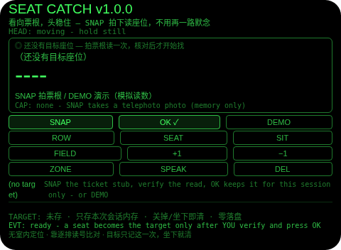
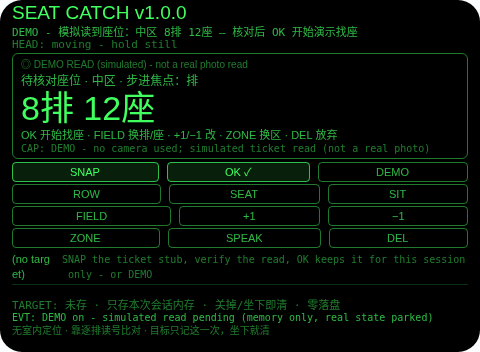
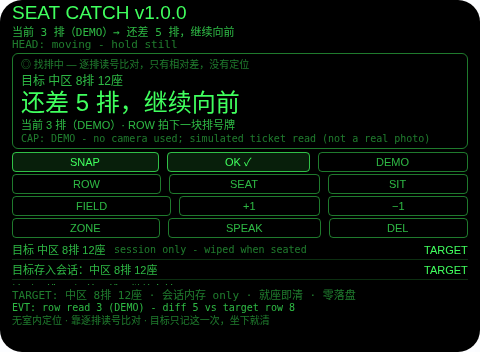
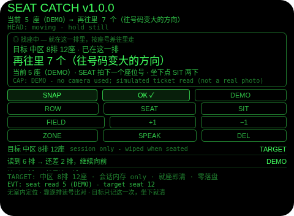
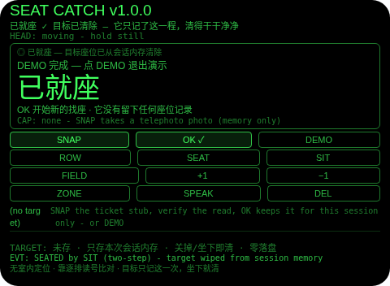

# Seat Catch（找座外包）

**Studio 导入地址**（复制到 Global AIUI Studio 的 Import Project 输入框）：

```
https://github.com/sakai55/rokid/tree/agent-seat-catch
```


注意力外挂系列 HO05（HOLD 默念型，本组收官）。电影院、剧场、会场、火车车厢——检票进场后满场找座，是最典型的短时记忆陷阱：排号座位号在票根上看一次忘一次，走一路低头掏票根看三回。本 Agent 的做法：看向票根头稳住，拍一张长焦照片，主机大模型读出区/排/座，放大给你核对，你确认了才成为目标——而且只活在本次会话的内存里，坐下就清、关掉就没。之后它陪你逐排找：你路过一块排号牌就拍一块，它读出当前排，只告诉你差几排；进了排，拍最近的座位号，它告诉你再往里几个。它没有任何室内定位，永远只报相对差。

## 解决的问题

找座难的不是座位本身，是「从看清票根到坐下」这段路不能想别的：手里有包、眼睛要看路、脑子里还得留着「8 排 12 座」反复默念。本 Agent 把这一程外包掉——捕获只花一次注视（拍照读座），保存必过一次核对（防机器读错），找的过程零默念（目标挂在会话里，每一步只报相对差），终点自动清账（坐下确认即擦除，不留任何记录）。脑子从复读机里解放出来，座位交给眼镜记，且只记这一程。

## 注意力外挂设计（HOLD 默念型）

- **和 HO01 number-catch 的分工（如实说明，第一位）**：number-catch 是通用号码的「存住 + 回看」——房号、柜号、取餐号存下来常驻显示。seat-catch 不是给座位号再做一个存档：存目标只是第一步，产品本体是**找座全流程**——存完之后逐排比对、逐座逼近，直到你说坐下了为止。它的主屏不是号码回看，而是「还差 3 排」「再往里 4 个」这类相对提示；存的方式也相反：number-catch 的号码落盘留存，本 Agent 的目标**零落盘**（见下条）。
- **目标只存会话内存，零落盘（本 Agent 的核心纪律）**：座位号是寿命最短的号码——坐下即作废。为它落盘毫无意义，所以本 Agent 全页没有任何存储调用：确认后的目标只是一个运行时字段，坐下确认擦除、放弃找座擦除、关掉 Agent 擦除。界面常驻行写明「只存本次会话内存 · 关掉/坐下即清 · 零落盘」，完成页写明「它没有留下任何座位记录」。
- **读数走官方拍照路径，且过三道门**：SNAP / ROW / SEAT 分别拍票根、排号牌、座位号（都是 `telephoto` 长焦），照片 Blob 转 data: URL 发给主机 `LanguageModel` 读图，回复格式写死（`SEAT: 区|排|座` / `ROW: 排` / `SEATNO: 座`，读不到回 `NONE`）；解析器只接受干净格式或紧贴的「N 排 M 座」式抢救，散文式回复一律判读失败——**读不清就是失败，绝不猜一个座位出来**。平台没有 OCR，本 Agent 也不声称有。照片只活在内存里，读完即弃，从不保存。
- **确认门：核对后 OK 才成为目标**：票根读数先落在核对屏，大字 + 「机器读数，可能读错」的标注；改错不用嘴——FIELD 切排/座焦点、+1/−1 步进（座位号的字母后缀如 12A 在步进时保留）、ZONE 轮换左/中/右/无区。读数不全（排或座缺失）时 OK 如实拒绝并保留待核对内容；DEL 一下放弃未确认读数（它本来就没成为目标）。**点头在核对屏被刻意忽略——点头永不存目标。**
- **引导只有相对差，没有定位（诚实边界，第二位）**：本 Agent 不申请定位、无地图、无场馆平面图、没有任何指向座位的箭头。它给的每句提示都是你刚读到的号与目标号的算术差：找排阶段「还差 3 排，继续向前 / 走过 1 排，往回走 / 就是这一排」；找座阶段「再往里 4 个（往号码变大的方向）/ 往回 2 个（往号码变小的方向）/ 就是这个座位」——方向来自座位号本身的递增顺序，看座椅靠背就懂。排号读数命中时自动进入找座阶段；你也可以在找排阶段点 OK 按**你自己的判断**进排，界面与日志都会如实标注「未经读数核对」。全部朗读串经扫描，不含任何导航/定位/到达断言。
- **读失败永远有手动路**：没相机、没模型、模型不可用/报错/没读清、wx 回退照片无法转图——票根阶段落到空白核对屏并写明原因，步进填上排/座照样开始；找排/找座阶段 +1/−1 变成手动报当前排/座（全程标注「手动」）。拍照读数是加速器，不是门槛。
- **就座确认是两步制（点头与 SIT 共用）**：头稳的点头在本 Agent 里只有一个意思——「我坐下了」，且只在找座阶段有效：第一下只武装（「再点头一次确认就座」），第二下才擦除目标并落到完成页；头不稳的点头不算数。找排阶段、核对屏上的点头一律无效并说明原因：点头永不推进排数、永不确认读数。放弃找座同理是两步 DEL。
- **为什么胸前设备做不了**：找座全程双手要拿包、扶座椅、让行人，递回必须进视线（低头看胸口设备在暗场里既慢又挡路）；「看向票根/排号牌/座位号」要求相机与视线同轴（胸口相机拍到的是别人的后背和你的手）；就座确认靠头部信号（点头）而不是摸设备——三条都只有头戴设备成立。

## 功能流程

1. **读票根（SNAP）**：看向票根、头稳住点 SNAP，长焦拍照 → 主机大模型读出区/排/座 → 落核对屏（未确认，还不是目标）。
2. **核对（CONFIRM）**：大字核对读数；错了用 FIELD + 步进 / ZONE 改；OK = 成为目标（只进会话内存）；DEL = 放弃这次读数。
3. **找排（ROW）**：往里走，路过排号牌点 ROW 拍它 → 读出当前排 → 大字 + 朗读相对差（还差 N 排 / 走过 N 排）；命中目标排自动进下一阶段。读不到牌时 +1/−1 手动报排。
4. **找座（SEAT）**：进排后看向最近的座位号点 SEAT 拍它 → 读出当前座 → 「再往里 N 个 / 往回 N 个 / 就是这个座位」；读不到时 +1/−1 手动报座。
5. **就座（SIT / 点头）**：对准目标座坐下，点头两下或点 SIT 两下确认 → 目标立即擦除 → 完成页「已就座 · 它没有留下任何座位记录」；OK 开始下一次找座。
6. **DEMO**：票根屏点 DEMO 播入一次完整模拟找座（模拟读数 中区 8排 12座 → 逐排模拟读数 3/6/8 → 逐座模拟读数 5/12 → 就座完成），全程标注模拟、不动相机；真实状态（若有）被暂存，退出 DEMO 精确恢复。

## 手势映射

主流程（拍票根 → 核对 → 逐排读号 → 点头就座）靠滑动 + 单击 + 点头即可走完：

| 手势（镜腿触控板） | 键事件 | 在本 Agent 中的作用 |
|---|---|---|
| 单击 | Enter | 情境主操作 OK：核对屏 = **确认成为目标**；找排时 = 按你的判断进排找座；找座时 = 就座确认的一步（与 SIT 同义，两步制）；完成页 = 开始新的找座 |
| 下滑 | ArrowDown | −1：核对屏改小焦点字段（排/座）；找排/找座时手动报当前排/座 −1 |
| 上滑 | ArrowUp | +1：核对屏改大焦点字段（排/座）；找排/找座时手动报当前排/座 +1 |
| 点头（头稳时） | `onHeadGesture('nod')` | **我坐下了**（本 Agent 的核心手势）：只在找座阶段有效，两下制——第一下武装、第二下擦除目标进完成页；头不稳不算；永不存目标、永不推进排数、永不确认读数 |
| 双击 | Backspace | 系统返回（不拦截） |
| 长按 | — | 唤醒助手（系统级，不拦截） |

屏幕按钮（每个都有保留理由）：

| 按钮 | 理由 |
|---|---|
| SNAP | 拍票根的主动作（找排/找座阶段点它等同 ROW / SEAT，拍当前要读的号） |
| OK ✓ | Enter 的镜像（情境主操作：确认目标 / 判断进排 / 就座确认 / 新的找座） |
| DEMO | 一次完整模拟找座（提审/自测用；全程标注模拟读数，不用相机） |
| ROW | 找排阶段拍排号牌读数的主动作 |
| SEAT | 找座阶段拍最近座位号读数的主动作 |
| SIT | 「坐下了」的按钮等价物（与点头共用两步武装，第一下武装、第二下擦除目标） |
| FIELD | 核对屏步进焦点在排/座之间切换 |
| +1 / −1 | 核对屏改排/座数值；找排/找座阶段是无相机时手动报当前排/座的唯一入口 |
| ZONE | 核对屏轮换区（左区/中区/右区/无区） |
| SPEAK | 朗读当前语境：待核对座位 / 目标 + 当前相对提示 / 已就座状态 |
| DEL | 核对屏 = 放弃未确认读数；找排/找座时 = 两步放弃本次找座并擦除目标 |

## 权限

| 权限 | 用途 |
|---|---|
| `CAMERA` | SNAP / ROW / SEAT 的长焦拍照：票根、逐块排号牌、排内最近的座位号（照片 Blob 只在内存中用于一次读图尝试，读完即弃，永不保存） |

只申请 1 项。**刻意不申请 `RECORD_AUDIO`**：纠错靠步进键，没有需要麦克风的口述环节（朗读用宿主 TTS，不需要录音权限）。**刻意不申请 `GEOLOCATION`**：室内找座不需要也用不上卫星定位，本 Agent 永远不知道你在哪——它只有你确认的目标座位，和你刚拍给它看的当前排号/座号。TTS 用宿主固定音色，永不设置 utterance 的 `lang`（官方文档注明该属性不生效）。

## 打包与预览

```bash
cd ~/workspace/rokid/seat-catch
~/tools/bin/aix pack . -o ../dist/seat-catch.aix
~/tools/bin/aix list ../dist/seat-catch.aix
~/tools/bin/aix preview . --html-out artifacts/preview.html
```

本地预览截图走 `~/workspace/preview-tools/` 的本地 Ink + puppeteer 路线（`shot-seat.js`，独立页面副本 `preview-seat.html`；点击坐标按状态逐个探针标定——信息框高度变化会让命中带整体偏移一行，坐标表写在脚本头注里）。

## 预览截图







## 真机测试（GO 的 Path 1，无线缆）

1. 将本项目导入 Global AIUI Studio（GitHub 导入分支 `agent-seat-catch`）。
2. 在 Studio 中构建并保存新的 AIX 版本（构建与提审）。
3. 手机 Hi Rokid App：设置 → 开发者选项 → AIUI → 更新眼镜资源包，等到「智能体资源包下载成功」。
4. 在眼镜上语音打开：「乐奇，打开 Seat Catch 智能体」。
5. 验收点：暗光影院里长焦拍票根的读数成功率与读错形态（区/排/座哪一项最容易错、核对屏步进改错是否顺手）；逐排拍排号牌的节奏（走一步拍一块是否跟得上人流、读数延迟）；排内拍座椅靠背号的可读距离；点头两下就座确认在坐下动作中的误触/漏触（人坐下时头本来就会动，头稳判定是否过严）；关掉 Agent 重开目标是否确实不存在（设计如此）；DEMO 全程在无票根时向他人演示是否讲得清。

## 真机测试信息

| 字段 | 值 |
|---|---|
| Studio 名称 | Seat Catch（待导入后回填） |
| Version / Build | 1.0.1 / 待导入后回填 |
| App Category | 待导入后回填 |
| Intent Description | Find-your-seat keeper: photo the ticket stub once, verify the seat big, then be guided relatively - row sign by row sign, seat number by seat number - until you say you are seated. Session memory only, wiped when seated. No indoor positioning. |
| Agent ID | 待导入后回填 |
| 状态 | 本地构建完成，待导入 Studio |

## 验证情况

**已验证（本地）**

- 静态校验：app.json / package.json / `<script def>` 三处 JSON 解析通过；抽出的 `<script setup>` 与 app.js 均 `node --check` 通过；无 `Page(`/`App(`/`Widget(`/`workers:` 误用；权限仅 `CAMERA`，页面源码中无任何存储 API、无 `GEOLOCATION`/`RECORD_AUDIO`/ASR 字样（与功能严格一致：纠错靠步进、无口述环节）。
- Node harness **137 条断言全过**：三路读数解析电池（管道格式、字母座位号、区抢救读、NONE 形式、散文拒绝、排 0/纯字母拒绝）；确认门（未确认读数绝不成为目标、读数不全 OK 被拒且待核对保留）；步进纠错（焦点切换、排/座 ±1、字母后缀保留、区轮换、更正标记、从空白步进落到 1）；纯手动填数也能成为目标；引导数学（还差 3 排/走过 2 排/排命中自动进找座、座号往大/往小差数、命中播报）；点头纪律（头不稳忽略、点头永不存目标、找排阶段点头无效、两下稳点头就座并擦除）；SIT 两步与点头共用武装、就座播报明说已清除；DEL 各路径（核对丢弃、两步放弃、其他动作解除武装）；DEMO 全程（模拟读数标注、逐排逐座推进、真实目标暂存后逐字节恢复、中途退出亦可恢复）；相机 + LLM 正路（断言 telephoto 模式、字节数上 CAP 行、拍后停轨、prompt 形态 = user 内容里 text + image_url data: URL、system 只走 initialPrompts）；排/座读数走同一套 machinery；全部 LLM 失败变体（不可用/NONE 回复/抛错/无模型）与无相机宿主都落到有标注的手动路；wx 回退照片如实标注读不了；键位全程（Enter/方向键）；onUnload 后目标与待核对全清（会话性验证）；全部朗读串扫描无导航/定位/到达断言；TTS 从不设置 lang。
- `aix pack` 成功（18.57 KB），`aix list` 确认包内文件集干净（artifacts 已排除）。
- 预览截图 5 张已生成并逐张目检：首页 / DEMO 读数待核对 / 找排中（还差 5 排）/ 找座中（再往里 7 个）/ 已就座（目标已清除）；点击坐标按状态逐个探针标定（信息框变高时命中带上移一行，DEMO/SIT 在不同状态用不同坐标，见 `shot-seat.js` 头注）。

**未验证（如实说明）**

- **它不知道你在哪（第一位）**：本 Agent 没有任何室内定位手段——不申请定位、无地图、无场馆图。它只会算差：你在错的过道里拍排号牌，它照样按读到的排号给差值；排号牌缺失/被挡时只能靠手动报排。第一次去的场馆请先确认自己进的是目标区那一侧的门，区（左/中/右）核对在核对屏上就是为这件事设的。
- **读数来自机器读图（第一位并列）**：票根字体千差万别（热敏纸、手写改座、电子票截图反光），模型读错区/排/座任何一项都会把目标设错——核对屏是唯一的把关点，读成什么样就显示什么样，错了一眼可见、步进改对再 OK。排号牌与座椅号在暗场、远距离、倾斜角度下的读出率未经真机验证；读不到时手动报排/报座是正式路径，不是凑合。
- **零落盘的另一面**：目标只记这一程是刻意的，但也意味着中途关掉 Agent（或眼镜重启）目标即消失，需要重新拍票根——票根请先别扔。
- 真机事项：头部稳定性事件与点头手势在「坐下」这个动作本身中的投递与误触率（坐下时头会晃，两下制的武装窗口 6 秒是否够用）；宿主 TTS 在影院散场噪声中的可懂度；长焦在暗光下的实际成像质量。

## 提审资料 (Review Submission)

### Feature Description

> Seat Catch finds your seat so your head does not have to memorise it. Glance at the ticket stub: a telephoto photo is read into zone, row and seat, you verify it big, and it is kept in session memory only - never saved, wiped when you sit down. Then it guides you relatively, row sign by row sign and seat number by seat number (3 rows to go, 7 more in), with no indoor positioning and no pretence of knowing where you are.

### Opening Message

> ## Seat Catch
>
> Ticket checked and already forgetting your seat? Aim at the stub and tap **SNAP** - the read lands big for you to verify (steppers fix a misread), and **OK** keeps it for this trip only. Then photo each row sign with **ROW** and the nearest seat number with **SEAT**: it only ever tells you the difference. Seated? **SIT** twice (or nod twice) and the target is wiped.

### Preview Media

- `preview-seat-catch-index.png` — 首页初始态：无目标 + 常驻诚实行（无室内定位 · 靠逐排读号比对 · 目标只记这一次，坐下就清）
- `preview-seat-catch-confirm.png` — DEMO 模拟读数待核对：中区 8排 12座大字 + 核对操作行
- `preview-seat-catch-grow.png` — 找排中：读到 3 排 →「还差 5 排，继续向前」
- `preview-seat-catch-gseat.png` — 找座中：读到 5 座 →「再往里 7 个（往号码变大的方向）」
- `preview-seat-catch-done.png` — 已就座：目标已清除 + 「它没有留下任何座位记录」

> 正式提审需 3–5 个媒体文件且含 ≥1 段视频（≤60 s），视频待 GO 真机自测时补录。

### Change Log（Build 1.0.0）

**Features added**

- 拍照读票根 + 核对门：长焦拍票根，主机大模型读出区/排/座落核对屏大字显示，步进（排/座焦点 + ±1，字母座位号后缀保留）与区轮换纠错，OK 才成为目标；读数不全如实拒绝，点头永不存目标
- 逐排逐座相对引导：找排阶段逐块拍排号牌读当前排，只报相对差（还差/走过/就是这排），命中自动进排；找座阶段拍最近座位号，按座号差给「再往里 N 个（往号码变大方向）」式提示；全程无室内定位、无到达断言
- 会话级目标（零落盘）：目标只存运行时内存，坐下确认（点头/SIT 两步制）即擦除并落完成页，放弃找座（两步 DEL）与关掉 Agent 同样擦除；全套读失败/无相机/无模型时步进手动路全程可用
- DEMO：一次完整模拟找座（模拟票根读数 → 逐排 3/6/8 → 逐座 5/12 → 就座完成），全程标注模拟、不用相机，真实状态暂存后精确恢复

**Improvements**

- 无（首个版本）

**Fixes**

- 无（首个版本）

### Change Log（Build 1.0.1）

**Features added**

- 无

**Improvements**

- 无

**Fixes**

- 删除 FileReader（Ink 运行时不存在，真机必死）：照片 Blob→dataURL 改走官方文档路径 `blob.arrayBuffer()` + 分块 `btoa`，失败接全局错误码 E2005 并如实显示为读数失败。
