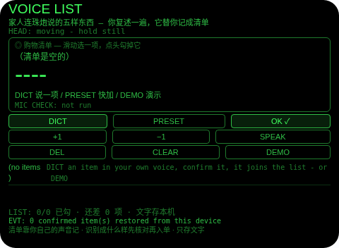
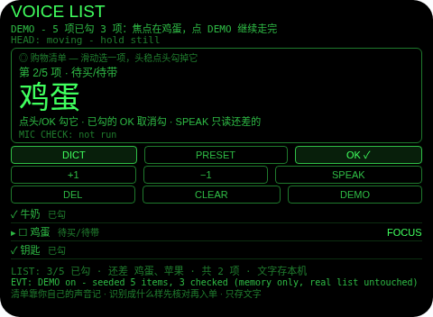
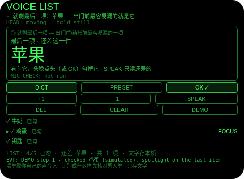
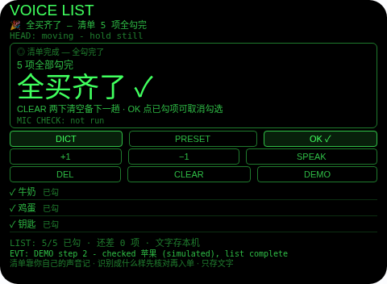

# Voice List（语音清单）

**Studio 导入地址**（复制到 Global AIUI Studio 的 Import Project 输入框）：

```
https://github.com/sakai55/rokid/tree/agent-voice-list
```


注意力外挂系列 H03（HOLD 默念型）。出门前家人连珠炮：牛奶、鸡蛋、钥匙、洗手液、苹果——五样东西一口气砸过来，走到门口就忘一半。本 Agent 的做法：家人说完，你自己复述一遍（麦克风只听你一个人），每项先落在核对片上，你确认了才进清单；清单以文字存在眼镜里，关掉 Agent 也不会丢。到店之后清单就挂在视线里：看向货架上的那一项，头稳住点一下头就勾掉；只剩最后一项时，它会被放大并朗读一次——就是出门前最容易漏的那一项。






## 解决的问题

听觉短时记忆对「连珠炮清单」最不友好：五项无关联的东西同时涌进来，脑子只能靠默念维持，一被打断就丢。本 Agent 把这段路外包掉——建单只花一次复述（你说一遍），入单必过一次核对（防识别听错），清单落盘成文字（回家路上、到店之前都不怕忘），购物时零记忆负担（清单挂在视线里，点头即勾），最后收尾有聚光提醒（只剩一项时放大 + 朗读，出门/结账前不漏项）。脑子从复读机里解放出来，清单交给眼镜记。

## 注意力外包设计（HOLD 默念型）

- **麦克风只听你，不听家人**：建单 = 你把刚听到的东西用自己的声音复述一遍。本 Agent 从不声称在听、在录、在转写对方说话——界面状态行、EVT 措辞、本文档都写明「只听你复述」。家人说一遍，你说一遍，眼镜从你这遍接住。
- **确认即入单，未确认绝不入单**：每一项先落在核对片上，标注「ASR 听写待确认」，只有你点 OK（Enter）才进清单落盘。听错了先改：DICT 重念替换待确认项（它本来就没入单），或 DEL 丢弃；**点头在核对时被刻意忽略**——点头永远不入单。清单上限 8 项，第 9 项如实拒绝并保留待确认项，绝不静默丢弃或覆盖。
- **解析贴近原话**：只剥掉句首的裸引导词（买 / 要买 / 我要买 / 带 / 拿 / 别忘了…）和句末标点——「买一瓶洗手液」保留数量说法，不会被「清洗」成你没说过的话。超过 30 字的听写截到 30 字并在 EVT 行写明截断；剥完为空的按没听清拒绝，绝不猜。
- **预置快加走同一道核对**：PRESET 在 牛奶 / 鸡蛋 / 钥匙 间轮换，落在同一张核对片上（再点换下一项，OK 入单）。快加是为不方便开口的场合准备的，不是对核对纪律的绕行。
- **显示截断如实标注**：超过 12 字的项显示为前 12 字 + 「…」，全文留在存储里、SPEAK 读的是全文；核对片与焦点行都会标注「显示截断」。
- **清单以文字落盘，这是它的本职（如实说明）**：`{内容, 是否已勾}` 纯文字（key `voiceList`，最多 8 项），每次变更即存，关掉 Agent、之后再打开还在——在家说、到店买，全靠这条。存的是文字，从不存音频；界面常驻行与本文档都写明。
- **点头 = 勾选，本 Agent 的核心 HOLD 手势**：到店看向货架上的那一项，头稳住点一下头，焦点项即被勾掉并当场朗读（「牛奶，勾了 3/5」）。头不稳的点头不算数；**点头永不取消勾选**（取消是刻意的 Enter 切换）、永不入单、永不删除。焦点用滑动 / +1 / −1 移动，打开时自动落在第一个未勾项上。
- **进度只报还差的**：计数行写「已勾 3/5 · 还差：鸡蛋、钥匙」；SPEAK 只朗读未勾项的全文，绝不念已勾的。
- **最后一项聚光**：只剩一项未勾时，它被放大显示并朗读一次（「就剩最后一项：钥匙」）——出门前、结账前最容易漏的就是这一项。聚光会重新武装：剩余数离开 1 之后再回到 1（比如把已勾的取消勾选、又勾回去），会再朗读一次，不装没发生过。「全买齐了」同样每次到达只报一次。
- **删除与清空都是两步**：DEL 第一下武装、第二下才删焦点项；CLEAR 两下才清空整单（朗读一次「清单已清空」）；做别的动作或过 6 秒自动解除武装。
- **为什么胸前设备做不了**：勾选要靠「看向货架 + 头部信号」定位你正在看的那一项（胸前设备没有头部朝向与停稳/点头信号）、递回要进视线内（推着购物车双手不空，清单得挂在眼前）、建单要贴着你的嘴（头部麦克风听你复述最清楚）——三条都只有头戴设备成立。

## 功能流程

1. **建单（DICT）**：先做佩戴者模式麦克风可用性检查（结果单独一行 `MIC CHECK:`，检查流读完设置立即停轨），再用宿主 SpeechRecognition（zh-CN）在它自己的麦克风上听你复述的一项。
2. **核对片**：听到的项以大字显示 + 来源标注（ASR 听写 / PRESET）。OK = 入单；DICT = 重念替换；DEL = 丢弃这项；PRESET = 换下一预置项。
3. **购物（SHOP）**：清单在视线内，滑动选焦点，看向货架上的那一项头稳点头勾掉，或 Enter 勾选/取消勾选；进度行随时报还差哪几项。
4. **收尾**：只剩一项 → 聚光放大 + 朗读一次；全勾完 → 朗读一次「全买齐了」+ 横幅；CLEAR 两下清掉整单备下一趟，或留着（勾选状态一并保存）。
5. **DEMO**：内存播入 5 项已勾 3 项（牛奶✓ / 鸡蛋 / 钥匙✓ / 洗手液✓ / 苹果），焦点在鸡蛋；继续点 DEMO 依次走完「勾鸡蛋 → 最后一项聚光 → 勾苹果 → 全买齐」；全程不写真实存储，退出后真实清单原样恢复。

## 手势映射

主流程（复述 → 核对 → 入单 → 点头勾选 → 收尾）靠滑动 + 单击 + 点头即可走完：

| 手势（镜腿触控板） | 键事件 | 在本 Agent 中的作用 |
|---|---|---|
| 单击 | Enter | 情境主操作 OK：核对片上 = **确认入单**；清单里 = 勾选焦点项 / 对已勾项取消勾选（切换） |
| 上滑 / 下滑 | ArrowUp / ArrowDown | 清单里移动焦点（上一项 / 下一项，环绕）；核对片上焦点锁定，滑动不生效 |
| 点头（头稳时） | `onHeadGesture('nod')` | **勾选焦点项**（本 Agent 的核心手势）：一下勾一项并朗读「X，勾了 n/m」；头不稳不算；永不取消勾选、永不入单、永不删除 |
| 双击 | Backspace | 系统返回（不拦截） |
| 长按 | — | 唤醒助手（系统级，不拦截） |

屏幕按钮（每个都有保留理由）：

| 按钮 | 理由 |
|---|---|
| DICT | 复述建单/重念替换的主动作（本 Agent 的建单全靠它） |
| PRESET | 无声快加：牛奶 / 鸡蛋 / 钥匙轮换到核对片，不方便开口时用 |
| OK ✓ | Enter 的镜像（情境主操作，含核对片上的确认入单与清单里的勾选切换） |
| +1 / −1 | 焦点移动（Enter 旁的手动等价物，头不方便动时用滑动键亦可） |
| SPEAK | 只朗读还差的项（核对片上改为朗读待确认项全文，供耳核对） |
| DEL | 核对片上 = 丢弃待确认项；清单里 = 两步删除焦点项 |
| CLEAR | 两步清空整单（下一趟用；一下武装、两下才清） |
| DEMO | 演示种子清单走完勾选、聚光与全勾流程（提审/自测用） |

## 权限

| 权限 | 用途 |
|---|---|
| `RECORD_AUDIO` | DICT 的佩戴者模式麦克风可用性检查（getUserMedia，检查流立即停轨）+ 宿主 SpeechRecognition 听你复述的清单项/替换项（zh-CN） |

只申请 1 项，无相机（说出来的清单不需要拍照）、无定位。麦克风模式只作用于 getUserMedia 流，永不影响宿主 `SpeechRecognition`；聆听状态标注为 (host ASR)。TTS 用宿主固定音色，永不设置 utterance 的 `lang`（官方文档注明该属性不生效）。麦克风只在用户点 DICT 时启动，用完立即停掉全部媒体轨道。

## 打包与预览

```bash
cd ~/workspace/rokid/voice-list
~/tools/bin/aix pack . -o ../dist/voice-list.aix
~/tools/bin/aix list ../dist/voice-list.aix
~/tools/bin/aix preview . --html-out artifacts/preview.html
```

本地预览截图走 `~/workspace/preview-tools/` 的本地 Ink + puppeteer 路线（`shot-voice.js`，独立页面副本 `preview-voice.html`）。

## 真机测试（GO 的 Path 1，无线缆）

1. 将本项目导入 Global AIUI Studio（GitHub 导入分支 `agent-voice-list`）。
2. 在 Studio 中构建并保存新的 AIX 版本（构建与提审）。
3. 手机 Hi Rokid App：设置 → 开发者选项 → AIUI → 更新眼镜资源包，等到「智能体资源包下载成功」。
4. 在眼镜上语音打开：「乐奇，打开 Voice List 智能体」。
5. 验收点：DICT 复述五项日常物品时宿主识别的实际返回形态与核对片把关是否顺手；安静与嘈杂环境各测一轮；在超市里看向貨架点头勾选的误触率（头不稳不勾是否符合手感）；只剩一项时聚光朗读是否响起、取消勾选再勾回是否重新提醒；全勾完后关掉 Agent 再打开，清单与勾选状态是否仍在；存满 8 项后第 9 项被拒且待确认项不丢。

## 真机测试信息

| 字段 | 值 |
|---|---|
| Studio 名称 | Voice List（待导入后回填） |
| Version / Build | 1.0.0 / 待导入后回填 |
| App Category | 待导入后回填 |
| Intent Description | Say-it-once list keeper: repeat the items in your own voice, confirm each one, then check them off with a nod at the shelf. The last remaining item is promoted and spoken once so it is not forgotten. |
| Agent ID | 待导入后回填 |
| 状态 | 本地构建完成，待导入 Studio |

## 验证情况

**已验证（本地）**

- 静态校验：app.json / package.json / `<script def>` 三处 JSON 解析通过；抽出的 `<script setup>` 与 app.js 均 `node --check` 通过；无 `Page(`/`App(`/`Widget(`/`workers:` 误用。
- Node harness **90 条断言全过**：听写核对流程（未确认项绝不入单、OK 之前零存储写入）、重念替换待确认项、解析电池（句首引导词剥离、完整短语保留原话、垃圾拒绝）、预置片轮换且走同一核对、8 项封顶拒绝且待确认项保留、存档条目恰为 {text, done} 两字段、持久化往返（模拟重开后条目与勾选状态恢复、焦点落第一个未勾项、重开不重写存储）、点头纪律（头不稳不勾、头稳点头只勾焦点项一次且当场朗读、点头永不取消勾选/永不入单）、Enter 双向切换、焦点环绕、进度数学与「还差」点名、最后一项聚光只报一次且取消再勾重新武装、全勾完每次到达只报一次、删除与清空两步制 + 其他动作解除武装、SPEAK 只读未勾项、显示截断且全文保留并朗读、纯键位 + 点头走完购物全程、DEMO 全程真实存储逐字节不变、麦克风检查先于 ASR 且检查轨道先停（OverconstrainedError 回退有标注）、TTS 从不设置 lang。
- `aix pack` 成功（约 21.6 KB），`aix list` 确认 README.md 在包内、artifacts 已排除。
- 预览截图 4 张已生成并逐张目检：EVT 行与底部常驻诚实行均在画面内（点击坐标经帧哈希探针逐状态标定）。

**未验证（如实说明）**

- **听写是佩戴者自己的复述（第一位）**：清单项的文字 = 宿主 ASR 听你复述的结果，不是家人原话的转写。本 Agent 听不到、也不声称能听到家人说话；家人说得快、你复述时记错或漏复述，清单就跟着错——核对片是唯一的把关点，识别成什么样就显示什么样，错了一眼可见、重念即可。
- 真机 DICT 识别率：安静/嘈杂环境下宿主识别器听复述的准确度、物品名（尤其生鲜/品牌名）的实际返回形态（wearer 检查流不参与识别）；头部稳定性事件与点头手势在真机上的投递与误触率（点头在这里最坏是误勾一项，可 Enter 取消，但超市里误勾可能当时没察觉）。
- wx 存储在眼镜重启后的持久性；宿主 TTS 在嘈杂卖场里朗读「还差项」的可懂度。

## 提审资料 (Review Submission)

### Feature Description（488 字符）

> Voice List catches the rapid-fire list your family throws at you on your way out. Repeat the items in your own voice - each heard item waits for your confirm before it joins the list, so a mishearing never sneaks in. The list is held as text on the glasses and survives closing the agent. At the shop, swipe to an item and nod with your head steady to check it off; SPEAK reads only what is still missing. When one item is left it is shown huge and spoken once - the one everyone forgets.

### Opening Message（415 字符）

> ## Voice List
>
> Family fired five things at you by the door? Repeat them one by one with **DICT** - the mic hears *you*, and every item waits on a confirm chip before it joins the list. At the shop the list sits in your view: swipe to move, **nod** to check the item in front of you, **SPEAK** to hear only what is still missing. When exactly one item is left, it goes huge and is spoken once - the doorway reminder.

### Preview Media

- `preview-voice-list-index.png` — 首页初始态：空清单 + 常驻诚实行（清单靠你自己的声音记 · 先核对再入单 · 只存文字）
- `preview-voice-list-demo.png` — DEMO 清单：5 项已勾 3 项，焦点在鸡蛋
- `preview-voice-list-spotlight.png` — 最后一项聚光：勾掉鸡蛋后，只剩苹果被放大 + 朗读一次
- `preview-voice-list-done.png` — 全部勾完：全买齐了横幅（DEMO 内）

> 正式提审需 3–5 个媒体文件且含 ≥1 段视频（≤60 s），视频待 GO 真机自测时补录。

### Change Log（Build 1.0.0）

**Features added**

- 复述建单 + 核对门：你用自己的声音复述家人刚说的东西（佩戴者模式麦克风检查在前、宿主 ASR 在后），每一项先落核对片，只有你确认才入单落盘；重念替换 / DEL 丢弃都先于入单，点头永不入单
- 点头勾选：清单在视线内，滑动选焦点，看向货架上的那一项头稳点头即勾并当场朗读进度；Enter 双向切换作刻意取消；SPEAK 只读还差的项
- 最后一项聚光：只剩一项未勾时放大显示并朗读一次，取消再勾会重新提醒；全勾完每次到达只报一次
- 文字落盘：清单 {内容, 是否已勾} 纯文字最多 8 项存本机，关掉 Agent 再开还在；显示超 12 字截断并标注，全文保留
- DEMO：5 项已勾 3 项的种子清单走完勾选、聚光与全勾全程，不写真实存储，退出精确恢复

**Improvements**

- 无（首个版本）

**Fixes**

- 无（首个版本）
