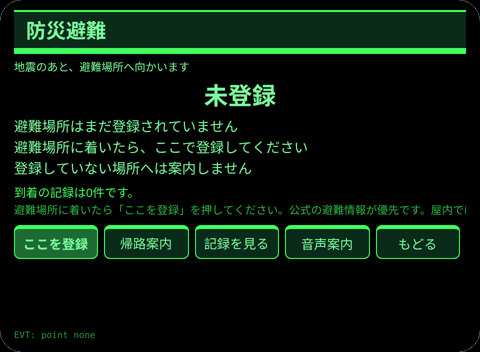
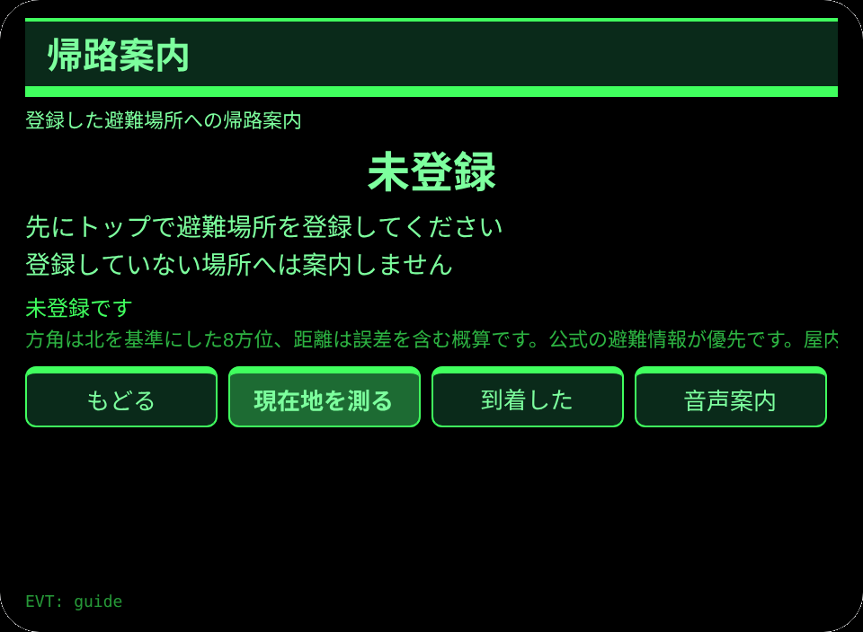
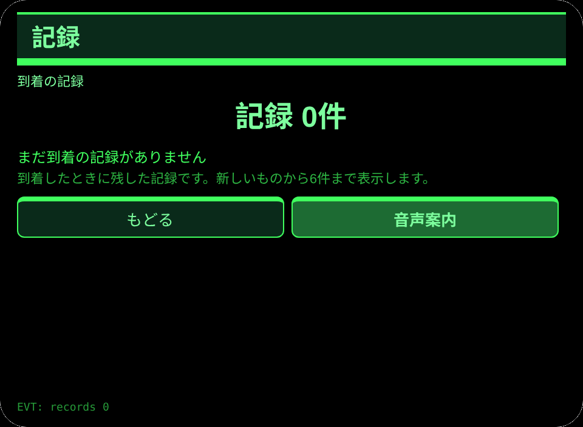
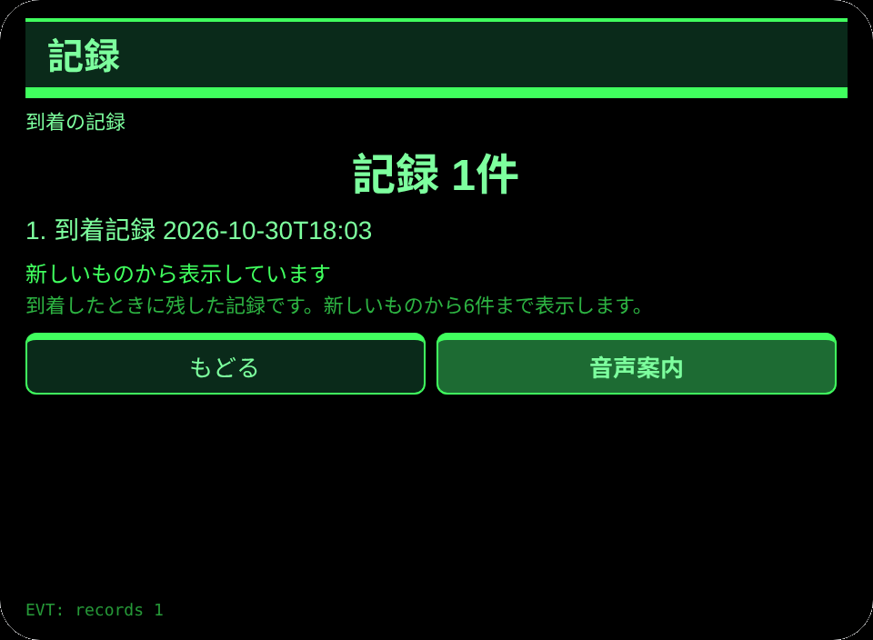

# 防災避難

**Studio インポートアドレス**（Global AIUI Studio の Import Project 入力欄にコピー）：

```
https://github.com/sakai55/rokid/tree/agent-bosai-hinan
```

**AIX 直接ダウンロード**（最新版）：[bosai-hinan.aix](https://raw.githubusercontent.com/sakai55/rokid/main/aix/bosai-hinan.aix)

JP40・日本在地 × 指向性 × 路縁坡。地震のあと避難する人が、登録した避難場所へ GPS の方角と距離で向かう。

## プレビュー画像






## 方向構成

- この Agent の方向構成：日本在地 × 指向性 × 路縁坡。各方向が場面の中で代替のきかない一環を担い、機能の寄せ集めではない。
- 日本在地：日本の地震のあと、避難場所へ向かう場面に沿う。
- 指向性：登録した避難場所へ、GPS の方角と距離で案内する。GPS 三件套の証拠は次のとおり。権限の宣言は `app.json` の `permissions` に `GEOLOCATION`。位置の取得は `pages/index/index.ink` の `saveTap` と `pages/guide/index.ink` の `primaryTap` の `navigator.geolocation.getCurrentPosition` 呼び出し。方角の換算は `pages/guide/index.ink` の `_calc`（`Math.atan2` による方位角から 8 方位の配列 `CARD` へ換算し、ハーバーサイン式で距離を 10m 単位に丸める）。
- 路縁坡：避難の場面で、避難場所の方角と距離を一画面にそろえ、到着を記録できる。
- 一文の場面：地震のあと避難する人が、登録した避難場所へ GPS の方角と距離で向かう。

## 構造と機能

3 ページ：`pages/index/` 避難場所登録（GPS 保存ボタンで避難場所を保存し、保存した緯度・経度を小数 4 桁と登録時刻で表示する。未登録のときは未登録と表示し、場所を作り出さない）；`pages/guide/` 帰路案内（現在地を測り、8 方位の方角と 10m 単位の距離を表示する。未登録のときは未登録と表示し、場所を作り出さない。「到着した」で到着を記録する）；`pages/record/` 記録（直近 6 件の到着記録と合計件数）。

内容集の数：到着記録は実際の条数で数える。セッションをまたぐ永続化：ストレージキー `bosaiHinanV1`（避難場所の緯度・経度・登録時刻、到着記録の配列、`lastError`）。

## ジェスチャ対応

| ジェスチャ（テンプルのタッチパッド） | キーイベント | この Agent での役割 |
|---|---|---|
| シングルタップ | Enter | 主確認（各ページの主ボタン） |
| 上スワイプ／下スワイプ | ArrowUp / ArrowDown | 選択肢の切替／前後の項目 |
| うなずき（頭が静止したとき） | `onHeadGesture('nod')` | 主確認と等価 |
| ダブルタップ | Backspace | 前のページに戻る |

## 権限

`GEOLOCATION` のみ。位置の利用を拒否されたときは測位せず、測れないことを表示する。GPS が弱いときは測れた値だけを表示し、距離は概算として示す。TTS と頭センサーにマニフェストの権限は不要で、カメラの呼び出しはゼロ。

## 誠実な境界

- 避難場所は本人の登録であり、公式の避難情報が優先される。実際の避難指示は自治体の発表で確かめること。
- 距離は誤差を含む概算であり、正確な道のりではない。
- 未登録のときは案内しない。場所を作り出したり、推測で補ったりしない。

## エラーコード

失敗時はグラスの画面に裸のコードを表示し、TTS はコードだけを読み上げ、直近のエラーは永続データの `lastError` に書く（コード、本機の slug、バージョン、原文を含む）。本機で起こりうるコード：

- `E5001` 記録の保存に失敗（ストレージ書き込みで例外）
- `E5002` 記録の読み取りに失敗（読み取り／解析で例外）
- `E3005` 読み上げに失敗（TTS の speak で例外）
- `E8001` ページ遷移に失敗（navigateTo/navigateBack で例外）
- `E7002` 位置が測れない（測位の利用不可または測位の失敗）
- `E7003` 位置の利用が拒否された（測位の拒否）

## デバイスのテスト情報

| 項目 | 内容 |
|---|---|
| Studio 名 | 未記入 |
| Version | 1.0.0 |
| App Category | 未記入 |
| Intent Description | 未記入 |
| Agent ID | 未記入 |
| 状態 | 未実施 |

## 審査提出資料 (Review Submission)

Feature Description: 地震のあと、登録した避難場所へ GPS の方角と距離で向かう手引きです。避難場所を登録し、8方位の方角と概算の距離で案内し、到着を記録します。

Opening Message: 避難場所へ向かいましょう。登録した場所の方角と距離を案内し、到着を記録します。

Preview Media:
- `preview-bosai-hinan-index.png`
- `preview-bosai-hinan-guide.png`
- `preview-bosai-hinan-record.png`
- `preview-bosai-hinan-guide-s2.png`

> 正式な審査提出にはメディアファイル 3〜5 点（うち動画 ≥1 本、≤60 秒）が必要。動画は GO が実機で録画した後に追加する。

Change Log — Build 1.0.0:

- Features added: 初版；地震のあと避難する人が、登録した避難場所へ GPS の方角と距離で向かう
- Improvements: なし（初版）
- Fixes: なし（初版）
