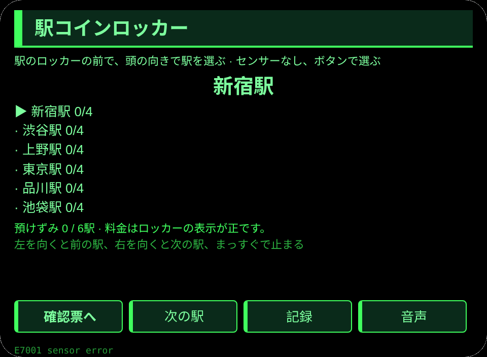
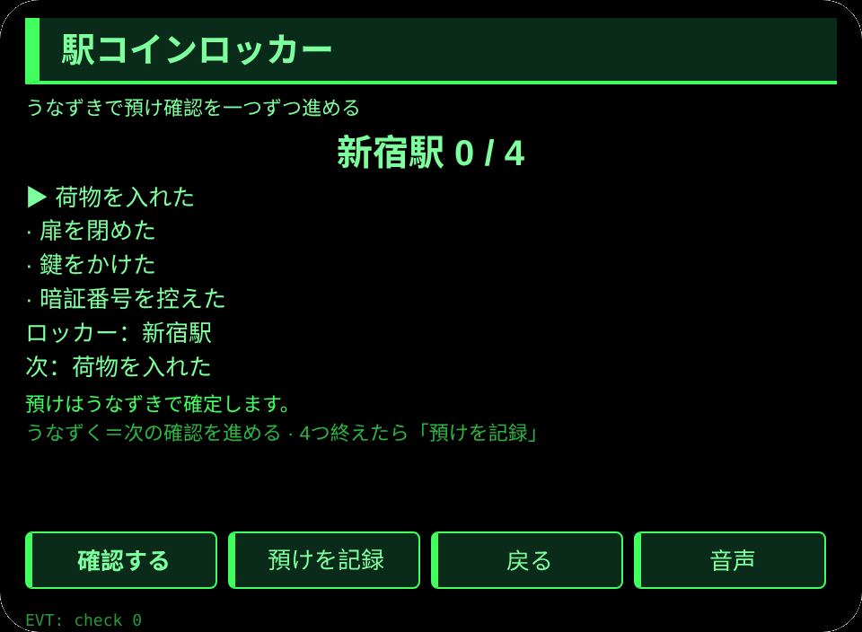
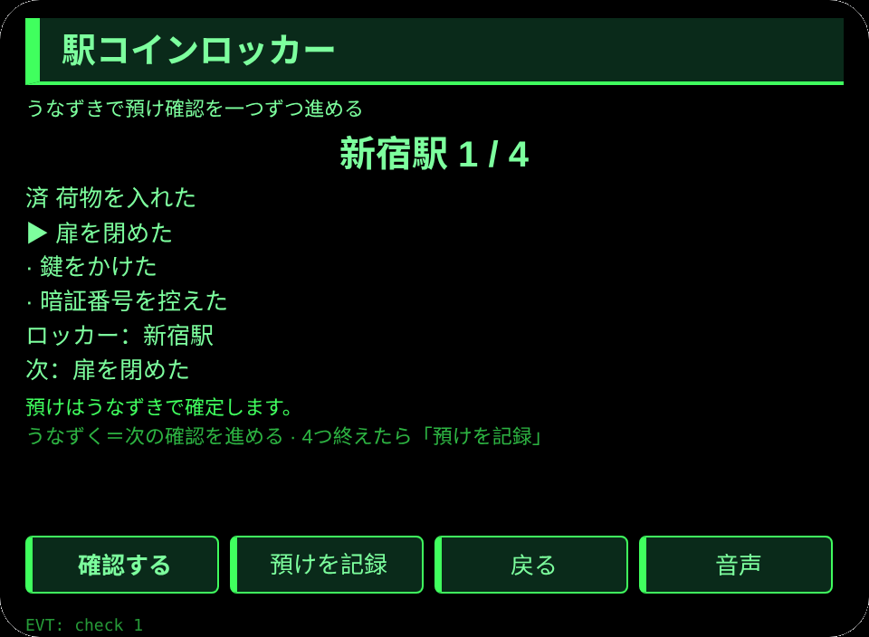
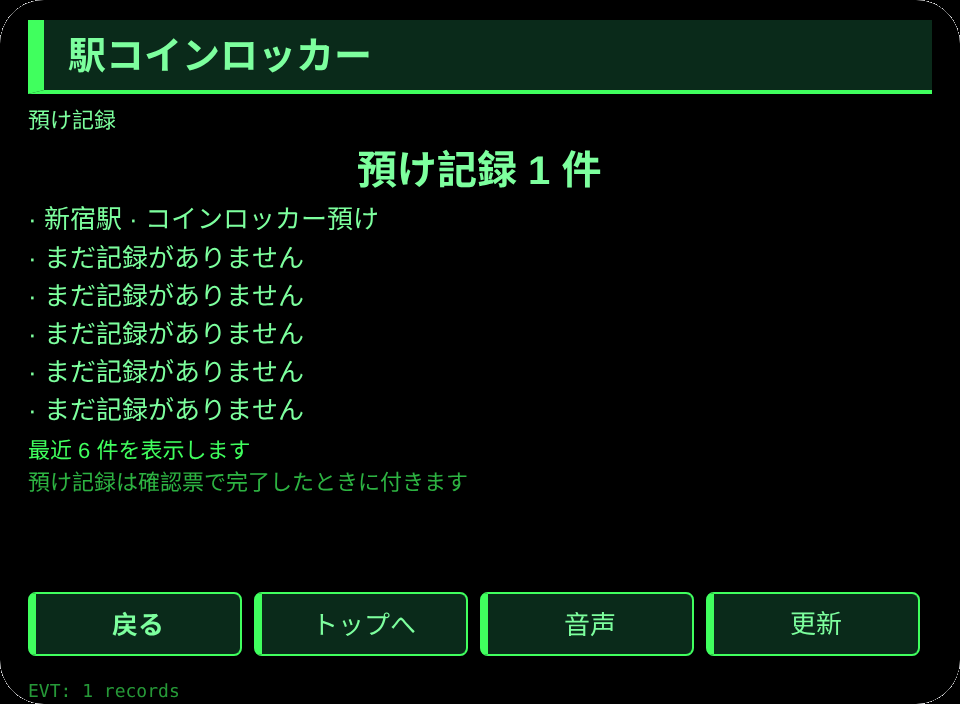

# 駅コインロッカー

**Studio インポートアドレス**（Global AIUI Studio の Import Project 入力欄にコピー）：

```
https://github.com/sakai55/rokid/tree/agent-eki-coin-locker
```

[eki-coin-locker.aix](https://raw.githubusercontent.com/sakai55/rokid/main/aix/eki-coin-locker.aix)

## 機能

駅のコインロッカーの前で、両手に荷物を持ったまま、頭の向きで駅を選び、うなずきで預け確認を一つずつ進め、預け票を声で読み上げる。

## シーン

駅のコインロッカーの前で、両手に荷物を持った人が、眼鏡だけで駅を選び、預け確認を終えて荷物を預ける。

## 方向構成

日本在地 × 注意力（預け確認の守候）× 指向性（頭の向きで駅を選ぶ）。指向性は駅の選択を担い、注意力は預け確認の逐項確認を担う。

## 眼鏡だけの能力

視線と頭の向きの連動＋両手がふさがったときのうなずき確認：荷物で両手がふさがっていても、頭を向けるだけで駅が選べ、うなずくだけで預け確認が進む。接線：pages/index/index.ink の _startSensor（AbsoluteOrientationSensor、存在性ガード）と _onYaw（±0.35 で駅を切替、まっすぐで再武装）＋ onHeadGesture('nod') が primaryTap と同じ確認。センサーが使えないときはボタンで選べ、センサー読取失敗は E7001 を出す。

## 正直な境界

- 料金は内蔵の見本ではなく、ロッカーの表示が正しい。
- 預けは記録のみで、ロッカーの開錠や決済はしない。
- センサーが使えないときはボタンで選ぶ。預け記録は 4 つの確認を全部終えたときだけ付く。

## ページ

| ページ | ページ |
|---|---|
| pages/index | 駅 6 か所の一覧、頭の向きで選ぶ |
| pages/confirm | 選んだ駅と預け確認 4 つをうなずきで逐項確認し、預けを記録 |
| pages/record | 最近 6 件の預け記録と合計 |

## 内容集

駅 6 か所（新宿駅／渋谷駅／上野駅／東京駅／品川駅／池袋駅）×預け確認 4 つ（荷物を入れた／扉を閉めた／鍵をかけた／暗証番号を控えた）。預け記録は実数で数える。

## セッションをまたぐ保存

保存キー `ekiCoinLockerV1`。選んだ駅、駅ごとの確認ずみ項目数、預け記録の配列、lastError を保存する。

## 権限

権限なし。音声読み上げに権限はいらない。カメラと位置情報は使わない。

## ジェスチャー対応

| 単指タップ | Enter | 主確認（駅の選択・預け確認） |
| 上下スワイプ | ArrowUp / ArrowDown | 駅の選択切替 |
| うなずき | onHeadGesture('nod') | 主確認と同じ |
| ダブルタップ | Backspace | 戻る |

## エラーコード

- `E5001` 保存の書き込み失敗
- `E5002` 保存の読み込み失敗
- `E3005` 音声読み上げ失敗
- `E8001` ページ遷移失敗
- `E7001` 頭部センサー不可または読取失敗

失敗したときは画面に裸のコードを出し、lastError にコード・slug・バージョン・原文を残す。

## プレビュー画像






## 提審資料

### Feature Description

駅のコインロッカーの前で、両手に荷物を持ったまま、頭の向きで駅を選び、うなずきで預け確認を一つずつ進め、預け票を声で読み上げる。

### Opening Message

ロッカーの前で両手がふさがっていても大丈夫。頭を向けて駅を選び、うなずいて預け確認を進めよう。

### Preview Media

[preview-eki-coin-locker-video.mp4](https://raw.githubusercontent.com/sakai55/rokid/main/screenshots/eki-coin-locker/preview-eki-coin-locker-video.mp4)


### Change Log

- Features：初版機能は上記の通り。
- Improvements：なし。
- Fixes：なし。

## デバイス試験情報

| 項目 | 内容 |
|---|---|
| Studio 名 | 未記入 |
| Version / Build | 未記入 |
| App Category | 未記入 |
| Intent Description | 未記入 |
| Agent ID | 未記入 |
| 状態 | 未記入 |
