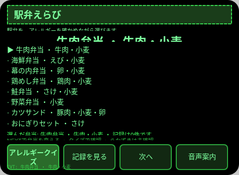
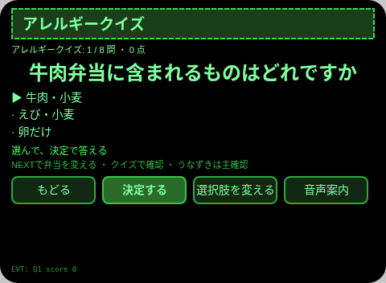
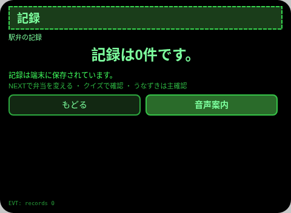
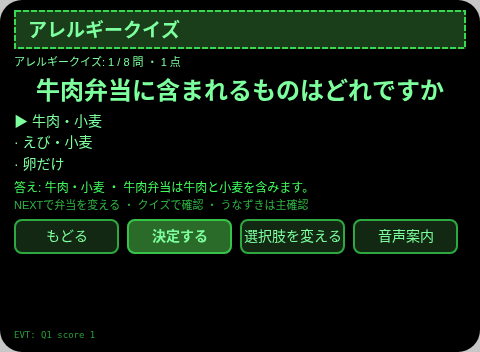
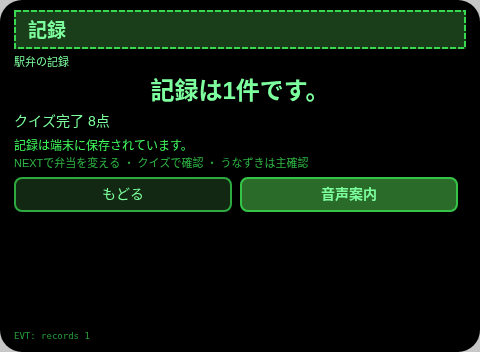

# 駅弁えらび

**Studio インポートアドレス**（Global AIUI Studio の Import Project 入力欄にコピー）：

```
https://github.com/sakai55/rokid/tree/agent-ekiben-erabi
```

**AIX 直接ダウンロード**（最新版）：[ekiben-erabi.aix](https://raw.githubusercontent.com/sakai55/rokid/main/aix/ekiben-erabi.aix)

JP31・日本在地 × 注意力 × ゲーム。駅で旅行者がアレルギーを確かめながら駅弁をクイズで選ぶ

## プレビュー画像







## 方向構成

- この Agent の方向構成：日本在地 × 注意力 × ゲーム。各方向が場面の中で代替のきかない一環を担い、機能の寄せ集めではない。
- 一文の場面：駅で旅行者がアレルギーを確かめながら駅弁をクイズで選ぶ。

## 構造と機能

3 ページ：`pages/index/` 駅弁一覧（8種・各アレルギー表示）；`pages/quiz/` アレルギークイズ（8問・3択・正誤TTS＋解説、8問完答で得点記録を 1 件記録）；`pages/record/` 記録（直近 6 件＋総数）。

内容集の数：駅弁 8 種；クイズ 8 問・各 3 択；得点記録は実際の条数で数える。セッションをまたぐ永続化：ストレージキー `ekibenErabiV1`（選択項目、チェック／回答／カウントの状態、完了記録の配列、`lastError`）。

## ジェスチャ対応

| ジェスチャ（テンプルのタッチパッド） | キーイベント | この Agent での役割 |
|---|---|---|
| シングルタップ | Enter | 主確認（各ページの主ボタン） |
| 上スワイプ／下スワイプ | ArrowUp / ArrowDown | 選択肢の切替／前後の項目 |
| うなずき（頭が静止したとき） | `onHeadGesture('nod')` | 主確認と等価 |
| ダブルタップ | Backspace | 前のページに戻る（子ページ） |

## 権限

なし。TTS とセンサーにマニフェストの権限は不要で、カメラの呼び出しはゼロ。

## 誠実な境界

- アレルギー表示は収録済みの定型表示です。実物の表示ラベルが正であり、表示と違う場合は現場の表示を優先してください。
- クイズの正誤は本人の選択で決まります。Agent はアレルギーの有無を判定しません。

## エラーコード

失敗時はグラスの画面に裸のコードを表示し、TTS はコードだけを読み上げ、直近のエラーは永続データの `lastError` に書く（コード、本機の slug、バージョン、原文を含む）。本機で起こりうるコード：

- `E5001` 記録の保存に失敗（ストレージ書き込みで例外）
- `E5002` 記録の読み取りに失敗（読み取り／解析で例外）
- `E3005` 読み上げに失敗（TTS の speak で例外）
- `E8001` ページ遷移に失敗（navigateTo/navigateBack で例外）

## デバイスのテスト情報

| 項目 | 内容 |
|---|---|
| Studio 名 | 未記入 |
| Version | 1.0.0 |
| App Category | 未記入 |
| Intent Description | 未記入 |
| Agent ID | 未記入 |
| 状態 | 実機未検証 |

## 審査提出資料 (Review Submission)

Feature Description: 駅弁えらび：アレルギーを確認しながら駅弁を選ぶ。アレルギー表示付きの駅弁 8 種、アレルギークイズ 8 問、そして保存されるクイズの記録。

Opening Message: 駅弁を選びましょう。アレルギーを確かめてから、安心して選べます。

Preview Media:
- `preview-ekiben-erabi-index.png`
- `preview-ekiben-erabi-quiz.png`
- `preview-ekiben-erabi-record.png`
- `preview-ekiben-erabi-quiz-s2.png`
- `preview-ekiben-erabi-record-s2.png`

> 正式な審査提出にはメディアファイル 3〜5 点（うち動画 ≥1 本、≤60 秒）が必要。動画は GO が実機で録画した後に追加する。

Change Log — Build 1.0.0:

- Features added: 初版；駅で旅行者がアレルギーを確かめながら駅弁をクイズで選ぶ
- Improvements: なし（初版）
- Fixes: なし（初版）
