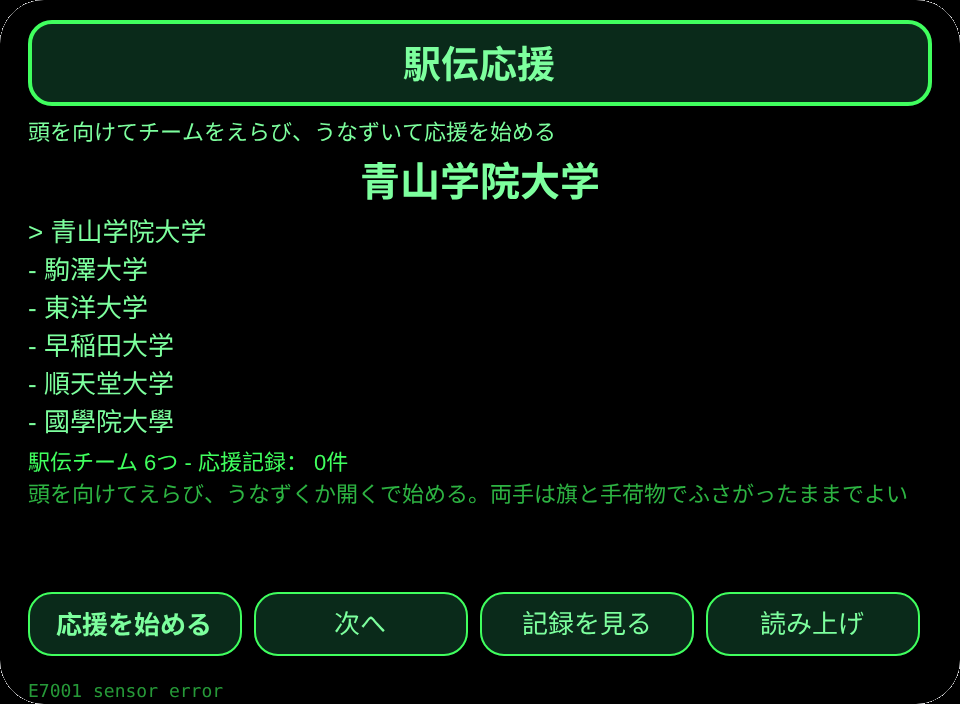
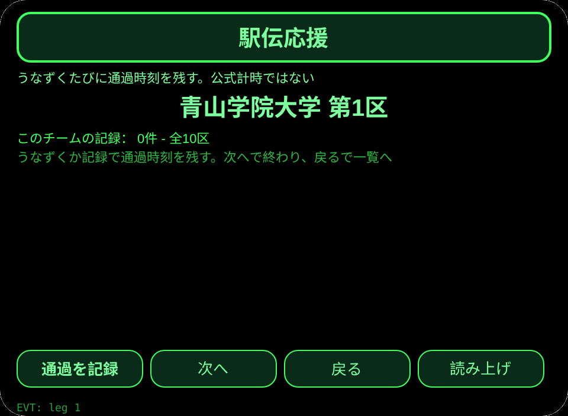
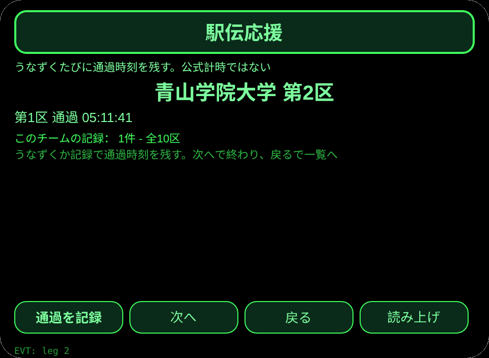
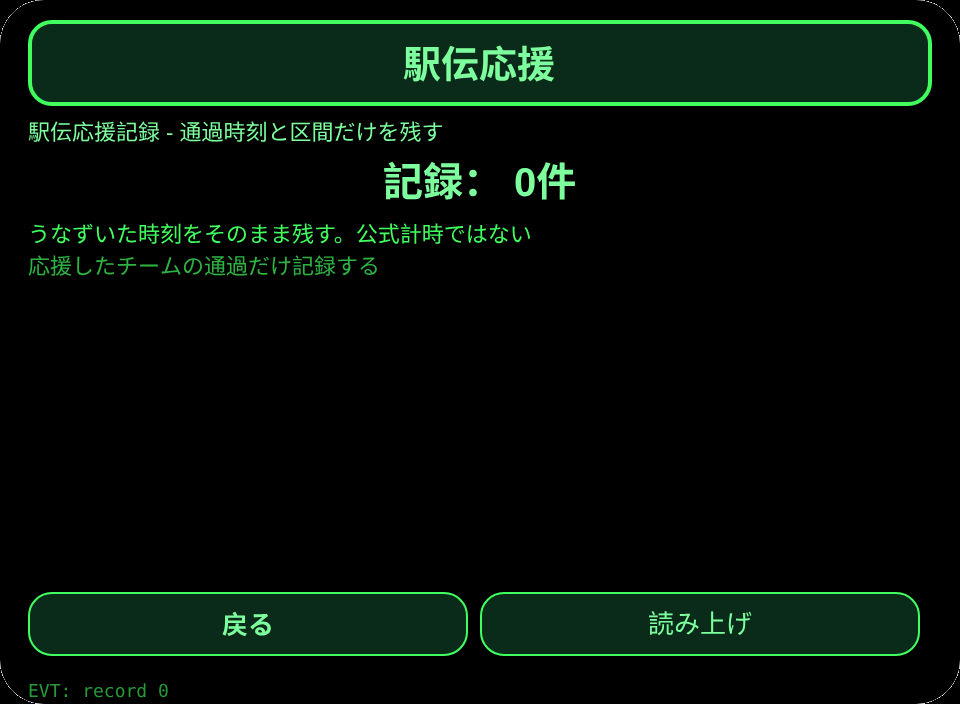

# 駅伝応援

**Studio インポートアドレス**（Global AIUI Studio の Import Project 入力欄にコピー）：

```
https://github.com/sakai55/rokid/tree/agent-ekiden-cheer
```

[ekiden-cheer.aix](https://raw.githubusercontent.com/sakai55/rokid/main/aix/ekiden-cheer.aix)

## 機能

駅伝の沿道で応援する人が、両手に旗と手荷物を持ったまま頭の向きでチームをえらび、うなずくたびに通過時刻を記録する。チームは箱根駅伝に出る実在の大学6つで、第1区から第10区まで、通過した区間とその時刻だけを残す。

## シーン

駅伝の沿道で応援する人が、両手に旗と手荷物を持ったまま頭の向きでチームをえらび、うなずいて通過時刻を記録する。

## 方向構成

日本在地 × 注意力 × 指向性。日本在地が駅伝の沿道応援という場を、注意力が通過する走者を見分けて時刻を残す役を、指向性が頭の向きでチームをえらぶ役を担う。

## 眼鏡だけの能力

視線と頭の向きの連携＋うなずきが主確認：両手が旗と手荷物でふさがっていても、頭を向けてチームをえらび、うなずくだけで通過を記録できる。接線：pages/index/index.ink の _startSensor（AbsoluteOrientationSensor、存在性ガード）＋ _onYaw（左／中／右の3区、中へ戻って再武装、一回の向きで一チームだけ）でチームを切り替え、pages/play/index.ink の onHeadGesture('nod') が primaryTap と同じ主確認で通過を記録する。センサーが使えないときはボタンでえらぶ。応援記録は手動記録で、公式計時ではない。

## ページ

| ページ | 内容 |
|---|---|
| pages/index | 駅伝チーム6つの一覧と選択 |
| pages/play | えらんだチームの第1区から第10区までの通過記録 |
| pages/record | 駅伝応援記録 |

## 内容集

駅伝チーム6つ（青山学院大学／駒澤大学／東洋大学／早稲田大学／順天堂大学／國學院大學 — 第103回箱根駅伝の出場校一覧で確認した実在の大学）× 全10区間。選手名は入れない。記録は「通過時刻＋区間」だけ。

## セッションをまたぐ保存

保存キー `ekidenCheerV1`（えらんだチーム、応援記録、lastError）。

## 権限

権限の宣言なし。音声読み上げは宿主管理で、宣言は不要。カメラと位置情報は使わない。

## ジェスチャー対応

| 単指タップ | Enter | 主確認 |
| 上下スワイプ | ArrowUp / ArrowDown | 選択切替 |
| うなずき | onHeadGesture('nod') | 主確認と同じ |
| ダブルタップ | Backspace | 戻る |

## エラーコード

- `E5001` 保存の書き込み失敗
- `E5002` 保存の読み込み失敗
- `E3005` 音声読み上げ失敗
- `E8001` ページ遷移失敗
- `E7001` 頭部センサー不可または読取失敗

- 通過時刻はうなずいた瞬間の手動記録で、公式計時を名乗らない。
- チーム名は実在の大学名だけで、選手名は入れない。
- 一回の向きでは一チームだけ変わり、中へ戻らないとまた変えられず、くるくる回らない。
- センサーが使えないときはボタンでえらぶ。応援の記録は変わらない。センサー失敗は E7001 を残す。

## プレビュー画像






## 提審資料

### Feature Description

駅伝の沿道で、両手に旗と手荷物を持ったまま頭の向きで応援するチームをえらび、うなずくたびに通過時刻を記録する。第1区から第10区まで、通過した区間とその時刻だけを残し、応援記録は次も残る。チームは箱根駅伝に出る実在の大学6つ。時刻はうなずいた瞬間の手動記録で、公式計時ではない。

### Opening Message

駅伝応援へようこそ。頭を向けてチームをえらび、うなずくたびに通過時刻を記録しよう。全10区の応援記録を残そう。

### Preview Media

[preview-ekiden-cheer-video.mp4](https://raw.githubusercontent.com/sakai55/rokid/main/screenshots/ekiden-cheer/preview-ekiden-cheer-video.mp4)


### Change Log

- Features：初版機能は上記の通り。
- Improvements：なし。
- Fixes：なし。

## デバイス試験情報

| 項目 | 内容 |
|---|---|
| Studio 名 | 未記入 |
| Version / Build | 未記入 |
| App Category | 未記入 |
| Intent Description | 未記入 |
| Agent ID | 未記入 |
| 状態 | 未記入 |
