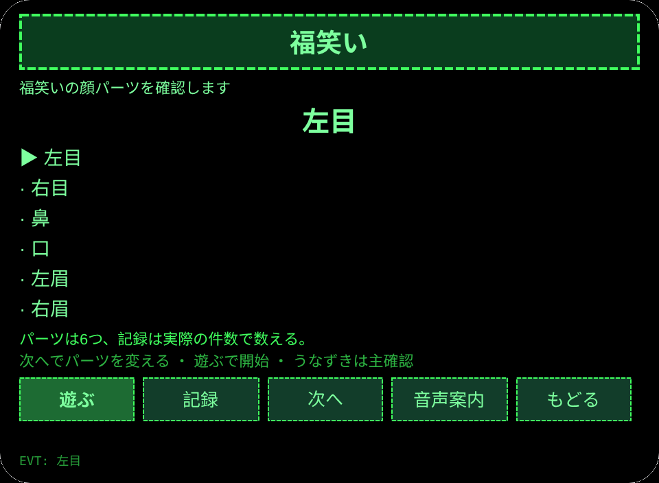
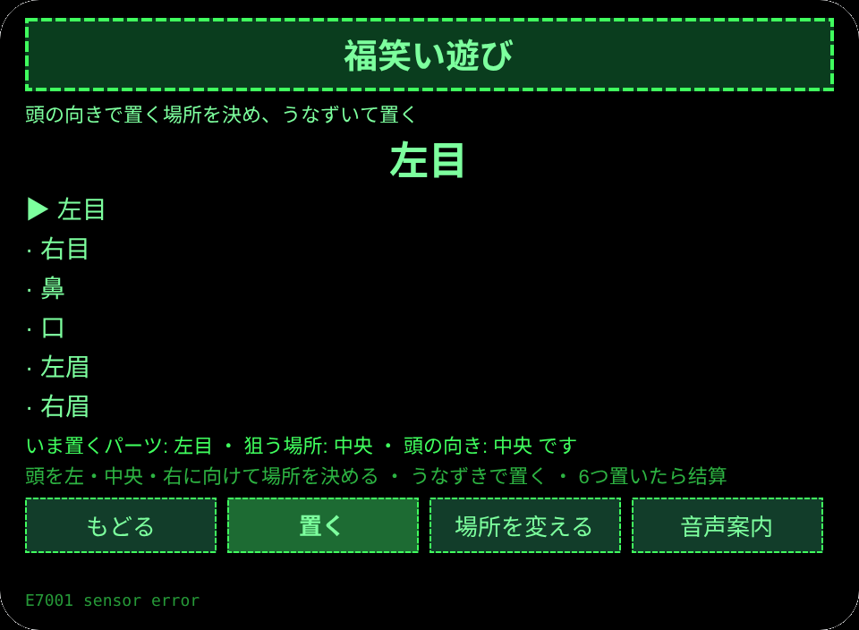
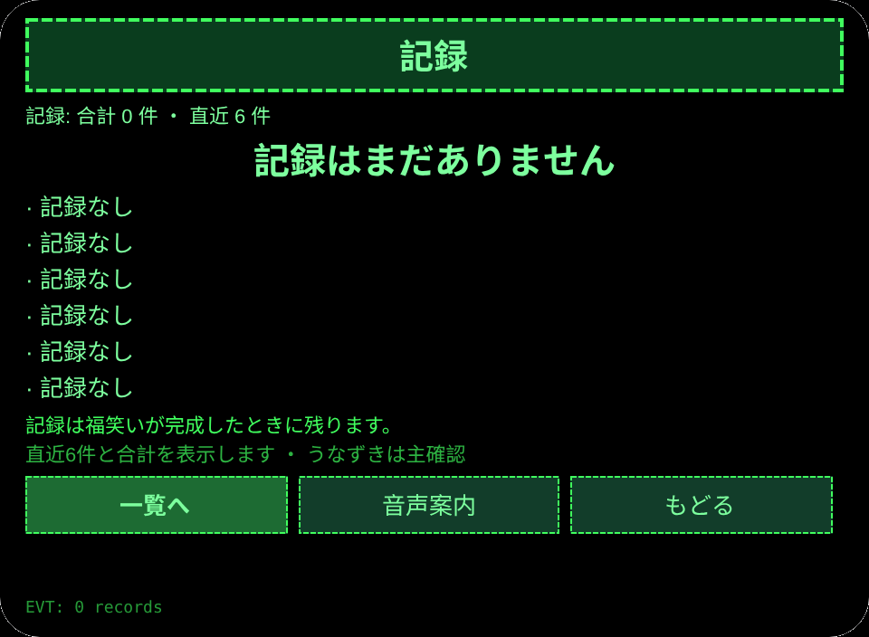
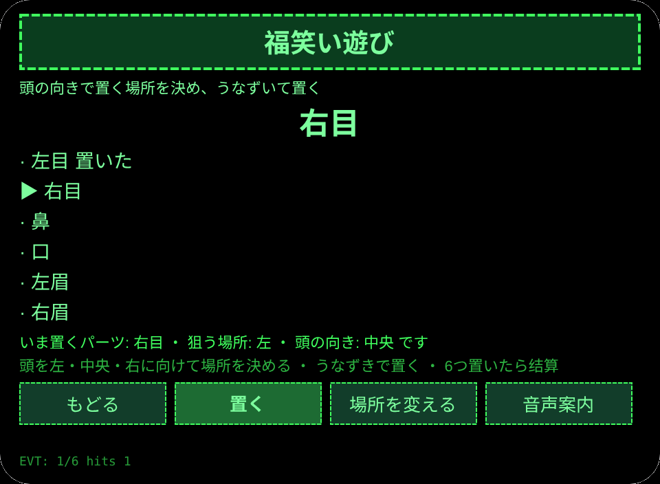

# 福笑い

**Studio インポートアドレス**（Global AIUI Studio の Import Project 入力欄にコピー）：

```
https://github.com/sakai55/rokid/tree/agent-fukuwarai
```

**AIX 直接ダウンロード**（最新版）: [fukuwarai.aix](https://raw.githubusercontent.com/sakai55/rokid/main/aix/fukuwarai.aix)

JP46・日本在地 × ゲーム × 指向性。正月に家族が集まったとき、頭の向きだけで福笑いを遊ぶ

## プレビュー画像






## 方向構成

日本在地 × ゲーム × 指向性。

## 構造と機能

3 ページ：`pages/index/` パーツ一覧（パーツ 6つ：左目、右目、鼻、口、左眉、右眉）；`pages/play/` 福笑い遊び（頭の向きで左・中央・右の置く場所を決め、うなずいて置く。6つ置いたら结算して記録に残す。センサーがないときはボタンで場所を変えて遊べる）；`pages/record/` 記録（直近 6 件と合計）。

内容集の数：パーツ 6つ；遊びは 6 置きで一局；記録は実際の条数で数える。セッションをまたぐ永続化：ストレージキー `fukuwaraiV1`（記録の配列、`lastError`）。

ジェスチャ対応

## | ジェスチャ（テンプルのタッチパッド） | キーイベント | この Agent での役割 |
|---|---|---|
| シングルタップ | Enter | 主確認（各ページの主ボタン） |
| 上スワイプ／下スワイプ | ArrowUp / ArrowDown | 選択肢の切替／前後の項目 |
| うなずき（頭が静止したとき） | `onHeadGesture('nod')` | 主確認と等価 |
| ダブルタップ | Backspace | 前のページに戻る |

権限

## 無。TTS とセンサーにマニフェストの権限は不要で、カメラの呼び出しはゼロ。

誠実な境界

## - 置く場所の判定は頭の向きと本人のうなずきによる。顔の形の良し悪しを Agent は判定しない。
- 動きは分段のみ：中心→一方向→戻る→次方向。首を回す動きは一切使わない。

エラーコード

失敗時はグラスの画面に裸のコードを表示し、TTS はコードだけを読み上げ、直近のエラーは永続データの `lastError` に書く（コード、本機の slug、バージョン、原文を含む）。本機で起こりうるコード：

- `E5001` 記録の保存に失敗（ストレージ書き込みで例外）
- `E5002` 記録の読み取りに失敗（読み取り／解析で例外）
- `E3005` 読み上げに失敗（TTS の speak で例外）
- `E8001` ページ遷移に失敗（navigateTo/navigateBack で例外）
- `E7001` 頭センサーに失敗（センサーが使えない／読み取りエラー。センサーがなくてもボタンで遊べる）

## 设备测试信息

| Studio 名 | 未記入 |
| Version | 1.0.0 |
| App Category | 未記入 |
| Intent Description | 未記入 |
| Agent ID | 未記入 |
| 状态 | 未真机验证 |

## 提审资料

Feature Description: 正月に家族で遊ぶ福笑いです。頭の向きで置く場所を決め、うなずいて6つのパーツを置き、完成を記録します。

Opening Message: 福笑いを始めましょう。頭の向きで場所を決めて、うなずいて置きます。

Preview Media:
- `preview-fukuwarai-index.png`
- `preview-fukuwarai-play.png`
- `preview-fukuwarai-record.png`
- `preview-fukuwarai-play-s2.png`

> 正式な審査提出にはメディアファイル 3〜5 点（うち動画 ≥1 本、≤60 秒）が必要。動画は GO が実機で録画した後に追加する。

Change Log — Build 1.0.0:

- Features added: 初版
- Improvements: なし（初版）
- Fixes: なし（初版）
