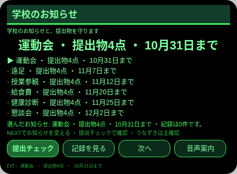
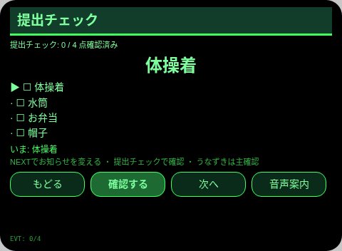
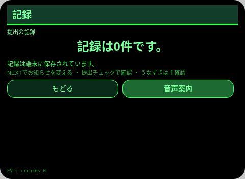
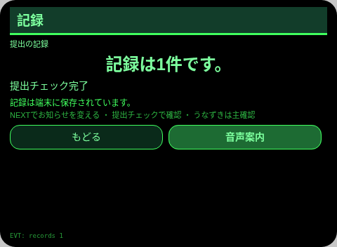

# 学校のお知らせ

**Studio インポートアドレス**（Global AIUI Studio の Import Project 入力欄にコピー）：

```
https://github.com/sakai55/rokid/tree/agent-gakkou-oshirase
```

JP29・日本在地 × カーブカット × 注意力。保護者が学校のお知らせの提出期限を眼鏡で守る

## プレビュー画像







## 方向構成

- この Agent の方向構成：日本在地 × カーブカット × 注意力。各方向が場面の中で代替のきかない一環を担い、機能の寄せ集めではない。
- 一文の場面：保護者が学校のお知らせの提出期限を眼鏡で守る。

## 構造と機能

3 ページ：`pages/index/` お知らせ一覧（6件・各提出物4点・期限表示）；`pages/check/` 提出チェック（選択したお知らせの提出物 4 点を 1 つずつチェックし、そろった時点で TTS で読み上げて完了記録を残す）；`pages/record/` 記録（直近 6 件＋総数）。

内容集の数：お知らせ 6 件；提出物 24 点（6 件 × 4 点）；完了記録は実際の条数で数える。セッションをまたぐ永続化：ストレージキー `gakkouOshiraseV1`（選択項目、チェック／回答／カウントの状態、完了記録の配列、`lastError`）。

## ジェスチャ対応

| ジェスチャ（テンプルのタッチパッド） | キーイベント | この Agent での役割 |
|---|---|---|
| シングルタップ | Enter | 主確認（各ページの主ボタン） |
| 上スワイプ／下スワイプ | ArrowUp / ArrowDown | 選択肢の切替／前後の項目 |
| うなずき（頭が静止したとき） | `onHeadGesture('nod')` | 主確認と等価 |
| ダブルタップ | Backspace | 前のページに戻る（子ページ） |

## 権限

なし。TTS とセンサーにマニフェストの権限は不要で、カメラの呼び出しはゼロ。

## 誠実な境界

- お知らせと期限は本人の登録した内容だけを表示する。学校のシステムとは連動しない。
- 提出チェックは本人の確認だけを記す。学校への提出完了を証明するものではない。

## エラーコード

失敗時はグラスの画面に裸のコードを表示し、TTS はコードだけを読み上げ、直近のエラーは永続データの `lastError` に書く（コード、本機の slug、バージョン、原文を含む）。本機で起こりうるコード：

- `E5001` 記録の保存に失敗（ストレージ書き込みで例外）
- `E5002` 記録の読み取りに失敗（読み取り／解析で例外）
- `E3005` 読み上げに失敗（TTS の speak で例外）
- `E8001` ページ遷移に失敗（navigateTo/navigateBack で例外）

## デバイスのテスト情報

| 項目 | 内容 |
|---|---|
| Studio 名 | 未記入 |
| Version | 1.0.0 |
| App Category | 未記入 |
| Intent Description | 未記入 |
| Agent ID | 未記入 |
| 状態 | 実機未検証 |

## 審査提出資料 (Review Submission)

Feature Description: 学校のお知らせ：保護者のためのお知らせ帳簿。期限付きのお知らせ 6 件、各 4 点の提出物を 1 つずつチェックし、永続的に記録します。

Opening Message: 学校のお知らせを確認しましょう。提出物を一つずつ、忘れずにそろえます。

Preview Media:
- `preview-gakkou-oshirase-index.png`
- `preview-gakkou-oshirase-check.png`
- `preview-gakkou-oshirase-record.png`
- `preview-gakkou-oshirase-check-s2.png`
- `preview-gakkou-oshirase-record-s2.png`

> 正式な審査提出にはメディアファイル 3〜5 点（うち動画 ≥1 本、≤60 秒）が必要。動画は GO が実機で録画した後に追加する。

Change Log — Build 1.0.0:

- Features added: 初版；保護者が学校のお知らせの提出期限を眼鏡で守る
- Improvements: なし（初版）
- Fixes: なし（初版）
