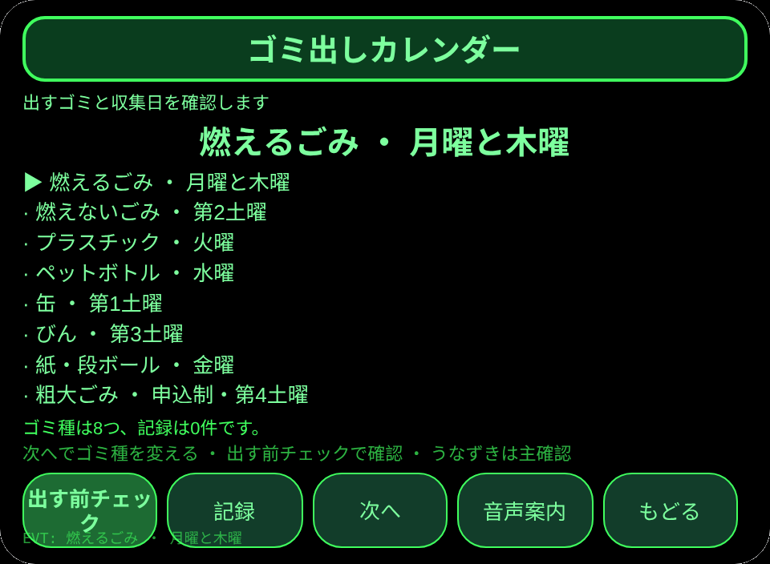
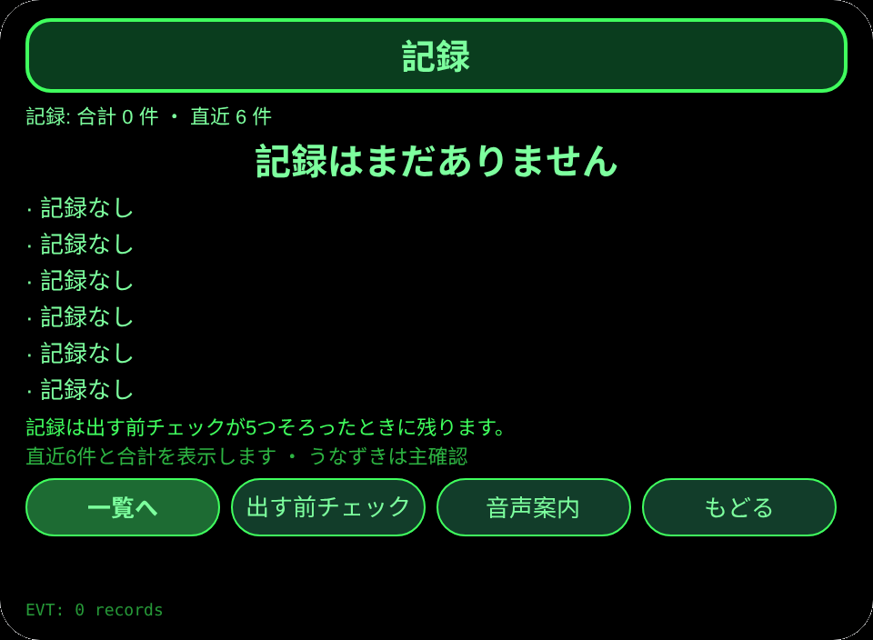
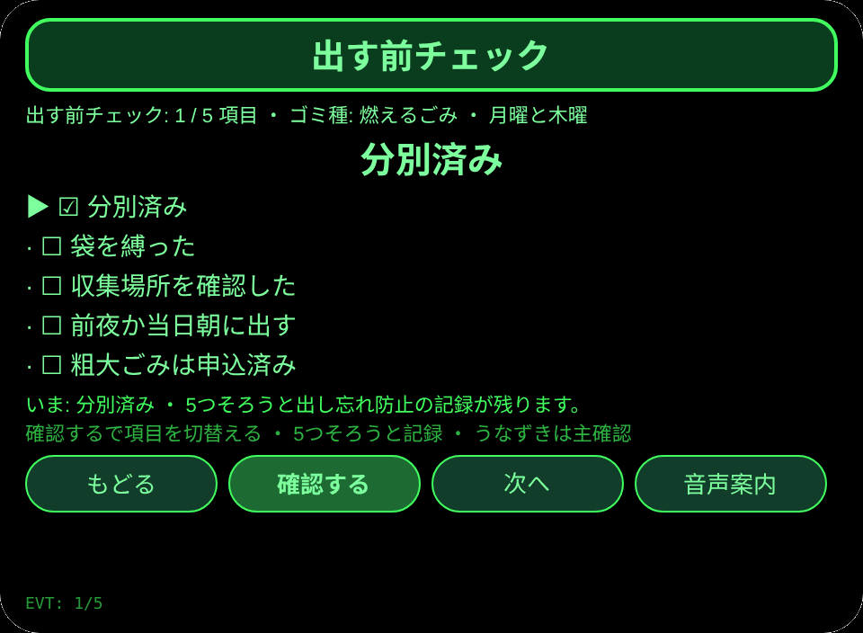

# ゴミ出しカレンダー

**Studio インポートアドレス**（Global AIUI Studio の Import Project 入力欄にコピー）：

```
https://github.com/sakai55/rokid/tree/agent-gomi-calendar
```

**AIX 直接ダウンロード**（最新版）：[gomi-calendar.aix](https://raw.githubusercontent.com/sakai55/rokid/main/aix/gomi-calendar.aix)

JP38・日本在地 × 路縁坡 × 注意力。分別に迷う高齢者が収集日の朝、出すゴミと分別を確認して出し忘れを防ぐ。

## プレビュー画像






## 方向構成

- この Agent の方向構成：日本在地 × 路縁坡 × 注意力。各方向が場面の中で代替のきかない一環を担い、機能の寄せ集めではない。
- 日本在地：日本の自治体のゴミ分別と収集日の考え方に沿う。文案は全て日本語。
- 路縁坡：分別に迷う高齢者が、出すゴミと収集日を一画面で確かめられる。
- 注意力：出す前の 5 項目を一つずつ確認し、5 つそろったときに記録を残す。
- 一文の場面：分別に迷う高齢者が収集日の朝、出すゴミと分別を確認して出し忘れを防ぐ。

## 構造と機能

3 ページ：`pages/index/` ゴミ種一覧（ゴミ種 8つ、それぞれに収集日の注記：燃えるごみ、燃えないごみ、プラスチック、ペットボトル、缶、びん、紙・段ボール、粗大ごみ）；`pages/check/` 出す前チェック（5 項目：分別済み、袋を縛った、収集場所を確認した、前夜か当日朝に出す、粗大ごみは申込済み——項目ごとに切替え、5 つそろったときに音声で知らせて記録を残す）；`pages/record/` 記録（直近 6 件と合計）。

内容集の数：ゴミ種 8つ；チェック項目 5つ；記録は実際の条数で数える。セッションをまたぐ永続化：ストレージキー `gomiCalendarV1`（選択項目、チェック状態、記録の配列、`lastError`）。

## ジェスチャ対応

| ジェスチャ（テンプルのタッチパッド） | キーイベント | この Agent での役割 |
|---|---|---|
| シングルタップ | Enter | 主確認（各ページの主ボタン） |
| 上スワイプ／下スワイプ | ArrowUp / ArrowDown | 選択肢の切替／前後の項目 |
| うなずき（頭が静止したとき） | `onHeadGesture('nod')` | 主確認と等価 |
| ダブルタップ | Backspace | 前のページに戻る |

## 権限

無。TTS とセンサーにマニフェストの権限は不要。

## 誠実な境界

- 収集日と分別は本人の登録内容であり、市の収集システムとは連動しない。実際の収集日と分別は自治体の案内で確かめること。
- 出す前チェックは本人の確認だけを記す。収集完了を証明するものではない。

## エラーコード

失敗時はグラスの画面に裸のコードを表示し、TTS はコードだけを読み上げ、直近のエラーは永続データの `lastError` に書く（コード、本機の slug、バージョン、原文を含む）。本機で起こりうるコード：

- `E5001` 記録の保存に失敗（ストレージ書き込みで例外）
- `E5002` 記録の読み取りに失敗（読み取り／解析で例外）
- `E3005` 読み上げに失敗（TTS の speak で例外）
- `E8001` ページ遷移に失敗（navigateTo/navigateBack で例外）

## 设备测试信息

| 項目 | 内容 |
|---|---|
| Studio 名 | 未記入 |
| Version | 1.0.0 |
| App Category | 未記入 |
| Intent Description | 未記入 |
| Agent ID | 未記入 |
| 状态 | 未真机验证 |

## 提审资料

Feature Description: 収集日の朝、出すゴミと分別を確認して出し忘れを防ぐ手引きです。ゴミ種8つと収集日を確かめ、出す前の5項目を一つずつ記録します。

Opening Message: 今日出すゴミを確認しましょう。分別と収集日を一つずつ、忘れずにそろえます。

Preview Media:
- `preview-gomi-calendar-index.png`
- `preview-gomi-calendar-check.png`
- `preview-gomi-calendar-record.png`
- `preview-gomi-calendar-check-s2.png`

> 正式な審査提出にはメディアファイル 3〜5 点（うち動画 ≥1 本、≤60 秒）が必要。動画は GO が実機で録画した後に追加する。

Change Log — Build 1.0.0:

- Features added: 初版；分別に迷う高齢者が収集日の朝、出すゴミと分別を確認して出し忘れを防ぐ
- Improvements: なし（初版）
- Fixes: なし（初版）
