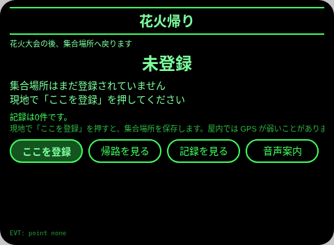
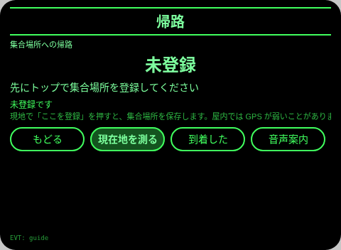
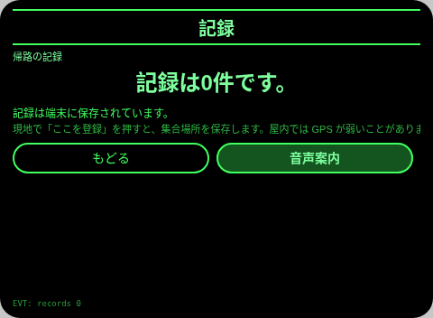
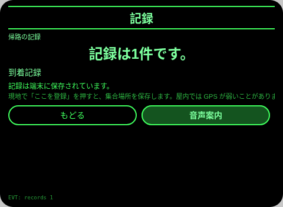

# 花火帰り

**Studio インポートアドレス**（Global AIUI Studio の Import Project 入力欄にコピー）：

```
https://github.com/sakai55/rokid/tree/agent-hanabi-kaeri
```

JP30・日本在地 × 指向性 × カーブカット。花火大会の後、混雑の中で集合場所へGPSの方角と距離で戻る

## プレビュー画像






## 方向構成

- この Agent の方向構成：日本在地 × 指向性 × カーブカット。各方向が場面の中で代替のきかない一環を担い、機能の寄せ集めではない。
- 一文の場面：花火大会の後、混雑の中で集合場所へGPSの方角と距離で戻る。

## 構造と機能

3 ページ：`pages/index/` 集合場所登録（GPS のワンタップで緯度経度＋時刻を保存、未保存のときは未登録と明示）；`pages/guide/` 帰路（再測位の後に 8 方位の cardinal ＋ 10m 単位に丸めた距離を算出、概数であることと誤差を含むことを明示、到着ボタンで到着記録を 1 件記録；プレビュー環境には GPS がなく、guide-s2 は無測位の状態でごまかさないため、本機のスクリーンショットは 4 枚：トップ／帰路／記録／記録‐到着後）；`pages/record/` 記録（直近 6 件＋総数）。測位の 3 点セット：app.json で GEOLOCATION を宣言し、index/guide の両ページで navigator.geolocation.getCurrentPosition を呼び、guide ページで緯度経度の差から方位角を算出 → 8 方位に換算。

内容集の数：集合場所 1 点（GPS の実測で保存）；方位 8 方向；到着記録は実際の条数で数える。セッションをまたぐ永続化：ストレージキー `hanabiKaeriV1`（選択項目、チェック／回答／カウントの状態、完了記録の配列、`lastError`）。

## ジェスチャ対応

| ジェスチャ（テンプルのタッチパッド） | キーイベント | この Agent での役割 |
|---|---|---|
| シングルタップ | Enter | 主確認（各ページの主ボタン） |
| 上スワイプ／下スワイプ | ArrowUp / ArrowDown | 選択肢の切替／前後の項目 |
| うなずき（頭が静止したとき） | `onHeadGesture('nod')` | 主確認と等価 |
| ダブルタップ | Backspace | 前のページに戻る（子ページ） |

## 権限

GEOLOCATION：集合場所の保存と、集合場所へ戻る方位・距離の計算にのみ使用。拒否／利用不可のときは正直に格下げし、位置を決して推測で補わない。

## 誠実な境界

- 方角と距離は GPS の測位からの概算です。誤差を含み、10m単位に丸めています。
- 屋内・人混みでは GPS が弱く、測れないときは測れないと出します。位置を推測で補いません。
- 集合場所は本人が現地で登録した一点だけを使います。

## エラーコード

失敗時はグラスの画面に裸のコードを表示し、TTS はコードだけを読み上げ、直近のエラーは永続データの `lastError` に書く（コード、本機の slug、バージョン、原文を含む）。本機で起こりうるコード：

- `E5001` 記録の保存に失敗（ストレージ書き込みで例外）
- `E5002` 記録の読み取りに失敗（読み取り／解析で例外）
- `E3005` 読み上げに失敗（TTS の speak で例外）
- `E8001` ページ遷移に失敗（navigateTo/navigateBack で例外）
- `E7002` 測位に失敗（getCurrentPosition の失敗、権限以外）
- `E7003` 測位の権限が与えられていない（getCurrentPosition が拒否）

## デバイスのテスト情報

| 項目 | 内容 |
|---|---|
| Studio 名 | 未記入 |
| Version | 1.0.0 |
| App Category | 未記入 |
| Intent Description | 未記入 |
| Agent ID | 未記入 |
| 状態 | 実機未検証 |

## 審査提出資料 (Review Submission)

Feature Description: 花火帰り：花火大会の後、保存した集合場所へ GPS の方位（cardinal）と概算の距離で戻ります。測位できないときは、正直に格下げします。

Opening Message: 花火大会の後ですね。集合場所を登録して、方角と距離で戻りましょう。

Preview Media:
- `preview-hanabi-kaeri-index.png`
- `preview-hanabi-kaeri-guide.png`
- `preview-hanabi-kaeri-record.png`
- `preview-hanabi-kaeri-record-s2.png`

> 正式な審査提出にはメディアファイル 3〜5 点（うち動画 ≥1 本、≤60 秒）が必要。動画は GO が実機で録画した後に追加する。

Change Log — Build 1.0.0:

- Features added: 初版；花火大会の後、混雑の中で集合場所へGPSの方角と距離で戻る
- Improvements: なし（初版）
- Fixes: なし（初版）
