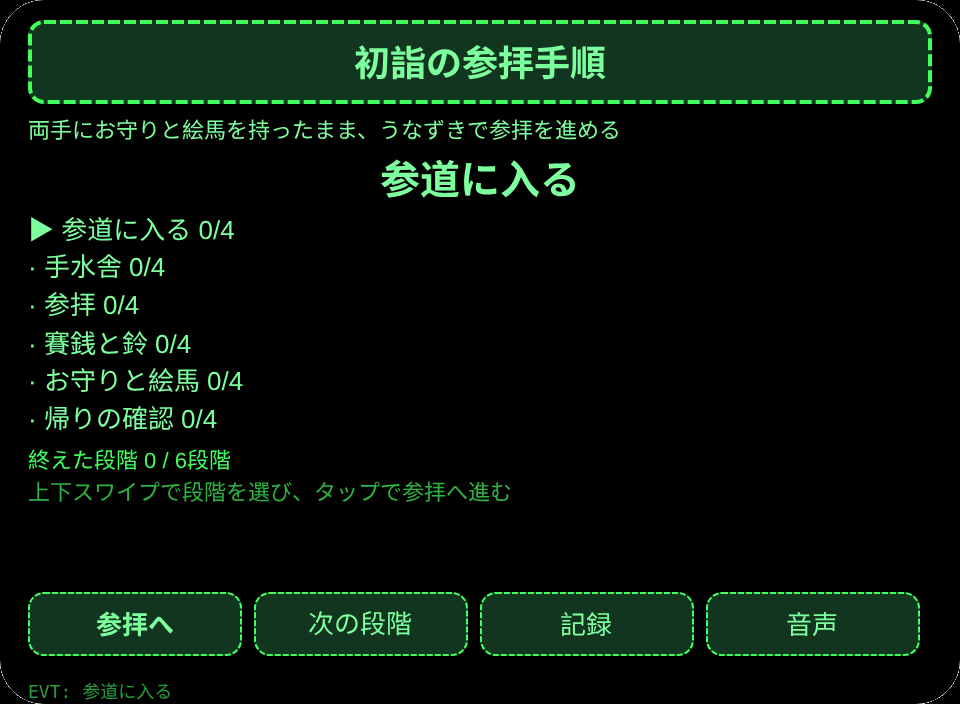
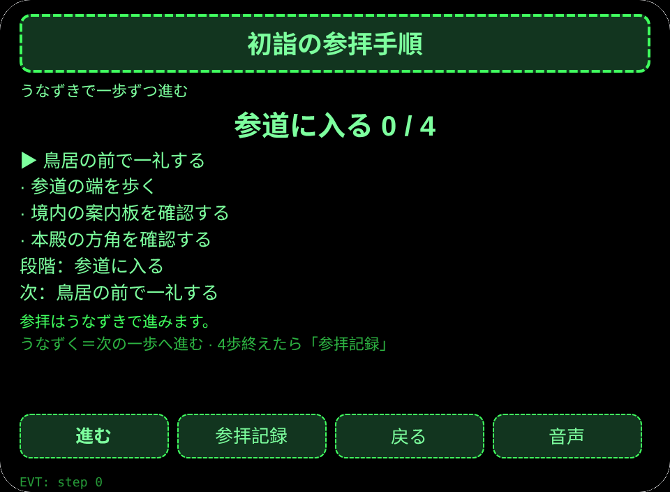
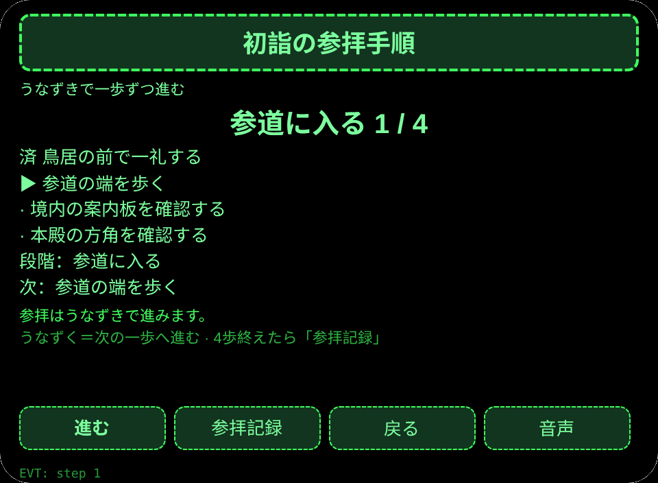
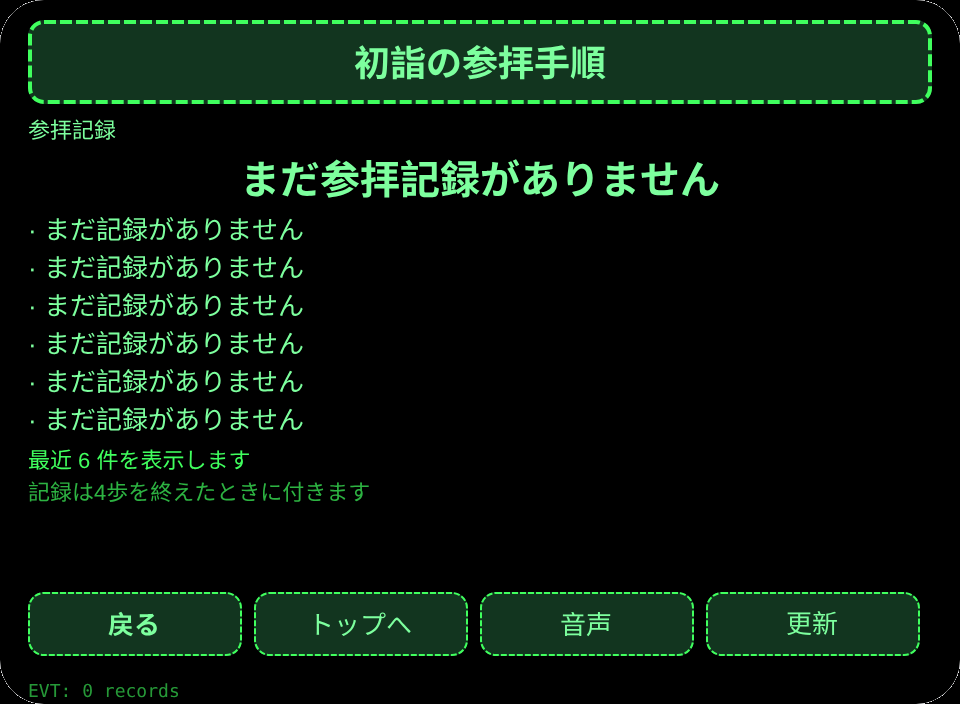

# 初詣の参拝手順

**Studio インポートアドレス**（Global AIUI Studio の Import Project 入力欄にコピー）：

```
https://github.com/sakai55/rokid/tree/agent-hatsumode-steps
```

[hatsumode-steps.aix](https://raw.githubusercontent.com/sakai55/rokid/main/aix/hatsumode-steps.aix)

## 機能

初詣に来た高齢者が両手にお守りと絵馬を持ったまま、携帯電話を取り出さずに、うなずきで6段階24歩の参拝手順を一つずつ進め、段階を終えたら参拝を記録する。

## シーン

初詣に来た高齢者が両手にお守りと絵馬を持ったまま、携帯電話を取り出さずに、うなずきで参拝の手順を進め、終えたら記録する。

## 方向構成

日本在地 × 路縁坡（両手がふさがった高齢者の参拝）× 注意力（6段階24歩を一歩ずつ確かめる）。路縁坡は両手がふさがった状態での利用を担い、注意力は手順を一歩ずつ進めることを担う。

## 眼鏡だけの能力

目の前の段階別案内と両手がふさがったときのうなずき進行：両手にお守りと絵馬を持っていると携帯電話を取り出せないが、目の前に今の段階の一歩が大きく出て、うなずくだけで次の一歩へ進み、次の一歩が声で聞ける。接線：pages/guide/index.ink の onHeadGesture('nod') が primaryTap と同じ一歩の進行で、primaryTap は次の一歩を TTS で読み上げる。うなずきが使えないときはボタンで進められる。

## 正直な境界

- 参拝の作法は一般的な手順で、神社ごとの違いは境内の案内が正解です。
- 4歩を終えていない段階は記録しません。
- うなずきが使えないときはボタンで進めます。

## ページ

| ページ | ページ |
|---|---|
| pages/index | 参拝 6 段階の一覧、段階ごとの進行 |
| pages/guide | 選んだ段階で 4 歩をうなずきで一つずつ進め、終えたら記録 |
| pages/record | 最近 6 件の参拝記録と合計 |

## 内容集

参拝 6 段階（参道に入る／手水舎／参拝／賽銭と鈴／お守りと絵馬／帰りの確認）×各 4 歩、合計 24 歩。記録は件数で数える。

## セッションをまたぐ保存

保存キー `hatsumodeStepsV1`。選んだ段階、段階ごとの終えた歩数、参拝記録の配列、lastError を保存する。

## 権限

権限なし。音声読み上げに権限はいらない。カメラと位置情報は使わない。

## ジェスチャー対応

| 単指タップ | Enter | 主確認（段階の選択・一歩の進行） |
| 上下スワイプ | ArrowUp / ArrowDown | 段階の選択切替 |
| うなずき | onHeadGesture('nod') | 主確認と同じ |
| ダブルタップ | Backspace | 戻る |

## エラーコード

- `E5001` 保存の書き込み失敗
- `E5002` 保存の読み込み失敗
- `E3005` 音声読み上げ失敗
- `E8001` ページ遷移失敗

失敗したときは画面に裸のコードを出し、lastError にコード・slug・バージョン・原文を残す。

## プレビュー画像






## 提審資料

### Feature Description

初詣に来た高齢者が両手にお守りと絵馬を持ったまま、携帯電話を取り出さずに、うなずきで6段階24歩の参拝手順を一つずつ進め、段階を終えたら参拝を記録する。

### Opening Message

初詣で両手がふさがっていても大丈夫。目の前の一歩を見て、うなずいて進もう。

### Preview Media

[preview-hatsumode-steps-video.mp4](https://raw.githubusercontent.com/sakai55/rokid/main/screenshots/hatsumode-steps/preview-hatsumode-steps-video.mp4)


### Change Log

- Features：初版機能は上記の通り。
- Improvements：なし。
- Fixes：なし。

## デバイス試験情報

| 項目 | 内容 |
|---|---|
| Studio 名 | 未記入 |
| Version / Build | 未記入 |
| App Category | 未記入 |
| Intent Description | 未記入 |
| Agent ID | 未記入 |
| 状態 | 未記入 |
