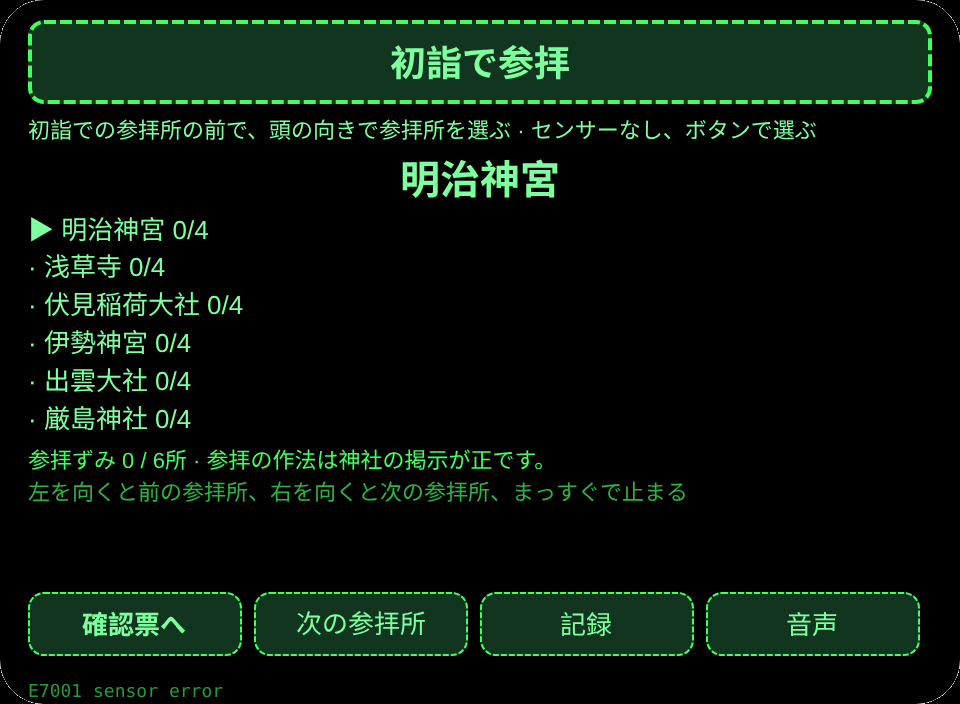
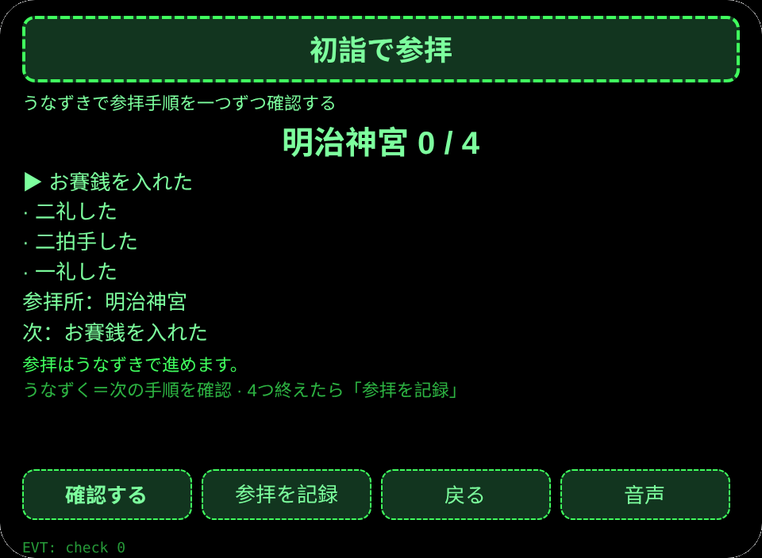
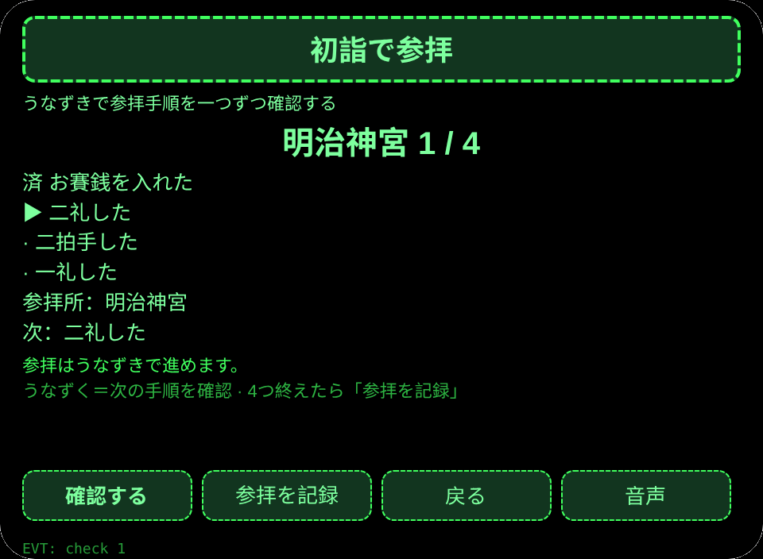
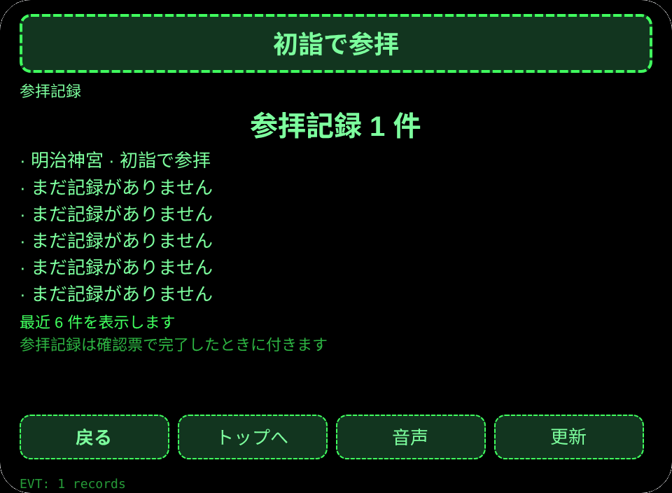

# 初詣で参拝

**Studio インポートアドレス**（Global AIUI Studio の Import Project 入力欄にコピー）：

```
https://github.com/sakai55/rokid/tree/agent-jinja-hatsumode
```

[jinja-hatsumode.aix](https://raw.githubusercontent.com/sakai55/rokid/main/aix/jinja-hatsumode.aix)

## 機能

初詣で参拝する人が、両手にお賽銭と御朱印帳を持ったまま、頭の向きで参拝所を選び、うなずきで参拝手順を一つずつ確認し、参拝票を声で読み上げる。

## シーン

初詣で参拝する人が、両手にお賽銭と御朱印帳を持ち、眼鏡だけで参拝所を選び、参拝手順を終えて参拝を記録する。

## 方向構成

日本在地 × 注意力（参拝手順の守候）× 指向性（頭の向きで参拝所を選ぶ）。指向性は参拝所の選択を担い、注意力は参拝手順の逐項確認を担う。

## 眼鏡だけの能力

視線と頭の向きの連動＋両手がふさがったときのうなずき確認：お賽銭と御朱印帳で両手がふさがっていても、頭を向けるだけで参拝所が選べ、うなずくだけで参拝手順が進む。接線：pages/index/index.ink の _startSensor（AbsoluteOrientationSensor、存在性ガード）と _onYaw（±0.35 で参拝所を切替、まっすぐで再武装）＋ onHeadGesture('nod') が primaryTap と同じ確認。センサーが使えないときはボタンで選べ、センサー読取失敗は E7001 を出す。

## 正直な境界

- 参拝の作法は神社の掲示が正で、ここは確認の手助けだけをする。
- 参拝は記録のみで、お賽銭の納め方や御朱印の受付はしない。
- センサーが使えないときはボタンで選ぶ。参拝記録は 4 つの手順を全部終えたときだけ付く。

## ページ

| ページ | ページ |
|---|---|
| pages/index | 参拝所 6 か所の一覧、頭の向きで選ぶ |
| pages/confirm | 選んだ参拝所と参拝手順 4 つをうなずきで逐項確認し、参拝を記録 |
| pages/record | 最近 6 件の参拝記録と合計 |

## 内容集

参拝所 6 か所（明治神宮／浅草寺／伏見稲荷大社／伊勢神宮／出雲大社／厳島神社）×参拝手順 4 つ（お賽銭を入れた／二礼した／二拍手した／一礼した）。参拝記録は実数で数える。

## セッションをまたぐ保存

保存キー `jinjaHatsumodeV1`。選んだ参拝所、参拝所ごとの確認ずみ手順数、参拝記録の配列、lastError を保存する。

## 権限

権限なし。音声読み上げに権限はいらない。カメラと位置情報は使わない。

## ジェスチャー対応

| 単指タップ | Enter | 主確認（参拝所の選択・参拝手順） |
| 上下スワイプ | ArrowUp / ArrowDown | 参拝所の選択切替 |
| うなずき | onHeadGesture('nod') | 主確認と同じ |
| ダブルタップ | Backspace | 戻る |

## エラーコード

- `E5001` 保存の書き込み失敗
- `E5002` 保存の読み込み失敗
- `E3005` 音声読み上げ失敗
- `E8001` ページ遷移失敗
- `E7001` 頭部センサー不可または読取失敗

失敗したときは画面に裸のコードを出し、lastError にコード・slug・バージョン・原文を残す。

## プレビュー画像






## 提審資料

### Feature Description

初詣で参拝する人が、両手にお賽銭と御朱印帳を持ったまま、頭の向きで参拝所を選び、うなずきで参拝手順を一つずつ確認し、参拝票を声で読み上げる。

### Opening Message

初詣で両手がふさがっていても大丈夫。頭を向けて参拝所を選び、うなずいて参拝手順を進めよう。

### Preview Media

[preview-jinja-hatsumode-video.mp4](https://raw.githubusercontent.com/sakai55/rokid/main/screenshots/jinja-hatsumode/preview-jinja-hatsumode-video.mp4)


### Change Log

- Features：初版機能は上記の通り。
- Improvements：なし。
- Fixes：なし。

## デバイス試験情報

| 項目 | 内容 |
|---|---|
| Studio 名 | 未記入 |
| Version / Build | 未記入 |
| App Category | 未記入 |
| Intent Description | 未記入 |
| Agent ID | 未記入 |
| 状態 | 未記入 |
