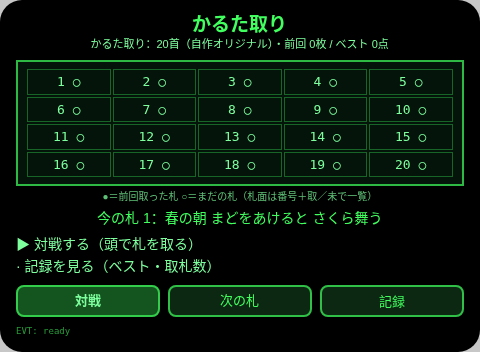
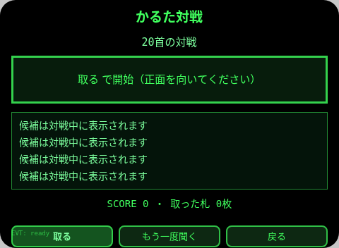
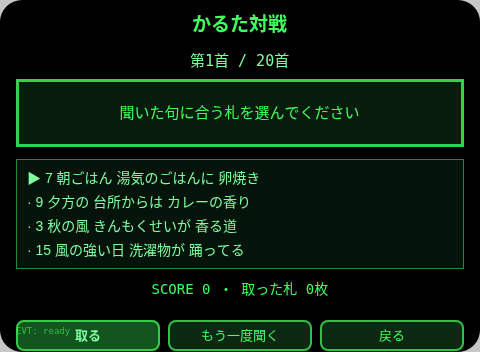
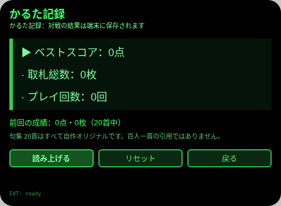
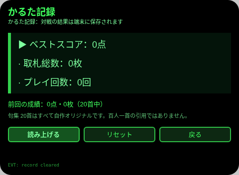

# かるた取り

**Studio インポートアドレス**（Global AIUI Studio の Import Project 入力欄にコピー）：
```
https://github.com/sakai55/rokid/tree/agent-karuta-tori
```

一文の場面：家族が待ち時間に、頭の動きだけでかるたを取る。

## 方向構成

日本在地 × 指向性 × ゲーム。

- 日本在地：かるた取りそのものが日本の家族の待ち時間の遊びであり、句は季節・日常の日本語で作る。ユーザーに見える文言はすべて日本語。
- 指向性：頭の左右（AbsoluteOrientationSensor の yaw）で札を選ぶことが核心入力。開始時に正面を校准し、左右への分段動作でカーソルを 1 枚ずつ動かす。
- ゲーム：20 首の対戦として開始／正誤判定／計分／勝敗決着まで一本の閉環。ベストスコア・取札数・プレイ回数はセッションをまたいで残る。

## プレビュー画像







## 構造と機能

- 札一覧（pages/index）：20 枚の札を 5 列 × 4 行の札面グリッドで一覧し、前回対戦で取った札に ●、まだの札に ○ を付ける。スポット表示で 1 首ずつ上の句を確認できる。
- 対戦（pages/play）：毎ラウンド TTS が目標の上の句を読み上げる。候補 4 枚（目標 1 枚＋別の札 3 枚）の中から頭の左右で選び、うなずき／Enter で取札を確定する。正解 +100 点、不正解 −50 点。20 首すべて終えたら勝敗を決める（正解 14 以上で勝ち）。
- 記録（pages/record）：ベストスコア・取札総数・プレイ回数・前回の成績を端末から読む。

内容集の数：自作オリジナル上の句 20 首（季節・日常）。句集はすべて本作オリジナルであり、百人一首の原文を引用していない。

## ジェスチャ対応

| 操作 | 動作 |
| --- | --- |
| 札一覧：子ページの選択 | ArrowUp / ArrowDown で対戦／記録を循環選択（▶ マーク）、Enter で選択した子ページを開く；子ページから戻った後は onShow で強制的に第 1 項目（対戦）にリセットされるため、戻った直後の Enter は必ず対戦を開き、ArrowDown 1 回＋Enter で必ず記録を開く |
| 対戦：札の選択 | 頭を左／右に向ける（分段動作：向く→正面に戻る→次）、または ArrowLeft / ArrowRight / ArrowUp / ArrowDown |
| 対戦：札を取る（主動作） | うなずき（onHeadGesture('nod')）または Enter |
| 対戦：もう一度聞く | 「もう一度聞く」ボタン |
| 記録：行の選択 | ArrowUp / ArrowDown で循環、Enter で要約を読み上げ |

頭の動作はすべて分段：向く→正面に戻る→次の動作。頭を回すことは絶対に要求しない。ゆっくり小さく動き、痛み・めまいがあれば中止すること。

## 権限

なし。TTS はホストの固定音色を使い、utterance に `lang` は設定しない。

## 誠実な境界

- 句集 20 首はすべて自作オリジナルであり、古典の引用ではない。
- センサーが使えない場合は画面の evt 行にその旨を出し、キーでも遊べることだけを案内する。センサー読取を装わない。
- TTS が使えない場合は読み上げを省略し、画面表示だけで遊べる。成功したふりをしない。
- 頭部動作に医療効果は主張しない。

## デバイスのテスト情報

| 項目 | 内容 |
| --- | --- |
| Studio 名 | karuta-tori（インポート後に必要に応じて名前を変更） |
| Version | 1.0.0 |
| App Category | ゲーム |
| Intent Description | 家族が待ち時間に、頭の動きだけでかるたを取る |
| Agent ID | 未記入 |
| 状態 | 未インポート／実機未検証 |

## 審査提出資料 (Review Submission)

Feature Description：頭の動きだけで遊べる家族のかるた取り。20首の自作オリジナル句を音声で聞き、左右を向いて札を選び、うなずいて取ります。正解で得点し、20首で勝敗が決まります。ベストスコアと取札数が端末に残ります。

Opening Message：かるた取りへようこそ。札一覧で今日の札を確認して、対戦で頭を動かして札を取りましょう。ゆっくり小さく動いてくださいね。

Preview Media：プレビュー画像は上記（札一覧／対戦／記録、全ページのスクリーンショットは aix preview で生成；動画は実機の段階で追加）。

Change Log（Build 1.0.0）：

- Features added：札一覧（20 枚グリッド＋取／未マーク＋スポット表示）；対戦（TTS 読み上げ・頭の左右選択・うなずき確定・正誤計分・20 首決着）；記録（ベスト・取札総数・プレイ回数のセッションをまたぐ保存）。
- Improvements：なし（初版）。
- Fixes：なし（初版）。
