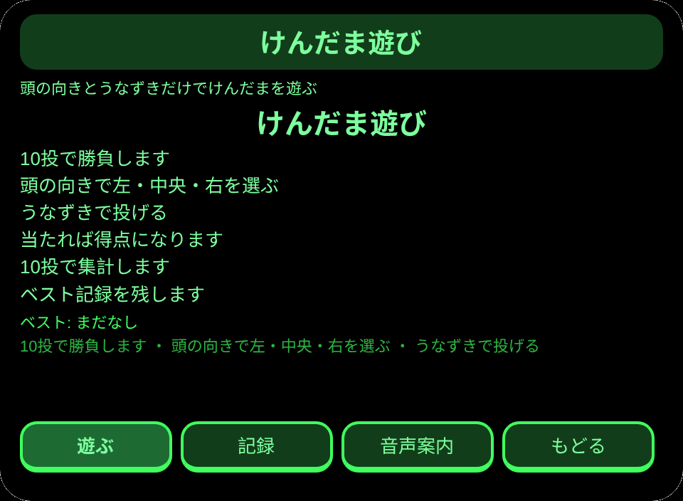
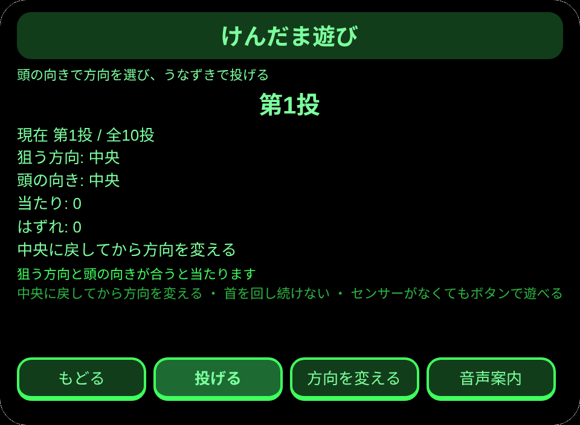
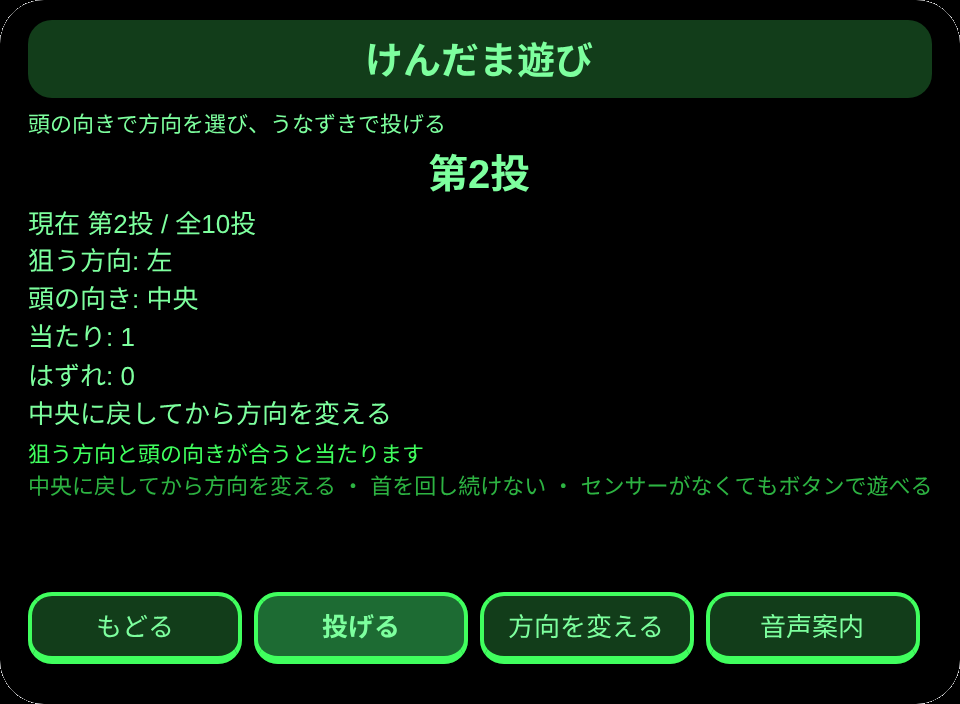
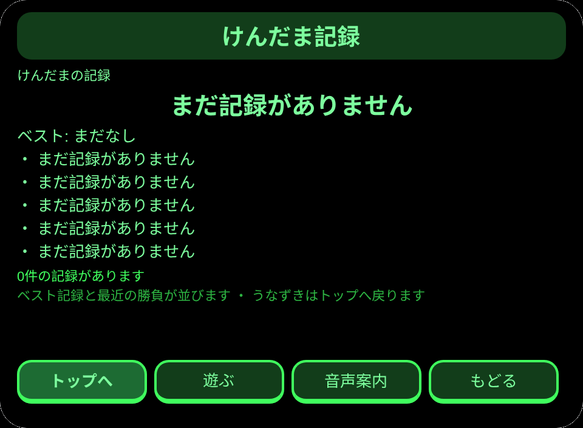

# けんだま遊び

**Studio インポートアドレス**（Global AIUI Studio の Import Project 入力欄にコピー）：

```
https://github.com/sakai55/rokid/tree/agent-kendama-game
```

**AIX 直接ダウンロード**（最新版）: [kendama-game.aix](https://raw.githubusercontent.com/sakai55/rokid/main/aix/kendama-game.aix)

AIX サイズ: 11785 B

JP52・日本在地 × ゲーム × 指向性。家族の集まりで、頭の向きとうなずきだけでけんだまを10投遊ぶ

## プレビュー画像






## 方向構成

日本在地 × ゲーム × 指向性。

## 構造と機能

3 ページ：`pages/index/` 遊びの説明とベスト記録、`pages/play/` けんだま遊び（10投）、`pages/record/` ベスト記録と最近の勝負。

内容集の数：投げる回数 10投；方向 3方向（左・中央・右）；狙う方向の並び 10手（中央・左・右・右・中央・左・中央・右・左・中央）。セッションをまたぐ永続化：ストレージキー `kendamaGameV1`（ベスト記録、勝負記録の配列、`lastError`）。

眼鏡独占能力は視線と頭の向きの協調です。`pages/play/index.ink` の `_startSensor` が `AbsoluteOrientationSensor`（存在性守衛つき）で頭のヨー角を読み、しきい値 ±0.35 で左・中央・右を選びます。方向を変えるには中央に戻すことが必須で、首を回し続ける動きは使いません。うなずきが投げる操作そのもので、センサーがなくてもボタンで遊べます。頭の向きとうなずきが遊びの必経路で、携帯を手に持つ遊び方では成立しません。

## ジェスチャ対応

| ジェスチャ（テンプルのタッチパッド） | キーイベント | この Agent での役割 |
|---|---|---|
| シングルタップ | Enter | 主確認（各ページの主ボタン） |
| 上スワイプ／下スワイプ | ArrowUp / ArrowDown | 選択肢の切替／前後の項目 |
| うなずき（頭が静止したとき） | `onHeadGesture('nod')` | 主確認と等価 |
| ダブルタップ | Backspace | 前のページに戻る |

## 権限

無。TTS とセンサーにマニフェストの権限は不要で、カメラの呼び出しはゼロ。

## 誠実な境界

- 勝敗の判定は頭の向きと本人のうなずきによる。実際のけん玉の動きを Agent は判定しません。
- 動きは分段のみ：中央→一方向→中央に戻る→次方向。首を回す動きは一切使いません。

## エラーコード

失敗時はグラスの画面に裸のコードを表示し、直近のエラーは永続データの `lastError` に書く（コード、本機の slug、バージョン、原文を含む）。本機で起こりうるコード：

- `E5001` 記録の保存に失敗（ストレージ書き込みで例外）
- `E5002` 記録の読み取りに失敗（読み取り／解析で例外）
- `E3005` 読み上げに失敗（TTS の speak で例外）
- `E8001` ページ遷移に失敗（navigateTo/navigateBack で例外）
- `E7001` 頭センサーに失敗（センサーが使えない／読み取りエラー。センサーがなくてもボタンで遊べる）


## 機器テスト情報

| Studio 名 | 未記入 |
| Version | 1.0.0 |
| App Category | 未記入 |
| Intent Description | 未記入 |
| Agent ID | 未記入 |
| 状態 | 未導入 |


## 審査提出資料

Feature Description: 頭の向きとうなずきだけで遊ぶけんだまです。左・中央・右の3方向から頭の向きで選び、うなずきで投げます。10投で勝負し、当たり数を集計してベスト記録を残します。センサーがなくてもボタンで遊べます。

Opening Message: けんだま遊びを開きましょう。頭の向きで方向を選び、うなずきで投げます。

Preview Media:
- `preview-kendama-game-video.mp4`
- `preview-kendama-game-index.png`
- `preview-kendama-game-play.png`
- `preview-kendama-game-record.png`

Change Log — Build 1.0.0:

- Features added: 初版
- Improvements: なし（初版）
- Fixes: なし（初版）
