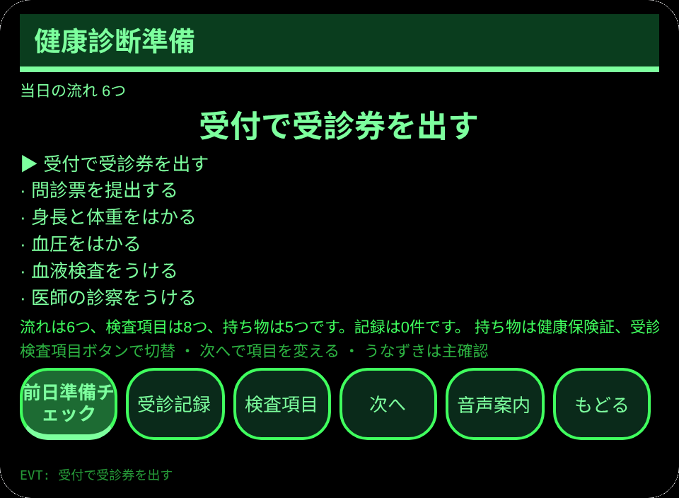
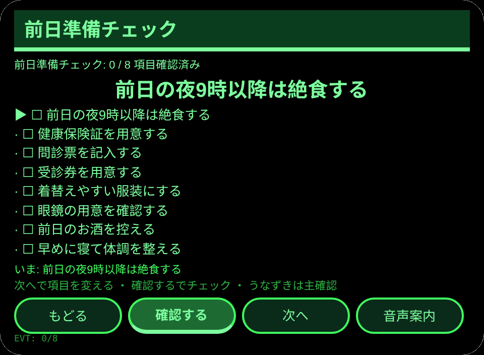
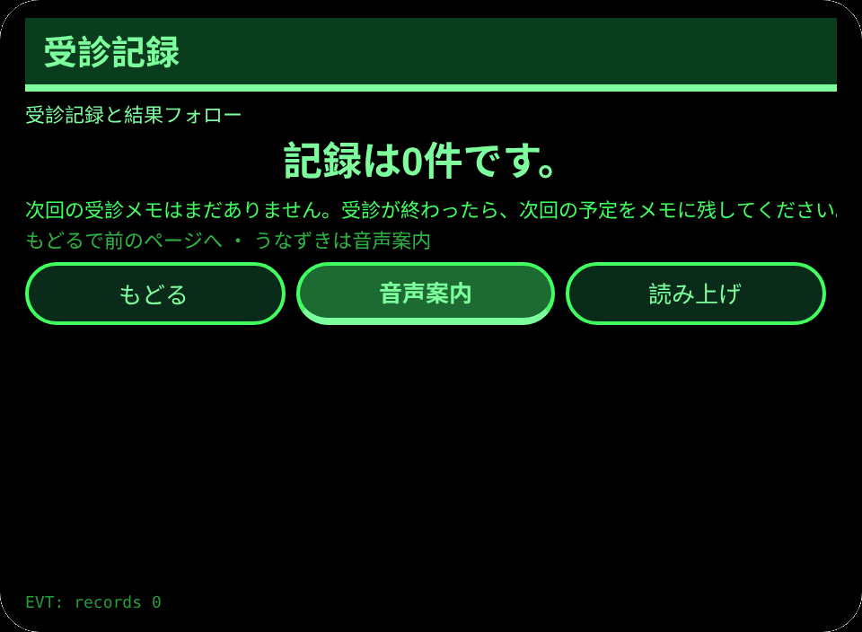

# 健康診断準備

**Studio インポートアドレス**（Global AIUI Studio の Import Project 入力欄にコピー）：

```
https://github.com/sakai55/rokid/tree/agent-kenkou-shindan
```

**AIX 直接ダウンロード**（最新版）：[kenkou-shindan.aix](https://raw.githubusercontent.com/sakai55/rokid/main/aix/kenkou-shindan.aix)

JP35・日本在地 × カーブカット × 注意力。健診をひかえた人が、前日の準備と当日の流れを眼鏡で忘れずに進める。

## プレビュー画像






## 方向構成

- この Agent の方向構成：日本在地 × カーブカット × 注意力。各方向が場面の中で代替のきかない一環を担い、機能の寄せ集めではない。
- 日本在地：日本の健康診断の受診券・問診票・健康保険証という実際の持ち物と流れに沿う。
- カーブカット：絶食や持ち物のような忘れやすい準備を、見落としにくい手順に分ける。
- 注意力：前日の準備を一つずつ確かめ、そろった時点で読み上げて完了を残す。
- 一文の場面：健診をひかえた人が、前日の準備と当日の流れを眼鏡で忘れずに進める。

## 構造と機能

3 ページ：`pages/index/` 健診確認（当日の流れ 6つと検査項目 8つを切り替えて確認、持ち物 5つを表示）；`pages/check/` 前日準備チェック（前日チェック 8項目を一つずつ確認し、絶食と持ち物を含み、全部そろった時点で TTS で読み上げて完了記録を残す）；`pages/record/` 受診記録と結果フォロー（直近 6件の記録と次回の受診メモ）。

内容集の数：当日の流れ 6つ；検査項目 8つ；持ち物 5つ；前日チェック 8項目；完了記録は実際の条数で数える。セッションをまたぐ永続化：ストレージキー `kenkouShindanV1`（選択項目、チェック状態、完了記録の配列、次回のメモ、`lastError`）。

## ジェスチャ対応

| ジェスチャ（テンプルのタッチパッド） | キーイベント | この Agent での役割 |
|---|---|---|
| シングルタップ | Enter | 主確認（各ページの主ボタン） |
| 上スワイプ／下スワイプ | ArrowUp / ArrowDown | 選択肢の切替／前後の項目 |
| うなずき（頭が静止したとき） | `onHeadGesture('nod')` | 主確認と等価 |
| ダブルタップ | Backspace | 前のページに戻る |

## 権限

なし。TTS とセンサーにマニフェストの権限は不要で、カメラの呼び出しはゼロ。

## 誠実な境界

- 本機は生活補助であり、医療診断や治療の助言ではない。検査結果の解釈や治療の判断は医師に相談すること。
- 流れ・検査項目・持ち物は一般的な健診の目安であり、受診先の案内と異なる場合は受診先の案内が優先される。

## エラーコード

失敗時はグラスの画面に裸のコードを表示し、TTS はコードだけを読み上げ、直近のエラーは永続データの `lastError` に書く（コード、本機の slug、バージョン、原文を含む）。本機で起こりうるコード：

- `E5001` 記録の保存に失敗（ストレージ書き込みで例外）
- `E5002` 記録の読み取りに失敗（読み取り／解析で例外）
- `E3005` 読み上げに失敗（TTS の speak で例外）
- `E8001` ページ遷移に失敗（navigateTo/navigateBack で例外）

## デバイスのテスト情報

| 項目 | 内容 |
|---|---|
| Studio 名 | 未記入 |
| Version | 1.0.0 |
| App Category | 未記入 |
| Intent Description | 未記入 |
| Agent ID | 未記入 |
| 状態 | 未実施 |

## 審査提出資料 (Review Submission)

Feature Description: 健康診断の準備を忘れずに進めるための手引きです。当日の流れ6つと検査項目8つを確認し、前日の準備8項目を一つずつチェックして、受診記録と次回のメモを残します。

Opening Message: 健診の準備を確認しましょう。前日の支度から当日の流れまで、一つずつ忘れずに進めます。

Preview Media:
- `preview-kenkou-shindan-index.png`
- `preview-kenkou-shindan-check.png`
- `preview-kenkou-shindan-record.png`
- `preview-kenkou-shindan-check-s2.png`

> 正式な審査提出にはメディアファイル 3〜5 点（うち動画 ≥1 本、≤60 秒）が必要。動画は GO が実機で録画した後に追加する。

Change Log — Build 1.0.0:

- Features added: 初版；健診をひかえた人が、前日の準備と当日の流れを眼鏡で忘れずに進める
- Improvements: なし（初版）
- Fixes: なし（初版）
