# 祭りゲーム集

**Studio インポートアドレス**（Global AIUI Studio の Import Project 入力欄に貼り付け）：

```
https://github.com/sakai55/rokid/tree/agent-matsuri-game-shuu
```

**AIX 直接ダウンロード**（最新版）：[matsuri-game-shuu.aix](https://raw.githubusercontent.com/sakai55/rokid/main/aix/matsuri-game-shuu.aix)

JP32 ・ 日本在地 × ゲーム × 注意力 × 指向性。夏祭りの待ち時間、家族が眼鏡一本で20の屋台ゲームを回す

## プレビュー画像

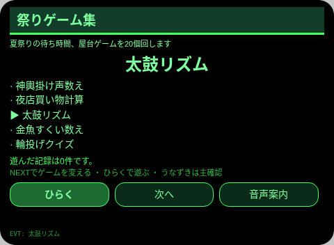
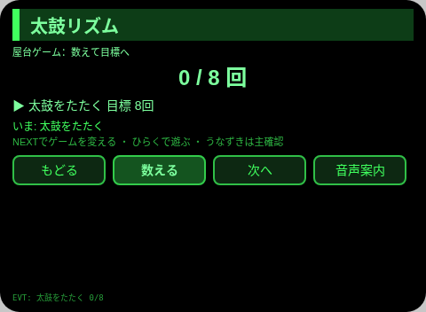
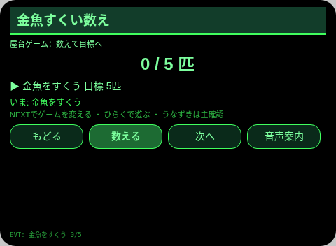
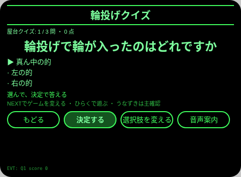
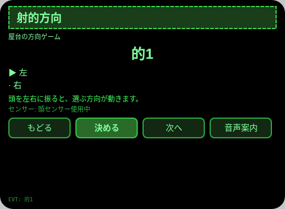
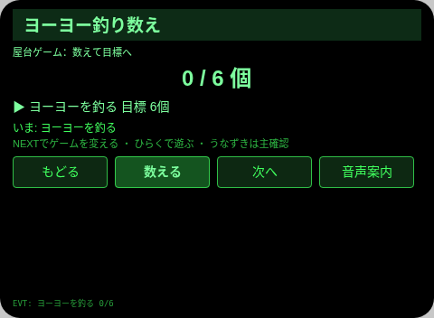
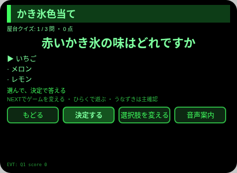
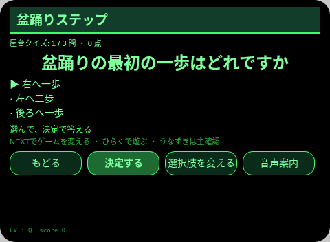
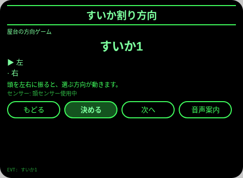
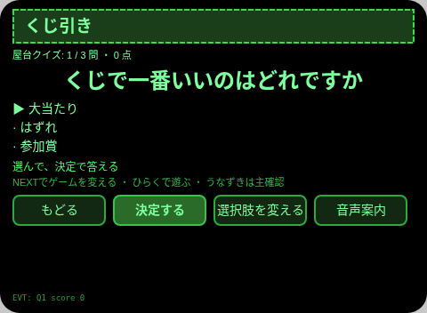
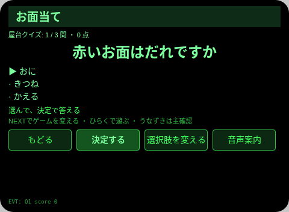
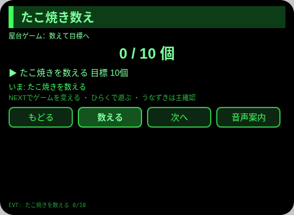
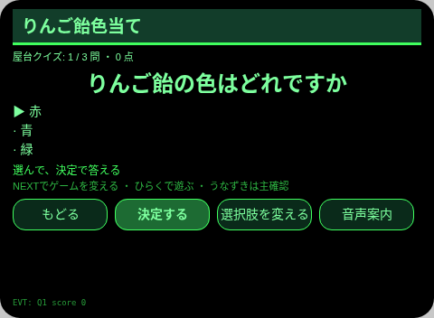
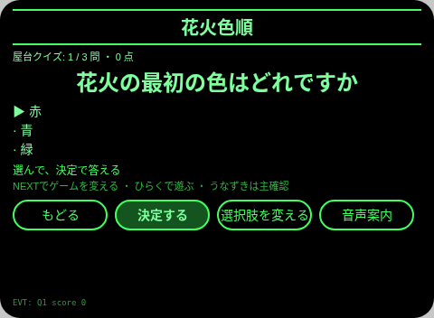
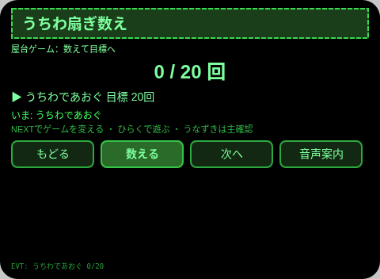
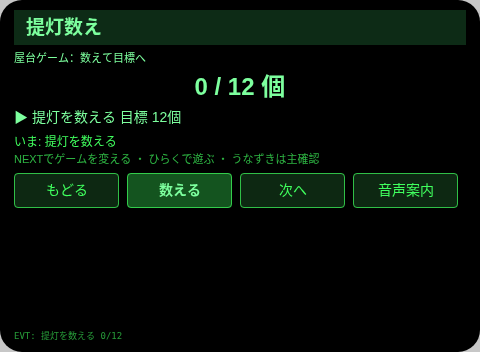
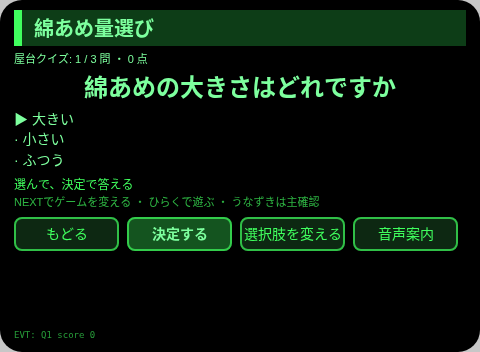
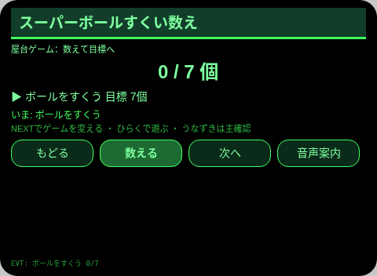
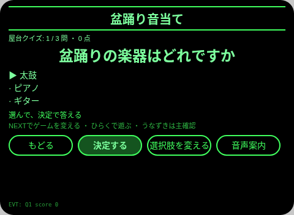
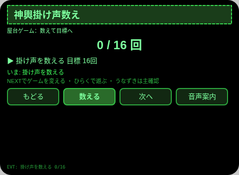
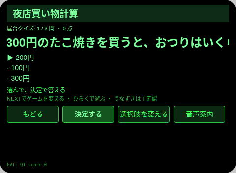


## 方向の構成

- 本 Agent の方向の構成：日本在地 × ゲーム × 注意力 × 指向性。各方向は場面の中で替えの利かない役割を担い、機能の寄せ集めではない。
- 場面を一言で表すと：夏祭りの待ち時間、家族が眼鏡一本で20の屋台ゲームを回す。

## 構造と機能

21 ページ：`pages/index/` 屋台一覧（20 ゲームの名称を 5 件ずつ窓表示し、上下で選び、Enter で開く）。ゲームページはそれぞれ 1 つの仕組みを持つ。数えるページ 8 件（太鼓 8 回 / 金魚 5 匹 / ヨーヨー 6 つ / たこ焼き 10 つ / うちわ 20 回 / 提灯 12 つ / ボール 7 つ / 掛け声 16 回）、選択式の問答 10 ページ（各 3 問・3 つの選択肢・正誤の TTS と解説、回答完了時にスコアを記録）、方向を選ぶページ 2 件（左右の頭の向きとキー、AbsoluteOrientationSensor のガード付き。センサーがない場合はキーで操作できる）。各ゲームページで機能と収録内容は異なり、状態の違いだけでページ数を数えることはしない。

収録内容の数：屋台ゲーム 20 件。数える目標 8 / 5 / 6 / 10 / 20 / 12 / 7 / 16。問答 10 ページ × 3 問。方向 2 ページ × 3 つの的。ゲームの記録は実際の件数で数える。セッションをまたぐ保存：保存キー `matsuriGameShuuV1`（選択中の項目、チェック / 回答 / カウントの状態、完了記録の配列、`lastError`）。

## ジェスチャー対応表

| ジェスチャー（テンプル側タッチパッド） | キーイベント | 本 Agent での役割 |
|---|---|---|
| 1 回タップ | Enter | 主な承認操作（各ページの主ボタン） |
| 上スワイプ / 下スワイプ | ArrowUp / ArrowDown | 選択肢の切り替え / 上下の項目への移動 |
| うなずき（頭が安定しているとき） | `onHeadGesture('nod')` | 主な承認操作と同等 |
| 2 回タップ | Backspace | 前のページに戻る（子ページ） |

## 権限

なし。TTS とセンサーにマニフェスト権限は不要で、カメラは一切呼び出さない。

## 正直な境界

- 各ゲームの採点は本人の操作・選択による。Agent は遊びの上手さを自動判定しない。
- 方向ゲームの頭センサーは、あるときだけ補助します。センサーがないときはキーで選べます。
- 景品・料金は収録済みの定型内容です。実際の屋台の案内が正です。

## エラーコード

失敗した場合は眼鏡の画面に裸のコードを表示し、TTS はコードだけを読み上げ、直近のエラーを保存データの `lastError` に書き込む（含まれるのはコード、本 Agent の slug、バージョン、原文）。本 Agent で出る可能性があるコード：

- `E5001` 記録の保存に失敗（保存の書き込みで例外）
- `E5002` 記録の読み取りに失敗（読み取り / 解析で例外）
- `E3005` 読み上げに失敗（TTS の speak で例外）
- `E8001` ページ切り替えに失敗（navigateTo / navigateBack で例外）
- `E7001` 方向センサーが使えない（AbsoluteOrientationSensor の生成 / 開始に失敗）

## 実機テスト情報

| 項目 | 内容 |
|---|---|
| Studio 名 | 未記入 |
| Version | 1.0.0 |
| App Category | 未記入 |
| Intent Description | 未記入 |
| Agent ID | 未記入 |
| 状態 | 実機未検証 |

## 審査提出資料 (Review Submission)

Feature Description: 祭りゲーム集：祭りの待ち時間向けコレクションです。数える遊び、クイズ、頭の方向で選ぶ遊びなど、屋台ゲーム 20 件を 1 つの Agent に収めます。各ゲームは独自の収録内容を持ち、プレイ記録は保存されます。

Opening Message: 夏祭りの待ち時間ですね。屋台ゲームを20個、眼鏡一本で回しましょう。

Preview Media:
- `preview-matsuri-game-shuu-index.png`
- `preview-matsuri-game-shuu-g01.png`
- `preview-matsuri-game-shuu-g02.png`
- `preview-matsuri-game-shuu-g03.png`
- `preview-matsuri-game-shuu-g04.png`
- `preview-matsuri-game-shuu-g05.png`
- `preview-matsuri-game-shuu-g06.png`
- `preview-matsuri-game-shuu-g07.png`
- `preview-matsuri-game-shuu-g08.png`
- `preview-matsuri-game-shuu-g09.png`
- `preview-matsuri-game-shuu-g10.png`
- `preview-matsuri-game-shuu-g11.png`
- `preview-matsuri-game-shuu-g12.png`
- `preview-matsuri-game-shuu-g13.png`
- `preview-matsuri-game-shuu-g14.png`
- `preview-matsuri-game-shuu-g15.png`
- `preview-matsuri-game-shuu-g16.png`
- `preview-matsuri-game-shuu-g17.png`
- `preview-matsuri-game-shuu-g18.png`
- `preview-matsuri-game-shuu-g19.png`
- `preview-matsuri-game-shuu-g20.png`
- `preview-matsuri-game-shuu-g01-s2.png`

> 正式な審査提出には 3–5 件のメディアファイルが必要で、動画を 1 件以上（≤60 s）含めます。動画は GO の実機録画のあとで追加します。

Change Log — Build 1.0.0:

- Features added: 初版。夏祭りの待ち時間、家族が眼鏡一本で20の屋台ゲームを回す
- Improvements: なし（初版）
- Fixes: なし（初版）
