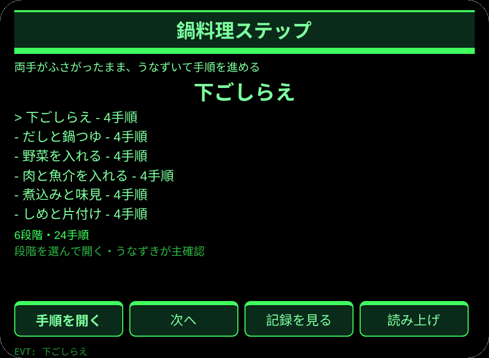
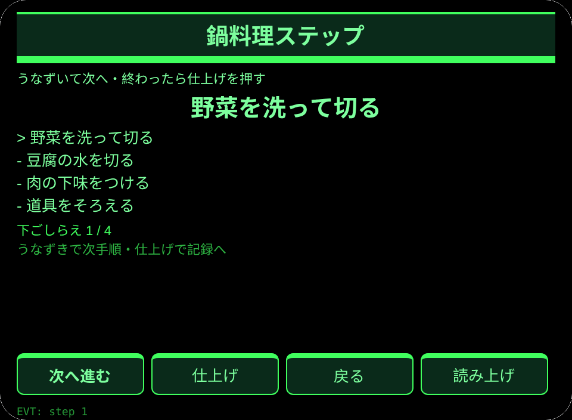
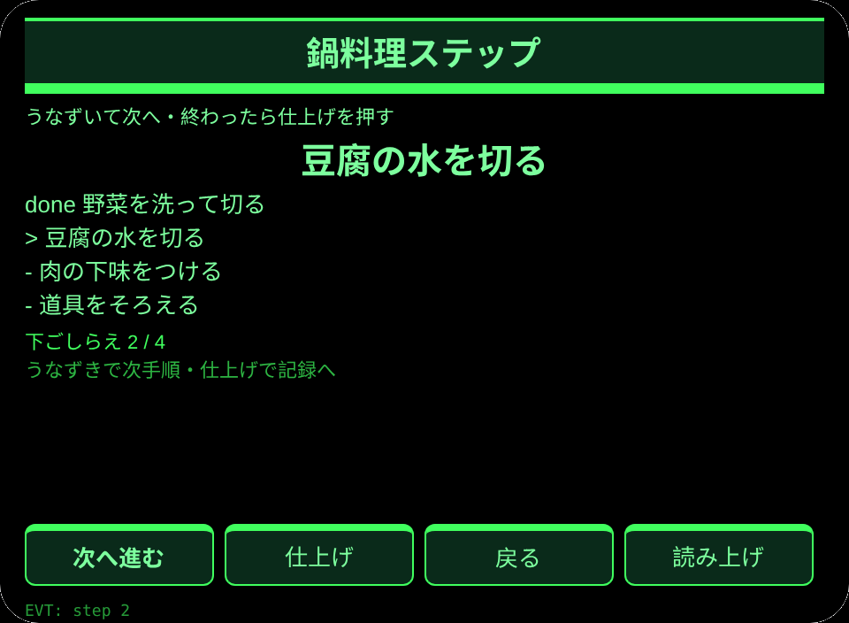
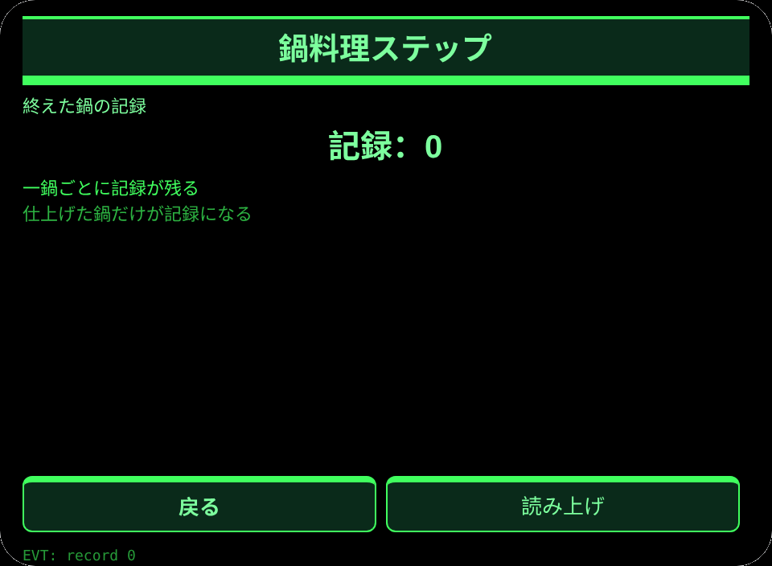

# 鍋料理ステップ

**Studio インポートアドレス**（Global AIUI Studio の Import Project 入力欄にコピー）：

```
https://github.com/sakai55/rokid/tree/agent-nabe-cook-steps
```

[nabe-cook-steps.aix](https://raw.githubusercontent.com/sakai55/rokid/main/aix/nabe-cook-steps.aix)

## 機能

冬の鍋料理で、両手がふさがったままうなずいて手順を進め、6段階24手順を終えたら一鍋の記録を残す。

## シーン

日本の家庭で鍋料理を作る人が、両手がふさがったまま眼鏡で手順を進め、一鍋を終える。

## 方向構成

日本在地 × 路縁坡（手がふさがった調理者への配慮）× 注意力（手順の守候）。

## 眼鏡だけの能力

眼前叠加的分步指引＋双手忙时点头推进：手が濡れてスマホに触れないとき、目の前の手順をうなずきで進める。接線：pages/steps/index.ink の primaryTap（うなずきで次手順）＋ onHeadGesture。

## ページ

| ページ | ページ |
|---|---|
| pages/index | 6段階の一覧 |
| pages/steps | うなずきで手順を進める |
| pages/record | 終えた鍋の記録 |

## 内容集

6段階×4手順＝24手順（下ごしらえ／だしと鍋つゆ／野菜／肉と魚介／煮込みと味見／しめと片付け）。

## セッションをまたぐ保存

保存キー `nabeCookStepsV1`（選択段階・一鍋記録・lastError）。

## 権限

権限の宣言なし。音声読み上げは宿主管理で、宣言は不要。

## ジェスチャー対応

| 単指タップ | Enter | 主確認 |
| 上下スワイプ | ArrowUp / ArrowDown | 選択切替 |
| うなずき | onHeadGesture('nod') | 主確認と同じ |
| ダブルタップ | Backspace | 戻る |

## エラーコード

- `E5001` 保存の書き込み失敗
- `E5002` 保存の読み込み失敗
- `E3005` 音声読み上げ失敗
- `E8001` ページ遷移失敗

- 塩加減や火の通りは測らない。味見は本人が行う。
- 手順は家庭の鍋料理の目安で、店のレシピではない。

## プレビュー画像






## 提審資料

### Feature Description

冬の鍋料理で、両手がふさがったままうなずいて手順を進め、6段階24手順を終えたら一鍋の記録を残す。

### Opening Message

冬の鍋料理で、両手がふさがったままうなずいて手順を進め、6段階24手順を終えたら一鍋の記録を残す。

### Preview Media

[preview-nabe-cook-steps-video.mp4](https://raw.githubusercontent.com/sakai55/rokid/main/screenshots/nabe-cook-steps/preview-nabe-cook-steps-video.mp4)


### Change Log

- Features：初版機能は上記の通り。
- Improvements：なし。
- Fixes：なし。

## デバイス試験情報

| Studio 名 | 未記入 |
|---|---|
| Studio 名 | 未記入 |
| Version / Build | 未記入 |
| App Category | 未記入 |
| Intent Description | 未記入 |
| Agent ID | 未記入 |
| 状態 | 未記入 |
