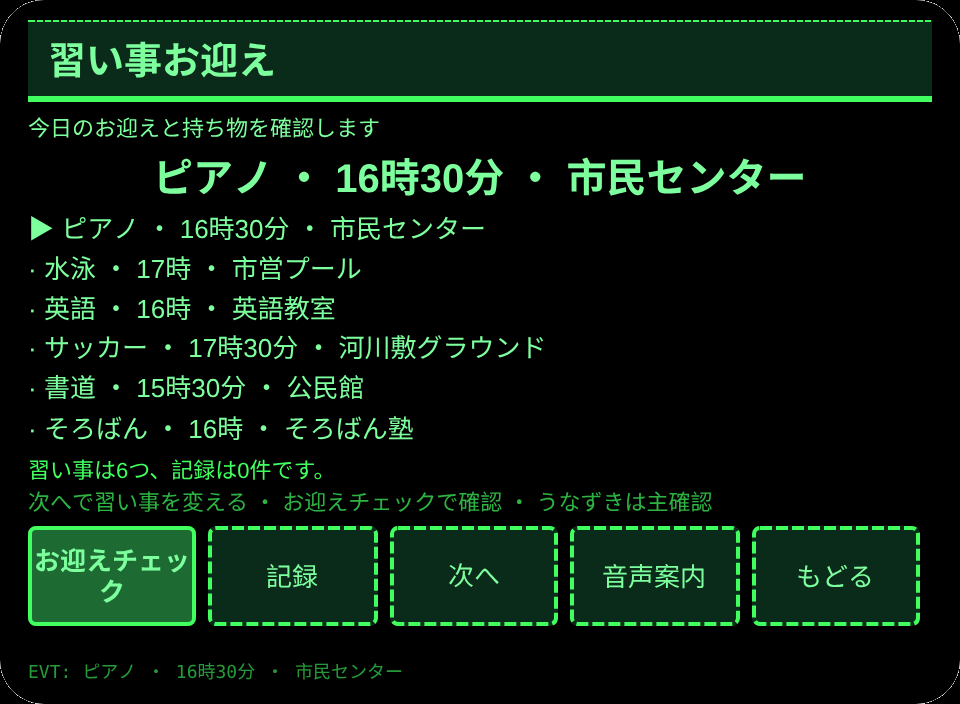
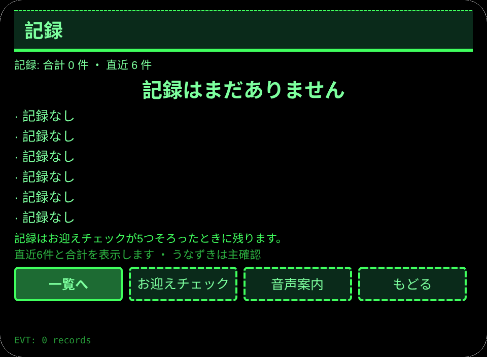
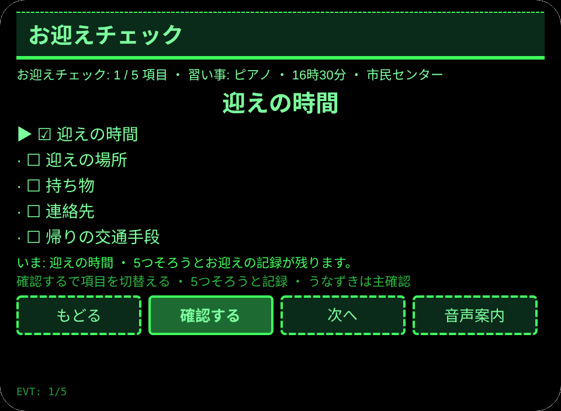

# 習い事お迎え

**Studio インポートアドレス**（Global AIUI Studio の Import Project 入力欄にコピー）：

```
https://github.com/sakai55/rokid/tree/agent-narai-okuri
```

**AIX 直接ダウンロード**（最新版）：[narai-okuri.aix](https://raw.githubusercontent.com/sakai55/rokid/main/aix/narai-okuri.aix)

JP39・日本在地 × 路縁坡 × 注意力。習い事の送迎をする保護者が、今日のお迎えと持ち物を眼鏡で確認して迎えに行く。

## プレビュー画像






## 方向構成

- この Agent の方向構成：日本在地 × 路縁坡 × 注意力。各方向が場面の中で代替のきかない一環を担い、機能の寄せ集めではない。
- 日本在地：日本の習い事の送迎という実際の場面に沿う。文案は全て日本語。
- 路縁坡：送迎の段取りを忘れやすい保護者が、時間と場所と持ち物を一画面で確かめられる。
- 注意力：お迎えの 5 項目を一つずつ確認し、5 つそろったときに記録を残す。
- 一文の場面：習い事の送迎をする保護者が、今日のお迎えと持ち物を眼鏡で確認して迎えに行く。

## 構造と機能

3 ページ：`pages/index/` 習い事一覧（習い事 6つ、それぞれにお迎えの時間と場所：ピアノ、水泳、英語、サッカー、書道、そろばん）；`pages/check/` お迎えチェック（5 項目：迎えの時間、迎えの場所、持ち物、連絡先、帰りの交通手段——項目ごとに切替え、5 つそろったときに音声で知らせて記録を残す）；`pages/record/` 記録（直近 6 件と合計）。

内容集の数：習い事 6つ；チェック項目 5つ；記録は実際の条数で数える。セッションをまたぐ永続化：ストレージキー `naraiOkuriV1`（選択項目、チェック状態、記録の配列、`lastError`）。

## ジェスチャ対応

| ジェスチャ（テンプルのタッチパッド） | キーイベント | この Agent での役割 |
|---|---|---|
| シングルタップ | Enter | 主確認（各ページの主ボタン） |
| 上スワイプ／下スワイプ | ArrowUp / ArrowDown | 選択肢の切替／前後の項目 |
| うなずき（頭が静止したとき） | `onHeadGesture('nod')` | 主確認と等価 |
| ダブルタップ | Backspace | 前のページに戻る |

## 権限

無。TTS とセンサーにマニフェストの権限は不要。

## 誠実な境界

- お迎えの時間と場所と持ち物は本人の登録内容であり、習い事の教室のシステムとは連動しない。実際の時間と場所は教室の案内で確かめること。
- お迎えチェックは本人の確認だけを記す。お迎えの完了を証明するものではない。

## エラーコード

失敗時はグラスの画面に裸のコードを表示し、TTS はコードだけを読み上げ、直近のエラーは永続データの `lastError` に書く（コード、本機の slug、バージョン、原文を含む）。本機で起こりうるコード：

- `E5001` 記録の保存に失敗（ストレージ書き込みで例外）
- `E5002` 記録の読み取りに失敗（読み取り／解析で例外）
- `E3005` 読み上げに失敗（TTS の speak で例外）
- `E8001` ページ遷移に失敗（navigateTo/navigateBack で例外）

## 设备测试信息

| 項目 | 内容 |
|---|---|
| Studio 名 | 未記入 |
| Version | 1.0.0 |
| App Category | 未記入 |
| Intent Description | 未記入 |
| Agent ID | 未記入 |
| 状态 | 未真机验证 |

## 提审资料

Feature Description: 習い事のお迎えを忘れずに進めるための手引きです。習い事6つとお迎えの時間・場所を確かめ、お迎えの5項目を一つずつ記録します。

Opening Message: 今日のお迎えを確認しましょう。時間と場所と持ち物を一つずつ、忘れずにそろえます。

Preview Media:
- `preview-narai-okuri-index.png`
- `preview-narai-okuri-check.png`
- `preview-narai-okuri-record.png`
- `preview-narai-okuri-check-s2.png`

> 正式な審査提出にはメディアファイル 3〜5 点（うち動画 ≥1 本、≤60 秒）が必要。動画は GO が実機で録画した後に追加する。

Change Log — Build 1.0.0:

- Features added: 初版；習い事の送迎をする保護者が、今日のお迎えと持ち物を眼鏡で確認して迎えに行く
- Improvements: なし（初版）
- Fixes: なし（初版）
