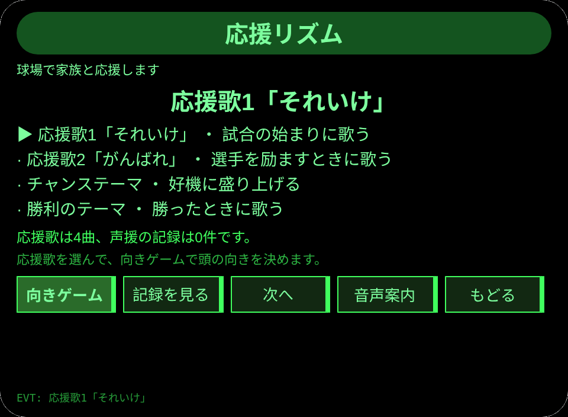
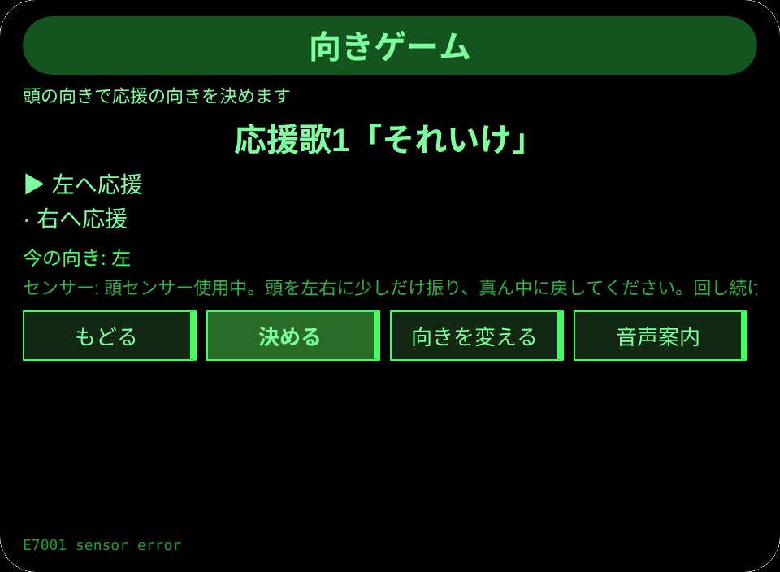
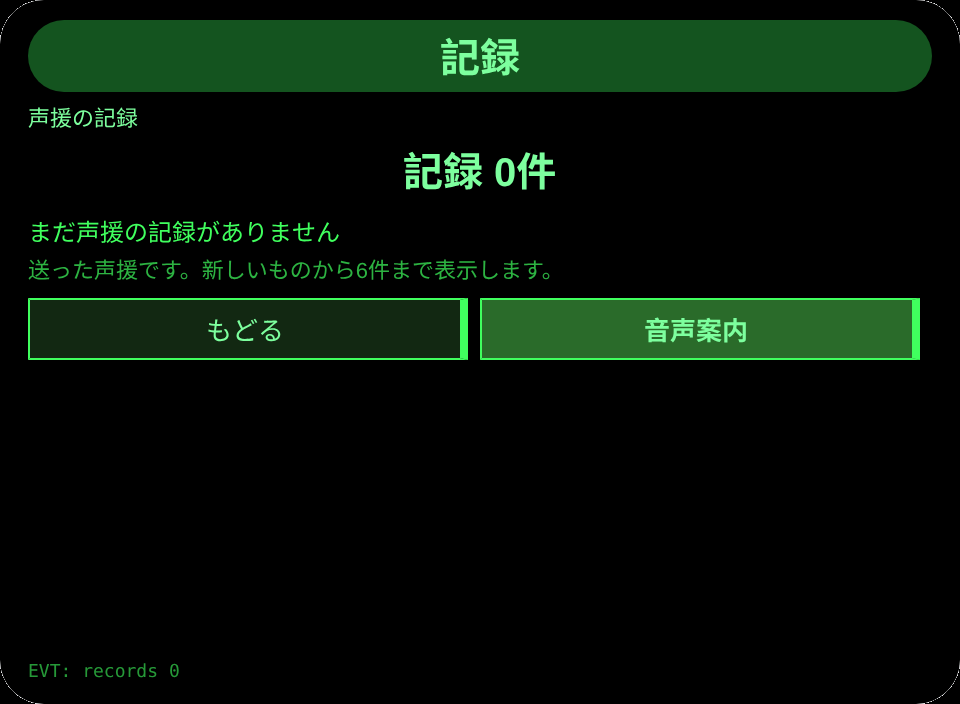
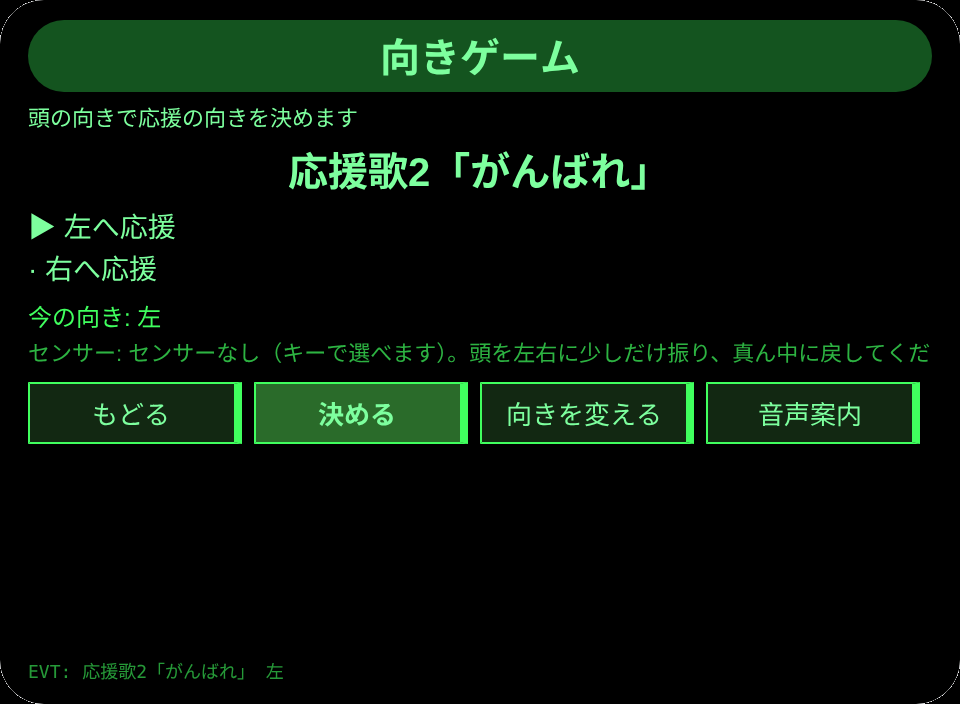

# 応援リズム

**Studio インポートアドレス**（Global AIUI Studio の Import Project 入力欄にコピー）：

```
https://github.com/sakai55/rokid/tree/agent-ouen-rhythm
```

**AIX 直接ダウンロード**（最新版）：[ouen-rhythm.aix](https://raw.githubusercontent.com/sakai55/rokid/main/aix/ouen-rhythm.aix)

JP41・日本在地 × ゲーム × 指向性。球場で応援する家族が、頭の左右で応援の向きを決めて声援を送る。

## プレビュー画像






## 方向構成

- この Agent の方向構成：日本在地 × ゲーム × 指向性。各方向が場面の中で代替のきかない一環を担い、機能の寄せ集めではない。
- 日本在地：日本の球場で家族と応援する場面に沿う。
- ゲーム：応援歌を選び、頭の向きで声援の向きを決める遊びの閉環（選ぶ・決める・記録する）がある。
- 指向性：この Agent の向きは眼前相对方向である。目の前で左右どちらへ声援を送るかだけを扱い、地図上の地点へ向かう課題ではないため、GPS 三件套は適用されない。頭の動きは `pages/play/index.ink` の `AbsoluteOrientationSensor`（存在性の守りつき）で読み、ヨー角の差が -0.35 以下なら左、0.35 以上なら右と判定する。センサーがないときはキーで向きを選べる。
- 一文の場面：球場で応援する家族が、頭の左右で応援の向きを決めて声援を送る。

## 構造と機能

3 ページ：`pages/index/` 応援一覧（応援歌 4 曲とそれぞれの説明。応援歌1「それいけ」、応援歌2「がんばれ」、チャンステーマ、勝利のテーマ）；`pages/play/` 向きゲーム（頭の左右で応援の向きを決め、決めるたびに応援歌と向きの声援記録を残し、音声で読み上げる。頭の動きは分段動作で、決めたら真ん中に戻す。回し続ける動きはしない）；`pages/record/` 記録（直近 6 件の声援記録と合計件数）。

内容集の数：応援歌 4 曲；向き 2 つ（左・右）；声援記録は実際の条数で数える。セッションをまたぐ永続化：ストレージキー `ouenRhythmV1`（選んだ応援歌、声援記録の配列、`lastError`）。

## ジェスチャ対応

| ジェスチャ（テンプルのタッチパッド） | キーイベント | この Agent での役割 |
|---|---|---|
| シングルタップ | Enter | 主確認（各ページの主ボタン） |
| 上スワイプ／下スワイプ | ArrowUp / ArrowDown | 選択肢の切替／前後の項目 |
| うなずき（頭が静止したとき） | `onHeadGesture('nod')` | 主確認と等価 |
| ダブルタップ | Backspace | 前のページに戻る |

## 権限

無。GPS の宣言はなし。TTS と頭センサーにマニフェストの権限は不要で、カメラの呼び出しはゼロ。

## 誠実な境界

- 向きの判定は本人の頭の動きであり、球場の座席や選手の位置とは連動しない。
- センサーがないときはキーで向きを選ぶ。センサーの有無で遊びの結果が変わることはない。
- 声援の記録は本人の遊びの記録であり、球場の応援の実績ではない。

## エラーコード

失敗時はグラスの画面に裸のコードを表示し、TTS はコードだけを読み上げ、直近のエラーは永続データの `lastError` に書く（コード、本機の slug、バージョン、原文を含む）。本機で起こりうるコード：

- `E5001` 記録の保存に失敗（ストレージ書き込みで例外）
- `E5002` 記録の読み取りに失敗（読み取り／解析で例外）
- `E3005` 読み上げに失敗（TTS の speak で例外）
- `E8001` ページ遷移に失敗（navigateTo/navigateBack で例外）
- `E7001` 頭センサーが使えない（センサーの開始失敗または読み取り失敗）

## デバイスのテスト情報

| 項目 | 内容 |
|---|---|
| Studio 名 | 未記入 |
| Version | 1.0.0 |
| App Category | 未記入 |
| Intent Description | 未記入 |
| Agent ID | 未記入 |
| 状態 | 未実施 |

## 審査提出資料 (Review Submission)

Feature Description: 球場で家族と応援する遊びです。応援歌4曲から選び、頭の左右で声援の向きを決めて送り、声援の記録を残します。

Opening Message: 一緒に応援しましょう。応援歌を選んで、頭の向きで声援を送ります。

Preview Media:
- `preview-ouen-rhythm-index.png`
- `preview-ouen-rhythm-play.png`
- `preview-ouen-rhythm-record.png`
- `preview-ouen-rhythm-play-s2.png`

> 正式な審査提出にはメディアファイル 3〜5 点（うち動画 ≥1 本、≤60 秒）が必要。動画は GO が実機で録画した後に追加する。

Change Log — Build 1.0.0:

- Features added: 初版；球場で応援する家族が、頭の左右で応援の向きを決めて声援を送る
- Improvements: なし（初版）
- Fixes: なし（初版）
