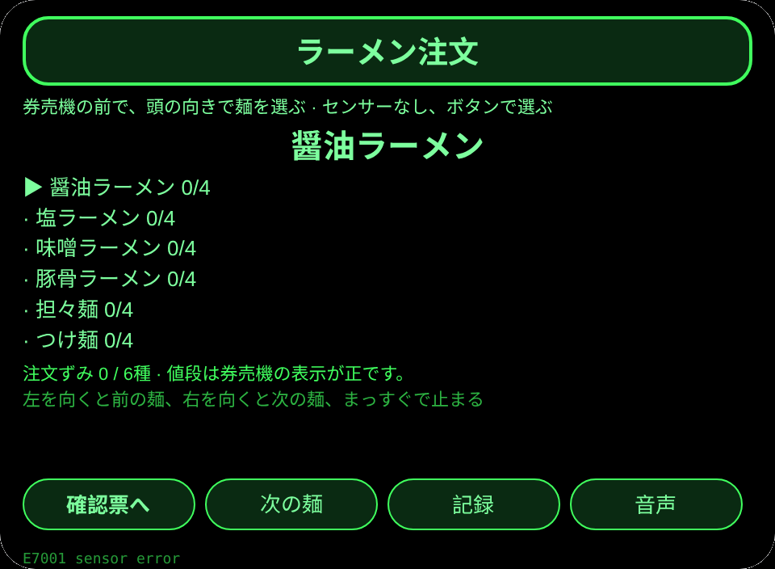
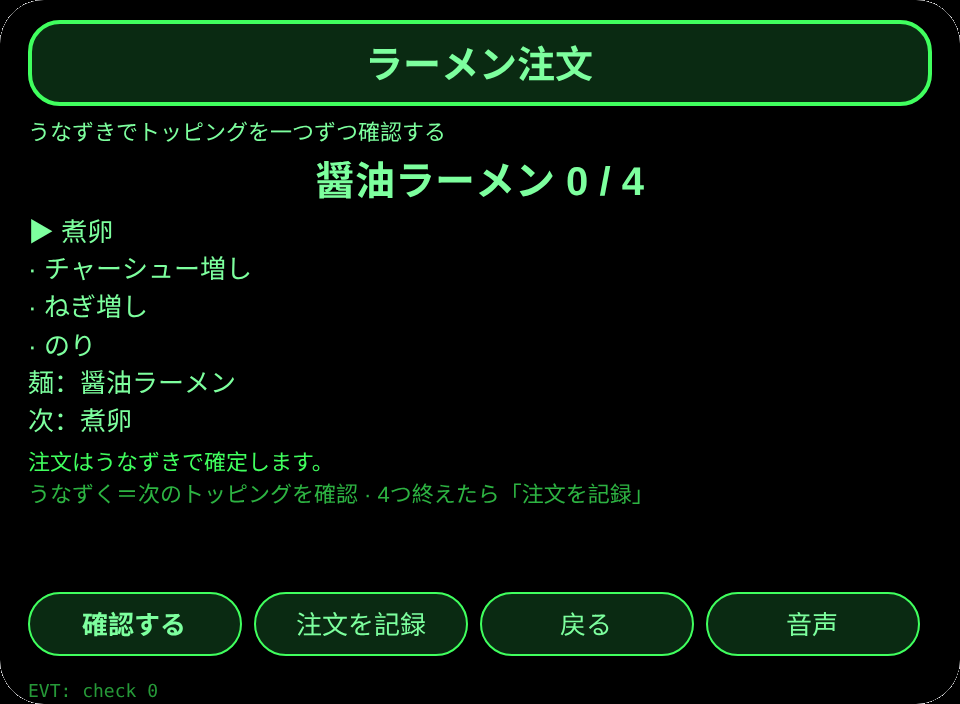
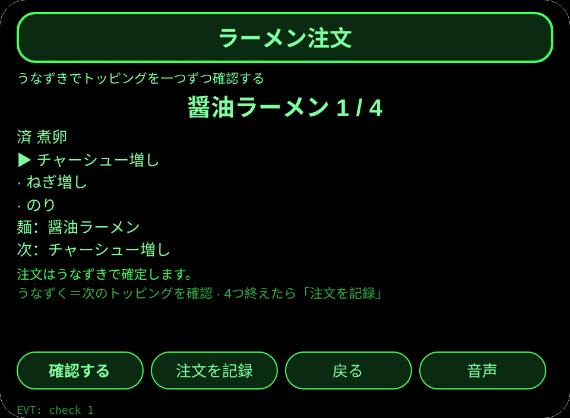
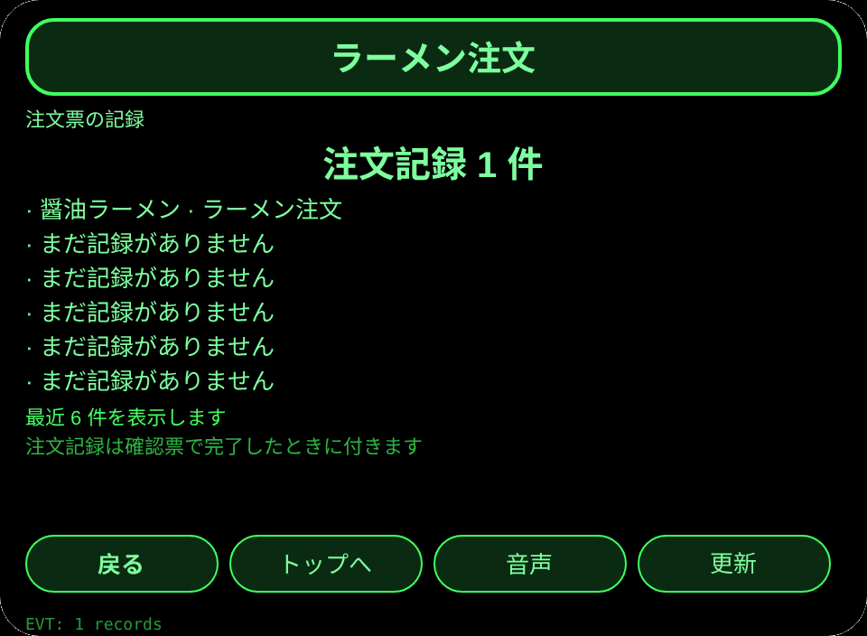

# ラーメン注文

**Studio インポートアドレス**（Global AIUI Studio の Import Project 入力欄にコピー）：

```
https://github.com/sakai55/rokid/tree/agent-ramen-order
```

[ramen-order.aix](https://raw.githubusercontent.com/sakai55/rokid/main/aix/ramen-order.aix)

## 機能

ラーメン屋の券売機の前で、両手に荷物と傘を持ったまま、頭の向きで麺を選び、うなずきでトッピングを一つずつ確認し、注文票を声で読み上げる。

## シーン

ラーメン屋の券売機の前で、両手に荷物と傘を持った人が、眼鏡だけで麺を選び、トッピングを確認して注文を終える。

## 方向構成

日本在地 × 注意力（注文票の確認）× 指向性（頭の向きで麺を選ぶ）。指向性は麺の選択を担い、注意力はトッピングの逐項確認を担う。

## 眼鏡だけの能力

視線と頭の向きの連動＋両手がふさがったときのうなずき確認：荷物と傘で両手がふさがっていても、頭を向けるだけで麺が選べ、うなずくだけでトッピングが確認できる。接線：pages/index/index.ink の _startSensor（AbsoluteOrientationSensor、存在性ガード）と _onYaw（±0.35 で麺を切替、まっすぐで再武装）＋ onHeadGesture('nod') が primaryTap と同じ確認。センサーが使えないときはボタンで選べ、センサー読取失敗は E7001 を出す。

## 正直な境界

- 麺と値段は内蔵の見本で、券売機の表示が正しい。
- 注文は記録のみで、券売機への送信はしない。
- センサーが使えないときはボタンで選ぶ。注文記録は 4 つのトッピングを全部確認したときだけ付く。

## ページ

| ページ | ページ |
|---|---|
| pages/index | 麺 6 種の一覧、頭の向きで選ぶ |
| pages/confirm | 選んだ麺とトッピング 4 つをうなずきで逐項確認し、注文を記録 |
| pages/record | 最近 6 件の注文記録と合計 |

## 内容集

麺 6 種（醤油／塩／味噌／豚骨／担々麺／つけ麺）×トッピング 4 つ（煮卵／チャーシュー増し／ねぎ増し／のり）。注文記録は実数で数える。

## セッションをまたぐ保存

保存キー `ramenOrderV1`。選んだ麺、麺ごとの確認ずみトッピング数、注文記録の配列、lastError を保存する。

## 権限

権限なし。音声読み上げに権限はいらない。カメラと位置情報は使わない。

## ジェスチャー対応

| 単指タップ | Enter | 主確認（麺の選択・トッピングの確認） |
| 上下スワイプ | ArrowUp / ArrowDown | 麺の選択切替 |
| うなずき | onHeadGesture('nod') | 主確認と同じ |
| ダブルタップ | Backspace | 戻る |

## エラーコード

- `E5001` 保存の書き込み失敗
- `E5002` 保存の読み込み失敗
- `E3005` 音声読み上げ失敗
- `E8001` ページ遷移失敗
- `E7001` 頭部センサー不可または読取失敗

失敗したときは画面に裸のコードを出し、lastError にコード・slug・バージョン・原文を残す。

## プレビュー画像






## 提審資料

### Feature Description

ラーメン屋の券売機の前で、両手に荷物と傘を持ったまま、頭の向きで麺を選び、うなずきでトッピングを一つずつ確認し、注文票を声で読み上げる。

### Opening Message

券売機の前で両手がふさがっていても大丈夫。頭を向けて麺を選び、うなずいてトッピングを確認しよう。

### Preview Media

[preview-ramen-order-video.mp4](https://raw.githubusercontent.com/sakai55/rokid/main/screenshots/ramen-order/preview-ramen-order-video.mp4)


### Change Log

- Features：初版機能は上記の通り。
- Improvements：なし。
- Fixes：なし。

## デバイス試験情報

| 項目 | 内容 |
|---|---|
| Studio 名 | 未記入 |
| Version / Build | 未記入 |
| App Category | 未記入 |
| Intent Description | 未記入 |
| Agent ID | 未記入 |
| 状態 | 未記入 |
