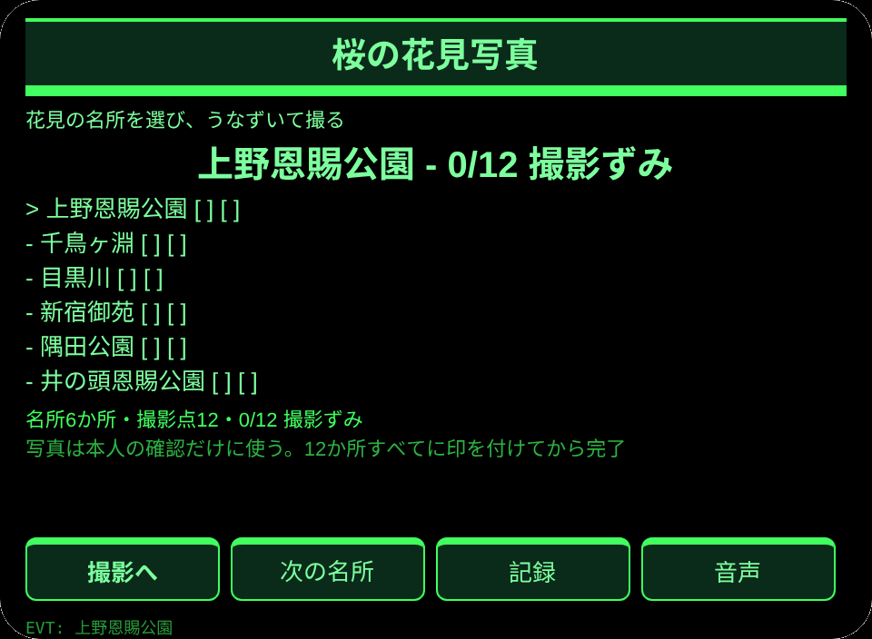
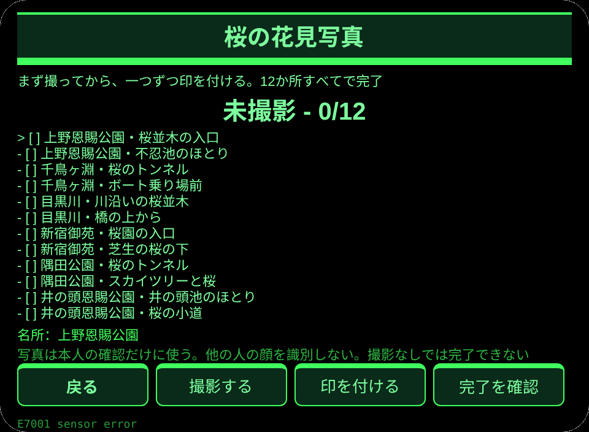
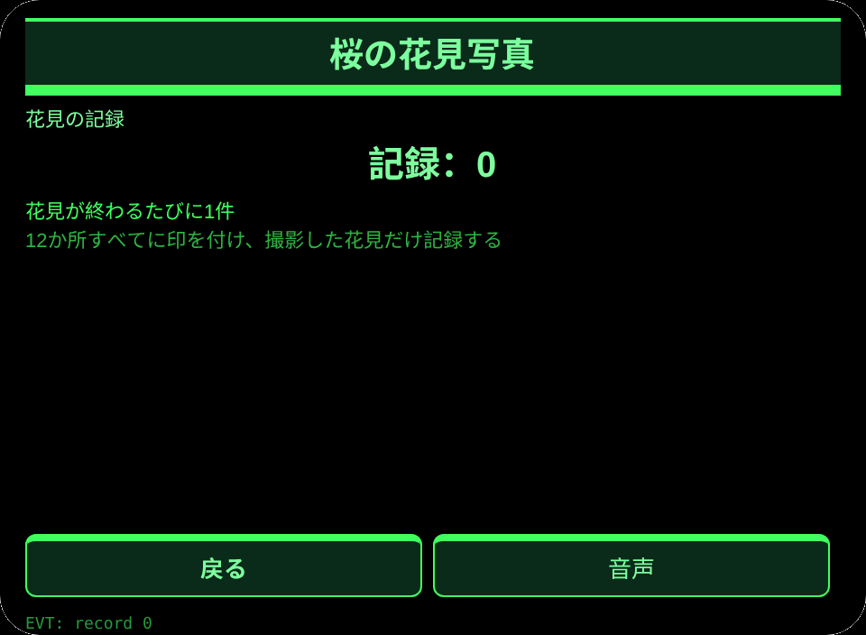

# 桜の花見写真

**Studio インポートアドレス**（Global AIUI Studio の Import Project 入力欄にコピー）：

```
https://github.com/sakai55/rokid/tree/agent-sakura-hanami-photo
```

[sakura-hanami-photo.aix](https://raw.githubusercontent.com/sakai55/rokid/main/aix/sakura-hanami-photo.aix)

## 機能

花見の観光客が、弁当と案内冊子で両手がふさがったまま、桜の名所を見てうなずくだけで写真を撮り、12の撮影点に印を付ける。6か所の名所をめぐり、12か所すべてに印が付いたときだけ完了になる。

## シーン

花見の観光客が、弁当と案内冊子で両手がふさがったまま、桜の名所を見てうなずくだけで写真を撮り、12の撮影点に印を付けて花見を終える。

## 方向構成

日本在地 × 指向性（見た名所へ向けて撮る）× 注意力（12の撮影点の見守り）。指向性は見る方向で名所を切り替える仕組みを担い、注意力は12の撮影点の逐項確認を担う。

## 眼鏡だけの能力

両手がふさがったときの第一人称での即時撮影：弁当と案内冊子で両手がふさがっていても、桜の名所を見てうなずくだけで写真が撮れ、撮影が完了への必須の一歩になる。接線：app.json に CAMERA を宣言、pages/photo/index.ink の photoTap（getUserMedia＋ImageCapture.takePhoto）、Blob から data URL への変換は arrayBuffer＋分割 btoa。撮影なしでは完了を確認できない。

## 正直な境界

- 写真は本人の確認だけに使う。他の人の顔を識別しないし、名所を自動で識別するとは言わない。
- 撮影なしでは完了を確認できない。印が付いていない撮影点があるときは記録を書かない。
- プレビューにカメラはないので撮影は失敗として表示し、成功したふりはしない。

## ページ

| ページ | ページ |
|---|---|
| pages/index | 名所 6 か所の一覧、頭の向きで選ぶ |
| pages/photo | 見た名所で撮影し、12 の撮影点に印を付ける |
| pages/record | 最近 6 件の花見の記録と合計 |

## 内容集

名所 6 か所（上野恩賜公園／千鳥ヶ淵／目黒川／新宿御苑／隅田公園／井の頭恩賜公園）×撮影点 12 か所（1 か所 2 点、合計 12 点）。記録は実数で数える。

## セッションをまたぐ保存

保存キー `sakuraHanamiPhotoV1`。選んだ名所、撮影点ごとの印、撮影の時刻とバイト数、花見の記録の配列、lastError を保存する。写真そのものはその場だけに置き、保存はしない。

## 権限

`CAMERA`。音声読み上げに権限はいらない。位置情報は使わない。

## ジェスチャー対応

| 単指タップ | Enter | 主確認（撮影ページでは撮影） |
| 上下スワイプ | ArrowUp / ArrowDown | 名所の選択切替 |
| うなずき | onHeadGesture('nod') | 主確認と同じ |
| ダブルタップ | Backspace | 戻る |

## エラーコード

- `E5001` 保存の書き込み失敗
- `E5002` 保存の読み込み失敗
- `E3005` 音声読み上げ失敗
- `E8001` ページ遷移失敗
- `E7001` 頭部センサー不可または読取失敗
- `E8004` カメラが見つからない
- `E2001` 撮影失敗
- `E2013` 写真の符号化失敗

失敗したときは画面に裸のコードを出し、lastError にコード・slug・バージョン・原文を残す。

## プレビュー画像






## 提審資料

### Feature Description

花見の観光客が、弁当と案内冊子で両手がふさがったまま、桜の名所を見てうなずくだけで写真を撮り、12の撮影点に印を付ける。6か所の名所をめぐり、12か所すべてに印が付いたときだけ完了になる。

### Opening Message

花見で両手がふさがっていても大丈夫。桜の名所を見て、うなずいて写真を撮ろう。

### Preview Media

[preview-sakura-hanami-photo-video.mp4](https://raw.githubusercontent.com/sakai55/rokid/main/screenshots/sakura-hanami-photo/preview-sakura-hanami-photo-video.mp4)


### Change Log

- Features：初版機能は上記の通り。
- Improvements：なし。
- Fixes：なし。

## デバイス試験情報

| 項目 | 内容 |
|---|---|
| Studio 名 | 未記入 |
| Version / Build | 未記入 |
| App Category | 未記入 |
| Intent Description | 未記入 |
| Agent ID | 未記入 |
| 状態 | 未記入 |
