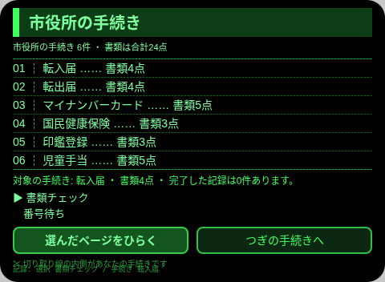
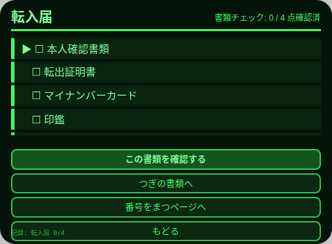
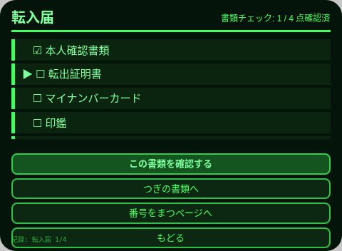
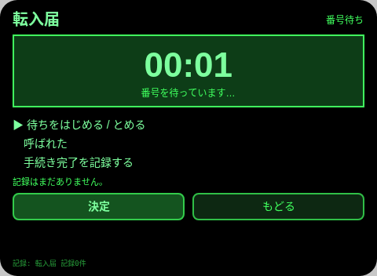

# 市役所手続きアシスタント Shiyakusho Tetsuzuki

**Studio インポートアドレス**（Global AIUI Studio の Import Project 入力欄に貼り付け）：

```
https://github.com/sakai55/rokid/tree/agent-shiyakusho-tetsuzuki
```

**AIX 直接ダウンロード**（最新版）：[shiyakusho-tetsuzuki.aix](https://raw.githubusercontent.com/sakai55/rokid/main/aix/shiyakusho-tetsuzuki.aix)

一文の場面：市役所で手続きをする高齢者が、チェックリストどおりに書類をそろえ、番号を守って呼び出しを逃さない。

## 方向構成

- 日本ローカル：手続きと書類はいずれも日本の市役所制度の実物（転入届、転出届、マイナンバーカード、国民健康保険、印鑑登録、児童手当）であり、ユーザーが見る文案はすべて日本語。
- カーブカット：高齢者と手続きに不慣れな人を先行させる——大きな文字の票、項目ごとのチェック、うなずきで進行。障がいは大衆向けの利益のために薄めない。
- 注意力：見守りモード——書類がそろったかの見守りと番号待ちの見守りが同じ手続きに落ちる。場面の内側から生まれるもので、機能の寄せ集めではない。

## プレビュー画像







## 構造と機能

3 ページ：

- `pages/index/` 手続き一覧：6 件の手続き票。各件に書類数（4/4/5/3/3/5 点、合計 24 点）を表示する。下部はサブページ選択列（▶ マーク、onShow 時に第 1 項目にリセット）：第 1 項目を選んだ状態で Enter を押すと書類ページを開き、ArrowDown を1回押して Enter を押すと番号ページを開く。サブページの行自体もクリックで直接移動できる。対象の手続きは明細行に表示され、「つぎの手続きへ」ボタンで切り替える。
- `pages/docs/` 書類チェック：選んだ手続きの書類を項目ごとにチェックするカード。うなずき／Enter で進み、すべてチェックできたら TTS で読み上げ、完了記録を書き込む。
- `pages/number/` 番号待ち：手動で開始する待ち時間タイマー（大きな文字の mm:ss、1 秒ごとに更新）。「呼ばれた」の確認と「手続き完了」がそれぞれ永続化記録を1件書く（待ち秒数と時刻を含む）。

内容セットの数：手続き 6 件。書類 24 点（転入届 4、転出届 4、マイナンバーカード 5、国民健康保険 3、印鑑登録 3、児童手当 5）。セッションをまたぐ永続化：ストレージキー `shiyakushoV1`（選んだ手続き、各件のチェック配列、完了／呼び出し／完了の記録配列）。

## ジェスチャー対応表

| 位置 | テンプル／キー | 動作 |
| --- | --- | --- |
| 一覧 | ArrowUp/ArrowDown | 上／下のサブページ（書類ページ／番号ページ） |
| 一覧 | Enter / うなずき | 選んだサブページを開く（第 1 項目は書類ページ、第 2 項目は番号ページ） |
| 一覧 | ボタン | 対象の手続きを切り替える／選んだサブページを開く |
| 一覧 | onShow | 選択項目を第 1 項目にリセットする |
| 書類 | ArrowUp/ArrowDown | 上／下の書類 |
| 書類 | Enter / うなずき | 現在の書類をチェックして進む |
| 書類 | Backspace / 戻るボタン | wx.navigateBack でホームに戻る |
| 番号 | ArrowUp/ArrowDown | 上／下の動作 |
| 番号 | Enter / うなずき | 選んだ動作を実行する（開始／停止、呼ばれた、手続き完了の記録） |
| 番号 | Backspace / 戻るボタン | wx.navigateBack でホームに戻る |

## 権限

なし。

## 誠実な境界

- 番号タイマーは、ユーザーが自分で開始を押した後の時間だけを測る。市役所の呼び出し画面は読み取らない。「呼ばれた」はユーザー本人が確認するだけであり、実際の呼び出しを知っているとは主張しない。
- 書類のチェックは、ユーザー本人がチェックしたことだけを証明する。窓口で実際に受け付けられることを保証しない。窓口の要件は現場が優先する。

## 実機テスト情報

| 項目 | 内容 |
| --- | --- |
| Studio 名 | 未記入 |
| Version | 1.0.0 |
| App Category | 未記入 |
| Intent Description | 未記入 |
| Agent ID | 未記入 |
| 状態 | 実機未検証 |

## 審査提出資料 (Review Submission)

Feature Description: 市役所で手続きをする高齢者向けのアシスタント。日本の市役所の手続き6件に24点の書類チェックリストを付け、項目ごとにチェックし、そろえば読み上げる。手動の番号待ちタイマーもあり、呼び出しの確認と手続きの完了をどちらも記録し、セッションをまたいで確認できる。

Opening Message: 市役所の手続きをお手伝いします。まず手続きを選んで、書類を一つずつ確認しましょう。

Preview Media: プレビュー画像 5 枚（上記「プレビュー画像」の節を参照。動画は GO が実機で録画した後に追加）。

Change Log — Build 1.0.0:

- Features added: 手続き6件×書類24点のチェックリスト。項目ごとのチェックと、そろったときの読み上げ。手動の番号待ちタイマーと、呼び出し／完了記録の永続化。
- Improvements: なし（初版）。
- Fixes: なし（初版）。
