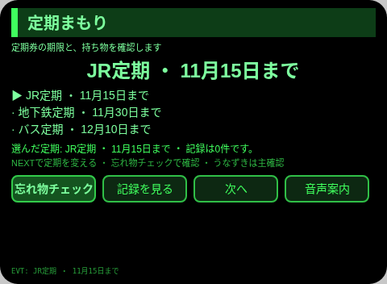
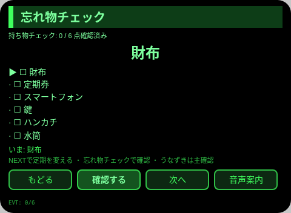
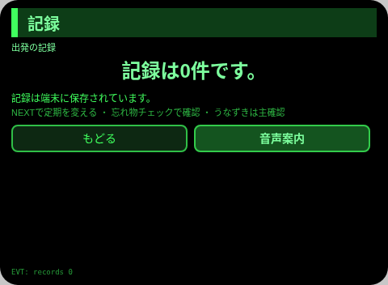
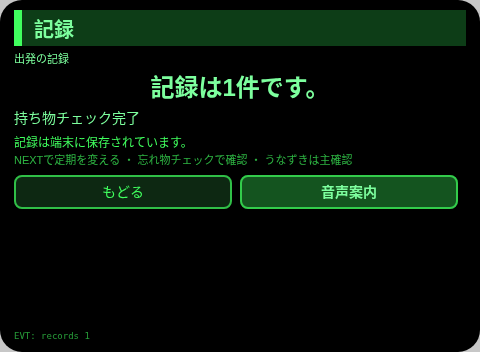

# 定期まもり

**Studio インポートアドレス**（Global AIUI Studio の Import Project 入力欄に貼り付け）：

```
https://github.com/sakai55/rokid/tree/agent-teiki-mamori
```

**AIX 直接ダウンロード**（最新版）：[teiki-mamori.aix](https://raw.githubusercontent.com/sakai55/rokid/main/aix/teiki-mamori.aix)

JP28 · 日本ローカル × カーブカット × アテンション。通勤者が改札前で定期券の期限と忘れ物を一度に確認する

## プレビュー画像







## 方向構成

- 本 Agent の方向構成：日本ローカル × カーブカット × アテンション。各方向が場面の中で欠かせない一環を担い、機能の寄せ集めではない。
- 一言で表す場面：通勤者が改札前で定期券の期限と忘れ物を一度に確認する。

## 構造と機能

3 ページ：`pages/index/` 定期一覧（定期3枚・期限表示、選んだ定期を保持）；`pages/check/` 忘れ物チェック（持ち物6点、うなずき/Enter で1点ずつチェックし、そろったら TTS で読み上げて完了記録を1件残す）；`pages/record/` 記録（最近6件の完了記録＋総数）。

内容セットの数：定期券3枚；持ち物6点；完了記録は実際の件数で数える。セッションをまたぐ永続化：保存キー `teikiMamoriV1`（選択項目、チェック／回答／カウントの状態、完了記録の配列、`lastError`）。

## ジェスチャ対応

| ジェスチャ（テンプル＝つるのタッチパッド） | キーイベント | 本 Agent での役割 |
|---|---|---|
| シングルタップ | Enter | 主な確認（各ページの主ボタン） |
| 上スワイプ / 下スワイプ | ArrowUp / ArrowDown | 選択肢の切り替え / 前後の項目へ |
| うなずき（頭が安定したとき） | `onHeadGesture('nod')` | 主な確認と同等 |
| ダブルタップ | Backspace | 前のページに戻る（子ページ） |

## 権限

なし。TTS とセンサーはマニフェスト権限を必要とせず、カメラは一切呼び出さない。

## 誠実な境界

- 期限は本人が登録した日付だけを表示する。鉄道・バス会社の実績データとは連動しない。
- 持ち物チェックは本人の確認だけを記す。忘れ物がないことの保証ではない。

## エラーコード

失敗時、眼鏡の画面には裸コードを表示し、TTS はコードだけを読み上げ、直近のエラーを永続データの `lastError` に書き込む（コード、本 Agent の slug、バージョン、原文を含む）。本 Agent で起こりうるコード：

- `E5001` 記録の保存に失敗（ストレージへの書き込みで例外発生）
- `E5002` 記録の読み取りに失敗（読み取り／解析で例外発生）
- `E3005` 読み上げに失敗（TTS speak で例外発生）
- `E8001` ページ切り替えに失敗（navigateTo/navigateBack で例外発生）

## 実機テスト情報

| 項目 | 内容 |
|---|---|
| Studio 名 | 未記入 |
| Version | 1.0.0 |
| App Category | 未記入 |
| Intent Description | 未記入 |
| Agent ID | 未記入 |
| 状態 | 実機未検証 |

## 審査提出資料 (Review Submission)

Feature Description: 定期まもり：改札前で使う通勤のお供です。期限付きで登録した定期券3枚と、持ち物6点のチェック、端末に保存される出発完了の記録を、改札の前でまとめて確認できます。

Opening Message: 改札の前に、定期券の期限と持ち物を確認しましょう。

Preview Media:
- `preview-teiki-mamori-index.png`
- `preview-teiki-mamori-check.png`
- `preview-teiki-mamori-record.png`
- `preview-teiki-mamori-check-s2.png`
- `preview-teiki-mamori-record-s2.png`

> 正式な審査提出には3–5点のメディアファイルが必要で、動画を≥1点（≤60 s）含めること。動画は GO の実機録画後に追加する。

Change Log — Build 1.0.0:

- Features added: 初版；通勤者が改札前で定期券の期限と忘れ物を一度に確認する
- Improvements: なし（初版）
- Fixes: なし（初版）
