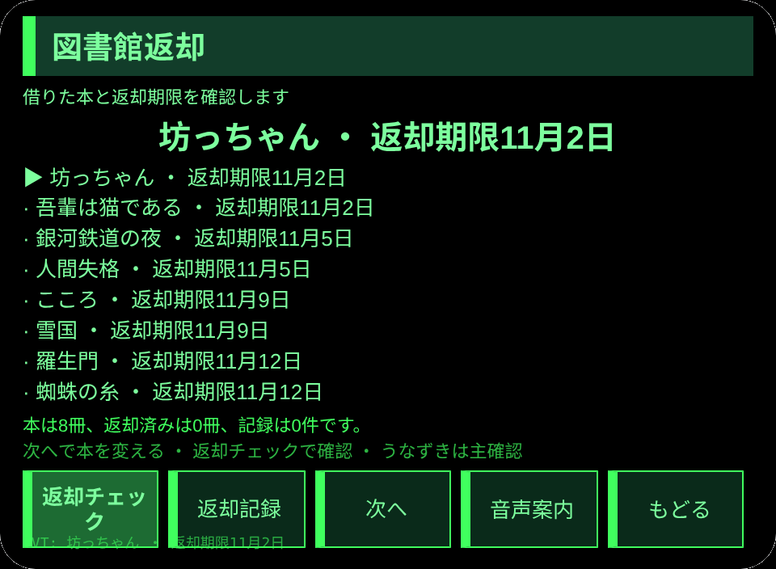
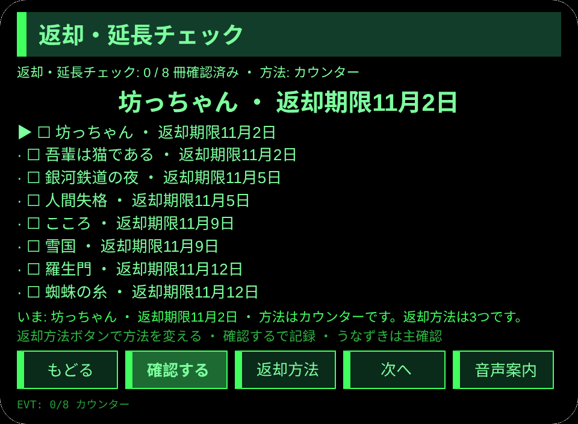
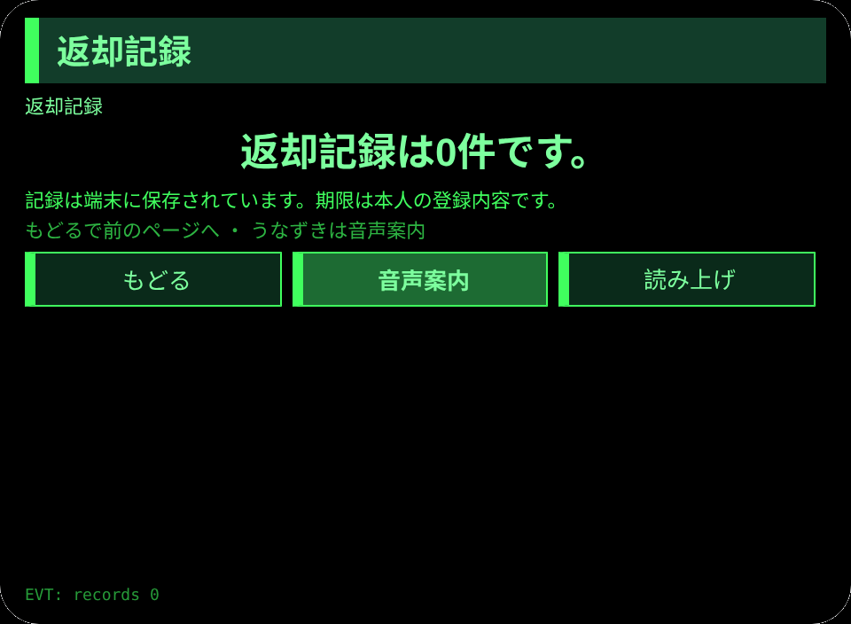

# 図書館返却

**Studio インポートアドレス**（Global AIUI Studio の Import Project 入力欄にコピー）：

```
https://github.com/sakai55/rokid/tree/agent-toshokan-kaeshi
```

**AIX 直接ダウンロード**（最新版）：[toshokan-kaeshi.aix](https://raw.githubusercontent.com/sakai55/rokid/main/aix/toshokan-kaeshi.aix)

JP36・日本在地 × 注意力 × カーブカット。図書館の利用者が、借りた本の返却期限を眼鏡で逃さずに守る。

## プレビュー画像






## 方向構成

- この Agent の方向構成：日本在地 × 注意力 × カーブカット。各方向が場面の中で代替のきかない一環を担い、機能の寄せ集めではない。
- 日本在地：日本の図書館のカウンター返却と返却ポスト、延長という実際の返却方法に沿う。
- 注意力：本ごとに返却期限を確かめ、返却か延長を一つずつ記録する。
- カーブカット：期限の見落としを防ぐため、本と期限と方法を一画面にそろえる。
- 一文の場面：図書館の利用者が、借りた本の返却期限を眼鏡で逃さずに守る。

## 構造と機能

3 ページ：`pages/index/` 借りた本一覧（本 8冊とそれぞれの返却期限）；`pages/check/` 返却・延長チェック（本ごとに返却か延長を確認し、返却方法 3つ（カウンター、返却ポスト、延長）から選び、確認した時点で返却記録を残す）；`pages/record/` 返却記録（直近 6件の返却記録）。

内容集の数：本 8冊；返却方法 3つ；返却記録は実際の条数で数える。セッションをまたぐ永続化：ストレージキー `toshokanKaeshiV1`（選択項目、返却済みの状態、返却記録の配列、`lastError`）。

## ジェスチャ対応

| ジェスチャ（テンプルのタッチパッド） | キーイベント | この Agent での役割 |
|---|---|---|
| シングルタップ | Enter | 主確認（各ページの主ボタン） |
| 上スワイプ／下スワイプ | ArrowUp / ArrowDown | 選択肢の切替／前後の項目 |
| うなずき（頭が静止したとき） | `onHeadGesture('nod')` | 主確認と等価 |
| ダブルタップ | Backspace | 前のページに戻る |

## 権限

なし。TTS とセンサーにマニフェストの権限は不要で、カメラの呼び出しはゼロ。

## 誠実な境界

- 期限は本人の登録内容であり、図書館システムとは連動しない。実際の期限は図書館の貸出票や案内で確かめること。
- 返却チェックは本人の確認だけを記す。図書館への返却完了を証明するものではない。

## エラーコード

失敗時はグラスの画面に裸のコードを表示し、TTS はコードだけを読み上げ、直近のエラーは永続データの `lastError` に書く（コード、本機の slug、バージョン、原文を含む）。本機で起こりうるコード：

- `E5001` 記録の保存に失敗（ストレージ書き込みで例外）
- `E5002` 記録の読み取りに失敗（読み取り／解析で例外）
- `E3005` 読み上げに失敗（TTS の speak で例外）
- `E8001` ページ遷移に失敗（navigateTo/navigateBack で例外）

## デバイスのテスト情報

| 項目 | 内容 |
|---|---|
| Studio 名 | 未記入 |
| Version | 1.0.0 |
| App Category | 未記入 |
| Intent Description | 未記入 |
| Agent ID | 未記入 |
| 状態 | 未実施 |

## 審査提出資料 (Review Submission)

Feature Description: 図書館の本の返却期限を逃さないための手引きです。借りた本8冊と期限を確認し、カウンター・返却ポスト・延長の3つの方法から選んで一つずつ記録します。

Opening Message: 借りた本の返却を確認しましょう。期限と返却方法を一つずつ、忘れずにそろえます。

Preview Media:
- `preview-toshokan-kaeshi-index.png`
- `preview-toshokan-kaeshi-check.png`
- `preview-toshokan-kaeshi-record.png`
- `preview-toshokan-kaeshi-check-s2.png`

> 正式な審査提出にはメディアファイル 3〜5 点（うち動画 ≥1 本、≤60 秒）が必要。動画は GO が実機で録画した後に追加する。

Change Log — Build 1.0.0:

- Features added: 初版；図書館の利用者が、借りた本の返却期限を眼鏡で逃さずに守る
- Improvements: なし（初版）
- Fixes: なし（初版）
