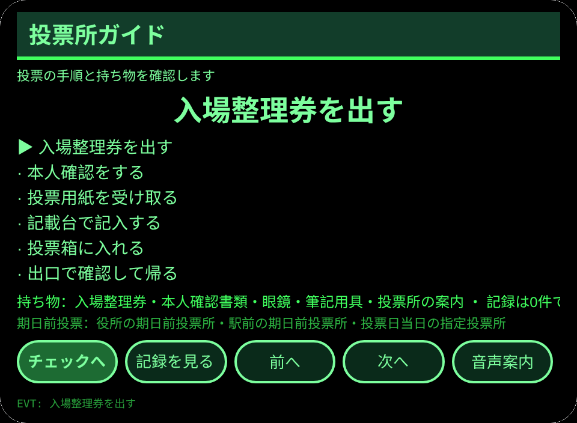
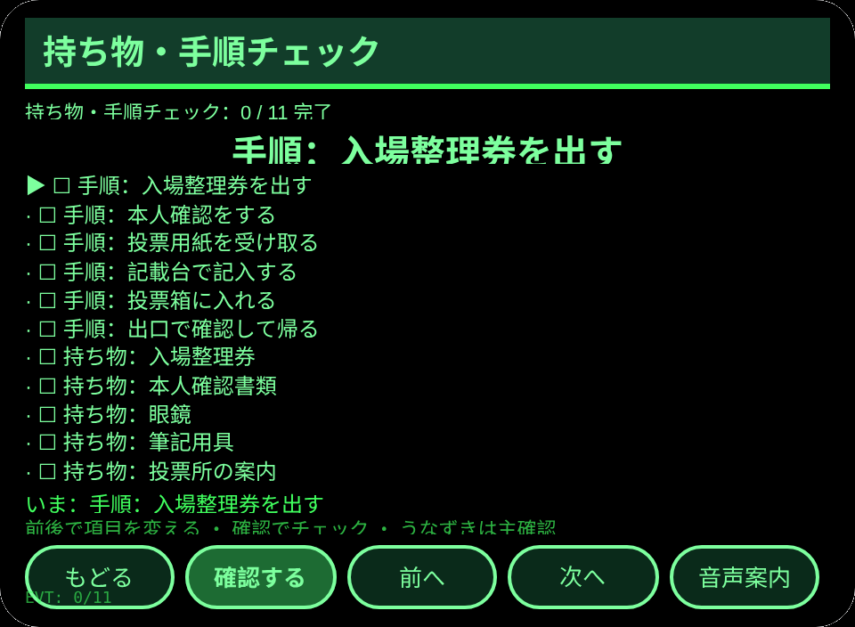
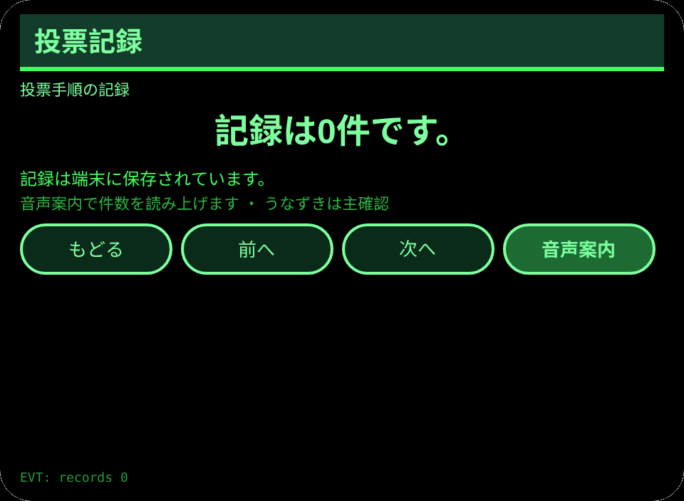
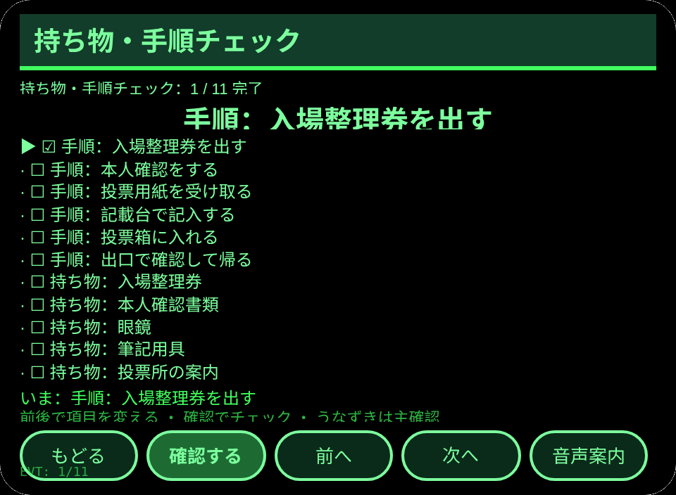

# 投票所ガイド

**Studio インポートアドレス**（Global AIUI Studio の Import Project 入力欄にコピー）：

```
https://github.com/sakai55/rokid/tree/agent-touhyou-guide
```

**AIX 直接ダウンロード**（最新版）：[touhyou-guide.aix](https://raw.githubusercontent.com/sakai55/rokid/main/aix/touhyou-guide.aix)

JP33・日本在地 × カーブカット × 注意力。初めて投票する高齢者が、手順と持ち物を忘れずに投票を終える

## プレビュー画像






## 方向構成

- この Agent の方向構成：日本在地 × カーブカット × 注意力。各方向が場面の中で代替のきかない一環を担い、機能の寄せ集めではない。
- 日本在地：日本の投票所の手順（入場整理券、本人確認、投票用紙、記載台、投票箱）に沿う。
- カーブカット：初めて投票する高齢者が、手順と持ち物を一つずつ確認できる。
- 注意力：11 項目のチェックが、忘れ物のないよう見守る。
- 一文の場面：初めて投票する高齢者が、手順と持ち物を忘れずに投票を終える。

## 構造と機能

3 ページ：`pages/index/` 投票手順一覧（手順 6 項目・持ち物 5 点・期日前投票 3 選択肢）；`pages/check/` 持ち物・手順チェック（手順 6 項目＋持ち物 5 点の計 11 項目を 1 つずつチェックし、そろった時点で TTS で読み上げて完了記録を残す）；`pages/record/` 投票記録（直近 6 件＋総数）。

内容集の数：投票手順 6 項目；持ち物 5 点；期日前投票 3 選択肢；チェック項目 11 項目（6＋5）；完了記録は実際の条数で数える。セッションをまたぐ永続化：ストレージキー `touhyouGuideV1`（選択項目、チェック状態、完了記録の配列、`lastError`）。

## ジェスチャ対応

| ジェスチャ（テンプルのタッチパッド） | キーイベント | この Agent での役割 |
|---|---|---|
| シングルタップ | Enter | 主確認（各ページの主ボタン） |
| 上スワイプ／下スワイプ | ArrowUp / ArrowDown | 選択肢の切替／前後の項目 |
| うなずき（頭が静止したとき） | `onHeadGesture('nod')` | 主確認と等価 |
| ダブルタップ | Backspace | 前のページに戻る（子ページ） |

## 権限

なし。TTS とセンサーにマニフェストの権限は不要で、カメラの呼び出しはゼロ。

## 誠実な境界

- 記録するのは本人の手順確認だけであり、候補者名や投票内容は記録しない。
- 投票所の制度や手続きは本人の確認用であり、選挙管理委員会の案内とは連動しない。
- 投票の可否や資格の判断は行わない。

## エラーコード

失敗時はグラスの画面に裸のコードを表示し、TTS はコードだけを読み上げ、直近のエラーは永続データの `lastError` に書く（コード、本機の slug、バージョン、原文を含む）。本機で起こりうるコード：

- `E5001` 記録の保存に失敗（ストレージ書き込みで例外）
- `E5002` 記録の読み取りに失敗（読み取り／解析で例外）
- `E3005` 読み上げに失敗（TTS の speak で例外）
- `E8001` ページ遷移に失敗（navigateTo/navigateBack で例外）

## デバイスのテスト情報

| 項目 | 内容 |
|---|---|
| Studio 名 | 未記入 |
| Version | 1.0.0 |
| App Category | 未記入 |
| Intent Description | 未記入 |
| Agent ID | 未記入 |
| 状態 | 未実施 |

## 審査提出資料 (Review Submission)

Feature Description: 投票所ガイド：初めて投票する高齢者のための手順ガイド。投票手順 6 項目と持ち物 5 点を一つずつチェックし、期日前投票 3 選択肢を示して、完了を永続的に記録します。

Opening Message: 投票所ガイドを始めましょう。手順と持ち物を一つずつ、忘れずに確認します。

Preview Media:
- `preview-touhyou-guide-index.png`
- `preview-touhyou-guide-check.png`
- `preview-touhyou-guide-record.png`
- `preview-touhyou-guide-check-s2.png`

> 正式な審査提出にはメディアファイル 3〜5 点（うち動画 ≥1 本、≤60 秒）が必要。動画は GO が実機で録画した後に追加する。

Change Log — Build 1.0.0:

- Features added: 初版；初めて投票する高齢者が、手順と持ち物を忘れずに投票を終える
- Improvements: なし（初版）
- Fixes: なし（初版）
