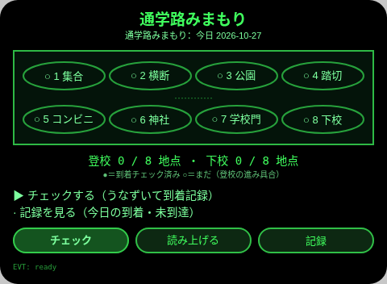
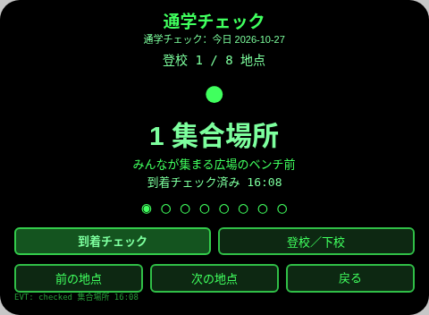
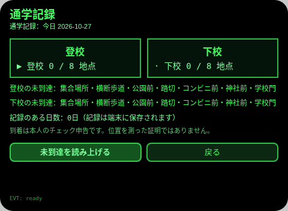
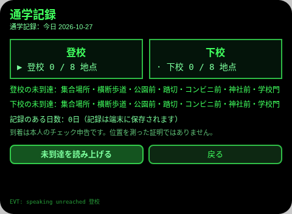

# 通学路みまもり

**Studio インポートアドレス**（Global AIUI Studio の Import Project 入力欄に貼り付け）：
```
https://github.com/sakai55/rokid/tree/agent-tsugaku-mimamori
```

**AIX 直接ダウンロード**（最新版）：[tsugaku-mimamori.aix](https://raw.githubusercontent.com/sakai55/rokid/main/aix/tsugaku-mimamori.aix)

一言で表す場面：小学生が眼鏡をかけて登校し、通学路のチェックポイントでうなずいて到着を記録し、帰宅後に記録を確認できる。

## 方向構成

日本ローカル × カーブカット × アテンション。

- 日本ローカル：日本の小学生の通学路（集合場所・横断歩道・公園前・踏切・コンビニ前・神社前・学校門・下校集合場所）そのものが場面であり、ユーザーに見える文言はすべて日本語。
- カーブカット：先行対象は通学児童（方向感覚・注意力が未発達で、道順の保持と到着確認に手助けが要る）。波及先は方向感覚の弱い成人訪問者（初めての土地で道順を辿る人）であり、児童のための設計が薄まらない。
- アテンション：8 地点を順に見守り、到着を 1 点ずつ記録して 8 点そろったことを確認する「見守り」の閉じた流れ。未到達点は記録ページで知らせる。

## プレビュー画像







## 構造と機能

- ルート概要（pages/index）：8 地点をドットで結んだ通学路として一覧し、今日の登校の到達状況を ●／○ で示す。今日の登校／下校の進捗も数で出す。
- チェック（pages/check）：現在の地点を大きく表示し、その地点の一言の特徴を出す。うなずき／Enter で到着にチェックを入れ、時刻を記録する。ArrowUp/ArrowDown で前／次の地点に移る。登校／下校はボタンで切り替える。8 点そろったら「登校完了」／「下校完了」を TTS で読み上げる。
- 記録（pages/record）：登校／下校の記録を日ごとに端末から読み、到達数と未到達点を示す。▶ 選択した方向の未到達点を読み上げる。

内容セットの数：通学路チェックポイント 8 か所（集合場所・横断歩道・公園前・踏切・コンビニ前・神社前・学校門・下校集合場所、各 1 言の特徴）。

## ジェスチャ対応

| 操作 | 動作 |
| --- | --- |
| ルート概要：子ページ選択 | ArrowUp / ArrowDown でチェック／記録を循環して選ぶ（▶ マーク），Enter で選択した子ページを開く；子ページから戻った後、onShow で選択は強制的に第 1 項（チェック）にリセットされるため、戻った直後の Enter は必ずチェックを開き、ArrowDown 1 回＋Enter は必ず記録を開く |
| チェック：前／次の地点 | ArrowUp（前）/ ArrowDown（次） |
| チェック：到着（主動作） | うなずき（onHeadGesture('nod')）または Enter、あるいは「到着チェック」ボタン |
| チェック：登校／下校の切り替え | 「登校／下校」ボタン |
| 記録：方向選択 | ArrowUp / ArrowDown で登校／下校を循環して選ぶ（▶ マーク），Enter でその方向の未到達点を読み上げる |

## 権限

なし。位置情報は使わない。到着は本人のうなずき／Enter による申告のみで記録する（GPS による自動判定はしない）。TTS はホストの固定音色を使い、utterance に `lang` は設定しない。

## 誠実な境界

- 到着記録は本人の申告であり、眼鏡が位置を測った証明ではない。画面と記録はその旨に沿って「チェック」として扱う。
- うなずき検出が使えない場合は Enter／ボタンでも記録できる。
- 記録のない日は 0 / 8・未到達全点として表示し、記録をでっち上げない。

## 実機テスト情報

| 項目 | 内容 |
| --- | --- |
| Studio 名 | tsugaku-mimamori（インポート後に必要に応じて改名） |
| Version | 1.0.0 |
| App Category | 生活 |
| Intent Description | 小学生が眼鏡をかけて登校し、通学路でうなずいて到着を記録し、帰宅後に記録を確認できる |
| Agent ID | 未記入 |
| 状態 | 未インポート／実機未検証 |

## 審査提出資料 (Review Submission)

Feature Description：小学生の通学路みまもりです。集合場所から学校門まで8つのチェックポイントを順にたどり、着いたらうなずいて時刻を記録します。8地点そろうと完了をお知らせし、帰宅後に登校・下校の記録と未到達点を確認できます。位置情報は使いません。

Opening Message：通学路みまもりへようこそ。今日の通学路を一緒にたどりましょう。着いたらうなずいてチェックしてくださいね。

Preview Media：プレビュー画像は上記を参照（ルート概要／チェック／記録。全ページの画像は aix preview で生成；動画は実機段階で追加）。

Change Log（Build 1.0.0）：

- Features added：ルート概要（8 地点ドット＋今日の進捗）；チェック（地点の大字表示・一言の特徴・うなずき／Enter での到着記録・時刻保存・8 点完了の読み上げ・登校／下校の切り替え）；記録（日ごとの登校／下校の到達数・未到達点のお知らせ・記録日数）。
- Improvements：なし（初版）。
- Fixes：なし（初版）。
