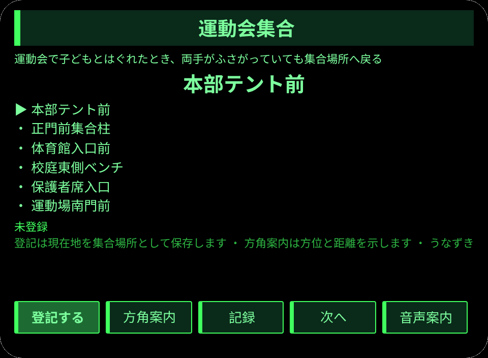
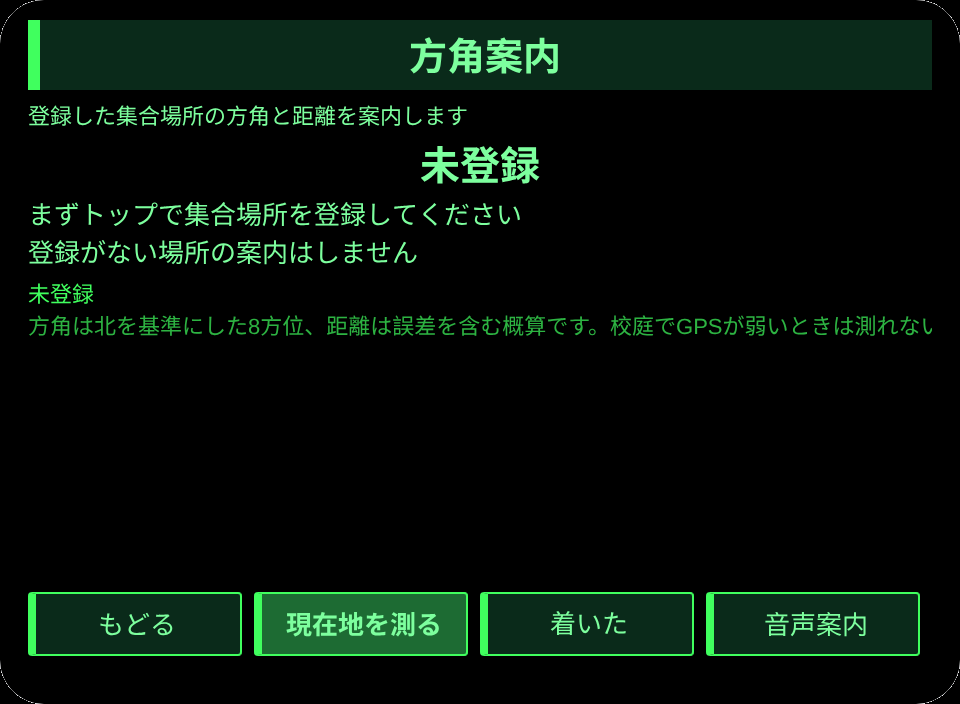
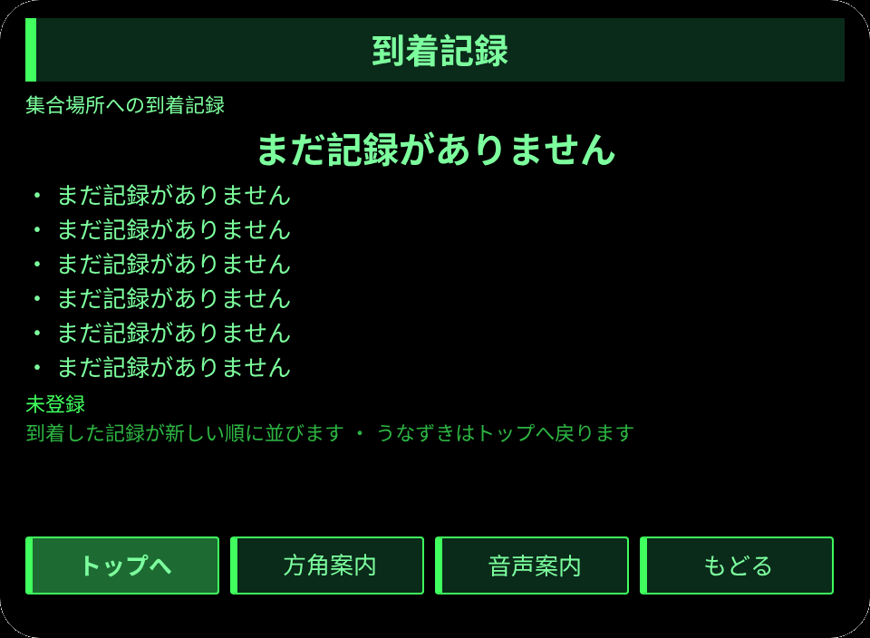

# 運動会集合

**Studio インポートアドレス**（Global AIUI Studio の Import Project 入力欄にコピー）：

```
https://github.com/sakai55/rokid/tree/agent-undoukai-shuugou
```

**AIX 直接ダウンロード**（最新版）: [undoukai-shuugou.aix](https://raw.githubusercontent.com/sakai55/rokid/main/aix/undoukai-shuugou.aix)

AIX サイズ: 12754 B

JP51・日本在地 × 指向性 × 路縁坡。運動会で子どもとはぐれた保護者が、両手がふさがったまま登録した集合場所へ方角と距離をたよりに戻る

## プレビュー画像





## 方向構成

日本在地 × 指向性 × 路縁坡。

## 構造と機能

3 ページ：`pages/index/` 集合場所の選択と登録（集合場所 6か所）、`pages/guide/` 方角案内（8方位と距離、到着記録）、`pages/record/` 到着記録（新しい順に最大 6件表示）。

内容集の数：集合場所 6か所（本部テント前、正門前集合柱、体育館入口前、校庭東側ベンチ、保護者席入口、運動場南門前）；方位 8方向（北・北東・東・南東・南・南西・西・北西）；到着記録は実際の条数で数える。セッションをまたぐ永続化：ストレージキー `undoukaiShuugouV1`（選択場所、登録した集合場所の名称と緯度経度と登録時刻、到着記録の配列、`lastError`）。

眼鏡独占能力はアンカー地点の方向案内です。両手がお弁当やカメラでふさがっている保護者が、携帯を取り出さずに登録した集合場所へ戻ります。`pages/guide/index.ink` の `_calc` が緯度経度差から方位角を求めて 8方位に換算し、ハーバーサインで距離を 10m 単位に丸めます。位置の取得は `navigator.geolocation.getCurrentPosition`（存在性守衛つき）で、登録がなければ案内は「未登録」とだけ出し、位置をでっちあげません。方角と距離がなければ集合場所へ戻る閉環が成り立たないため、必経の一環です。

## ジェスチャ対応

| ジェスチャ（テンプルのタッチパッド） | キーイベント | この Agent での役割 |
|---|---|---|
| シングルタップ | Enter | 主確認（各ページの主ボタン） |
| 上スワイプ／下スワイプ | ArrowUp / ArrowDown | 選択肢の切替／前後の項目 |
| うなずき（頭が静止したとき） | `onHeadGesture('nod')` | 主確認と等価 |
| ダブルタップ | Backspace | 前のページに戻る |

## 権限

`GEOLOCATION`（集合場所の登録と現在地の測位に使います）。

## 誠実な境界

- 登録がない場所の案内はしません。画面は「未登録」とだけ出します。
- 距離は誤差を含む概算で、校庭で GPS が弱いときは測れないことを正直に伝えます。
- 位置の取得を拒否されたときは E7003、取得できないときは E7002 を出します。

## エラーコード

失敗時はグラスの画面に裸のコードを表示し、直近のエラーは永続データの `lastError` に書く（コード、本機の slug、バージョン、原文を含む）。本機で起こりうるコード：

- `E5001` 記録の保存に失敗（ストレージ書き込みで例外）
- `E5002` 記録の読み取りに失敗（読み取り／解析で例外）
- `E3005` 読み上げに失敗（TTS の speak で例外）
- `E8001` ページ遷移に失敗（navigateTo/navigateBack で例外）
- `E7002` 位置の取得に失敗（測位が使えない／測位エラー）
- `E7003` 位置の取得が許可されていない（測位の許可が拒否された）


## 機器テスト情報

| Studio 名 | 未記入 |
| Version | 1.0.0 |
| App Category | 未記入 |
| Intent Description | 未記入 |
| Agent ID | 未記入 |
| 状態 | 未導入 |


## 審査提出資料

Feature Description: 運動会で子どもとはぐれた保護者が、両手がふさがったまま集合場所へ戻るための案内です。集合場所を6か所から選び、現在地を登録します。方角案内では北を基準にした8方位と距離を示し、到着を記録に残します。

Opening Message: 運動会集合を開きましょう。集合場所を選んで登録し、方角と距離をたよりに戻りましょう。

Preview Media:
- `preview-undoukai-shuugou-video.mp4`
- `preview-undoukai-shuugou-index.png`
- `preview-undoukai-shuugou-guide.png`
- `preview-undoukai-shuugou-record.png`

Change Log — Build 1.0.0:

- Features added: 初版
- Improvements: なし（初版）
- Fixes: なし（初版）
