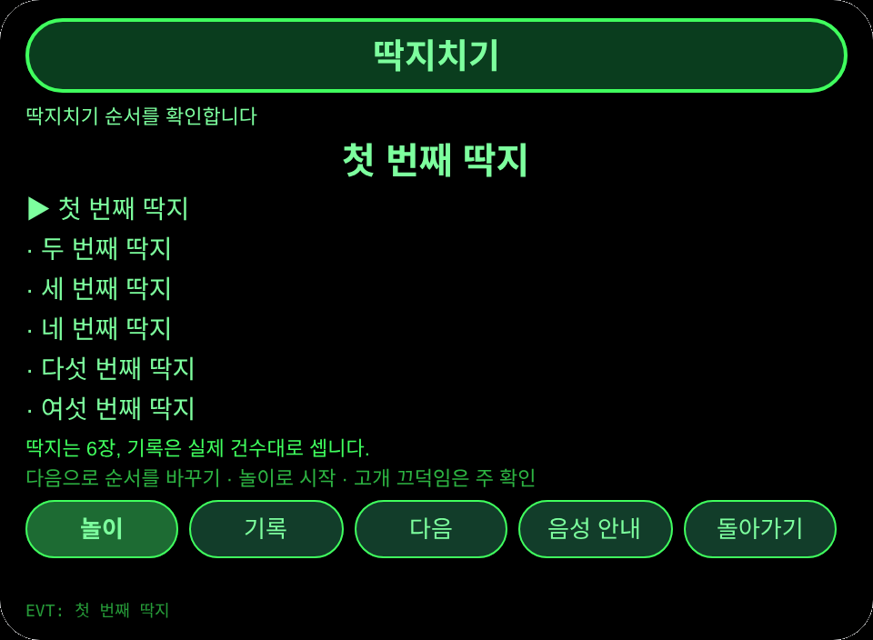
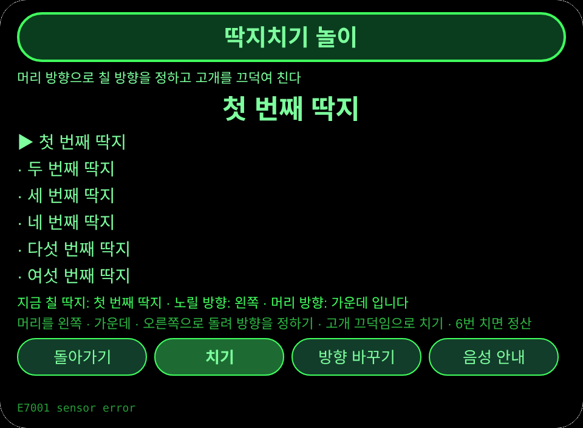
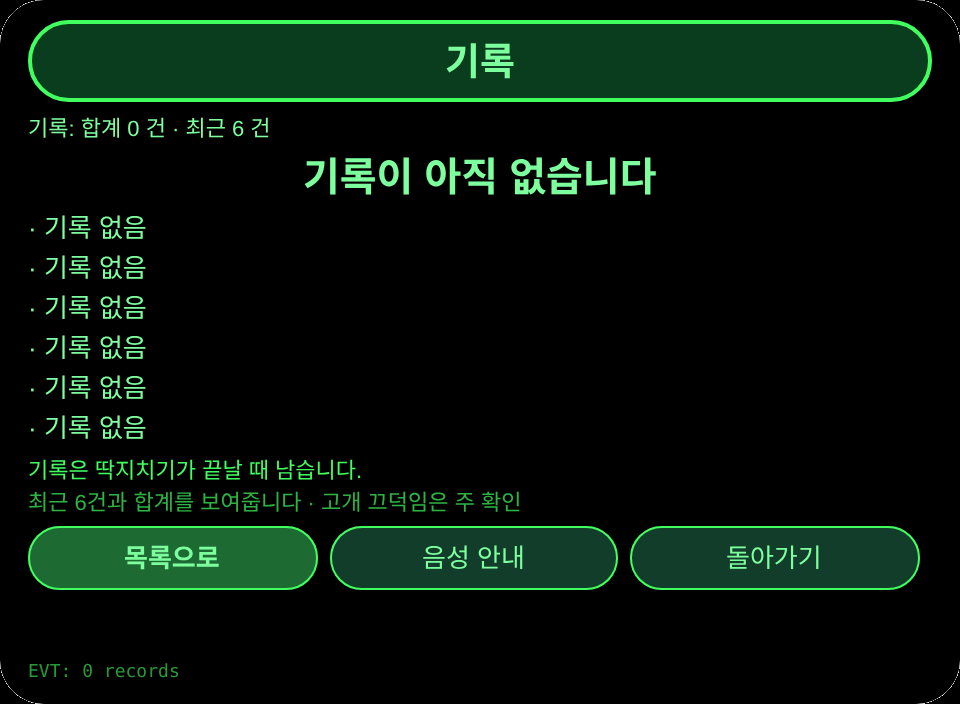
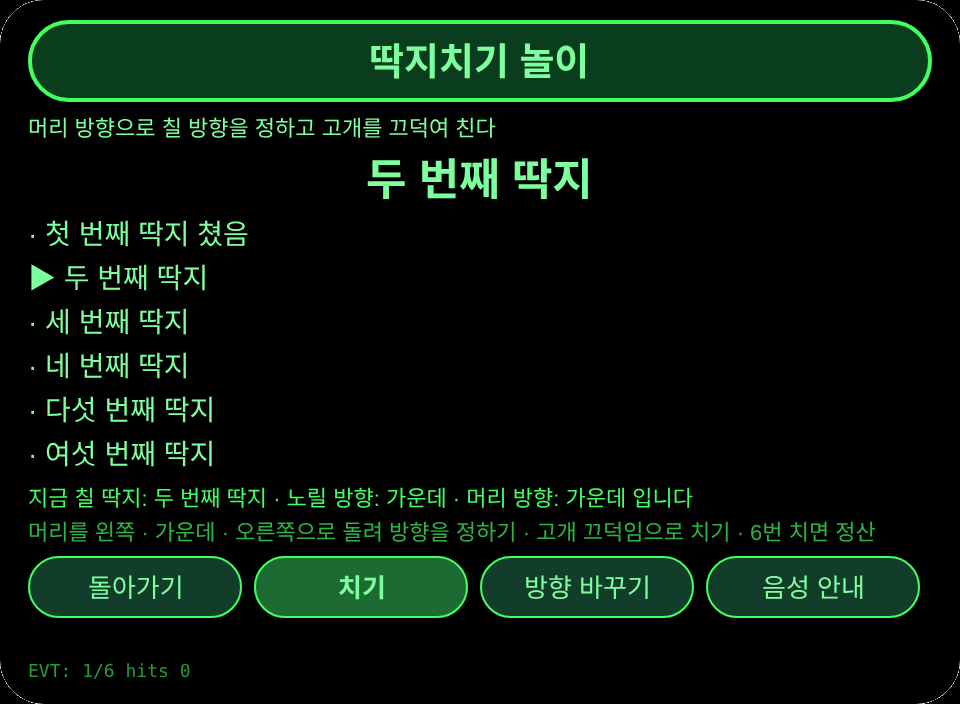

# 딱지치기

**Studio 가져오기 주소**(Global AIUI Studio의 Import Project 입력란에 붙여 넣으세요):

```
https://github.com/sakai55/rokid/tree/agent-ddakji-game
```

**AIX 직접 다운로드**(최신 버전): [ddakji-game.aix](https://raw.githubusercontent.com/sakai55/rokid/main/aix/ddakji-game.aix)

KR24・한국 현지 × 게임 × 지향성。가족이 모인 명절에 머리 방향만으로 딱지치기를 즐깁니다

## 미리보기 스크린샷






## 방향 구성

한국 현지 × 게임 × 지향성。

## 구조와 기능

3개 페이지: `pages/index/` 딱지 순서 목록(딱지 6장: 첫 번째 딱지, 두 번째 딱지, 세 번째 딱지, 네 번째 딱지, 다섯 번째 딱지, 여섯 번째 딱지); `pages/play/` 딱지치기 놀이(머리 방향으로 왼쪽 · 가운데 · 오른쪽 칠 방향을 정하고 고개를 끄덕여 친다. 6번 치면 정산하여 기록에 남긴다. 센서가 없을 때는 버튼으로 방향을 바꿔 놀 수 있다); `pages/record/` 기록(최근 6건과 합계).

내용집 개수: 딱지 6장; 놀이는 6번 치기로 한 판; 기록은 실제 건수대로 셉니다. 세션을 넘는 지속성: 저장 키 `ddakjiGameV1`(기록 배열, `lastError`).

제스처 매핑

## | 제스처 (안경다리 터치패드) | 키 이벤트 | 이 Agent에서의 역할 |
|---|---|---|
| 한 번 탭 | Enter | 주 확인(각 페이지의 주 버튼) |
| 위로 / 아래로 스와이프 | ArrowUp / ArrowDown | 옵션 전환 / 위아래 항목 |
| 고개 끄덕임 (머리가 안정됐을 때) | `onHeadGesture('nod')` | 주 확인과 동등 |
| 두 번 탭 | Backspace | 이전 페이지로 돌아가기(하위 페이지) |

권한

## 없음. TTS와 센서는 매니페스트 권한이 필요 없고, 카메라는 호출하지 않습니다.

정직한 경계

## - 맞고 빗나감은 머리 방향과 본인의 끄덕임으로 정합니다. 딱지의 실제 뒤집힘을 Agent가 인식하지 않습니다.
- 움직임은 구간 동작만 씁니다: 가운데 → 한 방향 → 돌아오기 → 다음 방향. 목을 돌리는 동작은 쓰지 않습니다.

오류 코드

실패하면 안경 화면에 코드만 표시되고, TTS는 코드만 읽으며, 가장 최근 오류는 지속 데이터의 `lastError`에 기록됩니다(코드, 이 기기의 slug, 버전, 원문 포함). 이 기기에서 나타날 수 있는 코드:

- `E5001` 기록 저장 실패(스토리지 쓰기 중 예외 발생)
- `E5002` 기록 읽기 실패(읽기/파싱 중 예외 발생)
- `E3005` 음성 안내 실패(TTS speak 중 예외 발생)
- `E8001` 페이지 전환 실패(navigateTo/navigateBack 중 예외 발생)
- `E7001` 머리 센서 실패(센서를 쓸 수 없거나 읽기 오류. 센서가 없어도 버튼으로 놀 수 있음)

## 기기 테스트 정보

| Studio 이름 | 미기입 |
| Version | 1.0.0 |
| App Category | 미기입 |
| Intent Description | 미기입 |
| Agent ID | 미기입 |
| 상태 | 실기기 미검증 |

## 심사 제출 자료

Feature Description: 명절에 가족이 즐기는 딱지치기입니다. 머리 방향으로 칠 방향을 정하고 고개를 끄덕여 딱지 6장을 치고 결과를 기록합니다.

Opening Message: 딱지치기를 시작합시다. 머리 방향으로 칠 방향을 정하고 고개를 끄덕여 칩니다.

Preview Media:
- `preview-ddakji-game-index.png`
- `preview-ddakji-game-play.png`
- `preview-ddakji-game-record.png`
- `preview-ddakji-game-play-s2.png`

> 정식 심사 제출에는 미디어 파일 3~5점(그중 동영상 1점 이상, 60초 이하)이 필요합니다. 동영상은 GO가 실기기에서 녹화한 뒤에 추가합니다.

Change Log — Build 1.0.0:

- Features added: 초판
- Improvements: 없음(초판)
- Fixes: 없음(초판)
